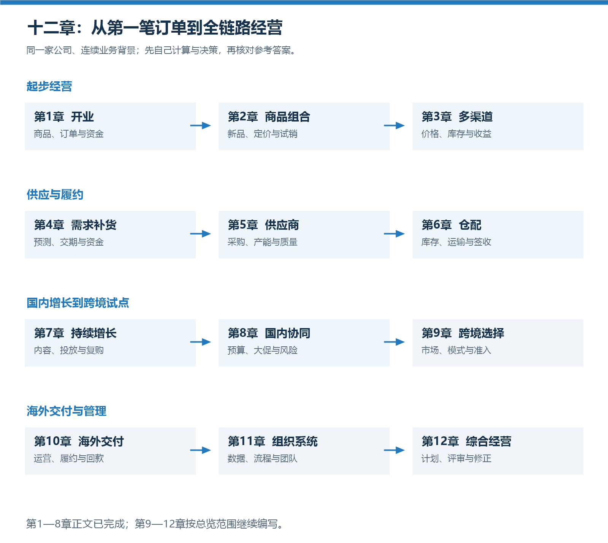

# 电商与供应链教程：课程总览与十二章介绍

这套教程从零开始，用“山禾生活”的同一条业务故事线，学习国内电商、跨境电商与供应链管理。你先接手一款保温杯，再面对商品组合、多渠道、预测采购、供应商、仓配、增长和跨境扩张，最后负责一家公司完整的经营计划。

目标是逐步建立资深电商与供应链管理者所需的业务框架、计算能力、协同方式和决策习惯。完成阅读和案例不等于已经具备全部资深实战能力，还需要在真实业务中验证判断，积累带团队、处理异常和承担结果的经验。

## 怎样从零开始学

按章顺序学习。第一章只要求能做加减乘除，后面的利润、库存、预测、流程和指标都会结合业务说明。遇到新概念，先弄清对象、单位、时间和状态，再代入公式。

每章采用“业务情景 → 概念与方法 → 图示与计算 → 练习和答案 → 管理建议”的结构。学习时先自己算、自己写决定，再比较参考答案；答案可以有不同方案，但要说明依据、代价、负责人和复查条件。

每章保存为一个带章节名称的文件夹，里面是一份完整 Markdown，配图放在 `images`。章节之间承接实际案例结果；独立演练和未来方案不会直接改写实际库存、费用和资金。需要核对的数据放在相关正文，章末只留一份辅助汇总。

## 十二章路线

| 章次 | 业务故事与学习重点 | 学完要能交付 | 当前状态 |
|---|---|---|---|
| [第一章　山禾生活的第一次开业](第一章-山禾生活的第一次开业/第一章-山禾生活的第一次开业.md) | 从 20 万元与一款杯子开始，贯通顾客、采购、上架、获客、订单、售后与资金 | 首周经营核对及下一轮行动建议 | 已完成 |
| [第二章　从一款杯子到商品组合](第二章-从一款杯子到商品组合/第二章-从一款杯子到商品组合.md) | 新品、价格带、SKU、老品替代、试销和采购约束 | 商品组合、试销及供应方案 | 已完成 |
| [第三章　从单店到多渠道经营](第三章-从单店到多渠道经营/第三章-从单店到多渠道经营.md) | 货架、内容合作、自营交易、经销等模式；渠道价格、库存、费用和冲突 | 渠道经营表与库存、预算分配 | 已完成 |
| [第四章　从需求预测到补货计划](第四章-从需求预测到补货计划/第四章-从需求预测到补货计划.md) | 目标与预测、活动增量、误差、安全余量、交期、起订和滚动协同 | 分 SKU、分日期的需求与采购计划 | 已完成 |
| [第五章　从供应商报价到稳定交付](第五章-从供应商报价到稳定交付/第五章-从供应商报价到稳定交付.md) | 寻源准入、报价、合同、物料产能、质量、部分验收及供应商绩效 | 采购评审与供应商改进计划 | 已完成 |
| [第六章　从仓库库存到顾客签收](第六章-从仓库库存到顾客签收/第六章-从仓库库存到顾客签收.md) | 库位批次、收货上架、锁定拣配、产能、运输、退货和盘点 | 仓配流程、服务指标与成本核对 | 已完成 |
| [第七章　从流量投放到用户持续购买](第七章-从流量投放到用户持续购买/第七章-从流量投放到用户持续购买.md) | 深化国内平台与内容经营，连接搜索、推荐、内容、直播、广告、促销、会员与复购 | 增长实验、活动及用户经营计划 | 已完成 |
| [第八章　从单项优化到国内经营协同](第八章-从单项优化到国内经营协同/第八章-从单项优化到国内经营协同.md) | 统筹旺季、大促、生命周期、需求与供应、库存资金、服务和应急 | 国内季度经营预算与协同方案 | 已完成 |
| 第九章　从国内生意到跨境市场选择 | 市场与客群研究，出口业务模式、平台与独立站、品牌、本地化、商品准入和责任分工 | 目标市场及跨境试点立项方案 | 待编写 |
| 第十章　从跨境订单到海外交付与回款 | 跨境定价投放、币种、支付回款、贸易条件、头程与清关、海外仓及平台履约、退货和税费核查 | 跨境单笔模型、备货及履约资金计划 | 待编写 |
| 第十一章　从业务报表到组织与系统管理 | 主数据、指标、分析、预算利润现金、经营预警、系统衔接、权限、团队绩效与项目实施 | 管理看板、流程责任与系统改进方案 | 待编写 |
| 第十二章　从部门负责人到全链路经营管理者 | 国内与跨境双业务、多商品多渠道，在需求、质量、物流与现金变化中作综合决策 | 年度经营计划、情景推演和经营评审 | 待编写 |

前八章是目前已完成正文，后四章是后续编写安排。后续详细情节可随前章结果发展，学习范围按这张路线持续补齐。

*先跑通业务，再深化供应与增长，最后统筹国内、跨境和组织管理。*

## 每章具体学什么

### 第一章：先把一笔生意做完整

认识商品、顾客、SKU、订单、库存与资金；用售价和费用计算贡献；理解广告漏斗；处理取消、签收、退货及报损。重点是把“顾客付了钱”“商品发出了”“平台结算了”分成不同事件，再核对它们。

### 第二章：决定卖什么，而不只是多上几个链接

从用途与顾客出发设计商品组合，分析新品是否带来增量，理解价格带、产品生命周期、替代和退出；比较起订量、单价、库存占款与试销投入，建立 SKU 与采购、实物和页面的对应。

### 第三章：理解不同渠道背后的交易结构

区分触达、归因、成交和履约，分析平台零售、内容合作、自营与经销的责任差异。处理活动价格、佣金、固定费、渠道冲突、共享库存和结算，避免重复计算销售和收益。

### 第四章：让需求进入时间与数量计划

用历史、业务假设和活动形成预测，认识基线、波动、偏差与误差；把现货、在途、欠交、交期、工作安全余量、复查周期和最低订量一起算，形成滚动需求与供应计划。

### 第五章：把采购从询价推进到可验证交付

学习自制与外购选择、寻源和准入、成本拆解与总投入、采购条款、物料清单和可分配产能；贯通质量、追溯、验收、补供、付款及供应商评价，理解不同成本批次和库存计价。

### 第六章：让库存准确转成顾客收到的商品

学习库位与区域、批次、库存状态和可承诺量，设计收货、上架、锁定、补拣、复核与发运；测算高峰瓶颈，跟踪运输和签收，处理逆向物流、盘点及账实差异，比较仓配服务和成本。

### 第七章：建立可持续的国内增长方法

把流量结构、搜索与推荐、商品内容、详情页转化、直播与达人合作、广告和活动连接起来。继续学习获客成本、归因与增量、用户分层、复购、会员、客服体验和客户价值，形成有对照、有止损条件的增长实验。

### 第八章：把国内经营各环节放在同一份计划中

学习季节与大促准备、商品生命周期、渠道资源、供销存协同、库存结构和滞销处理，比较服务水平、资金与利润的代价。处理供应中断、质量范围、爆单与活动失效情景，将每日异常、周计划和经营评审结合。

### 第九章：先确定做哪一种跨境生意

比较目标国家、客群、竞争、平台和自营模式；明确出口与面向消费者销售的交易关系、责任和所需能力。学习本地化、产品与品牌资料、知识产权及目标市场准入的核查路径，在试点前确认事实与专业支持。

### 第十章：把跨境利润与交付算到回款

从币种和到手价开始，分析投放、平台、支付、退款、汇兑和回款周期；学习贸易条件、运输方案、清关资料、海外仓、平台仓、直发和逆向物流。结合关税、税务及合规核查形成落地成本、补货和现金情景，而不是只看海外标价。

### 第十一章：让组织、数据与系统支持经营

统一商品、订单、客户、供应商和仓库主数据；连接订单、仓储、企业管理、客户及报表系统，明确重复同步、状态变更和权限责任。建立利润、现金与资产联动的管理报表，学习岗位分工、目标绩效、项目推进、供方及外包治理。

### 第十二章：完成管理者综合实战

同时经营国内与跨境业务，面对扩品、渠道取舍、供应约束、海外备货、人员预算和现金压力。提交年度经营计划，进行旺季、缺货、汇率、退货与质量变化的情景推演，完成跨部门评审与滚动修正。

## 全课程能力覆盖与主学位置

| 能力 | 建立基础 | 深化与综合 |
|---|---|---|
| 顾客、商品、定价与生命周期 | 第一、二章 | 第七、八、九、十二章 |
| 国内渠道、内容、投放、活动及用户经营 | 第一、三章 | 第七、八章 |
| 预测、计划、库存与供销协同 | 第二、四章 | 第六、八、十、十二章 |
| 采购、生产协同、质量及供应商 | 第五章 | 第八、九、十、十二章 |
| 仓配、运输、逆向物流与服务 | 第一、六章 | 第八、十章 |
| 跨境市场、模式、运营与本地化 | 第三章的渠道思路 | 第九、十、十二章 |
| 合规、合同、知识产权与风险核查 | 第一、五章 | 第九、十、十一、十二章 |
| 成本、利润、预算、结算与现金 | 每章逐步核对 | 第八、十、十一、十二章 |
| 数据、系统、组织、绩效与管理决策 | 第四、五、六章的协同 | 第十一、十二章 |

## 故事线与学习边界

一款杯子开业 → 扩商品 → 扩渠道 → 计划补货 → 管供应商 → 管仓配 → 做持续增长 → 统筹国内经营 → 选择跨境试点 → 组织海外交付 → 建立组织与系统 → 负责全链路经营。

案例以可计算的简化模型起步。前五章的报损、待结算、批次和未完成采购都延续到后章，没有把期末余额随意重置；第六章继续处理第五章四件待补供。后续引入工资、租金、税费、币种和其他项目时，要明确新增范围，保持旧结果可追溯。

所有公司、数量、费用与合同示例均为教学设定。真实平台政策、商品准入、税务和运输条件需要在实际经营时查证；跨境章节编写时也应注明资料日期和适用范围。不同品类的保质期、危险品、冷链等要求会作为差异化场景讲解，不能把杯子的流程当作所有品类的统一规范。

建议把每章作业保存成自己的业务表和一页建议。最终用第十二章综合任务检验：你是否能解释经营结果、识别证据不足、提出可执行方案，并组织团队跟进。
