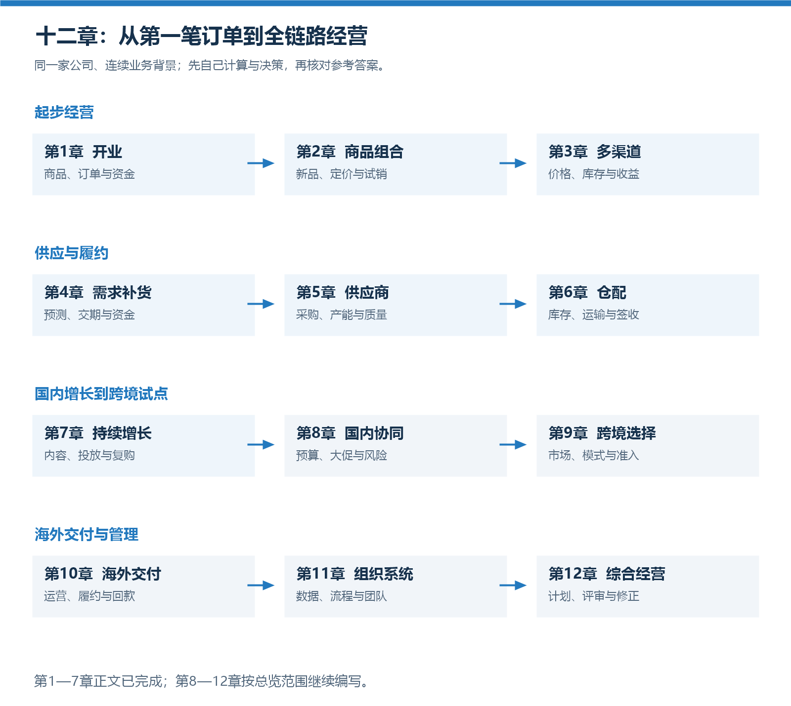

# 电商与供应链教程

从零开始，用“山禾生活”的连续业务故事，学习国内电商、跨境电商与供应链管理。把商品、顾客、渠道、订单、预测、采购、供应商、仓配和资金放进同一门生意，练习可解释、可执行的经营决策。

**当前进度：十二章规划，前七章已完成。** 每章包含完整 Markdown 课件、流程示意图、练习与参考答案，以及章节综合作业。课程使用虚构公司和教学数据，独立演练与实际案例结果分别记录。

**[查看课程总览与十二章介绍](00-课程总览与十二章介绍.md)**

## 开始阅读

| 已完成章节 | 学习重点 |
|---|---|
| [第一章：山禾生活的第一次开业](第一章-山禾生活的第一次开业/第一章-山禾生活的第一次开业.md) | 顾客、采购、上架、广告、订单、售后与资金 |
| [第二章：从一款杯子到商品组合](第二章-从一款杯子到商品组合/第二章-从一款杯子到商品组合.md) | 新品、定价、SKU、试销、替代与库存 |
| [第三章：从单店到多渠道经营](第三章-从单店到多渠道经营/第三章-从单店到多渠道经营.md) | 渠道模式、价格、佣金、共享库存与结算 |
| [第四章：从需求预测到补货计划](第四章-从需求预测到补货计划/第四章-从需求预测到补货计划.md) | 需求、活动、误差、安全余量、交期与补货 |
| [第五章：从供应商报价到稳定交付](第五章-从供应商报价到稳定交付/第五章-从供应商报价到稳定交付.md) | 寻源、成本、合同、产能、质量、验收与付款 |
| [第六章：从仓库库存到顾客签收](第六章-从仓库库存到顾客签收/第六章-从仓库库存到顾客签收.md) | 库位批次、锁定拣配、高峰、运输、退货与盘点 |
| [第七章：从流量投放到用户持续购买](第七章-从流量投放到用户持续购买/第七章-从流量投放到用户持续购买.md) | 搜索内容、转化投放、促销实验、会员复购与增长核算 |

第八至十二章将继续覆盖国内经营协同、跨境市场选择、海外运营与交付、数据系统与组织管理，最终完成全链路经营实战。详细范围和各章交付物见课程总览，尚未完成的章节没有正文链接。

## 怎样使用

按章节顺序阅读，先看业务背景，自己算出结果并写出建议，再核对参考答案。每个决定尽量写清事实、假设、代价、负责人和复查时间。

可以直接在 GitHub 阅读，或下载整个仓库后用支持 Markdown 的阅读器打开。配图使用相对路径，下载时保留各章的 `images` 文件夹。每章保持“一章一个文件夹、一份完整 Markdown”的结构。

前七章已经核对订单、库存、费用、待结算与资金的跨章衔接。课程逐步引入复杂度，未列入简化模型的真实经营项目仍需另行补齐；平台政策、产品准入、税务及运输条件需要按实际业务核实。

## 参与完善

欢迎通过 Issue 提交错误、疑问与补充建议，或通过 Pull Request 提交修改。请注明章节、小节和问题依据；涉及数字变化时，同时检查后续库存、成本、现金和练习答案。

详细约定见 [贡献指南](CONTRIBUTING.md)。教程采用 AI 辅助编写与绘图，欢迎对概念、计算和业务情景提出有依据的修订。

## 开放许可

© 2026 [wengwenyu888-cmyk](https://github.com/wengwenyu888-cmyk)。教程正文及随附原创示意图采用 [Creative Commons Attribution 4.0 International（CC BY 4.0）](https://creativecommons.org/licenses/by/4.0/deed.zh-hans) 许可。

允许复制、修改、传播及商业使用，使用时应保留适当署名、提供许可链接，并标明修改。完整许可文本见 [LICENSE](LICENSE)。如以后引入另有授权的第三方材料，将在相应位置单独注明。

署名示例：

> 《电商与供应链教程》，wengwenyu888-cmyk，https://github.com/wengwenyu888-cmyk/ecommerce-supply-chain-course ，CC BY 4.0。若有修改，请另行说明。
