# 第一章　山禾生活的第一次开业

你是山禾生活的第一名业务员工。公司有 20 万元启动资金，准备销售黑色和米白色两种 500 毫升通勤保温杯。你会先做首批采购，随后明确顾客、验收入库、完成上架，再跟踪首周广告、订单、售后与现金，最后提出下一周行动计划。

**学完本章**，你应能把一笔小生意的商品、库存、订单和资金连接起来，并解释自己每次决定的依据和代价。

## 阅读顺序

| 节次 | 要解决的业务问题 |
|---|---|
| [第一节　20 万元启动资金，第一批保温杯订多少？](#lesson-01) | 怎样安排首批订货与付款 |
| [第二节　卖 129 元的保温杯，顾客为什么选我们？](#lesson-02) | 谁会买、购买理由有什么依据 |
| [第三节　货到仓，哪些库存可以卖？](#lesson-03) | 怎样验收、锁定并记录库存 |
| [第四节　开店上架与促销，怎样真正落地？](#lesson-04) | 怎样连接页面与实物、检查优惠 |
| [第五节　500 元广告费，带来多少订单？](#lesson-05) | 怎样计算转化和广告费用上限 |
| [第六节　从付款到退货，怎样把订单交完？](#lesson-06) | 怎样处理取消、发货、退货与库存 |
| [第七节　订单赚了钱，现金为什么还对不上？](#lesson-07) | 怎样核对贡献、现金和结算 |
| [第八节　第一次经营复盘，你决定下周怎么做](#lesson-08) | 下一周怎样投放、补货和分工 |

每节先读业务情境，自己计算和写建议，再看参考答案。各节需要的数字就近给出；完成第八节后，可以用章末的[首周案例数据汇总](#chapter-data)复查作业。

## 案例约定与业务时间

本章所有公司、访谈、竞品、订单及收费条件均为教学设定，金额统一为人民币。每个销售订单购买一个杯子，仓库仅设一个国内仓。平台规则、税费、工资、仓租等实际经营事项应在真实业务中逐项核算，本章先计算表内列明的收支。文中的“贡献”和“列示结果”均使用这个范围。

启动支出共 10,000 元，覆盖本章的开店、样品、拍摄、页面与基础验证等准备，计算时作为本章期间支出。另预留 60,000 元供后续扩员与软件订阅等事项使用，这些计划在本案例观察期尚未产生费用或付款。

| 时间 | 业务进展 | 本章位置 |
|---|---|---|
| P0，下单当天 | 确认首批采购，支付预付款 | 第一节 |
| 生产准备期 | 明确顾客、核查产品信息与页面方向 | 第二节 |
| 发货前至 P25 | 支付尾款，货到仓，按约验收 | 第三节 |
| 验收后、正式上线前 | 完成商品、价格、优惠与订单路径检查 | 第四节 |
| 上市首周 S1—S7 | 获客、接单、履约与售后 | 第五、六节 |
| S7 截止与复盘 | 核对结算、库存和现金，讨论下一阶段 | 第七、八节 |

P25 表示下单并付预付款后第 25 天；S1 表示正式上线第一天。为练清基础关系，案例设定到 S7 时，已列出的签收、退货与退款都处理完毕。“最终保留订单”指截至这一观察时点顾客保留的商品，后续发生变化时还需更新。

各节另设的比较方案、练习及下一阶段预算，都在提出时注明。只有故事中确认执行的事项进入对应阶段的经营记录。

---

## 第一节　20 万元启动资金，第一批保温杯订多少？

今天是你加入「山禾生活」的第一天。

公司准备做一款面向通勤人群的保温杯。创始人拿出黑色和米白色两只样品，放在你面前。

“计划卖 129 元，公司账上有 20 万元。工厂等我们确认数量。第一批订多少？”

你还没有开过店，也没有做过采购。这一节，你将拿着报价、费用和需求假设，做出第一笔订货决定。

**学完后，你应能独立完成三件事。** 算一笔订单能留下多少钱，说明采购在什么时间占用多少现金，写出一份包含数量、理由和后续行动的订货建议。

> 本节的广告费按每个未退款订单 20 元预估，首批采购的三种方案暂按无退款情景比较。

### 1.1　先认识这门生意里的人

山禾向工厂买杯子，存放在合作仓库，通过线上店铺卖给顾客。顾客付款后，仓库发货，平台按约定向山禾结算。山禾负责向顾客兑现商品与交付承诺。

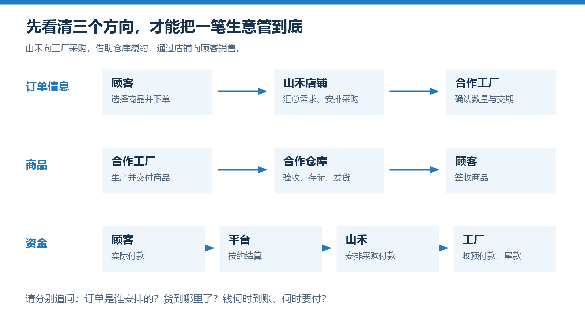

*图 1-1　订单信息、商品和资金会经过不同的参与方，发生时间也不同。图中省略仓储物流费用等支线，突出本节的主要关系。*

先记住一个容易影响判断的事实。顾客买到杯子、山禾收到结算款、山禾向工厂付款，可能发生在不同日期。公司需要把中间这段时间的资金安排好。

### 1.2　你桌上的三份资料

#### 资料一　工厂报价

| 项目 | 本次条件 |
|---|---|
| 商品 | 500 毫升通勤保温杯 |
| 颜色 | 黑色、米白色 |
| 单价 | 每个 42 元，以下三种订货数量均按此价 |
| 起订要求 | 总数至少 200 个，每种颜色至少 100 个 |
| 交期 | 确认订单并支付预付款后，第 25 天到指定国内仓库 |
| 付款 | 下单支付 30%，发货前支付剩余 70% |
| 运输 | 42 元报价已包含运到指定国内仓库的费用 |
| 退换 | 经确认的质量问题由工厂处理，销售不佳的合格商品由山禾承担 |
| 后续补货 | 仍需 25 天，仍为总数至少 200 个、每色至少 100 个 |

本节比较订 200 个、500 个和 1,000 个三种方案。

#### 资料二　预计怎样卖

公司准备先开一家国内线上店铺。按每笔购买一个杯子的订单估算如下。

| 项目 | 每单金额 | 谁承担、什么时候发生 |
|---|---:|---|
| 商品标价 | 129 元 | 顾客看到的价格 |
| 商家优惠券 | 10 元 | 山禾承担，减少本单实付 |
| 顾客实际付款 | 119 元 | 顾客付款给平台 |
| 平台等交易费用 | 6 元 | 本节按每单固定 6 元估算 |
| 商品采购成本 | 42 元 | 山禾按采购合同付款 |
| 发货包装 | 3 元 | 山禾承担 |
| 国内快递 | 6 元 | 山禾承担 |
| 分摊的广告费用 | 20 元 | 本节按每个成交订单分摊 |

平台费用和广告费暂用上述假设。开店后要用实际账单替换。

#### 资料三　市场与资金

你访谈了 20 位有日常饮水需求的人，其中 12 人更喜欢黑色，8 人更喜欢米白色。目前店铺尚未销售，没有已付款订单。

团队提出上市后前 28 天的三个需求情景。

| 情景 | 黑色需求 | 米白色需求 | 总需求 |
|---|---:|---:|---:|
| 销售偏慢 | 60 个 | 40 个 | 100 个 |
| 销售居中 | 150 个 | 100 个 | 250 个 |
| 销售较快 | 270 个 | 180 个 | 450 个 |

“居中”只是其中一个假设。三个情景暂时没有可靠的发生概率。

公司另外安排了 10,000 元开店、拍摄和样品等启动支出，并为后续扩员、软件订阅等支出预留 60,000 元。这笔预留资金暂时不能用于采购。

### 1.3　先做一次决定

请先停下来，用五分钟写下答案。后面会给出计算与参考判断。

1. 你订多少个，两个颜色各多少？
2. 下单当天向工厂支付多少钱？
3. 采购款全部付完，再付启动支出后，还剩多少现金？
4. 销量偏慢时，你愿意留下多少库存？销量较快时，你愿意承担多大的缺货？

保留第一次答案。学完后，你会再修改一次。

### 1.4　算清一单能留下多少钱

顾客使用商家优惠券后付了 119 元。从这 119 元开始，逐项扣除本节列出的费用。

**单笔贡献 = 顾客实付 − 平台费用 − 商品成本 − 包装 − 快递 − 分摊广告费**

**119 − 6 − 42 − 3 − 6 − 20 = 42 元**

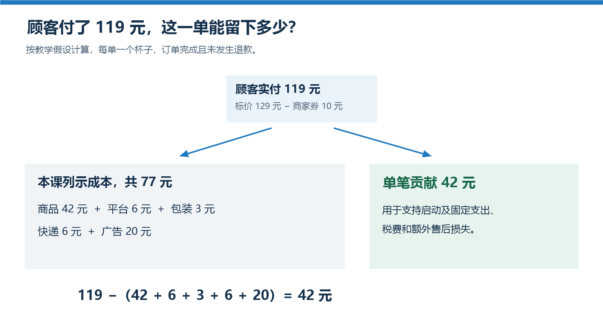

*图 1-2　77 元包含题目列出的五项成本。42 元还要支持公司的其他支出。图中的商品成本与采购付款是同一批商品的两个观察角度，核算收益时扣一次。*

**单笔贡献**可以理解为，每多完成一笔符合这些假设、未发生退款的订单，能多留下 42 元，支持启动费用、人员等固定支出、税费及额外售后损失。

例如，完成 100 笔这样的订单，贡献为：

**100 × 42 = 4,200 元**

公司还有 10,000 元启动支出以及后续固定支出。仅凭“每单贡献为正”，暂时不能判断整家公司已经盈利。

还有一个问题。你今天向工厂买入 1,000 个杯子，需要按合同付款；这 1,000 个杯子什么时候能卖完，目前尚未确定。接下来要把采购放到时间线上。

### 1.5　30% 预付款，把付款分成了两次

假设首批订 200 个，采购总额为：

**200 × 42 = 8,400 元**

下单时支付 30%：

**8,400 × 30% = 2,520 元**

发货前支付剩余 70%：

**8,400 × 70% = 5,880 元**

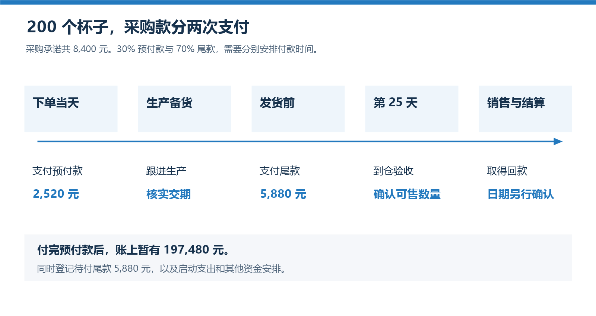

*图 1-3　“第 25 天”从确认订单并付预付款开始计算。具体发货日和平台回款日未给定，需要另行确认。*

确认采购时，公司承诺的采购总额为 8,400 元。2,520 元已经支付，5,880 元还要为发货前留好。

这会形成两个需要同时管理的数字。

- **银行里还剩多少现金**，用来判断现在能付多少。
- **已承诺但尚未支付多少钱**，用来判断未来付款是否安排得过来。

比如，付完预付款，公司银行余额暂时为 197,480 元。你还要记住未来的 5,880 元尾款，以及其他已安排的支出。

### 1.6　比较三种数量，会占用多少资金

| 首批数量 | 采购总额 | 下单付 30% | 发货前付 70% |
|---|---:|---:|---:|
| 200 个 | 8,400 元 | 2,520 元 | 5,880 元 |
| 500 个 | 21,000 元 | 6,300 元 | 14,700 元 |
| 1,000 个 | 42,000 元 | 12,600 元 | 29,400 元 |

再扣除 10,000 元启动支出，并留好 60,000 元固定支出预算。

| 首批数量 | 采购及启动支出全部付完后的现金 | 再扣除固定支出预留后的资金 |
|---|---:|---:|
| 200 个 | 181,600 元 | 121,600 元 |
| 500 个 | 169,000 元 | 109,000 元 |
| 1,000 个 | 148,000 元 | 88,000 元 |

以 200 个方案为例：

**200,000 − 8,400 − 10,000 − 60,000 = 121,600 元**

预留 60,000 元是一项内部资金安排。当这笔钱还没实际支付时，它仍在公司现金余额里。“扣除预留后的资金”表示按当前安排可以另作经营用途的金额。

这部分资金接下来还要支持广告、补货、仓储和售后等开支。三种数量目前都能支付，我们还要继续比较商品卖得快慢时的后果。

### 1.7　把销量变化放进采购决定

本次比较先假设，上市后 28 天内没有追加到货，销售均按上述单笔成本完成，没有取消或退款。我们用这个简化条件观察首批库存的影响，后面再练滚动补货。

各方案的颜色如下。

| 方案 | 黑色 | 米白色 | 合计 |
|---|---:|---:|---:|
| A | 100 个 | 100 个 | 200 个 |
| B | 300 个 | 200 个 | 500 个 |
| C | 600 个 | 400 个 | 1,000 个 |

A 受到每色至少 100 个的要求限制。B、C 暂按这 20 人整体的颜色偏好配置。第二节会筛选重点顾客，届时仍需核实目标人群的颜色偏好；获得成交后再更新配比。

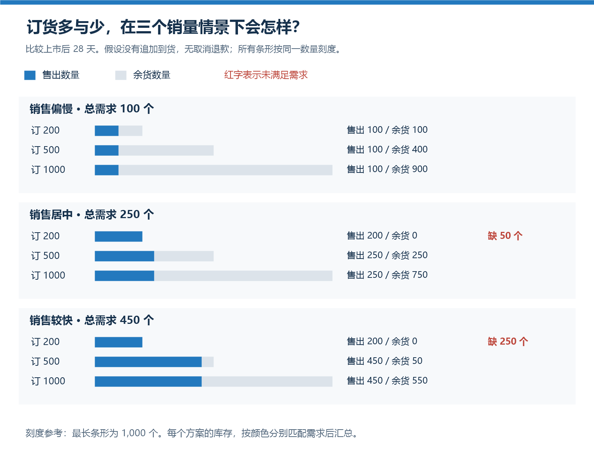

*图 1-4　所有条形采用同一数量刻度。蓝色代表售出，灰色代表期末余货，右侧红字表示首批库存无法满足的需求。红字所示需求位于库存条形之外。*

| 方案 | 偏慢，需求 100 个 | 居中，需求 250 个 | 较快，需求 450 个 |
|---|---|---|---|
| A，200 个 | 售出 100，余货 100 | 售出 200，黑色缺 50 | 售出 200，黑色缺 170、米白色缺 80 |
| B，500 个 | 售出 100，余货 400 | 售出 250，余货 250 | 售出 450，余货 50 |
| C，1,000 个 | 售出 100，余货 900 | 售出 250，余货 750 | 售出 450，余货 550 |

在偏慢情景下，订 1,000 个会留下 900 个。按采购成本计，余货金额为：

**900 × 42 = 37,800 元**

这些钱仍体现在库存中，未来能收回多少、多久收回，要看后续销售、价格和商品状态。暂时留在仓库的合格商品，不能直接全算作本期亏损。

在较快情景下，订 200 个会有 250 个需求无法由首批库存满足。即使发现畅销后立即追单，也要考虑 25 天的补货等待。

你需要在**资金占用、余货风险和现货供应能力**之间作出选择。

### 1.8　为什么两个颜色要分开算

一个可以独立识别、下单和管理库存的商品规格，通常称为一个 **SKU**。

这里有两个 SKU，分别是 500 毫升黑色杯和 500 毫升米白色杯。

假设某天仓库还剩 40 个杯子，全部为米白色。一位顾客只想买黑色，你仍然无法直接满足他的需求。

因此，每次看库存，都要进一步问到具体规格。商品变多后，还可能需要按仓库、渠道和库存状态继续细分。

### 1.9　写出你的参考决定

**本节的参考方案为首批 200 个，黑色、米白色各 100 个。**

这是基于现有资料作出的教学选择。理由包括：

1. 目前还没有付费订单，销量和每单广告费用都需要验证。
2. 三种数量的单价均为 42 元，多买目前主要能提高现货供应能力。
3. 200 个满足工厂要求，采购金额为 8,400 元，公司保留了调整下一批数量的资金。
4. 首批销售能帮助团队取得真实成交、颜色偏好和履约数据。

这项选择接受了一个后果。需求较快时，库存可能在补货前售罄，公司会失去部分销售机会。

如果能取得可信的付费订单或更稳定的销售依据，500 个也可以成为合理方案。由于本题缺少各情景的可靠概率，暂时无法据此算出唯一最优数量。

你交给创始人的建议，可以写成下面这样。

> 建议首批订 200 个，两色各 100 个，采购总额 8,400 元。下单付 2,520 元，发货前预留 5,880 元。上市后每天记录分色销量、广告费、退款和可售库存，尽早评估下一批。若需求接近较快情景，需要安排补货，并调整推广或交付承诺，处理补货等待期。这个方案主要控制首次试销的库存承诺，同时接受可能缺货的代价。

### 1.10　让这笔采购真正执行下去

| 时间或触发条件 | 你要做什么 | 留下什么记录 |
|---|---|---|
| 下单前 | 确认颜色、数量、质量要求、交期及质量问题处理方式 | 采购订单与产品要求 |
| 下单当天 | 付 2,520 元，登记 5,880 元尾款及其付款节点 | 付款凭证、待付款记录 |
| 发货前 | 核实检查结果、预计到货日，按约定付款 | 检验、付款及发货记录 |
| 到货后 | 清点数量，验收质量，确认可售数量 | 分色验收与库存记录 |
| 上市后每天 | 记录支付、发货、退款、库存及广告支出 | 每日经营记录 |
| 得到首批销售数据后 | 估算库存还能卖几天，与 25 天补货交期比较 | 补货建议与依据 |

如果库存预计只能卖 10 天，而补货还需 25 天，今天追单也会出现供货空档。你还需要与工厂确认能否加快、控制推广节奏，或调整顾客可接受的交付安排。

### 1.11　练习，把条件改一改

#### 练习一　更快到货，需要先付全款

工厂把交期缩短为 10 天，但要求下单付清全部货款。单价和起订要求保持不变。假设仍订 200 个。

1. 下单当天比原方案多付多少？
2. 这批货的采购总额变了吗？
3. 交期缩短、付款提前，会怎样影响你的补货和资金安排？

#### 练习二　你拿到了 300 个付费订单

假设下单前通过预售取得 300 个有效订单，其中黑色 180 个、米白色 120 个。顾客已付款，公司需要按预售约定交付，也要保留处理退款的资金。工厂允许按这两个具体数量下单。

1. 订 200 个是否足够？
2. 订 300 个与 500 个的采购支出相差多少？
3. 下单前，你还需要确认哪些条件？

---

### 1.12　参考答案

#### 练习一

原方案下单付 2,520 元，新方案下单付 8,400 元。

**当天多付 8,400 − 2,520 = 5,880 元。采购总额仍为 8,400 元。**

10 天交期让公司能在取得销售数据后更快追加货物，可能减少等待补货所需的库存。全款支付让现金更早流出，需要同时核实工厂能否兑现质量和交期承诺。再结合需求变化及起订要求，重新评估首批和后续数量。

#### 练习二

200 个无法覆盖当前订单，其中黑色缺 80 个、米白色缺 20 个。

300 个按黑色 180 个、米白色 120 个配置，可覆盖订单数量。500 个相比 300 个，多采购 200 个，增加采购承诺：

**200 × 42 = 8,400 元**

额外库存可支持后续销售，也增加销售偏慢时的占款。还要判断这些额外库存分配到什么颜色。

下单前，需要确认顾客承诺交期、工厂产能及质量、已收款项何时可用、取消和退款情况，以及后续需求是否足以支持额外订货。实际交付还要留意不合格品可能造成的数量缺口。

### 1.13　把决定记进第一张经营表

下面沿用本节参考方案。实际执行时，应把相对日期改成具体年月日。

| 项目 | 本节记录 |
|---|---|
| 期初现金 | 200,000 元 |
| 首批商品 | 500 毫升黑色 100 个、米白色 100 个 |
| 采购单价与总额 | 42 元，共 8,400 元 |
| 下单已付预付款 | 2,520 元 |
| 仅付预付款后的现金余额 | 197,480 元 |
| 待付尾款 | 5,880 元，发货前支付 |
| 预计到货 | 确认订单并付预付款后第 25 天 |
| 启动支出预算 | 10,000 元 |
| 固定支出预留 | 60,000 元 |
| 采购及启动支出全部支付后的现金 | 181,600 元 |
| 再扣除固定支出预留后的资金 | 121,600 元，还需支持其他经营开支 |
| 当前决定依据 | 首次试销，先验证成交、颜色偏好和履约 |
| 接受的代价 | 需求较快时，可能在补货前售罄 |
| 下一步核查 | 质量与交期，以及上市后的销量、广告和退款数据 |

回到 1.3 小节「先做一次决定」，检查你最初的答案。若改变了数量，写下让你改变决定的信息。若维持原方案，就补上现金安排，以及销量偏慢、较快时的行动。

**本节完成标准**　你能用自己的话解释：这笔采购承诺多少金额，什么时候付款，不同销量会留下多少库存，以及为什么接受这些后果。

创始人看完建议，指着电脑上的竞品页面问你：

“旁边一家卖 79 元，我们准备卖 129 元。顾客为什么选我们？”

带着这个问题，你将进入下一节的商品与顾客分析。

---

## 第二节　卖 129 元的保温杯，顾客为什么选我们？

首批采购方案已经确认，黑色和米白色各 100 个，单价 42 元。公司付出了 2,520 元预付款，工厂正在备货。店铺还没有上架。

摄影师发来一张样品照片。你正准备写标题，创始人把一个竞品链接递过来。

“它卖 79 元，我们标价 129 元。顾客为什么选我们？”

你想到几个说法，“品质好”“高颜值”“性价比高”。创始人继续问：

“这些话，别家也能说。我们先卖给谁？他买杯子最在意什么？拿什么证明我们能做到？”

这一节，你会回答这三个问题，再把答案落实到商品页面、价格判断和工厂确认事项。

**本节完成目标**　选出首批重点服务的顾客，写出一个有证据支持的购买理由，画出详情页结构，并算清降价会对单笔贡献产生什么影响。

> 表中的“待确认”表示团队尚未取得证据。本节仍在生产准备期，新增测试为提案，未形成新增订单或付款。

### 2.1　先把上一节的决定带过来

| 事项 | 进入本节时的状态 |
|---|---|
| 首批采购 | 黑色 100 个，米白色 100 个，共 200 个 |
| 采购总额 | 8,400 元 |
| 已付预付款 | 2,520 元 |
| 待付尾款 | 5,880 元，发货前支付 |
| 交期 | 从确认订单并付预付款起，第 25 天到仓 |
| 计划价格 | 标价 129 元，商家券 10 元，实付 119 元 |
| 单笔贡献 | 按第一节假设为 42 元，实际经营数据尚未验证 |
| 当前任务 | 在上架前明确顾客、购买理由和证据 |

这次采购已经限定了容量、颜色和杯型。现在需要判断，现有商品最适合先解决谁的什么问题。后续改模、增加配件或承诺新的服务，都要重新评估成本和交期。

### 2.2　同样买杯子，三类人的要求很不一样

第一节访谈的 20 人里，有 8 人主要想上下班带水，6 人主要在办公室使用，6 人主要用于运动或户外活动。

这次你重新整理了他们的使用场景，保留了下面几条代表性回答。

| 使用场景 | 代表性回答 | 决定购买时可能在意什么 |
|---|---|---|
| 通勤携带，8 人 | “我会把杯子放进装电脑的包里。最怕漏，太重也不愿意带。” | 携带密封、重量、体积、清洗 |
| 办公室桌面，6 人 | “公司有热水，我希望随手喝，洗起来方便。” | 开盖与饮水便利、清洗、桌面使用 |
| 运动户外，6 人 | “半升对我偏少，我更想要大容量，最好能单手喝。” | 容量、饮水速度、运动适用性 |

**顾客分群**，就是把需求和购买条件比较接近的人放在一起分析。本节按使用场景分群，便于直接判断商品是否合适。

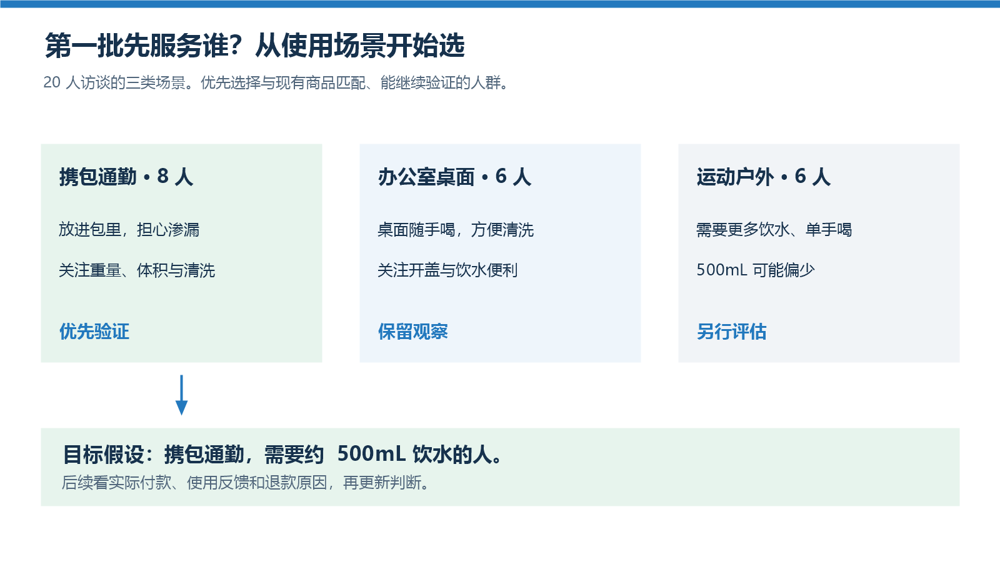

*图 1-5　三组都可能买杯子，但要求不同。本节优先验证通勤人群，访谈人数用于描述样本。*

山禾现有商品是 500 毫升旋盖杯。运动人群对更大容量和单手饮水的要求，会牵涉产品变化；办公室人群则可能更偏爱轻松开盖、无需随身携带的款式。

本节先选定一个较具体的目标：

> 每天携包通勤、希望随身带约 500 毫升饮水，并关注携带密封、重量和清洗便利的人。

这个选择仍要经过验证。接下来要看顾客是否愿意为山禾现有商品付款，以及实际使用后是否满意。

**停下来想一想**　如果你选择办公室人群作为首批重点，你会调整什么页面信息？哪些产品条件仍要先确认？写下理由，再继续。

### 2.3　把“品质好”拆成顾客能理解的具体利益

先认识三个词。

- **产品属性**，商品本身具有什么特征，例如 500 毫升、旋盖、外径 68 毫米。
- **顾客利益**，这些特征对顾客有什么帮助，例如方便判断杯子能否放进自己的包侧袋。
- **证据**，用什么让顾客判断说法是否可信，例如尺寸标注、拆洗演示、记录了条件的测试结果。

“外径 68 毫米”是一项参数。把它和包侧袋、车内杯架的内尺寸一起比较，顾客才能判断是否适合自己。

你从工厂拿到了产品说明，并对样品做了基础测量。案例记录如下。

| 目前得到的信息 | 状态 | 页面与业务上怎样处理 |
|---|---|---|
| 标称容量 500 毫升、旋盖结构 | 已取得工厂资料，尚需完成验收确认 | 作为基础规格，与后续验收要求核对 |
| 样品外径约 68 毫米、空杯约 310 克 | 已做基础测量 | 说明测量口径，向工厂确认量产允许差异 |
| 杯盖可拆下，密封圈可取出清洗 | 已对样品操作 | 拍拆洗及正确复装步骤，确认说明书要求 |
| 携带过程中是否渗漏 | 尚未验证 | 设计测试，明确装液、旋紧、摆放与检查条件 |
| 保温表现 | 尚未验证 | 取得与商品匹配的测试资料，确认条件后再决定怎样表述 |
| 量产批次是否与样品一致 | 尚未验收 | 与工厂约定材料、尺寸、装配及检查要求 |

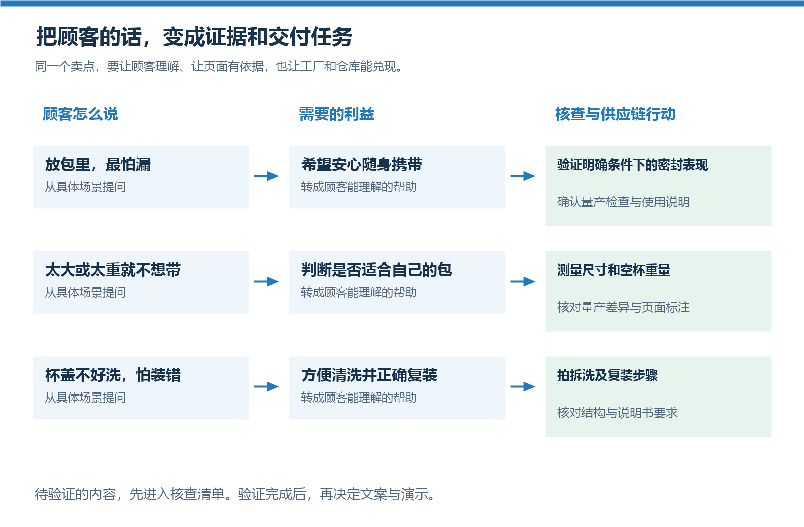

*图 1-6　一个购买理由，要同时落到顾客理解、页面展示和产品交付三个地方。*

例如，对于“放包里怕漏”的顾客，你需要把这条链补齐：

**携带顾虑 → 希望旋紧后能安心随身携带 → 验证样品在明确条件下的表现 → 把相关要求交给工厂 → 验收量产批次。**

这就是运营和供应链在商品上的协作。运营提出顾客在意的体验，供应链确认产品及批次怎样兑现，再共同决定页面能承诺到什么程度。

### 2.4　竞品比较，要比较到手价、证据和使用条件

团队挑出两个虚构竞品，和山禾放在一起。下表是案例调研时取得的信息，空白部分还要继续核查。

| 比较项目 | 竞品 A | 山禾 | 竞品 B |
|---|---|---|---|
| 目标场景 | 日常饮水 | 拟主打携包通勤 | 通勤与礼赠 |
| 当前活动实付价 | 79 元 | 计划 119 元 | 149 元 |
| 标称容量 | 500 毫升 | 500 毫升 | 480 毫升 |
| 开盖方式 | 旋盖 | 旋盖 | 按键开盖 |
| 空杯重量 | 页面未找到，待核查 | 样品约 310 克 | 页面标注约 280 克 |
| 尺寸信息 | 页面未找到，待核查 | 样品外径约 68 毫米 | 页面有尺寸图 |
| 清洗说明 | 有杯内展示，拆洗步骤待核查 | 样品可拆洗，准备拍步骤 | 页面有拆洗演示 |
| 密封及保温证据 | 有相关宣传，测试条件待核查 | 尚需完成验证 | 页面展示部分测试条件，仍需核对适用款式 |

价格需要按同一时间、相近规格及可取得的优惠来比。在本题里，79 元与 119 元的实际差额为：

**119 − 79 = 40 元**

接下来应问，顾客是否能感受到足以支持这 40 元差额的价值。

从这张表，目前可以形成“通勤适配、尺寸透明、拆洗清楚”的页面方向。至于山禾是否比 A 更密封、更耐用、更保温，需要进一步证据。竞品页面暂未找到某项信息，也可能只是调研尚未找全。

**本节的阶段判断**　山禾已经找到一个值得验证的购买方向，119 元是否有竞争力，还需要补齐产品证据和真实成交数据。

### 2.5　先写定位，再写主图

**定位**可以先写成一句内部工作说明，交代服务谁、解决什么问题，以及依靠什么。

山禾本节的定位假设为：

> 面向携包通勤、需要约 500 毫升饮水的人，提供尺寸和重量信息清楚、易于理解拆洗方式的随行保温杯；携带密封和保温卖点在验证后补充。

这句话帮助摄影、运营、采购和质量人员对齐工作。

接下来才是顾客看到的内容。本节的页面草稿可以先写：

> **500mL 通勤随行杯**  
> 尺寸、重量、拆洗方式，选购前看清楚。

第二行承诺的是页面会提供什么信息。密封验证完成后，再依据真实条件和结果调整主文案及演示。

#### 把详情页当作一串购买问题

顾客通常需要依次判断：它适合我吗，凭什么相信，具体规格是否合适，多少钱，以及什么时候能收到。

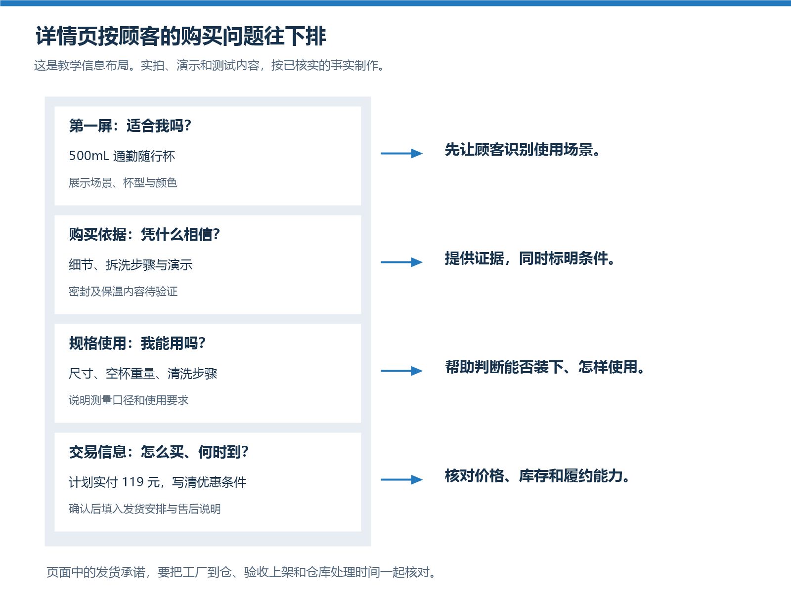

*图 1-7　这是信息布局示意。页面中的实拍、演示和测试内容需要按相应事实制作。实际商品上线前还应完成必要的商品及平台信息核查。*

你可以这样向摄影师和运营同事交付。

| 页面位置 | 顾客要解决的问题 | 准备什么内容 |
|---|---|---|
| 第一屏 | 和我的使用场景有关吗？ | 真实通勤场景，清楚展示杯子、容量和颜色 |
| 购买依据 | 我为什么相信这些说法？ | 可核对的产品细节、拆洗演示，验证后补充测试条件和结果 |
| 规格与使用 | 装得下吗？能接受重量吗？怎么洗？ | 尺寸图、空杯重量、使用与清洗步骤、适用条件 |
| 交易信息 | 到手多少钱？何时发？售后怎样处理？ | 标价和优惠条件、可兑现的发货安排及清楚的售后说明 |

页面写“预计何时发货”，需要先确认工厂到仓时间、验收上架时间和仓库处理能力。第一节的“第 25 天到仓”与顾客下单后的发货时效，需要分别安排。

### 2.6　如果跟着竞品降价，会发生什么

创始人听完后提出：“那先把到手价降到 79 元，比较容易卖吧？”

你拿出第一节的成本。先将广告之外的列示单笔成本加总：

**商品 42 + 平台 6 + 包装 3 + 快递 6 = 57 元**

假设平台费仍按本题固定 6 元、广告仍按每个完成订单 20 元，其他条件保持本题设定：

**单笔贡献 = 顾客实付 − 57 − 20**

| 实付价 | 广告外列示成本 | 广告费 | 单笔贡献 |
|---|---:|---:|---:|
| 119 元 | 57 元 | 20 元 | 42 元 |
| 99 元 | 57 元 | 20 元 | 22 元 |
| 79 元 | 57 元 | 20 元 | 2 元 |

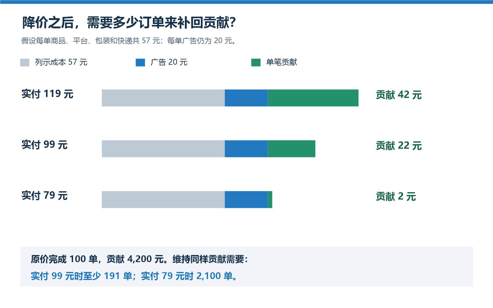

*图 1-8　在列示成本和每单广告费相同的假设下，到手价每减少 20 元，单笔贡献也减少 20 元。实际业务需要重算价格变化后的广告和平台费用。*

再做一道决策计算。假设原来完成 100 单，每单贡献 42 元，共贡献 4,200 元。

如果降到实付 99 元，每单贡献 22 元，要达到相同贡献，至少需要：

**4,200 ÷ 22 ≈ 190.91，即 191 单。**

如果降到实付 79 元，每单贡献 2 元，需要：

**4,200 ÷ 2 = 2,100 单。**

这个比较尚未加入新增销量可能带来的人员、仓库和售后压力。首批只有 200 个，交期为 25 天，因此促销判断还要检查库存和补货能否支持目标数量。

你可以向创始人提出：先保留 119 元的实付价假设，补齐购买证据；后续用受控测试观察价格变化带来的成交增量和贡献，再决定是否调整。

### 2.7　用一次小测试验证页面方向

“顾客觉得好看”和“顾客愿意付款”需要分别记录。本节先设计上架前的信息理解测试。

你另找 8 位符合目标场景、没有参加前面访谈的人，展示同一商品、同一实付价 119 元的两版页面草稿。

- A 版强调颜色与外观。
- B 版强调通勤场景，并把尺寸、重量和拆洗展示放得更清楚。

让 4 人先看 A、再看 B，另 4 人先看 B、再看 A，减少固定展示顺序的影响。两版都使用已确认的信息。

不要提前告诉他们你更喜欢哪一版。展示后询问：

1. 你觉得这款杯子最适合什么场景？
2. 哪条信息能帮助你判断是否适合自己？还有什么没看懂？
3. 按 119 元考虑，你现在最犹豫什么？你还会比较哪款产品？

| 记录项目 | 怎样记录 |
|---|---|
| 场景理解 | 对方用自己的话复述，保留原句 |
| 选择原因 | 记录具体信息，例如重量、清洗、外观 |
| 购买顾虑 | 例如价格、密封证据、容量、交付日期 |
| 缺失信息 | 哪个问题页面没有回答 |
| 页面倾向 | 是否偏好某版，以及为什么 |

这轮测试用来找理解障碍和修改方向。后续拿到真实访问和订单，再学习比较转化、广告费用、退款及贡献，进一步验证商业效果。

这轮页面理解测试仍处于提案阶段，后续执行时登记时间和费用。下一阶段先按已核实的信息完成页面；测试结果取得后再更新。

### 2.8　把购买理由交给供应链

本节结束前，你需要把页面方向转换成具体任务。

| 顾客在意的事 | 运营准备 | 采购与质量准备 |
|---|---|---|
| 能否装进包侧袋 | 准备尺寸标注和选购提示 | 确认量产尺寸及允许差异 |
| 重量是否可接受 | 标明空杯测量口径 | 核对不同样品及量产批次 |
| 能否拆洗、如何复装 | 拍步骤，展示需要注意的部位 | 确认结构、使用说明及复装检查 |
| 旋紧后携带是否渗漏 | 根据验证结果决定文案与演示 | 确认测试条件、样本、判断方式及出货检查要求 |
| 何时能发货 | 写顾客可理解的交付信息 | 核实工厂、到仓验收和仓库处理时间 |

如果为兑现新卖点，需要加配件或修改结构，先核算成本、交期及对这批订单的影响，再决定是否实施。现阶段的页面草稿没有改变第一节的采购合同。

### 2.9　练习，先自己写一遍

#### 练习一　把一句泛泛的卖点变具体

摄影师准备写：“高品质通勤杯，轻便防漏，超长保温。”

请结合本节资料，回答：

1. 哪些信息已经有依据，哪些需要继续验证？
2. 给出一句现在可以使用的主文案。
3. 如果想突出携带密封，你还需要安排什么？

#### 练习二　先算降价需要的增量

假设目前实付 119 元时可完成 100 单，单笔贡献 42 元。团队建议降到实付 99 元，预计能完成 150 单。沿用本节成本和广告费。

1. 两种方案的总贡献各多少？
2. 你会据此批准降价吗？为什么？
3. 首批 200 个能否支持维持原贡献所需的 191 单？还要核查什么？

#### 练习三　竞品也能做到

进一步调研发现，竞品 A 同样提供完整尺寸、拆洗演示，并有匹配款式的密封测试资料，实付价仍为 79 元。

请写出山禾接下来三项行动。暂时保留首批 200 个采购及原付款条件。

---

### 2.10　参考答案

#### 练习一

已有基础资料包括标称容量、结构，以及样品尺寸、空杯重量和拆洗操作。关于“轻便”，顾客可结合明确重量判断，比较性表达还需要明确比较对象与依据。携带密封、保温表现尚需补证据。

当前可用的页面草稿为：

> 500mL 通勤随行杯。尺寸、重量、拆洗方式，选购前看清楚。

突出携带密封前，要确认具体使用条件、测试方法、样本和结果，再把要求落实到量产检查与使用说明。页面表述应与已核实的事实一致。

#### 练习二

原方案的总贡献：

**100 × 42 = 4,200 元。**

降价后的总贡献：

**150 × 22 = 3,300 元。**

相差 900 元。若本次目标是提高这批订单的总贡献，现有预测尚不能支持降价。团队如果还有获取新客等目标，需要说明预算、评价期限和验证方式。

200 个在总数上可以支持 191 单。但还要核查两个颜色的需求分布、可售合格数量、其他渠道占用和销售发生时间。黑色缺货时，米白色库存可能无法满足同一顾客。

#### 练习三

可以选择以下行动：

1. 找目标顾客对照实物和页面，追问山禾是否仍有值得付费的差别，核查体验、材料、服务等可能的依据。
2. 重算 119 元、99 元等价格下的贡献，安排预算受控的真实销售验证，观察转化、退款和单笔成本。
3. 与工厂讨论现有成本、质量和交期的改善空间，评估后续批次；先核实本批能实现的内容，再调整承诺。

如果顾客感受不到差别，测试和成本测算都不支持当前售价，应更新商品或定价计划，并重新评估后续采购。

### 2.11　更新这门生意的记录

| 项目 | 本节结束时的记录 |
|---|---|
| 首批采购与付款 | 延续第一节，200 个、总额 8,400 元，已付 2,520 元、待付 5,880 元 |
| 新增已执行付款 | 0 元，本节新增测试尚处计划阶段 |
| 目标顾客假设 | 携包通勤，需要约 500 毫升饮水的人 |
| 重点购买顾虑 | 携带密封、重量和体积、清洗 |
| 当前可展示依据 | 工厂基础资料、样品测量与拆洗操作，按状态标注 |
| 尚待完成 | 密封及保温证据、量产要求核对、页面理解测试 |
| 计划价格 | 暂保留标价 129 元、券后 119 元，待真实销售验证 |
| 当前单笔贡献假设 | 42 元，税费、固定支出及额外售后损失另行考虑 |
| 下一步交付物 | 页面草稿、拍摄清单、产品核查清单、测试记录 |

**本节完成标准**　你能说清先卖给谁，至少列出三项具体购买顾虑，为页面中的关键说法标明依据，并算出降价后需要多少额外订单。

页面方向已经明确。接下来，你与工厂核对产品要求和检查记录，安排剩余 5,880 元尾款。

P25，首批货抵达仓库。仓库问：“收到 200 个，是不是就能把 200 个全部挂到店里卖？”

下一节，先完成验收，并分清哪些库存可以承诺给顾客。

---

## 第三节　货到仓，哪些库存可以卖？

P25，首批货到仓。你准备在店里填写黑色 100 个、米白色 100 个。仓库同事提醒：“先验收，再确认能卖多少。”

为了让你理解库存锁定，他拿出一张练习表：黑色合格实物 100 个，其中有 12 个模拟订单占用。

“这张练习表上，还能继续承诺多少个？”

你需要同时看清实物、占用和可用。正式销售在下一节完成上架检查后开始。

**本节目标**　理解验收、可售、锁定、已发出和退回商品，能建立开业库存基线，判断订单动作怎样改变可用数量，并识别超卖风险。

> 本节发生在到仓与开业准备阶段。100 个实物、锁定 12 个是库存演练，演练结束后恢复；开业时两色各有 100 个可售，尚无销售订单。

### 3.1　先完成到仓验收

P25，200 个杯子到仓。卸下来的数量，需要经过清点和验收，才能作为可售商品对外承诺。

到货核对至少包括采购订单、颜色数量、包装标识、样品与规格、约定质量要求。检查方法、抽样或全检范围、判定条件应在采购前与工厂确认，并保留结果。第二节提到的密封、保温等验证也应落实为记录。

本案例中，团队已核对约定的样品验证资料，并在到货后按约完成检查，200 个验收合格，黑、白各 100 个。页面只使用已经核实的规格和说明。验收记录还要与后续使用反馈对照；出现异常继续核查批次和供应商处理。

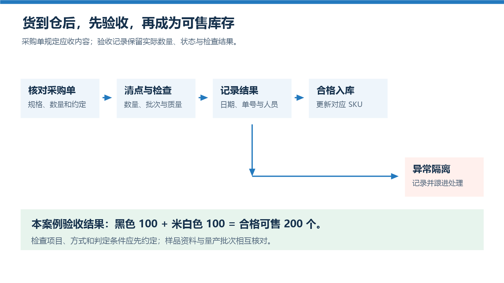

*图 1-9　这里展示库存状态流转，具体检测项目和方法按商品及约定要求执行。*

采购单写的是“应该收到什么”，验收单记的是“实际收到什么、检查结果怎样”，入库记录则让系统知道哪些实物可以使用。

### 3.2　库存至少要问清三个状态

| 状态 | 含义 | 举例 |
|---|---|---|
| 已确认可分配库存 | 合格在库，尚未分配给其他订单 | 可以继续对外销售的 88 个 |
| 已锁定库存 | 已分配给订单、尚未发出 | 给 12 笔模拟付款订单保留的 12 个 |
| 异常或待检库存 | 待验、残次、退回待检等状态 | 退货还没确认能否二次销售 |

本节使用一个简化关系：

**可对外承诺数量 = 合格实物在库 − 已锁定数量 − 内部预留数量。**

如果 100 个实物全部合格，锁定 12 个，内部预留为零，就剩 88 个可对外承诺。

已经把库存表字段直接定义为“可用”的系统，通常已经扣过锁定，读数时先核查字段含义，避免再次扣减。采购在途尚未到仓，本节的现货承诺不把它计入。

### 3.3　一笔订单怎样改变库存

上市后，顾客支付一只黑色杯，系统锁定一只，可承诺数量减少一只。

若顾客在发货前取消，订单确认取消后释放锁定。这时实物没有离开仓库；如果期间也没有产生异常，它可以再次分配。

若仓库完成拣货、核对和出库，实物库存减少，原锁定数量同步解除。此时不要在可售数上再额外减第二次。

签收后退回的商品则先进入待检，核对实物与订单后，再判断重新销售、维修处理或报损。

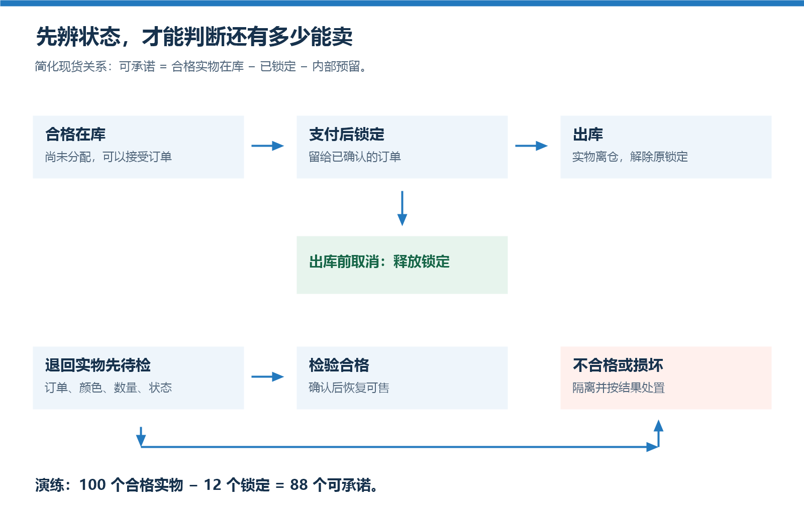

*图 1-10　先确认业务动作，再更新相应状态。同一个杯子在每个时点只有一个明确库存归属。*

### 3.4　两个渠道同时卖，会发生什么

假设黑色最后有 10 个可分配实物。店铺 A 显示 10 个，店铺 B 也显示 10 个，两边系统各自接受 8 笔订单，如果没有共享锁定，总承诺达到 16 个，会超过实物 6 个。这是风险示例，未发生在本周案例记录中。

常见处理方式包括共享实时可用库存，或给渠道明确分配份额。比如 A 分配 6 个、B 分配 4 个，并规定调拨额度怎样更新。是否还需要额外预留，取决于系统同步速度和异常风险。

还要验证付款、超时取消、人工改单和出库失败时，锁定能否正确保留或释放。正常下单和异常重试都可能影响库存准确性。

### 3.5　建立开业库存记录

| 项目 | 黑色 | 米白色 | 合计 |
|---|---:|---:|---:|
| 本次到货 | 100 | 100 | 200 |
| 验收合格 | 100 | 100 | 200 |
| 正式订单锁定 | 0 | 0 | 0 |
| 内部预留与异常 | 0 | 0 | 0 |
| 开业可承诺数量 | 100 | 100 | 200 |

这张表是销售开始前的基线。以后每笔订单的锁定、出库、取消和退回，都要从这张基线上逐项更新。第六节处理首周售后时，再核对期末余额。

### 3.6　盘点不一致，从哪查

如果系统显示黑色可售 74，货架清点却是 73，先固定盘点时点，暂停或单独记录盘点期间的出入动作。

按时间核对入库、锁定、出库、取消、退货、报损和调拨记录，再复点具体货位。检查错色、错位、重复出库、漏记退货等可能原因。

查明原因后，按公司权限更正库存，并保留更正人与依据。单纯把系统改成实物数量，会丢掉追查和改进的线索。

### 3.7　练习

#### 练习一

某时点黑色合格实物 74 个，其中已锁定 6 个，另预留 2 个做拍摄。可对外承诺多少？若其中两笔订单在出库前取消，且不影响实物状态，可承诺数变为多少？

#### 练习二

仓库收到一件退回的米白色杯，系统立即把它加入可售。你要核查哪些事情？如果核对后发现杯盖损坏，应怎样记录？

#### 练习三

在开头的练习表里，黑色合格实物 100 个，其中 12 个被模拟订单锁定。仓库说“实物有 100 个，所以还能卖 100 个”。你会怎样纠正？

---

### 3.8　参考答案

练习一，可承诺 74 − 6 − 2 = 66 个。两笔取消释放锁定后为 68 个。这里 74 是包含锁定及内部预留的合格实物总数，若直接读取系统可用字段，要先确认是否已扣减。

练习二，先核对订单、型号、颜色、数量、收到状态和原发出批次，进入待检，再按要求检查。损坏件隔离、记录原因和责任线索，按审批结果处置，恢复可售需有合格依据。

练习三，已锁定的 12 个需要留给对应订单，可继续承诺 100 − 12 = 88 个。正式开业前，这组模拟锁定已清除，回到两色各 100 个的开业基线。

### 3.9　你的库存交付物

建一张分 SKU 表，至少记期初合格数、入库、锁定、释放、出库、退回待检、恢复可售和报损。每一行关联日期与业务单号。

**本节完成标准**　你能解释实物、可售和锁定的关系，建立开业 200 个可售的基线，并判断一件退货恢复销售之前需要什么依据。

库存已经清楚了。接下来，把货架上的黑、白两款杯子，准确连接到顾客在页面上选择的商品。

---

## 第四节　开店上架与促销，怎样真正落地？

摄影师问你：“图拍好了，直接上传就能卖吗？”

你打开店铺草稿，发现黑色选项连接的是米白色仓库编码。活动同事又加了一张 15 元优惠券，但页面原来已经设置了 10 元券。

现在处于验收完成、正式上线之前。团队在检查中发现并修复规格映射与优惠设置问题，开业按两色各 100 个、券后 119 元执行。

**本节目标**　认识商家入驻和商品上架需要准备的业务信息，连接页面与实物编码，算清优惠叠加，并验证从选规格到付款、库存和仓库的路径。

> 本节使用虚构店铺和教学促销，不对应某个平台的当期操作规则。真实上线时，要逐项查看目标平台当时的主体、类目、商品、收费、结算及售后要求。上架和优惠判断需要的数据都列在本节。

### 4.1　开店需要先明确什么

第二节完成的是卖给谁、为什么买。正式经营还要明确谁作为商家收款、承担售后，以及谁负责仓库和客服。

| 业务准备 | 需要回答的问题 | 对经营有什么影响 |
|---|---|---|
| 经营主体与店铺 | 以什么主体经营，开什么店铺类型？ | 影响合同、入驻与收款责任 |
| 类目与商品要求 | 这件商品能进入什么类目，需要哪些资料？ | 影响可售范围与上线时间 |
| 品牌与商品信息 | 品牌名称和使用依据是什么，来源是否可追踪？ | 影响商品信息及纠纷处理 |
| 平台合同与费用 | 收什么费，怎样结算，怎样处理退款？ | 影响单笔贡献及资金安排 |
| 仓配与客服 | 谁发货，谁回复，异常交给谁？ | 影响交付承诺与服务结果 |
| 收款与权限 | 款到哪个账户，谁能改价、退款和改库存？ | 影响资金安全与错误追查 |

本案例设定，上述事项已完成核查，可以经营该商品。本节暂不引入额外保证金、平台年费或税费；真实业务若产生这些支出，应加入预算和账务记录。

### 4.2　建立一份商品主档

**商品主档**就是各岗位共同使用的商品基础资料。一个杯子在店铺、采购和仓库里可以有不同显示名称，但要能追溯到同一个规格。

| 字段 | 黑色 | 米白色 |
|---|---|---|
| 商品组 | 山禾 500mL 通勤杯 | 山禾 500mL 通勤杯 |
| 内部 SKU 编码 | SH500-BK | SH500-WH |
| 顾客可见规格 | 黑色／500mL | 米白色／500mL |
| 工厂订单规格 | 黑色／500mL | 米白色／500mL |
| 仓库编码 | SH500-BK | SH500-WH |
| 采购成本 | 42 元 | 42 元 |
| 首批验收数量 | 100 个 | 100 个 |
| 计划标价 | 129 元 | 129 元 |

标题和颜色名称可由运营维护，内部编码要有稳定规则。尺寸、材质、使用与清洗说明、图片依据和供应商批次也应在主档关联，变更时留记录。

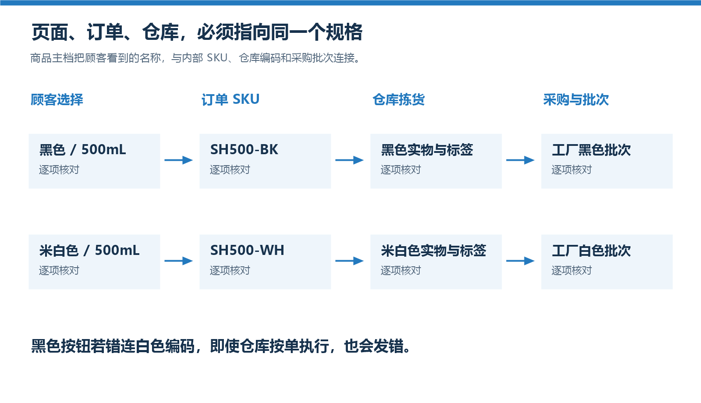

*图 1-11　顾客点选规格后，订单必须把正确的 SKU 传给仓库。采购与批次信息帮助追溯货源。*

如果黑色按钮错误连接 SH500-WH，页面看着正常，仓库按系统执行仍会错发。上线检查要沿着顾客选择一路追到实物标签。

### 4.3　优惠券会怎样改变订单贡献

原方案，标价 129 元、商家券 10 元，顾客实付 119 元。

假设又加一张可叠加的 15 元商家券，且两张均由山禾承担：

**实付 = 129 − 10 − 15 = 104 元。**

按原列示成本及每单广告 20 元：

**单笔贡献 = 104 − 57 − 20 = 27 元。**

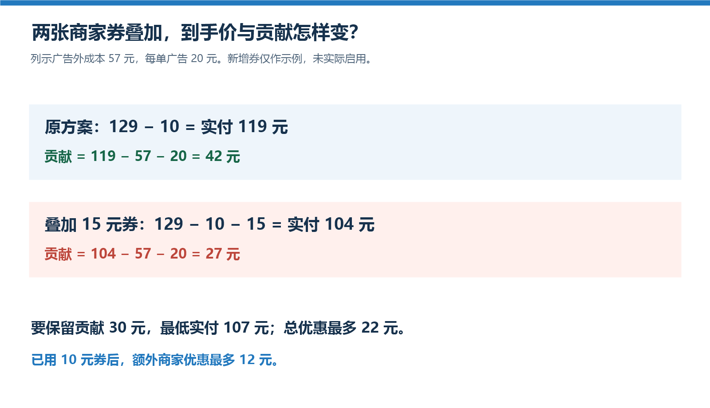

*图 1-12　新增的 15 元优惠会减少相同金额的本题单笔贡献。这里的 15 元券只用于练习，没有实际启用。*

如果希望每单至少留下 30 元，在其他费用不变时，顾客实付至少需要：

**57 + 20 + 30 = 107 元。**

以 129 元标价计算，商家承担的总优惠最多为 22 元。原有 10 元券已使用其中 10 元，额外叠加空间最多 12 元。

实际活动还要逐项确认优惠适用范围、叠加顺序、承担方、最低门槛、退款后优惠分配及平台费用计算方式。平台出资补贴与商家出资优惠，在商家结算上可能产生不同结果，要按合同和账单核对。

### 4.4　画出一次上架检查

你可以请另一名同事，从顾客角度检查草稿，并把每步结果记下来。

1. 打开商品，核对标题、图片、参数和使用条件，与已确认资料一致。
2. 分别选择黑、白，检查图片、规格、SKU 和库存对应关系。
3. 输入不同收货地区，核对可配送范围、运费和发货安排。
4. 查看优惠条件，计算结算页到手价，检查费用承担方。
5. 验证订单进入处理系统后，SKU、金额、地址和库存锁定正确。
6. 在平台允许的测试环境或测试方式下，检查取消、退款、解锁和账单记录。

如果使用了真实交易，按平台允许的方式如实处理，并登记相应订单、费用和库存。本案例的上述检查由允许的测试方式完成，未产生真实销售。

### 4.5　发货承诺怎样定

工厂说 P25 到仓，仓库仍需收货、验收、上架和处理订单。采购交期、现货发货时效、快递运输时长是不同阶段。

山禾首批已合格入库后，才能根据仓库实际排班和处理能力确定现货发货安排。节假日、大促、偏远地区等情况，需要在承诺中写清适用条件。

本节先建立一张内部表：最晚接单截点、仓库处理时间、承运商揽收时间、异常通知负责人。对外页面再用清楚的语言呈现最终安排。

### 4.6　变更要能追到人和时间

售价、优惠、库存映射和交付承诺都会影响真实订单。为这些操作确定负责人和复核要求，保留修改前后值、修改人及生效时间。

例如运营提出 15 元新券，负责人先核算贡献，仓库确认库存，再决定是否启用。提案、获准与实际执行分别记录。上线后监控异常价格、规格错配、付款失败和库存不同步，发现问题后及时关闭相应入口并处理已受影响订单。

### 4.7　练习

#### 练习一

129 元商品已有 10 元商家券，再叠加 20 元店铺券。每单广告 20 元，其余成本沿用本题。实付与贡献分别是多少？若目标贡献为 30 元，新券最多能加多少？

#### 练习二

黑色页面指向了白色 SKU，已有 2 笔顾客付款，尚未发货。你先做什么？怎样避免仓库直接发错？为什么不能只换一张图片就结束？这是假设异常，不计入首周案例记录。

---

### 4.8　参考答案

练习一，实付 99 元，贡献 22 元。为维持 30 元贡献，最低实付 107 元，总优惠最多 22 元；已配 10 元券，新券最多 12 元。

练习二，暂停错误规格的销售并拦截这两笔订单，确认顾客实际选择，核对库存与正确 SKU，联系顾客处理并按系统权限更正或重新安排。修复页面、订单与仓库映射，重新检查锁定及金额，记录原因。只改图片仍可能留下原订单与仓库执行错误。

### 4.9　你的上线交付物

交付商品主档、上架检查表、优惠测算表和改动记录。本案例最终仍执行 129 元标价与 10 元商家券，实付 119 元；新增券未启用，首批案例记录保持原口径。

**本节完成标准**　你能把页面规格对应到正确实物，计算叠加优惠，并说明一笔已付错配订单怎样拦截和修复。

准备工作完成，商品正式上线，顾客开始访问和付款。创始人给出 500 元首轮广告预算，想知道它带来了多少订单。下一节，读懂这份广告报告。

---

## 第五节　500 元广告费，带来多少订单？

前两节已经完成验收、库存与上架检查，店铺按券后 119 元开始销售。现在来到上市首周末，先看广告后台，再在第六、七节加入交付、退款和回款结果。

创始人给你 500 元首轮广告预算。上市一周后，他打开后台：

“一万次展示，五百次点击，二十五笔订单。还能加预算吗？”

**本节目标**　看懂从展示到付款的变化，算出每个支付订单花了多少广告费，并区分预算上限与实际盈利。

> 本节先按支付口径观察广告效果。广告归因 25 笔支付订单，自然渠道另有 25 笔，全店共 50 笔。取消和退货结果在第六节逐项说明。

### 5.1　先把后台数字排成一条链

| 本周广告报告 | 数值 | 口径 |
|---|---:|---|
| 展示 | 10,000 次 | 广告被展示的次数 |
| 点击 | 500 次 | 广告被点击的次数 |
| 广告归因支付订单 | 25 笔 | 本案例归入同一广告计划的支付订单 |
| 广告费用 | 500 元 | 本周实际消耗 |
| 广告归因支付金额 | 2,975 元 | 25 × 119 |

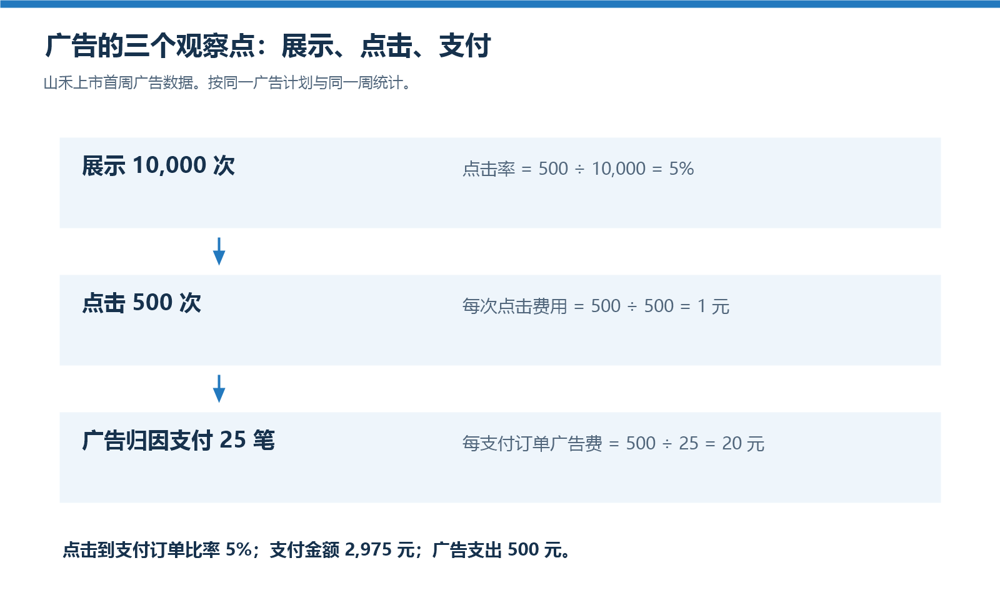

*图 1-13　逐步计算比率，先保证统计期间、广告计划和订单范围一致。*

“展示”按次数统计，同一个人可能看到多次；“点击”也可能包含同一人的多次操作。真实后台还会提供去重访客等指标，不能把所有次数直接解释成人数。本题点击到支付按“支付订单数 ÷ 点击次数”计算。

**点击率 = 500 ÷ 10,000 = 5%。**

**点击到支付订单比率 = 25 ÷ 500 = 5%。**

**平均点击费用 = 500 ÷ 500 = 1 元。**

**每个广告归因支付订单成本 = 500 ÷ 25 = 20 元。**

如果顾客重复购买，订单数还会与购买人数不同。以后算“获客成本”，要进一步明确新客人数、来源和归因方式。

### 5.2　5.95 倍的投放产出，代表什么

后台可能显示一个“投入产出”数字。本节明确定义为广告归因支付金额除以广告费，常见缩写为 ROAS。

**ROAS = 2,975 ÷ 500 = 5.95。**

它表示每花一元广告，后台归因了 5.95 元支付金额。该支付金额仍要覆盖商品、平台、仓配、退款和其他开支。

沿用第一节的费用假设，一笔未退款订单，广告之外的列示成本为：

**42 + 6 + 3 + 6 = 57 元。**

实付 119 元时，扣广告前可留下 62 元：

**119 − 57 = 62 元。**

如果每单广告支出 20 元，单笔贡献仍为 42 元。广告与其他渠道的贡献要分别核算，再汇总到店铺。

本周广告之外另有 25 笔自然渠道支付订单。因此，全店 50 笔支付订单中，每单平均分到的本次广告支出为 10 元。这个数字与广告计划的每单 20 元使用了不同的订单范围，后续评估计划时要保留原口径。

### 5.3　最多能花多少广告费

创始人提出：“每单赚 42 元，那广告贵一点也可以吧？”

你需要先知道公司要求保留多少贡献。

**每单可接受广告费 = 实付价 − 广告外列示成本 − 目标单笔贡献。**

假设团队暂定，希望每个未退款广告订单至少留下 30 元，用来支持其他支出。那么：

**119 − 57 − 30 = 32 元。**

当前每单 20 元，低于这个支付口径下的暂定上限。

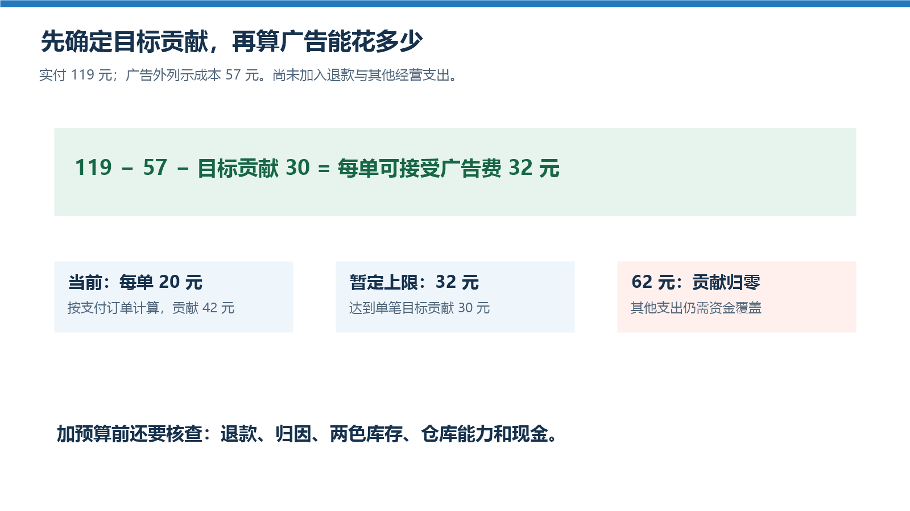

*图 1-14　32 元对应本题暂定目标，62 元对应列示成本口径下贡献归零。退款、固定支出、税费和归因误差会影响实际判断。*

若放弃目标贡献，将广告费推到每单 62 元，按给定费用这单贡献恰好为零。公司还有其他成本需要承担，因此日常投放应结合经营目标留出空间。

广告后台的归因也需要复核。有人可能先看广告、再搜索品牌下单，其他渠道也可能参与成交。扩大预算前，要评估新增投入能否带来额外订单。

### 5.4　怎样找到应该先改的地方

假设另一个备选素材使用相同 500 元预算，得到 20,000 次展示、500 次点击和 10 笔支付订单。这是诊断用的假设，未实际投入。

| 指标 | 当前计划 | 备选素材假设 |
|---|---:|---:|
| 点击率 | 5% | 2.5% |
| 点击到支付比率 | 5% | 2% |
| 每支付订单广告费 | 20 元 | 50 元 |
| 未退款订单的列示贡献 | 42 元 | 12 元 |

备选素材展示更多，订单反而更少。可以提出两个调查方向：画面是否吸引了合适的人，以及点击之后页面、价格、规格和交付是否让人继续付款。

运营应检查素材展示的场景与落地页面是否一致，也要核对页面加载、规格选择、库存、优惠和支付链路。比率给出调查方向，原因还要靠用户行为和小规模修改验证。

### 5.5　加预算前，先过四道检查

1. **数据检查。** 消耗、点击、归因支付金额和订单范围一致，去掉重复记录。
2. **经营检查。** 结合退款观察单笔贡献，说明可承受广告费用及目标。
3. **交付检查。** 确认两色可售库存、仓库处理能力和补货时间。
4. **资金检查。** 写明下一轮投放上限、观察周期和负责停止的人。

本节建议先复核售后，再讨论逐步扩量。下一轮 300 元等方案可以列入提案，获准执行后才能进入实际案例记录。

### 5.6　练习

#### 练习一

另一项计划花 300 元，取得 6,000 次展示、200 次点击和 10 笔支付订单，每单实付 119 元。计算点击率、点击到支付比率、每支付订单广告费和 ROAS。按每单目标贡献 30 元，是否达到本题支付口径要求？

#### 练习二

本周 25 笔广告支付订单，后续有 3 笔发货前取消、1 笔签收后退货。广告费仍为 500 元。广告最终保留多少笔订单？每个保留订单分摊多少广告费？还需要哪些费用才能准确计算这批订单的贡献？

---

### 5.7　参考答案

练习一，点击率约 3.33%，点击到支付比率 5%，每支付订单广告费 30 元，ROAS 为 1,190 ÷ 300，约 3.97。未退款订单贡献为 119 − 57 − 30 = 32 元，达到暂定 30 元目标。是否扩大还要继续核查退款、归因、库存与现金。

练习二，保留 21 笔，每保留订单广告支出约 500 ÷ 21 = 23.81 元。还要加入实际平台收费、已经发出的包装和快递、退回运费、退货商品检验与处置等费用。对退掉的订单，已经发生的履约成本也要保留在账内。

### 5.8　你的第一份投放记录

记录 500 元已花、25 笔广告支付订单、支付口径每单 20 元、支付口径 ROAS 5.95。注明待与售后核对，并把库存与下一轮预算列入检查清单。

**本节完成标准**　你能给每个指标标明分母，计算广告费用上限，并在加预算前检查商品交付与资金。

支付报告看完后，客服和仓库给出新消息：“有顾客取消，也有包裹已经退回。”

下一节，把 50 笔支付订单逐一放回交付和售后状态，再确认留下多少成交。

---

## 第六节　从付款到退货，怎样把订单交完？

上市首周，你看到 50 笔付款订单。客服说其中有人要取消；仓库说发出 45 个；售后说有 3 个杯子退回来了。

创始人问：“这周到底卖了多少？”

你需要先把订单放回各自状态，再决定哪些收入、费用和库存要保留。

**本节目标**　走完支付、取消、出库、签收和退货，处理一笔质量投诉，核对首周最终保留的 42 笔订单。

> 本节截止上市首周末 S7。为集中练习，本案例把 45 笔签收、3 笔退货及相应退款都设为已处理；未发取消共 5 笔。接下来的表逐项给出数量和费用。

### 6.1　先问“卖出”指哪个阶段

| 订单口径 | 数量 | 本周发生了什么 |
|---|---:|---|
| 已付款 | 50 | 顾客已支付 |
| 发货前取消 | 5 | 取消并全额退款，库存释放 |
| 已发出并签收 | 45 | 实物已交给顾客 |
| 签收后退货 | 3 | 全额退款，实物已退回 |
| 最终保留 | 42 | 顾客保留商品 |

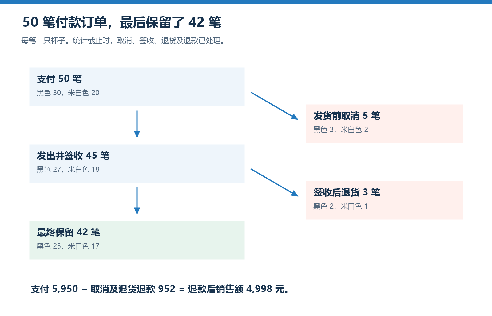

*图 1-15　支付、发货、签收和最终保留是不同统计口径。这里的最终结果只截至本案例规定时点。*

支付金额为 50 × 119 = 5,950 元。5 笔取消与 3 笔退货共退款：

**8 × 119 = 952 元。**

**退款后销售额 = 5,950 − 952 = 4,998 元。**

再按来源核对同一批订单：

| 渠道 | 支付 | 未发取消 | 签收后退货 | 最终保留 |
|---|---:|---:|---:|---:|
| 广告归因 | 25 | 3 | 1 | 21 |
| 自然渠道 | 25 | 2 | 2 | 21 |
| 合计 | 50 | 5 | 3 | 42 |

第五节广告费累计 500 元，按支付订单平均为 20 元；现在按 21 笔保留订单平均，变为 **500 ÷ 21 ≈ 23.81 元**。两个数对应不同阶段和分母。完整贡献还要加入已发生的履约与售后费用，下一节继续计算。

这里的订单保留率为 42 ÷ 50 = 84%。另有两个可诊断指标：发货前取消占支付订单 10%，签收后退货占已发货订单约 6.67%。分母不同，要在报表上注明。

### 6.2　订单交付中的具体动作

付款后先核验地址、SKU、库存与订单状态。仓库按有效订单拣货，核对颜色数量、检查外观，包装并交接承运商，保留运单和出库记录。

物流异常要确认发生在哪个环节，向顾客说明已核实的情况和后续时间。若顾客发货前申请取消，系统确认拦截成功后再释放库存；已经交接的包裹则要跟踪拦截或退回结果，避免商品继续寄出但账面已经恢复可售。

本案例 5 笔取消都在出库前处理完，没有发生包装及快递费用。实际经营应依据已发生动作记账。

### 6.3　一件漏水投诉，怎样处理

顾客发来消息：“杯子放包里，发现包底湿了。”

先核对订单、颜色、批次和使用过程，请顾客提供与问题有关的情况和证据。客服按已公布且适用的售后安排提出处理方式，仓库登记退货，质量人员确认问题与受影响范围。

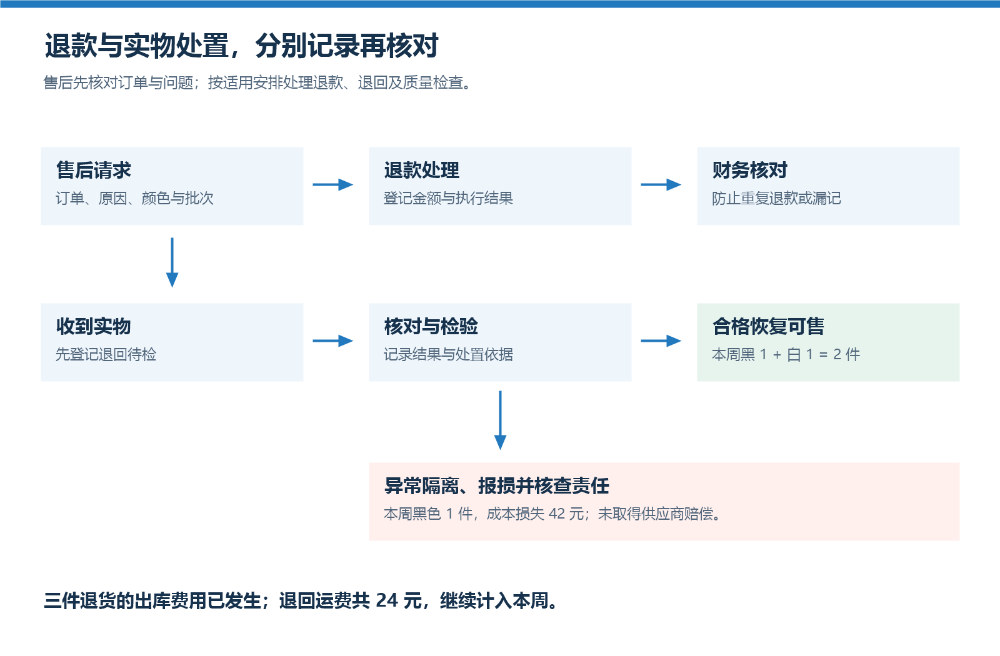

*图 1-16　退款、实物收回与质量处置分别留记录，再相互核对。退款是否需等待实物，按实际适用条件判断。*

本案例中，三件均已退回并全额退款。检验结果为：黑色一件和米白色一件符合再次销售要求；另一件黑色确认密封问题，隔离报损。

对质量问题，还要核查同批次检查记录和其他投诉。若证据提示批次风险，应评估暂停相应批次、扩大检查并联系供应商。供应商赔偿要取得确认，本周未收到赔偿，暂不把预计追偿计成已收资金。

### 6.4　把订单结果核对回库存

| 动作 | 黑色 | 米白色 | 合计 |
|---|---:|---:|---:|
| 验收入库 | 100 | 100 | 200 |
| 支付订单锁定 | 30 | 20 | 50 |
| 发货前取消，释放锁定 | 3 | 2 | 5 |
| 实际出库 | 27 | 18 | 45 |
| 退回实物 | 2 | 1 | 3 |
| 退回后恢复可售 | 1 | 1 | 2 |
| 退回后报损隔离 | 1 | 0 | 1 |

截止首周结束，所有订单与退货已处理，期末无锁定。

**黑色可售 = 100 − 27 + 1 = 74 个。**

**米白色可售 = 100 − 18 + 1 = 83 个。**

可售合计 157 个。仓库还隔离着 1 个报损杯子，实物合计 158 个；报损件按案例约定已从存货账面价值中扣除。

“卖出去最后没退”的数量是 42 个。用实物核对：

**200 = 最终顾客持有 42 + 可售 157 + 隔离报损 1。**

### 6.5　退款后，有哪些费用仍然发生了

| 费用或商品 | 发货前取消 5 单 | 签收后退货 3 单 | 保留 42 单 |
|---|---:|---:|---:|
| 包装 3 元／单 | 0 | 9 元 | 126 元 |
| 出库快递 6 元／单 | 0 | 18 元 | 252 元 |
| 退回运费 | 0 | 24 元 | 0 |
| 平台最终费用 | 0 | 0 | 252 元 |
| 商品成本处置 | 未出库 | 2 件恢复库存，1 件报损 42 元 | 1,764 元销售成本 |

广告费按已经消耗的 500 元保留。退款不会自动把已经花掉的广告取回。

本案例平台对退货订单原收费用已全部冲回；包装和出库快递没有退回，因此 45 单出库费用都要计入。真实平台及物流收费需逐项核对。

### 6.6　为异常指定负责人与截止时间

可以用一张表跟进售后，字段包括订单号、问题、颜色批次、申请时间、当前状态、已退款金额、实物位置、责任人、下一动作和完成时间。

客服负责与顾客沟通并跟进，仓库负责实物登记，质量人员确认处置与风险，财务核对退款和费用。每次交接应能看见谁接下了任务。

如果退款已完成、实物仍待回收，表中同时保留两个状态；恢复库存以实际收到并检验为依据。重复收到退款请求时，先核查已退金额和执行结果，避免重复退款。

### 6.7　怎样把投诉变成改进

把原因写具体，例如发货慢、选错颜色、尺寸不合、密封问题、与页面预期不符。将“顾客描述”“检验结果”和“最终原因”分别记录，避免把未经核实的猜测当成原因。

然后安排动作。尺寸误解可能需要改页面；错发要检查 SKU 映射与拣货复核；同批密封异常要联动工厂及质量检查。下周继续观察是否减少，同时看处理时间和每单损失。

### 6.8　练习

#### 练习一

另一周 80 笔支付，8 笔发货前取消，余下均发货，其中 6 笔最终退货。每单一个杯子，实付 119 元。计算最终保留订单、退款总额、退款后销售额与按发货计算的退货率。

#### 练习二

一笔订单已全额退款，仓库还没有收到实物。客服建议先把杯子恢复库存，好让广告继续售卖。你怎样处理？

#### 练习三

本案例三件退货为什么不能都按商品成本 42 元直接算作亏损？又为什么仍需保留它们的出库快递费用？

---

### 6.9　参考答案

练习一，发货 72，最终保留 66，退款 14 × 119 = 1,666 元，退款后销售额 66 × 119 = 7,854 元。退货率为 6 ÷ 72，约 8.33%。

练习二，把订单退款状态与实物回收状态分别记录，追踪退回；在收到、核对和检验完成前，保持退回待处理或相应状态。广告库存使用可兑现的数量。

练习三，两件重新销售商品恢复为库存，成本留在存货中；一件报损产生 42 元损失。三件已经发出，相关包装和出库快递已经发生，本案例费用无法退回，所以继续计入。

### 6.10　本周交付记录

支付 50，取消 5，发货并签收 45，退货 3，最终保留 42。三件退货已处理，2 件恢复可售、1 件报损。退款 952 元、退回运费 24 元。

**本节完成标准**　你能复述一笔订单从付款到完成或退货的处理动作，解释退款和实物状态，并逐项保留已发生的费用。

这时财务发来问题：“顾客最终留下了 42 个杯子，可平台只向银行打了 4,000 元。其余的钱在哪里？”

下一节，核对这笔生意的现金和贡献。

---

## 第七节　订单赚了钱，现金为什么还对不上？

首周结束，平台累计记录 5,950 元支付，扣掉退款后销售额为 4,998 元。银行实际收到的结算款却只有 4,000 元。

创始人还记得第一节算出的“每单贡献 42 元”，想直接用 42 笔乘 42 元。财务提醒，你们有 45 笔出库，还有退货、报损和自然渠道订单。

**本节目标**　用同一组订单分别算贡献、平台结算和银行现金，再核对存货，找到看似不一致的原因。

> 本节新增结算结果：平台应结 4,746 元，其中银行已收 4,000 元，平台待结算 746 元。采购、启动、广告、包装及物流均已按下表实际支付；60,000 元仍为后续支出预留。

### 7.1　先锁定截止时点和订单范围

我们统计上市首周 S1—S7 的 50 笔支付订单。截止 S7，取消、退货和退款都已处理，45 件发出后全部签收。

顾客最终保留 42 个，退款后销售额为 4,998 元。平台按保留订单每单最终收 6 元，共 252 元。退款订单原收费已冲回。

如果实务中月底有未完成退货或跨期费用，应另列状态和估计依据。本节通过固定时点，把基础关系先算清楚。

### 7.2　这周的订单贡献是多少

| 项目 | 算式 | 金额 |
|---|---|---:|
| 退款后销售额 | 42 × 119 | 4,998 元 |
| 销售商品成本 | 42 × 42 | −1,764 元 |
| 最终平台费用 | 42 × 6 | −252 元 |
| 已发生包装 | 45 × 3 | −135 元 |
| 已发生出库快递 | 45 × 6 | −270 元 |
| 广告费用 | 本周实际 | −500 元 |
| 退回运费 | 3 × 8 | −24 元 |
| 商品报损 | 1 × 42 | −42 元 |
| **本周列示贡献** | 以上相加 | **2,011 元** |

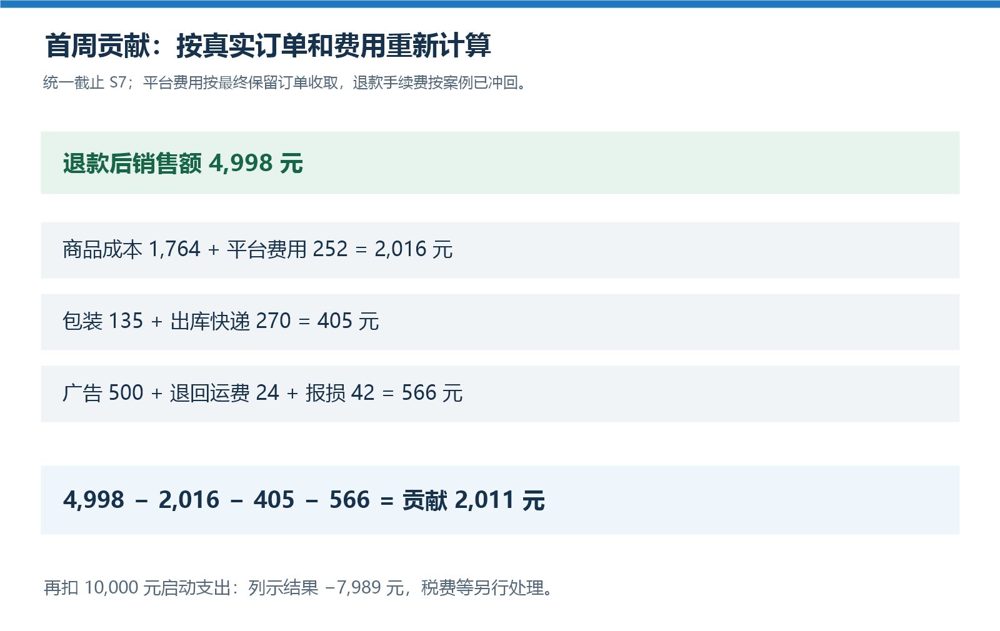

*图 1-17　贡献使用实际发生的数量。已经退货订单发生的包装与运费保留，恢复销售商品回到库存。*

原来的 42 元单笔贡献，是每笔未退款订单分摊 20 元广告费的教学假设。本周有自然渠道订单，实际广告累计 500 元；又发生额外退货与报损，所以应按实际业务重新计算。

若把 10,000 元启动支出也扣除：

**2,011 − 10,000 = −7,989 元。**

公司在本章列示口径下仍有 7,989 元亏损。60,000 元目前为资金预留，未发生的费用本周暂不扣入。后续支出发生后，再更新相应期间。

### 7.3　银行收到 4,000 元，另 746 元在哪

先核对平台应该结给山禾多少。

**支付 5,950 − 退款 952 − 平台费 252 = 4,746 元。**

案例约定平台本周已向银行转入 4,000 元，剩下 746 元在平台待结算。

**4,746 = 已到银行 4,000 + 平台待结算 746。**

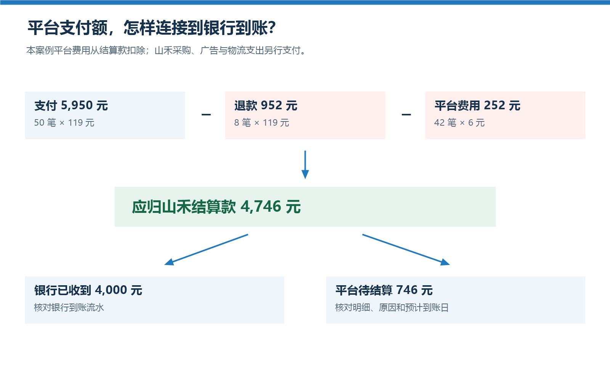

*图 1-18　图中的平台余额是本案例待结算款，后续需按约核对到账。采购、广告等由山禾另行支付。*

“待结算”需要记录预计日期、明细单号和当前原因。逾期时进一步查结算条件、冻结、退款处理中或对账差异等事项。

### 7.4　银行现金从 20 万变成多少

本案例采购、启动费用、广告、包装及物流均已实际支付。平台费直接从结算中扣除，不能再从银行支出扣一遍。

| 银行收支 | 金额 | 累计余额 |
|---|---:|---:|
| 期初资金 | +200,000 元 | 200,000 元 |
| 采购预付款及尾款合计 | −8,400 元 | 191,600 元 |
| 启动支出 | −10,000 元 | 181,600 元 |
| 广告 | −500 元 | 181,100 元 |
| 包装 | −135 元 | 180,965 元 |
| 出库快递 | −270 元 | 180,695 元 |
| 退回运费 | −24 元 | 180,671 元 |
| 平台到账 | +4,000 元 | **184,671 元** |

扣除 60,000 元资金预留后，按现有安排剩 124,671 元可再评估用途。后续新采购、广告和其他承诺仍需一起排期。

### 7.5　采购的 8,400 元，为什么本周成本没扣满

200 个 × 42 元，已经付给工厂 8,400 元。最终顾客保留 42 个，报损 1 个，余下 157 个还可销售。

| 商品去向 | 数量 | 成本金额 |
|---|---:|---:|
| 顾客最终保留，计销售成本 | 42 个 | 1,764 元 |
| 报损 | 1 个 | 42 元 |
| 可售存货 | 157 个 | 6,594 元 |
| 合计 | 200 个 | 8,400 元 |

银行按合同支付整批采购款，贡献表按本期销售及报损确认商品成本。剩余合格库存继续占用资金，未来销售后再转入相应成本。

最后做一个贯穿核对：

**银行 184,671 + 平台待结算 746 + 存货 6,594 = 192,011 元。**

**期初 200,000 − 本案例列示亏损 7,989 = 192,011 元。**

本例没有其他资产、应付或借款，所以可以直接相等。真实企业还要继续加入其他资产、负债及权益变动。

### 7.6　差异怎样一笔笔追

订单记录核对支付与退款，仓库核对出入及退货，平台账单核对收费、冲回和待结算，银行流水核对到账及支出。

用订单号连接销售、退款、运单和平台明细，用采购单及批次连接入库与付款。差异表至少记金额、数量、原因、负责人和预计解决日期。

比如财务多扣了一次 252 元平台费，贡献表可能仍正确，银行预测却会偏低；又如退货入库漏记，银行无差异，库存和成本会出现偏差。不要用一个“其他费用”把所有差额填平。

### 7.7　练习

#### 练习一

平台下周将 746 元待结算款全部打入银行，没有发生新销售及其他收支。银行余额变多少？这一笔到账是否增加新的销售额和贡献？

#### 练习二

如果三件退货全部符合再次销售条件，其他情况相同，本周贡献和可售库存成本各是多少？银行余额改变吗？

#### 练习三

有人说：“银行还剩 184,671 元，比开店前少了 15,329 元，所以亏了 15,329 元。”请用待结算与存货解释差异。

---

### 7.8　参考答案

练习一，银行为 185,417 元，平台待结算减少 746 元。这是已有结算款转入银行，不新增本题销售和贡献。

练习二，报损减少 42 元，贡献为 2,053 元；可售库存 158 个，成本为 6,636 元。退回运费和其他收支不变，银行仍为 184,671 元。

练习三，银行减少 15,329 元，其中 6,594 元体现在可售库存，746 元是待结算。扣掉这两项后，列示亏损为 15,329 − 6,594 − 746 = 7,989 元。

### 7.9　本周对账完成

你交付三张表：贡献表、银行收支表、库存及平台余额表。确认金额能相互解释，差异要继续跟踪。

**本节完成标准**　你能从 50 笔支付算到 2,011 元贡献，并解释 184,671 元银行、746 元待结算和 6,594 元存货怎样关联。

现在，创始人要你给下一周建议：“广告加多少？黑色还能卖多久？要不要再订一批？”

下一节，你来主持山禾第一次经营复盘。

---

## 第八节　第一次经营复盘，你决定下周怎么做

星期一上午，山禾第一次开经营会。运营想增加投放，仓库提醒黑色消耗更快，财务希望先核对 746 元待结算款，工厂问你是否要安排下一批。

创始人把白板笔交给你：“今天要定出下周的事情。”

**本节目标**　把前七节的信息放到同一张经营表上，找出优先事项，计算补货等待，并提交有数量、预算、负责人和时间的行动计划。

> 本节使用前面已核对的首周结果。接下来“常态、增长”和新增预算都是下一阶段的决策情景，执行后再登记为新的经营事项。

### 8.1　先用同一张表说话

| 维度 | 本周事实 | 接下来要问 |
|---|---|---|
| 顾客与商品 | 目标为携包通勤人群，1 件黑色退货确认密封问题 | 原因和批次范围查清了吗？ |
| 流量与成交 | 广告 500 元，25 笔广告支付、最终保留 21 笔 | 后续投放能否继续取得类似效果？ |
| 订单 | 全店支付 50、最终保留 42 | 5 笔取消和 3 笔退货分别因为什么？ |
| 库存 | 可售黑 74、白 83，合计 157 | 广告扩大后各色能支持多久？ |
| 贡献 | 列示贡献 2,011 元，扣启动支出后 −7,989 元 | 哪些成本可改善，投入何时能覆盖？ |
| 资金 | 银行 184,671 元，平台待结算 746 元 | 待结算何时到账，新承诺怎样排期？ |

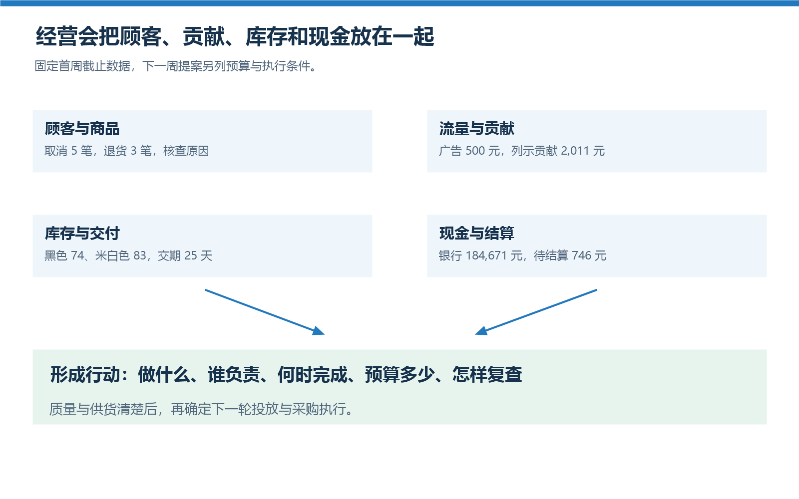

*图 1-19　从已核对的事实出发，形成决定，再交给明确的人执行与复查。*

每个数字都要能追到前面各节。比如把“支付 50”直接当作最终销量，就会高估保留订单、忽略售后成本，并影响补货判断。

### 8.2　别把首周销量直接当成未来保证

先区分本周成交数量与库存净减少数量。黑色由 100 个可售降到 74 个，净减少 26 个，其中 25 个被顾客保留、1 个报损；米白色净减少 17 个。两色合计减少 43 个。

| 颜色 | 期初可售 | 期末可售 | 本周库存净减少 |
|---|---:|---:|---:|
| 黑色 | 100 | 74 | 26 |
| 米白色 | 100 | 83 | 17 |
| 合计 | 200 | 157 | 43 |

若暂用本周平均库存净减少速度估算：

**黑色覆盖天数 = 74 ÷（26 ÷ 7）≈ 19.9 天。**

**米白色覆盖天数 = 83 ÷（17 ÷ 7）≈ 34.2 天。**

总库存平均可支持 **157 ÷（43 ÷ 7）≈ 25.6 天**，黑色却不足 25 天补货交期。

这是包含本周报损的一次粗算。正式预测应把需求、可再售退货、一次性损耗与未来质量风险分别估计，再观察每日波动和退货滞后。首周样本短，先用覆盖天数识别问题。

### 8.3　用两个情景检查下一批

为了暂时简化，我们设两个未来净消耗情景，即每天可售库存净减少多少。

| 未来情景 | 黑色每天净消耗 | 米白色每天净消耗 |
|---|---:|---:|
| 常态假设 | 4 个 | 3 个 |
| 增长假设 | 6 个 | 4 个 |

假设今天 S7 结束后下单，25 天后才到货，期间无其他到货或调拨。暂不加安全库存，先算时间缺口。

| 情景 | 黑色库存覆盖 | 米白色库存覆盖 | 25 天需求与现存的关系 |
|---|---:|---:|---|
| 常态 | 74 ÷ 4 = 18.5 天 | 83 ÷ 3 ≈ 27.7 天 | 黑需要 100、缺 26；白需要 75、余 8 |
| 增长 | 74 ÷ 6 ≈ 12.3 天 | 83 ÷ 4 = 20.75 天 | 黑需要 150、缺 76；白需要 100、缺 17 |

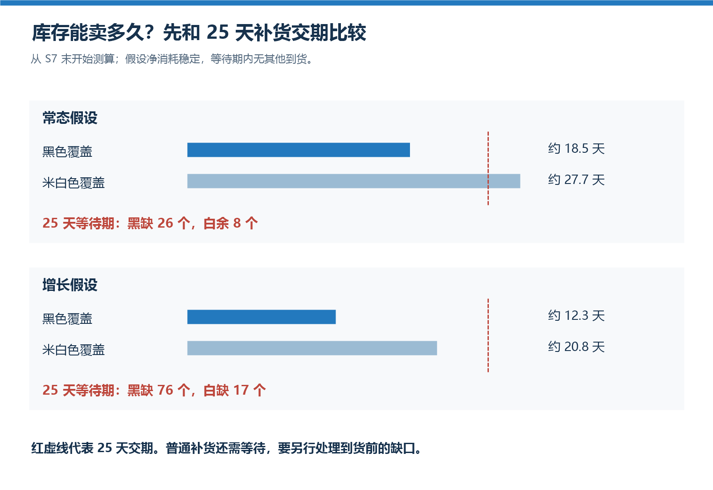

*图 1-20　“缺”表示持续有需求时、到下一批到达前的理论未覆盖需求。缺货后顾客可能等待、换色或离开，需要进一步观察。*

今天下单能补充后面的库存，25 天等待期内的缺口还需要另做安排。可以向工厂核实是否能分批提前交付、是否有合格现货；运营同步评估投放节奏和交付安排。新方案都要确认成本、质量及日期后再执行。

### 8.4　订多少，还要看颜色和资金

工厂每色最低 100 个，总数最低 200 个。一个可讨论的起点是黑、白各 100 个，总采购 8,400 元，预付款 2,520 元、尾款 5,880 元。

但常态情景下，白色目前已经比黑色覆盖更长，仍被每色最低数量要求绑在一起补货。可以继续讨论颜色起订条件、分批交付或下一批生产结构，评估对价格和交期的影响。

数量决策还应明确下一批想覆盖多长时间、再补一批需要多久、需求能否持续。没有这些信息，不能仅凭“还剩 74 个”算出唯一订货量。

资金方面，若今天批准上述 200 个方案并付预付款，假设此刻没有其他新收支：

**银行将为 184,671 − 2,520 = 182,151 元。**

再预留 60,000 元固定支出与新尾款 5,880 元，可再评估安排的资金为 116,271 元。待结算 746 元到账时间应单独列示。这是方案测算，尚未实际付款。

### 8.5　写出一份下周行动计划

下面是一份可供讨论的参考提案。任务负责人是案例岗位，一人也可以兼任多个岗位，但每项要有明确承担者。

| 动作 | 负责人 | 截止与检查 | 预算或约束 |
|---|---|---|---|
| 核查密封报损件与同批记录 | 质量／采购 | 下次投放前给出范围判断及处置 | 发现批次风险及时暂停受影响库存 |
| 整理取消、退货原因 | 客服／运营 | 下个工作日提交分类和原始记录 | 先分事实、检验结果和原因判断 |
| 核对平台待结算 | 财务 | 下个工作日核清 746 元明细及日期 | 逾期及时追踪 |
| 获取加急、分批及颜色起订方案 | 采购 | 两个工作日内拿到书面条件 | 比较成本、质量与最早到货日 |
| 复核可售与锁定 | 仓库 | 每天固定时点更新 | 黑白分开，不包含报损 |
| 提出下一轮广告测试 | 运营 | 供货与质量核查后决定启动 | 提议总预算最多 300 元，分阶段使用 |

300 元是下一轮提议上限。若按支付口径每单广告 20 元，可能取得约 15 笔广告支付订单；结果会受人群、素材、价格和库存影响，15 笔只是测算。

测试前写明观察项和调整条件，例如每单广告费是否超出暂定 32 元、退款后贡献是否满足目标、是否出现质量或库存异常。达到何种样本再判断也应先约定，避免一两笔订单造成随意加减预算。

### 8.6　章节综合作业

你需要向创始人提交一页经营建议，附三张计算表。使用本章实际数据，预测与建议另列。

#### 一页建议

用自己的话回答：

1. 首周最重要的经营事实是什么？请同时涉及顾客、贡献和交付。
2. 下周最先解决的两件事是什么，为什么？
3. 现在是否扩大投放，批准多少、什么条件下启动与调整？
4. 是否提出下一批采购？写清数量、颜色、付款和到货假设，以及等待期怎样处理。
5. 谁负责，每天看什么，下次何时复查？

#### 三张计算表

- **订单与库存表。** 从 200 个入库算到 42 个由顾客保留、157 个可售、1 个报损；颜色分别列出。
- **贡献与资金表。** 从支付 5,950 元算到贡献 2,011 元，再解释银行、待结算和存货。
- **未来 25 天计划表。** 比较常态与增长需求，列每日库存、可能缺口、追加采购和资金节点。

可以用纸、表格软件或 Markdown 完成。先保证每一项都能追溯，再考虑版式。

### 8.7　复查标准与参考方向

| 复查维度 | 能达到的表现 |
|---|---|
| 事实与口径 | 支付、保留、库存和到账数分清，截止时点一致 |
| 算术与关联 | 贡献、现金、存货与待结算可以互相解释 |
| 顾客与商品 | 从具体投诉和体验出发，安排证据与改进 |
| 决策与代价 | 说明加投、补货或暂缓各自承担什么 |
| 执行与复查 | 数量、金额、时间、负责人和触发条件明确 |

参考方向是先核查质量范围和订单损失原因，核对结算与可售库存，同时取得可执行的补货交期。质量和供货能力清楚后，再按预算控制的方式继续测试投放。

如果你选择立即安排普通补货，也要承认它无法填满当前等待期；如果你选择暂缓，说明库存还能支持多久、何时再决策，以及可能失去多少订单。方案之间可以不同，但数字与行动要一致。

#### 一页建议的参考写法

> 首周最终保留 42 笔订单，列示贡献 2,011 元；扣除启动支出后为 −7,989 元。当前可售黑色 74、米白色 83。按常态需求黑色每日 4 个测算，黑色约支持 18.5 天，短于 25 天补货交期。
>
> 由质量与采购在下个工作日完成密封问题范围核查，由财务同时核清 746 元待结算。采购在两个工作日内提交加急、分批和颜色起订方案，并测算黑白各 100 个的普通补货备选。负责人在取得条件后决定数量和交期，写明普通补货到达前的供货空档处理方式。
>
> 下一轮广告提议预算上限 300 元，以质量范围和可兑现供货安排确认作为启动条件。运营每日核对支付与保留订单、实际费用及颜色库存；若超过暂定成本目标或出现异常，及时提交调整。各项新增收支另行登记。两天后复查质量、结算和供货方案，一周后再做完整经营复盘。

这份参考提案将采购数量保留到取得供应条件后决定，同时确定了最迟复查时间。若你现在就决定追加采购，也要把依据和付款节点补完整。

### 8.8　第一章完成后的能力边界

**本章完成标准**　能独立核对首周经营表，计算两色补货等待期的缺口，并提交附有预算、责任人和复查时间的下一周行动计划。

你已经经历一笔小生意的采购、商品准备、获客、库存、上架、订单、售后、现金与经营复盘，并能把它们放到同一份计划中。

接下来，山禾会从一款杯子扩展商品组合。你将面对新品选择、价格带、老品淘汰、不同渠道需求，以及更复杂的预测和供应商协同。把本章的经营记录带过去，后面的决定继续接受这些数据约束。

---

## 附录　首周案例数据汇总

这份汇总用于完成全章后复查订单、库存、费用与资金关系。

每笔订单买一个杯子，实付 119 元。商品单价 42 元，包装 3 元，出库快递 6 元。实际每单费用按本案例规则处理。库存只设一个国内仓。

| 订单与渠道 | 黑色 | 米白色 | 合计 |
|---|---:|---:|---:|
| 已支付订单 | 30 | 20 | 50 |
| 发货前取消并全退 | 3 | 2 | 5 |
| 实际发货并签收 | 27 | 18 | 45 |
| 签收后全额退货 | 2 | 1 | 3 |
| 最终保留商品的订单 | 25 | 17 | 42 |

| 渠道与投放 | 广告归因 | 自然渠道 | 合计 |
|---|---:|---:|---:|
| 支付订单 | 25 | 25 | 50 |
| 发货前取消 | 3 | 2 | 5 |
| 签收后退货 | 1 | 2 | 3 |
| 最终保留订单 | 21 | 21 | 42 |
| 广告现金支出 | 500 元 | 0 元 | 500 元 |

“广告归因”表示本案例后台将订单归入该广告计划。广告报告为 10,000 次展示、500 次点击，展示、点击与去重的区别在第五节说明。自然渠道不分摊本次广告支出，相关页面制作费用包含在启动支出中。

### 售后与库存

三件退货均由山禾承担每件 8 元退回运费，共 24 元。检验后，黑色一件、米白色一件可重新销售；另一件黑色因密封问题报损，成本损失 42 元。供应商责任与追偿另行核实，本周未取得赔偿。

期末可售库存为黑色 74、米白色 83，共 157 个。另有一件报损实物，已隔离，账面存货价值按零处理。期末无在途采购、未发订单和未处理退货。

### 收费、资金与收益

本案例约定，平台按最终保留订单每单收 6 元。取消订单不收费，退货订单原收费用已在本周全部冲回。实际平台收费和退款规则需要在真实业务中分别核实。

| 项目 | 首周累计 |
|---|---:|
| 支付金额 | 5,950 元 |
| 取消及退货退款 | 952 元 |
| 退款后销售额 | 4,998 元 |
| 最终平台费用 | 252 元 |
| 应归山禾的结算款 | 4,746 元 |
| 已到银行账户 | 4,000 元 |
| 平台待结算余额 | 746 元 |
| 期末银行余额 | 184,671 元 |
| 期末可售库存成本 | 6,594 元 |
| 本周列示口径贡献 | 2,011 元 |

本周贡献已扣商品成本、包装、出库快递、广告、平台费、退回运费和报损。另将 10,000 元启动支出在本案例中全部作为期间支出，扣除后为 −7,989 元。税费及尚未发生的固定支出暂未计入。60,000 元只是资金预留，本周没有实际支付。

**核对恒等式**　184,671 元银行余额 + 746 元平台待结算 + 6,594 元存货成本 = 192,011 元 = 200,000 元期初资金 − 7,989 元列示亏损。

复查作业时若算不一致，先检查截止时点、订单范围、费用规则和库存状态，再找算术错误。

[返回课程总览](../00-课程总览与十二章介绍.md)　｜　[下一章：从一款杯子到商品组合](../第二章-从一款杯子到商品组合/第二章-从一款杯子到商品组合.md)
