# 第七章　从流量投放到用户持续购买

山禾完成了仓配整改，创始人提出新要求：“别只靠一次广告带来一批订单，要让新客买得明白，老客有合适的理由再来。”

第六章留下黑色 42、米白 28、小杯 27，共 97 件可售。这次没有新采购。运营必须在现货、服务和预算范围内，协调搜索、内容、广告、促销与会员经营。

增长不是把后台订单数做大就结束。你要说明顾客从哪里来、为什么买、优惠留下多少钱、哪些购买属于新增，以及购买后的体验能否支持下一次选择。

**本章完成目标**　能搭建增长漏斗，连接搜索与内容、页面和广告，设计有库存约束的促销与实验，分清新老客、归因、增量和复购，并把增长结果核对到利润、库存与现金。

## 阅读顺序

| 节次 | 要解决的问题 | 交付物 |
|---|---|---|
| [第一节　想增长，先确定增长什么](#section-01) | 目标、流量、归属、库存和预算 | 增长地图与边界 |
| [第二节　顾客从搜索或内容进来，怎样走向购买？](#section-02) | 搜索意图、内容、页面与转化测试 | 内容与页面改进方案 |
| [第三节　广告回报五倍，就一定值得加投吗？](#section-03) | 广告漏斗、归因、ROAS 与获客口径 | 广告评估表 |
| [第四节　老客减十元，应该怎样算这笔促销？](#section-04) | 优惠、价格、组合与活动库存 | 活动规则及投入核算 |
| [第五节　多卖了几单，怎样证明来自你的动作？](#section-05) | 随机对照、增量、样本和预算 | 增长实验与停止规则 |
| [第六节　十七笔老客订单，等于十七位复购顾客吗？](#section-06) | 生命周期、会员、同期群与客户价值 | 用户经营与复购分析 |
| [第七节　流量来了，客服和库存能接住吗？](#section-07) | 咨询、体验、售后与供需反馈 | 服务与增长联动方案 |
| [第八节　把增长、存货和资金核对回来](#section-08) | 订单、批次、费用与经营评审 | 增长复盘和综合作业 |

正文提供各节所需数据。完成后可以使用[章末参数与结果核对](#chapter-check)复查。

## 案例约定与起点

承接第六章：银行 **208,899.88 元**、平台待结算 **667 元**；可售黑色 42、米白 28、小杯 27，合计 **97 件**、成本 **3,938 元**。黑色分成旧批 2 × 42、新批 40 × 44；米白单位成本 42，小杯 34。另有两件旧零账面隔离实物，在场共 99 件。

本轮记为 **T1—T28**。触达、支付发生在 T1—T21，T28 统一核对签收、退款与结算。本案例截止时所有订单和退货均处理完，没有未发锁定、顾客在途或待检退回。本章没有采购、补供、补发和其他资本投入。

所有订单仍在交易渠道 A 成交，每单一杯。支付前七日最后一个可识别入口用于本章的互斥来源归属，一单只归一次；这是教学统计约定，不代表真实平台的统一归因规则。入口分别记为广告、自然搜索、内容、会员推荐或活动标记入口，不能把入口当成四家不同交易平台。

普通成交价原款 119、小杯 99。符合条件的历史购买顾客，在 T1—T21 每单可减 10，每人本轮最多使用两次，不与其他商家优惠叠加。实际 20 笔支付使用优惠，退款后 17 笔保留，优惠已体现在实付价中。

平台按最终保留订单每笔收 6；包装和出库快递按实际出库每笔收 3、6；顾客退回运费每件 8，由山禾承担。广告实际 600、内容制作 400、会员触达及客服服务 200、仓储操作服务 700，均已支付；费用范围不重复计人工、另列包材与运输。

| 时间 | 本轮实际业务 |
|---|---|
| T1 | 收回上章待结算 667，核对现货、活动名额和预算 |
| T1—T21 | 搜索与内容经营、广告页面分组、老客优惠和用户触达 |
| T1—T23 | 80 笔支付，取消 4，实际出库 76；先发黑色旧批两件 |
| 截至 T28 | 签收后退货 6，恢复可售 5、米白报损 1，最终保留 70 笔 |
| T28 | 核对新老客、归因、经营结果、期末库存和资金 |

黑色两件退货均来自 44 元新批，检查后恢复可售；两件旧批都被顾客保留。退回恢复的五件本轮没有再卖。原隔离两件仍在场，本轮未处置、未收到赔款。

公司、价格、活动、投放及实验数据均为教学设定。具体平台的竞价、归因、费用、经营规则和适用要求需要实际核实。本章继续使用列示范围，60,000 预留仍在银行，未将未列工资、税费等当作已经计全。

---

## 第一节　想增长，先确定增长什么

运营希望增加支付单，财务关心保留订单和贡献，采购提醒米白只剩 28 件。顾客则在乎商品适不适合、能否按时收到。

把这些要求放在一起，才有可执行的增长任务。

**本节目标**　明确增长对象与限制，建立从触达到持续购买的业务地图。

### 1.1　增长目标需要主指标和约束

本轮围绕“在现货和服务能力内取得有贡献的保留订单”组织工作，同时观察新顾客、体验和老客后续购买。支付额、点击率和订单数都要保留，但不单独决定是否扩大投入。

| 层次 | 关注问题 | 本轮怎样使用 |
|---|---|---|
| 经营结果 | 扣退款、商品与费用后留下多少 | 看保留销售、交易贡献及列示结果 |
| 获得顾客 | 谁首次完成有效购买 | 定义品牌新客与保留新客 |
| 过程转化 | 哪一环节流失或改善 | 看流量、页面、咨询和支付 |
| 体验与后续 | 是否按约交付，是否适合再买 | 看服务、退货、复购及反馈 |
| 约束 | 能否供货、履约和承担费用 | 看 SKU 现货、预算与资源 |

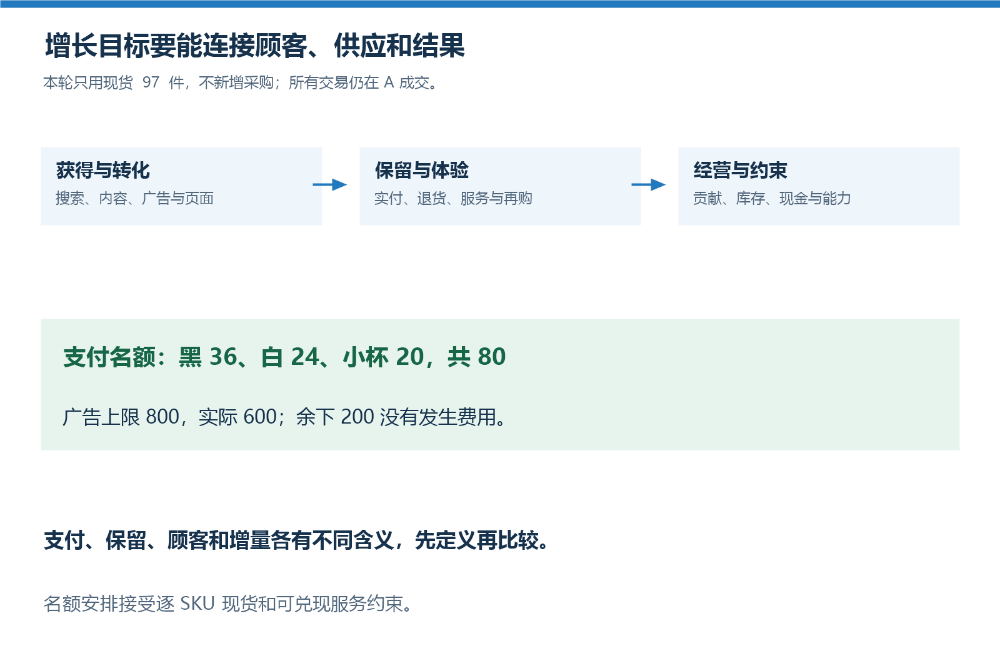

*图 7-1　增长同时接受商品、服务、库存和资金约束。*

### 1.2　先安排库存和费用边界

在不预先依赖退货恢复的情况下，本轮支付名额上限定为黑 36、白 24、小杯 20，共 80。与现货 42、28、27 比较，即使名额都同时锁定，仍各留 6、4、7 件合格现货。

这只是本轮工作缓冲，不代表已证明能覆盖下一轮补货交期。取消后的名额是否重开要再评估，本轮没有额外追加名额；实际支付恰好达到这组上限，并不意味着所有活动都应强行卖满。

广告预算上限 800，分批审批并按实际消耗登记，最终使用 600。剩余 200 不是费用，也没有必须花完的要求。内容制作 400、会员及客服 200 为另列的实际支出，不能混入广告消耗后再重复扣。

### 1.3　触达、入口与订单各有不同单位

展示次数可以重复，点击不必等于独立访客，一位顾客可能多次进入并买多单。先定义次数、访客、顾客、订单和商品件数，再计算比率。

| 本章互斥订单来源 | 支付订单 | 发货前取消 | 签收后退货 | 保留订单 | 其中保留新客订单 | 其中保留老客订单 |
|---|---:|---:|---:|---:|---:|---:|
| 广告 | 30 | 1 | 3 | 26 | 21 | 5 |
| 自然搜索 | 20 | 1 | 1 | 18 | 16 | 2 |
| 内容 | 15 | 1 | 1 | 13 | 11 | 2 |
| 会员推荐或活动入口 | 15 | 1 | 1 | 13 | 5 | 8 |
| 合计 | **80** | **4** | **6** | **70** | **53** | **17** |

会员推荐入口可带来从未买过的新顾客，老顾客也可能最后通过广告购买。顾客身份与入口是两个维度。没有识别到来源的实际订单应单列未知，不能为了表格好看硬塞进某类；本教学案例的 80 笔来源均可核对。

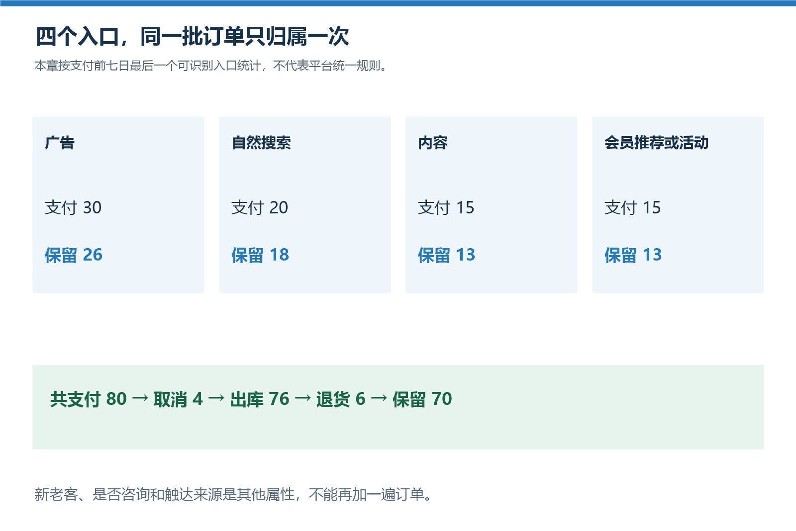

*图 7-2　同一顾客可以接触多个入口，成交记录仍只计一次。*

### 1.4　练习与参考答案

**练习。** 把四类支付相加得到 80，再把 20 笔老客支付加进去，是否得到 100 笔？广告预算上限 800、实花 600，费用按哪个数？

**参考答案。** 老客支付已包含在四类来源中，不能重复相加。广告费用按实际 600；200 未花额度只是预算剩余。两者都要记录，分别用于控制与核算。

**本节交付物**　增长指标、来源口径、SKU 名额与费用边界。

---

## 第二节　顾客从搜索或内容进来，怎样走向购买？

同样卖保温杯，有人主动搜索通勤携带，有人看见装包演示才意识到自己需要。进店后，两类人都要核实容量、尺寸、密封方式和交付信息。

**本节目标**　连接顾客意图、搜索、内容和页面，学会用有边界的分组数据评价转化。

### 2.1　搜索经营先回答顾客在找什么

把用途、规格、体验和价格等需求整理成问题，再核对真实商品是否能满足。商品标题、类目属性、选项和页面用一致的信息说明相关性，避免为了点击承诺产品不具备的性能。

例如“500mL 通勤携带”需要容量、尺寸、重量和使用限制；“小容量雾蓝杯”需要把 350mL 与原款区分。主动搜索是明确意图的重要线索，但一个关键词的成交仍受价格、竞争、评价、库存和体验影响，不能只盯关键词位置。

### 2.2　内容把场景和购买证据连起来

| 内容任务 | 可以展示什么 | 怎样判断是否帮助经营 |
|---|---|---|
| 让需求被看见 | 场景、携带、不同容量用途 | 目标受众是否进入相关商品 |
| 解释商品 | 尺寸、部件、操作、清洁及限制 | 是否减少关键疑问与误解 |
| 建立可信证据 | 真实样品、可复查演示和资料 | 描述与实际体验是否一致 |
| 引导下一步 | 对应 SKU、价格、交付与咨询路径 | 看进入、支付、保留和服务结果 |

推荐式内容先争取注意，再逐步解释价值；搜索流量往往先带着问题。它们并非互不相干，内容也可能帮助顾客之后搜索。具体分发机制与工具按平台实际核实，不能假定多发内容就必然获得推荐。

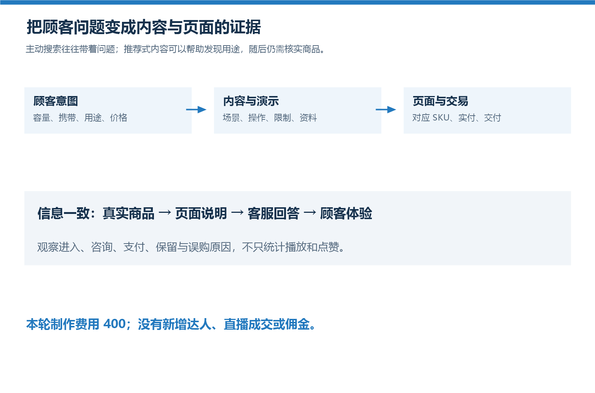

*图 7-3　场景吸引、商品证据与交易信息要能互相验证。*

本轮内容制作花 400，包括实际素材与页面说明制作，没有另聘达人或发生直播佣金。达人、直播方案在第三章已有交易结构，这里继续按“受众—讲解—商品—价格—库存—售后”检查；本轮没有新增直播成交。

### 2.3　页面优化围绕购买障碍

先检查访客看到的商品、价格与可发规格，再看图文、尺寸比较、使用说明、评价线索和咨询入口是否解决顾虑。支付流失也可能来自库存、费用、地址或系统问题，不能把所有流失都归因于文案。

本轮广告带来的 1,000 名去重到店访客，首次进入时随机分为旧说明页和新说明页，每组 500。两页商品、价格、优惠资格及交付条件相同，新页主要加强容量对照和使用限制。

为简化本例，这 1,000 名访客各发生一次广告点击，组内每位最多形成一笔本次广告归因订单，无跨组。因此本例点击和去重访客恰好同数，不代表现实中二者可以通用。

### 2.4　读懂一次页面分组结果

| 页面分组 | 去重访客 | 支付 | 取消 | 退货 | 保留 | 支付转化率 | 保留订单／访客 |
|---|---:|---:|---:|---:|---:|---:|---:|
| 旧说明页 | 500 | 12 | 0 | 2 | 10 | 2.40% | 2.00% |
| 新说明页 | 500 | 18 | 1 | 1 | 16 | 3.60% | 3.20% |
| 合计 | **1,000** | **30** | **1** | **3** | **26** | **3.00%** | **2.60%** |

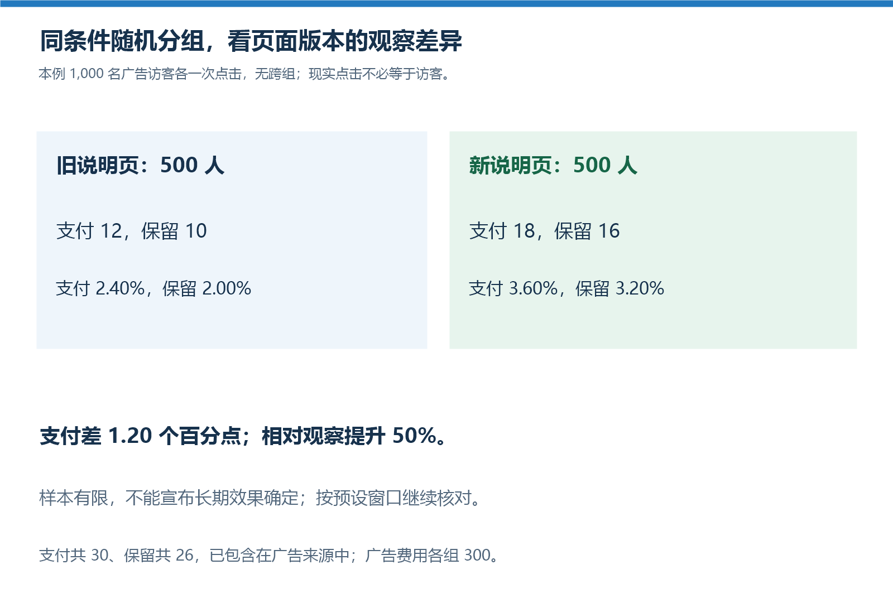

*图 7-4　这组订单属于广告来源的 30 笔，不额外加入全店。*

支付转化增加 **1.20 个百分点**；相对提升为 3.60% ÷ 2.40% − 1 = **50%**。50% 不是提高了 50 个百分点。

两个组各分配广告消耗 300，费用合计仍为 600。当前看到方向差异，但样本中的支付只有 12 与 18，不能直接宣布长期效果已确定。要检查分组、记录、退款、客单与贡献，按事先约定的样本和观察规则继续判断。

### 2.5　练习与参考答案

**练习。** 新页相对支付提升 50%，能否认定下月销售一定增加 50%？若新页提高支付却增加误购退货，应看什么？

**参考答案。** 不能。当前样本、受众、库存与时期都有边界，观察差异还有不确定性。继续看保留订单、净销售、贡献、咨询和退货原因，核对是否夸大商品信息或改变了受众结构。

**本节交付物**　顾客问题清单、内容及页面证据、分组测试记录。

---

## 第三节　广告回报五倍，就一定值得加投吗？

广告后台显示消耗 600，归因支付实付 3,390。运营说“回报 5.65 倍”，财务问退款、商品和履约成本算了没有。

**本节目标**　计算广告漏斗与回报，区分归因销售、费用、利润和新顾客。

### 3.1　把分子分母写完整

| 广告实际报告 | 本章结果 |
|---|---:|
| 展示次数 | 20,000 |
| 点击次数 | 1,000 |
| 广告归因支付订单 | 30 |
| 取消／退货／保留 | 1／3／26 |
| 实际广告费 | 600 元 |
| 支付实付金额，已含优惠 | 3,390 元 |
| 退款后归因销售额 | 2,944 元 |

点击率 = 1,000／20,000 = **5%**；平均点击费用 CPC = 600／1,000 = **0.60 元**；千次展示费用 CPM = 600／20,000 × 1,000 = **30 元**。

点击到支付订单比率为 30／1,000 = **3%**，广告费按支付订单分摊为 **20 元／单**，按保留订单分摊为 600／26 ≈ **23.08 元／单**。本例访客与点击已明确对应，不能把这个简化推广到其他报告。

实际管理广告时，将“给谁看、展示什么、怎样付费、何时停止、怎样记结果”分别设置和核对。关键词或受众对应需求，素材与落地页对应商品证据；出价、预算、时段和投放范围影响执行，转化事件、去重及退款回传影响报告。修改时留下版本，避免同时改变所有条件后无法解释结果；预算上限也不代表平台一定会花完或取得同样效率。

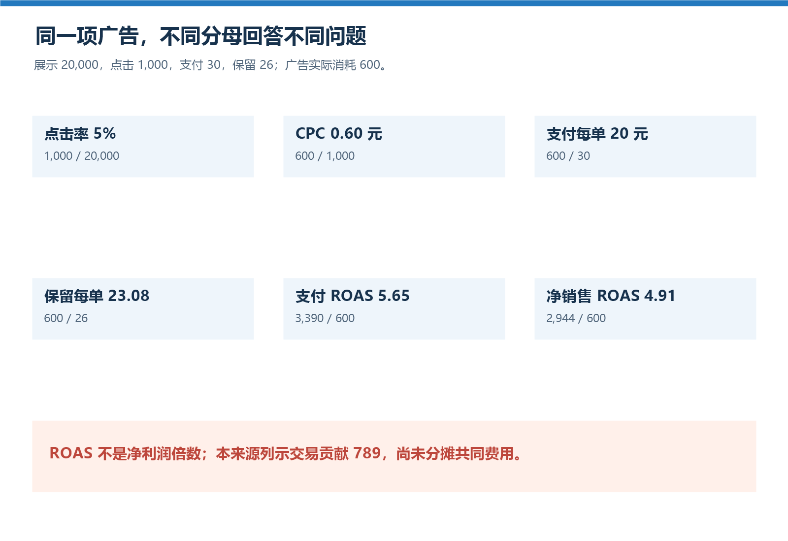

*图 7-5　ROAS 的分子要说明支付还是退款后销售，分母是广告消耗。*

### 3.2　ROAS 与利润分别计算

ROAS 常用来表示广告归因销售额与广告费之比。本例支付口径 3,390／600 = **5.65**；退款后口径 2,944／600 ≈ **4.91**。它们都不是净利润倍数。

本广告归因支付为黑 14、白 10、小杯 6；取消一件黑色，退回黑、白、小杯各一件，保留黑 12、白 9、小杯 5。支付有六笔老客用券，保留五笔，所以净销售为 21 × 119 + 5 × 99 − 5 × 10 = 2,944。

两件 42 元旧批黑色都在这些保留订单中，其余保留黑色十件为 44。广告来源销售成本 = 2 × 42 + 10 × 44 + 9 × 42 + 5 × 34 = **1,072 元**。该来源有 29 笔出库、三笔退回，其中米白一件报损 42。

| 广告归因订单的列示核算 | 元 |
|---|---:|
| 退款后销售 | 2,944 |
| 销售商品成本 | −1,072 |
| 平台费，26 × 6 | −156 |
| 包装，29 × 3 | −87 |
| 出库快递，29 × 6 | −174 |
| 退回运费，3 × 8 | −24 |
| 米白报损 | −42 |
| 广告费 | −600 |
| 该来源列示交易贡献 | **789** |

789 尚未分摊内容、会员客服与仓储等本章共同费用，也没有证明这些订单全部由广告额外创造。全店核算时，这组商品和费用已经包含在总数中，不能再扣一次。

### 3.3　获客费用先定义顾客

30 笔广告支付里，新顾客 24、老客六；退款后保留新顾客 21、老客五。本例新客均只付一单，所以新顾客数与新客订单数恰好一致。

若把整项广告费对支付新客分摊，600／24 = **25 元／人**；对保留新客分摊，600／21 ≈ **28.57 元／人**。后者明确了有效购买范围，但广告费也支持了老客订单，不能把它包装成只投新客的精准成本。

获客成本 CAC 要说明费用范围、顾客去重、身份与时间窗口。要判断纯拉新与再营销效率，应按计划用途及实际费用进一步分开；按订单计算的每单费用不能直接改名为每位新顾客费用。

### 3.4　归因和加投决策之间还有证据缺口

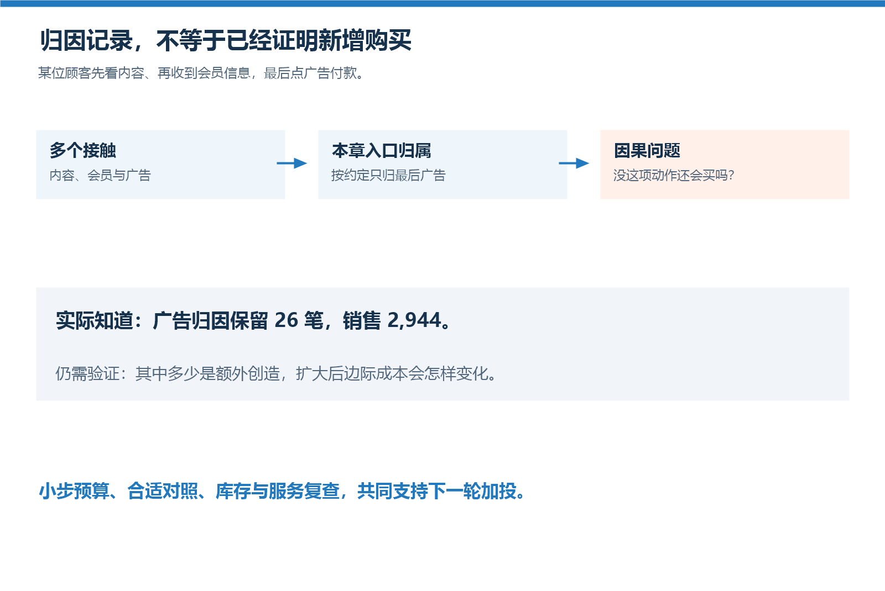

*图 7-6　最后入口告诉你怎样记账，反事实对照才帮助判断没有这个动作会怎样。*

顾客可能先看内容、收到会员信息，最后点广告付款。按本章规则归广告，前面触达仍可能有作用；另一些顾客没有广告也会买。不能将广告归因的 26 笔保留直接视为 26 笔增量。

加投还需核对新增受众、库存、服务与边际成本。消耗翻倍不保证订单翻倍；点击变贵、受众重复和商品余量都会改变结果。先设小步投入、观察范围和复查条件，再讨论扩大。

### 3.5　练习与参考答案

**练习。** ROAS 4.91 能否理解为赚了广告费的 4.91 倍？全店保留 70，能否算 600／70 就宣称广告每单获客费只有 8.57？

**参考答案。** 4.91 是退款后归因销售额与广告费之比，不是利润。600／70 可作为明确命名的全店广告支出分摊，但全店含其他来源与老客，不能当作广告归因订单费用或新增顾客 CAC。

**本节交付物**　广告指标、订单成本、顾客身份与加投证据清单。

---

## 第四节　老客减十元，应该怎样算这笔促销？

会员方案准备了每单减 10 的优惠。有人把可发出的券面额全部当成费用，又在销售额里扣一次优惠。

活动要从实际规则、实际使用和订单结果逐层核对。

**本节目标**　理解促销对实付、贡献、需求和供应的影响，写清活动规则与退出条件。

### 4.1　活动规则先写给顾客和执行岗位看

本轮向 80 位具备可触达条件的历史购买顾客提供优惠资格。有效期 T1—T21，每笔一杯订单减 10，每人最多用两次，不与其他商家优惠叠加，活动仍受 SKU 名额和现货限制。

这 80 位是符合本次条件的历史客池，不代表山禾此前只有 80 位买家。没有参与购买的人不会因为取得优惠资格就形成一笔销售或现金支出。

规则还要说明适用商品、名额、使用及退款后的处理、价格展示与客服说明。本例退款按实际支付原路全退，不额外支付券面额；不计未使用优惠为已发生费用。

### 4.2　二十笔用券，最后留下十七笔

| 老客优惠订单，笔／件 | 黑色 | 米白 | 小杯 | 合计 |
|---|---:|---:|---:|---:|
| 支付并使用优惠 | 10 | 6 | 4 | 20 |
| 发货前取消 | 1 | 0 | 0 | 1 |
| 签收后退货 | 0 | 1 | 1 | 2 |
| 最终保留 | 9 | 5 | 3 | 17 |

支付时优惠金额 20 × 10 = 200；退款对应的三笔不再形成保留销售，保留订单优惠为 **170 元**。它已经进入本轮净实付价，不能在第八节利润表再多扣 170。

其余 60 笔支付是品牌新客订单，按普通成交价支付，没有本轮老客优惠。本轮没有额外满减、赠品、组合购或预售。

### 4.3　降价需要多少增量才能补回贡献

做一个独立促销演练：新批黑色 44，平台 6、包装 3、快递 6，无退款，暂不计营销及共同费用。按 119 卖，每笔贡献 119 − 44 − 6 − 3 − 6 = **60**；按 109 卖，每笔为 **50**。

原来 20 单的 1,200 元贡献，要用 1,200／50 = **24 单**补回，即订单增加 **20%**。这还没有考虑额外获客、服务、退货及库存代价，也没有证明降价一定能带来这四单。

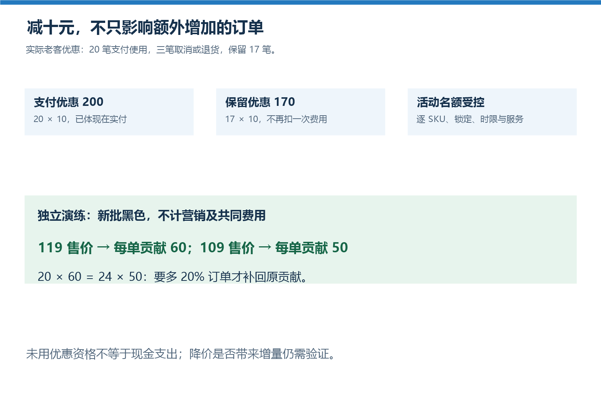

*图 7-7　优惠会影响原本就会购买的订单，活动量还受现货与服务限制。*

### 4.4　不同促销改变不同约束

| 方式 | 需要一起评估 |
|---|---|
| 直降与优惠券 | 受众、实际到手价、原价购买替代、退款及效果 |
| 满额或阶梯优惠 | 是否改变件数、客单与订单结构，如何分摊退款 |
| 组合购 | 子 SKU 的库存、拣配、包材、运费和组合需求 |
| 赠品 | 赠品采购及库存、缺赠补救、退回与成本 |
| 限时或限量活动 | 名额、锁定、排队、客服及可兑现承诺 |
| 达人或直播专场 | 固定费、佣金、成交来源、讲解、库存与售后 |

这些是后续方案检查项，没有加入本轮已发生的订单与费用。活动前用真实商品和流程核验规则，期间按 SKU 消耗与费用复查，结束后同时看保留结果与库存。

### 4.5　练习与参考答案

**练习。** 80 人每人最多两次减 10，是否发生了 1,600 元费用？如果独立演练降到 109 后只卖 22 单，贡献是否超过原 20 单？

**参考答案。** 资格额度不等于实际费用。本轮实际保留优惠 170，已体现在销售实付中。演练的 22 × 50 = 1,100，低于原 20 × 60 = 1,200，不能只看订单增长 10% 就说更赚钱。

**本节交付物**　活动规则、优惠及退款记录、贡献与供应情景。

---

## 第五节　多卖了几单，怎样证明来自你的动作？

运营认为本轮老客购买说明优惠有效。创始人问：“如果不发优惠，他们中有多少人本来也会买？”

本轮实际没有为老客优惠保留随机对照组，所以只能确认发生了什么，还不能直接确定优惠的净增量。第二节页面有随机分组，评价的是页面版本，不等于同时验证了优惠或广告整体。

**本节目标**　理解对照、增量和试验边界，设计可复查的增长验证。

### 5.1　不同问题需要不同对照

| 想回答的问题 | 可以设计的比较 | 不能替代它的数字 |
|---|---|---|
| 新页面是否改善转化 | 同条件访客随机进入不同版本 | 新页面上线后总单量变高 |
| 优惠是否带来额外购买 | 合适的客群随机分为优惠与对照 | 所有用券订单数 |
| 广告是否创造增量 | 在可行条件下设计受众、地区或时段对照 | 广告归因销售额 |
| 内容是否改善经营 | 先定义内容目标与可识别比较 | 播放、点赞或末次入口单量 |

没有随机条件时，可以做前后或相近对象比较，但要核对活动、季节、商品、价格和受众变化，明确证据较弱。不能把同时发生的变化都归功于自己的操作。

### 5.2　做一道独立优惠增量演练

以下是为学习方法另设的 200 位历史顾客，不是本轮实际的 80 人客池，也不增加任何实际订单、优惠或费用。假定随机等分 100 人、条件相近，各人在观察期最多保留一单；优惠组每保留单减 10，对照组不减。退款已处理，其他条件不变。

| 独立演练 | 优惠组 | 对照组 |
|---|---:|---:|
| 顾客数 | 100 | 100 |
| 保留订单及购买顾客 | 18 | 12 |
| 观察到的购买率 | 18% | 12% |
| 每保留单优惠前贡献 | 60 | 60 |
| 每保留单优惠 | 10 | 0 |
| 本组额外触达费用 | 60 | 0 |
| 贡献相抵 | 18 × 50 − 60 = 840 | 12 × 60 = 720 |

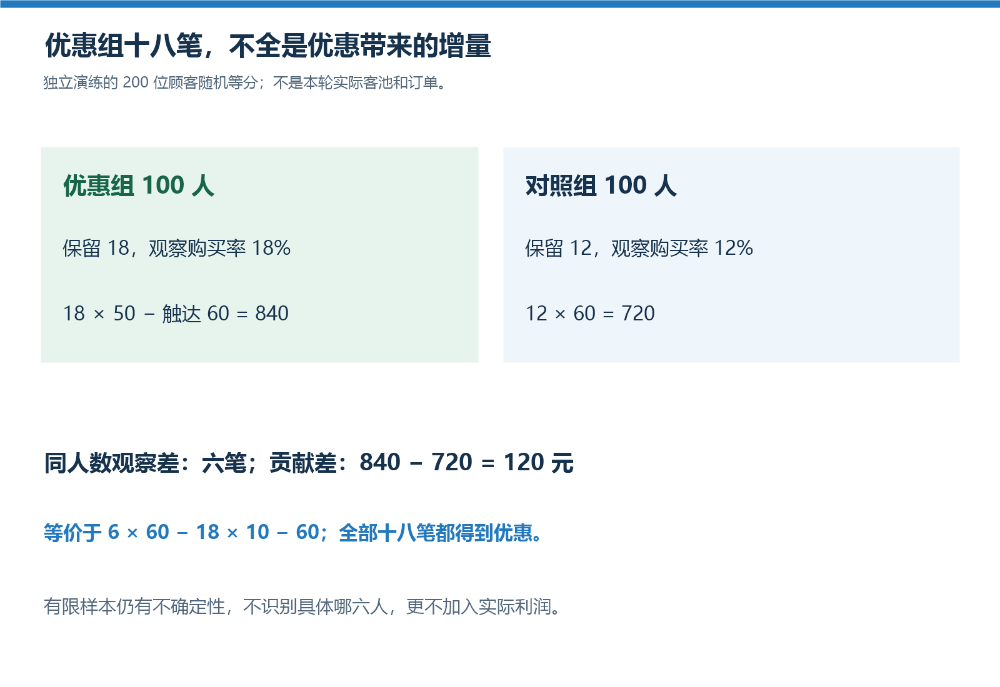

*图 7-8　按同样人数的观察差估计六笔增量，不把十八笔全算成增量。*

观察率差 **6 个百分点**，相对观察提升为 18%／12% − 1 = 50%。按对照估计，100 人中额外六笔；但优惠组 18 笔都用券，不能只算六笔的优惠。

贡献差 = 6 × 60 − 18 × 10 − 60 = **120 元**，也等于 840 − 720。这里优惠已经在净贡献中扣除，没有再加一遍营销费用。

这是有限样本的观察估计，不说明能辨认出具体哪六人“被优惠改变”，也不能保证重复试验仍有六笔。真实实验要预先考虑样本、随机化、观察窗口和不确定性。

### 5.3　让实验在开始前可被复查

写清业务假设、对象、分组单位、唯一变化、主指标、体验与库存约束、费用、样本及观察时长。去重和分组要稳定，顾客不要今天看旧页、明天看新页却被当成两位独立样本。

先安排数据记录，再开始实验。避免把效果最好的几天单独拿出来，或反复查看直到偶然出现好结果就停止。出现严重商品、交付或系统问题，可以按预设异常规则暂停并记录原因，不能把异常组删掉后宣称成功。

对难直接试验的品牌内容和长期用户经营，结合访问、搜索、咨询、保留购买及分期效果观察，明确哪些还属于假设。

### 5.4　预算决定下一步，而不是强迫花完

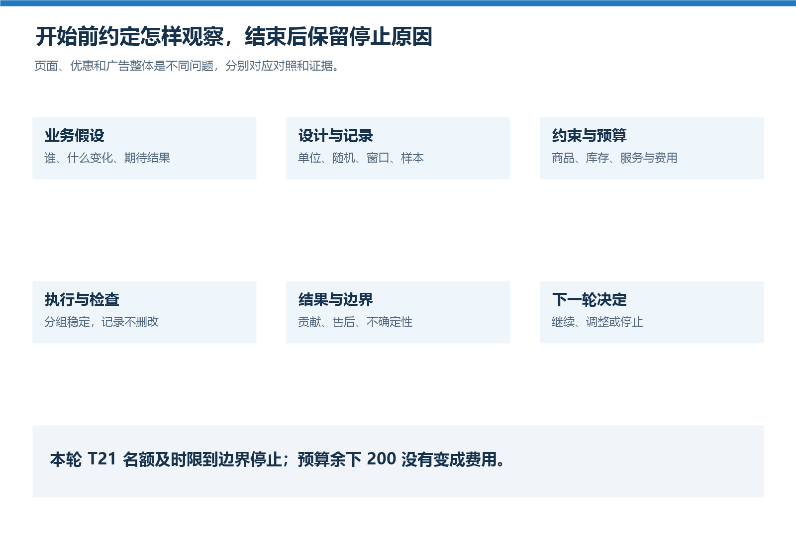

*图 7-9　样本与预算分批安排，停止原因和最终可解释范围分别记录。*

本轮广告上限 800，实际消耗 600。到 T21，活动支付名额和本轮时限均已到边界，停止继续获取本轮活动订单；没有把剩余 200 追加为费用。不能因为“还有预算”就绕过库存名额。

下轮是否采用新页、是否继续老客券、是否加广告是三个决定，各自对应不同证据。新页的观察方向值得继续验证，老客券尚无实际随机对照，广告也缺乏整体增量验证，不能用一个结论代替三个问题。

### 5.5　练习与参考答案

**练习。** 独立演练中，若只将六笔估计增量各减 10，贡献会被高估多少？为什么不能把 120 元写进本章实际利润？

**参考答案。** 漏算其余 12 笔也得到的优惠，共 120，估计贡献会从 120 高估到 240。演练不是实际发生，不能加入真实案例的订单、销售或费用。本轮老客优惠也不能直接套用这个增量结果。

**本节交付物**　实验问题、分组与窗口、指标和停止规则、结论边界。

---

## 第六节　十七笔老客订单，等于十七位复购顾客吗？

报表出现 17 笔保留老客订单。会员人员准备报“17 人复购”，却发现有顾客买过两次。

同一个人的生命周期要按统一身份与时间观察，不能用订单行代替顾客。

**本节目标**　区分新老客、订单、复购顾客和同期群，理解客户价值的观察与预测边界。

### 6.1　先明确品牌身份与统计范围

本章以 T1 前是否有品牌成功购买记录区分新老客。首次进入某个入口，不代表第一次买这个品牌；同一顾客跨入口购买仍需去重。

新客 60 人各支付一单，三人取消、四人退货，留下 **53 位保留新顾客**。老客有 16 人支付 20 单，最终 14 人保留 17 单；其中三位各保留两单，其余十一位各保留一单。

| 顾客与订单口径 | 新客 | 老客 | 合计 |
|---|---:|---:|---:|
| 支付顾客数，去重 | 60 | 16 | 76 |
| 支付订单数 | 60 | 20 | 80 |
| 保留购买顾客数，去重 | 53 | 14 | 67 |
| 保留订单数 | 53 | 17 | 70 |

老客支付 16 人中，四人原各支付两单，其余十二人各一单。取消来自一位单笔顾客；两笔退货分别来自另一位单笔顾客与一位双单顾客，因此最终少两位保留购买者，双单者中的一位仍保留另一单。

### 6.2　复购率需要固定客群与观察窗口

本轮可触达历史客池 80 人，其中 16 人支付再购，14 人最终保留再购。按这个特定客池，支付再购参与率为 **20%**，保留再购顾客比例为 **17.5%**。

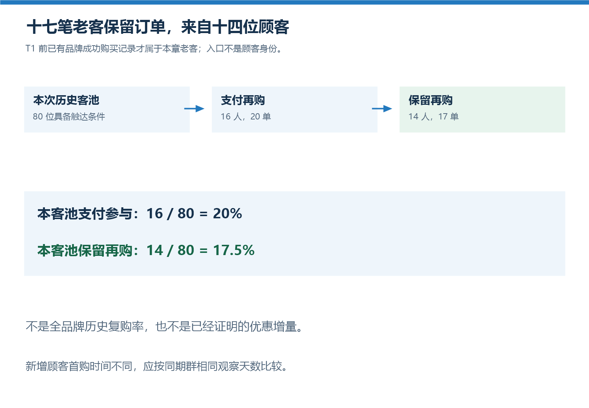

*图 7-10　十七笔保留老客订单来自十四人；分母是本次明确的八十人客池。*

80 不是全品牌历史顾客总数，也不是会员注册人数。因此不能把 17.5% 直接写成品牌全部历史顾客复购率，更不能当作优惠的增量效果。

同期群分析把同一条件下进入的顾客放在一起，例如按首次保留购买月份分组，再观察各自后续相同天数的购买。T1 新客和 T21 新客到 T28 的可观察时间不同，不能拿这 53 人直接做完整的“首购后 28 天复购率”。

### 6.3　会员经营提供具体价值

| 顾客阶段或线索 | 可以提供的服务 | 怎样验证有用 |
|---|---|---|
| 首次了解 | 容量选择、尺寸和用途说明 | 减少关键疑问和误购 |
| 首单完成 | 使用、清洁、交付及问题处理 | 看体验、售后和商品适配 |
| 有明确再购线索 | 家庭使用、礼赠、其他容量选择 | 看适合的需求和保留结果 |
| 较久未购买 | 核实偏好，按合适频率提供信息 | 看有效响应与不希望再触达的反馈 |
| 高价值或服务复杂 | 匹配服务资源与长期体验 | 同时看贡献、服务成本和风险 |

保温杯是耐用品，不能默认每月都应换新。跨容量、家人或礼赠是需要验证的线索，复购频率要符合商品用途。会员权益也可以是帮助选择和使用，不必只发券。

常见的 RFM 分层分别看最近一次有效购买时间 R、固定窗口内购买频次 F、同窗口购买金额 M。先约定有效购买和净销售口径，再判断近期活跃、频繁购买或高金额顾客；同时叠加贡献、退货和服务成本，避免把金额高直接等同于盈利高。新顾客尚未有足够历史，不宜立即用老客标准判定价值低。

依据可用且适当取得的顾客记录开展服务，明确触达目的、频率和退出方式，不把所有联系方式当作可以无限营销的对象。本轮会员及客服合计 200，已包括列示服务，没有另付按单佣金或推荐奖励。

### 6.4　客户价值不是当前客单价乘一个想象次数

本轮新客保留销售 **6,027 元**，老客保留销售 **1,793 元**，合计 7,820。这只是本期销售额，还没有扣各自商品与服务成本，也不是完整客户终身价值。

客户终身价值常用缩写 LTV，使用时需说明按收入还是贡献、包含多长时间以及怎样预测。下面只估计首单与未来十二个月的贡献窗口，不宣称已测得完整的终身价值。

做一个独立预测演练：假设某新顾客首单后，在未来十二个月平均再产生 0.4 笔保留订单；每笔扣除商品和变动服务后的贡献为 45，暂不计资金时间价值和共同费用。

营销前预期客户贡献 = (1 + 0.4) × 45 = **63 元**。若为取得该顾客付出 25，获客后预期贡献为 **38 元**。预测订单次数需要后续同期群证据验证，63 既不是销售额，也不是已实现净利润。

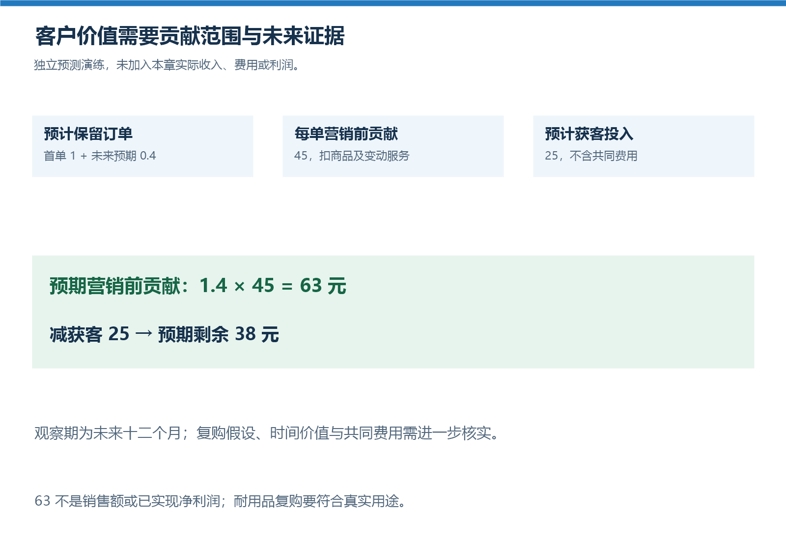

*图 7-11　把观察期、贡献范围、复购假设与获客投入分别写清。*

本轮已列营销支出为广告 600 + 内容 400 + 会员及客服 200 = 1,200；若对 53 位保留新顾客分摊，为 **22.64 元／人**。这笔支出也服务老客与后续经营，应明确叫“列示营销支出对保留新客的分摊”，不能假装是纯拉新活动的精准成本。

### 6.5　练习与参考答案

**练习。** 为什么 17／80 不是本轮保留再购顾客比例？能否用独立预测的 63 元价值判断广告计划中的 28.57 元一定划算？

**参考答案。** 17 是订单，分母 80 是顾客，本题应去重为 14／80 = 17.5%。63 来自另设的未来复购与贡献假设，28.57 是本轮整项广告费对保留新客的分摊，两者范围不同，且未来尚未实现，不能直接得出确定收益。

**本节交付物**　新老客去重、固定客群与窗口、会员服务及客户价值假设。

---

## 第七节　流量来了，客服和库存能接住吗？

本轮有 40 名去重访客各发起一次咨询，其中 18 人各形成一笔支付订单。咨询记录可以帮助商品和内容改进，但不能再为全店加 18 笔销售。

**本节目标**　把咨询、体验、评价、退货和库存反馈放进增长复盘，形成共同约束。

### 7.1　咨询既是服务，也是需求证据

咨询后支付比例 18／40 = **45%**，这些订单已经包含在 80 笔中，来源仍按前述入口规则归属。咨询顾客是主动选择的一群人，这个比例不能证明没有客服就会少 18 单。

记录问题类别，如容量、携带、密封操作、配件、价格和交付。反复出现的问题要反馈页面和内容；商品描述不适配、质量范围不清的情况，要连到商品与供应商，不能只训练客服提高话术转化。

### 7.2　服务指标先定义事件与样本

本章约定工作服务窗口内的首次响应目标，40 次咨询中有 36 次在该目标内响应，比例 **90%**。这里的期限为教学服务安排，没有套用真实平台统一要求。

另有 15 位服务后顾客回答满意度问卷，12 位表示满意，样本满意比例 **80%**。它不是全体顾客满意率，未回答者可能不同；更不是需要另一套题目与分组定义的推荐意愿指标。

评价与反馈应来自真实体验。不要用删掉不利样本、引导虚假好评或省略商品限制来制造转化改善。

### 7.3　退款原因连接前端承诺与后端改进

| 退回处理，件 | 黑色 | 米白 | 小杯 | 合计 |
|---|---:|---:|---:|---:|
| 已退回全额退款 | 2 | 2 | 2 | 6 |
| 检查后恢复可售 | 2 | 1 | 2 | 5 |
| 新增报损隔离 | 0 | 1 | 0 | 1 |

米白一件检查后不能重售，确认成本损失 42；原因与责任继续核实，本轮没有赔偿到账。其余恢复件保留批次记录，黑色两件均为 44 元新批，不能按旧价 42 恢复。

可恢复不等于前端承诺一定正确，不可恢复也不能未经调查就判断承运商或供应商负全责。将顾客描述、页面承诺、批次、使用、包装与运输记录放在一起核查。

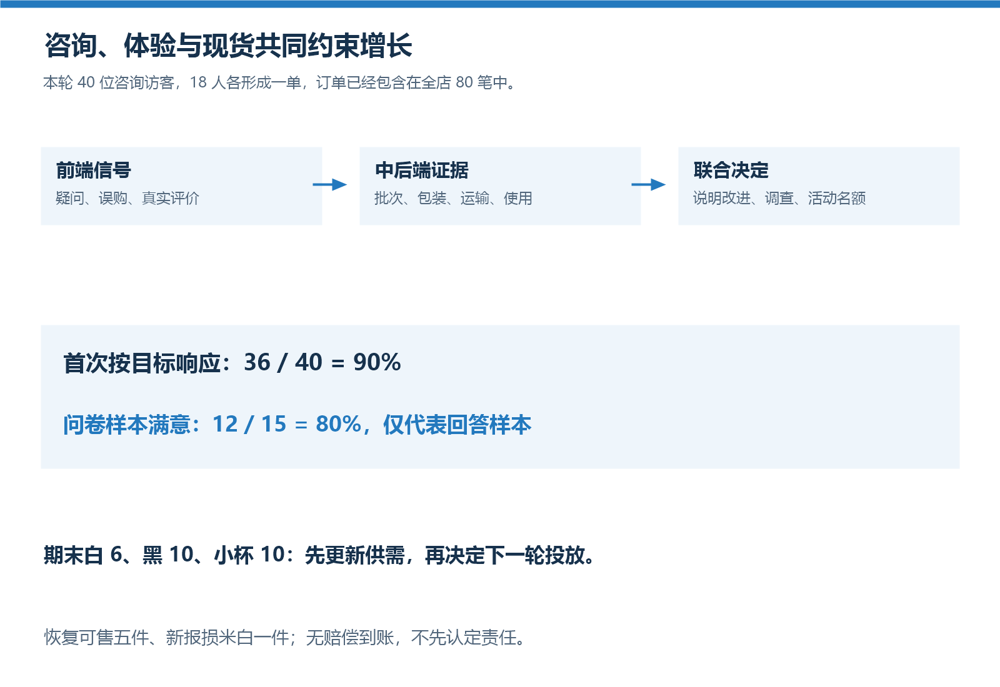

*图 7-12　转化、体验和可兑现库存需要不同岗位共同验证。*

### 7.4　流量计划跟着可用量调整

本轮出库 76 笔，不能只用保留 70 计算包装、快递和仓配负荷。若做组合购，订单数与件数还会分离，需要重新核拣配能力，而不是沿用第六章的一件装效率。

期末白色只剩六件、黑色十件。即使本轮贡献为正，也不适合不检查交期就继续同等强度投放。按第四章方法更新 SKU 需求、现货、补货条件与现金，再确认下一轮名额和承诺。

### 7.5　练习与参考答案

**练习。** 18 笔咨询后支付、20 笔老客支付、30 笔广告支付，能否相加表示新增 68 单？满意问卷 12／15 能否用于宣称全店八成顾客满意？

**参考答案。** 这些是同一批订单的不同属性，可能重合，不能相加当作新增订单。问卷结果仅描述回答者样本，需要说明范围和可能偏差；全店体验还应结合未回答者、售后、投诉和服务记录。

**本节交付物**　咨询与订单对应、服务样本、退货证据和供需调整清单。

---

## 第八节　把增长、存货和资金核对回来

T28，所有活动结束。运营提交四类来源数据，会员交来顾客表，仓库区分新旧批次，财务要求所有表回到同一轮实际。

**本节目标**　用订单、实付、批次、费用和资金解释增长，形成可执行的下一轮决定。

### 8.1　先核对支付、取消和退货

| 订单状态，笔／件 | 黑色 | 米白 | 小杯 | 合计 |
|---|---:|---:|---:|---:|
| 已支付 | 36 | 24 | 20 | 80 |
| 发货前取消 | 2 | 1 | 1 | 4 |
| 实际出库并签收 | 34 | 23 | 19 | 76 |
| 签收后全额退货 | 2 | 2 | 2 | 6 |
| 最终保留 | 32 | 21 | 17 | 70 |

基准成交价对应支付额 60 × 119 + 20 × 99 = 9,120；支付使用优惠 200，所以实际支付 **8,920 元**。

取消退款 = 3 × 119 + 1 × 99 − 1 × 10 = **446 元**。退货退款 = 4 × 119 + 2 × 99 − 2 × 10 = **654 元**。

保留销售额 = 8,920 − 446 − 654 = **7,820 元**。也可从保留商品计算：53 × 119 + 17 × 99 − 17 × 10 = 7,820。这里 53 是原款保留件数，恰好也等于保留新顾客数，但两者含义不同，不能互相替代。

### 8.2　第一次把黑色新成本真正带进销售

黑色先发旧批两件，再发新批 32。退回恢复的是新批两件，所以保留黑色为旧批两件、新批三十件。

| 批次 | 期初可售 | 本章接受 | 出库 | 退回恢复 | 期末可售 | 单价 | 期末价值 |
|---|---:|---:|---:|---:|---:|---:|---:|
| 黑色旧批 | 2 | 0 | 2 | 0 | 0 | 42 | 0 |
| 黑色新批合计 | 40 | 0 | 32 | 2 | 10 | 44 | 440 |
| 米白旧批 | 28 | 0 | 23 | 1 | 6 | 42 | 252 |
| 小杯旧批 | 27 | 0 | 19 | 2 | 10 | 34 | 340 |
| 合计 | **97** | **0** | **76** | **5** | **26** | — | **1,032** |

可售：97 − 76 + 5 = **26 件**；也等于 97 − 顾客保留 70 − 新报损 1。

销售成本 = 2 × 42 + 30 × 44 + 21 × 42 + 17 × 34 = **2,864 元**。新报损 42 单独列支，不能一面按未冲回的发货成本算，一面再重复报损。

存货价值：3,938 − 2,864 − 42 = **1,032 元**。实物在场：99 − 出库 76 + 退回 6 = **29 件**，对应可售 26 + 原隔离 2 + 新隔离 1。

### 8.3　经营结果按实际费用核算

| 项目 | 计算口径 | 金额，元 |
|---|---|---:|
| 保留销售额 | 已扣退款和保留优惠 | 7,820 |
| 销售商品成本 | 按原批次与先进先出 | −2,864 |
| 平台费 | 70 × 6 | −420 |
| 出库包装 | 76 × 3 | −228 |
| 出库快递 | 76 × 6 | −456 |
| 顾客退回运费 | 6 × 8 | −48 |
| 新增报损成本 | 米白一件 × 42 | −42 |
| 广告实际消耗 | 上限 800、实际 600 | −600 |
| 列示交易贡献 | 以上相抵 | **3,162** |
| 内容制作 | 本轮费用化，不再重复分摊 | −400 |
| 会员触达及客服服务 | 本轮已支付 | −200 |
| 仓储操作服务 | 同一国内仓本轮报价范围 | −700 |
| 本章列示范围经营结果 | 3,162 − 1,300 | **1,862** |

本轮净销售已含 170 保留优惠，不再作为现金费用减一次。没有把未花的广告 200、独立实验的 120 增量或预测客户价值计入实际利润。

仓储服务 700 包含本案例入库状态维护、拣配、复核和退回操作，不含另列包材、运输、会员客服；没有因操作量减少就自动沿用其他报价。真实经营仍需补齐本模型之外的全部支出，1,862 不是已算全的企业净利润。

### 8.4　用银行和资产验证结果

本轮应结算 = 7,820 − 420 = **7,400 元**，实际到账 7,000，期末待结算 **400 元**。上章 667 已在 T1 到账，不再增加本轮收入。

| 银行变动 | 金额，元 |
|---|---:|
| 承接第六章期末 | 208,899.88 |
| 收回前章平台款 | +667.00 |
| 本章平台结算到账 | +7,000.00 |
| 广告支付 | −600.00 |
| 出库包装支付 | −228.00 |
| 出库快递支付 | −456.00 |
| 顾客退回运费支付 | −48.00 |
| 内容制作支付 | −400.00 |
| 会员及客服支付 | −200.00 |
| 仓储操作支付 | −700.00 |
| T28 银行余额 | **213,934.88** |

平台费已从结算扣除，不能在银行表再扣一次。报损是库存转损失，不是再支付 42；本章没有采购付款。

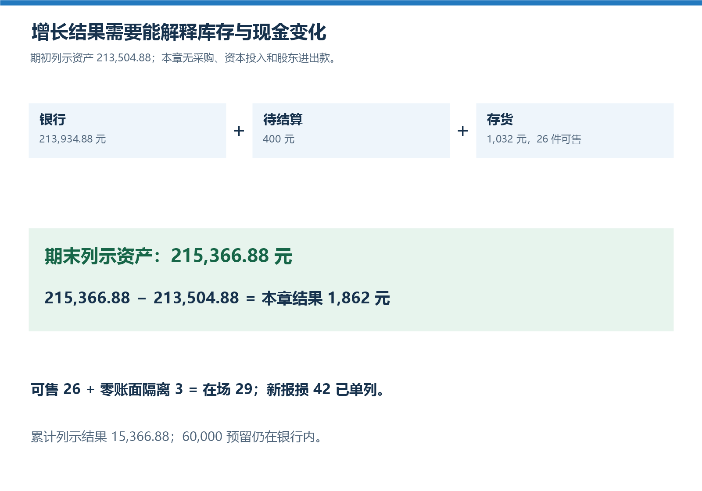

*图 7-13　银行、待结算和存货共同解释本轮列示结果。*

期初列示资产 = 208,899.88 + 667 + 3,938 = **213,504.88 元**。

期末列示资产 = 213,934.88 + 400 + 1,032 = **215,366.88 元**。

差额 **1,862 元**，与本章列示经营结果一致；自初始投入 200,000 起，累计列示结果为 **15,366.88 元**。没有其他资产负债变动或股东进出款，60,000 资金预留仍在银行中。

### 8.5　哪些动作可以继续，哪些需要再验证

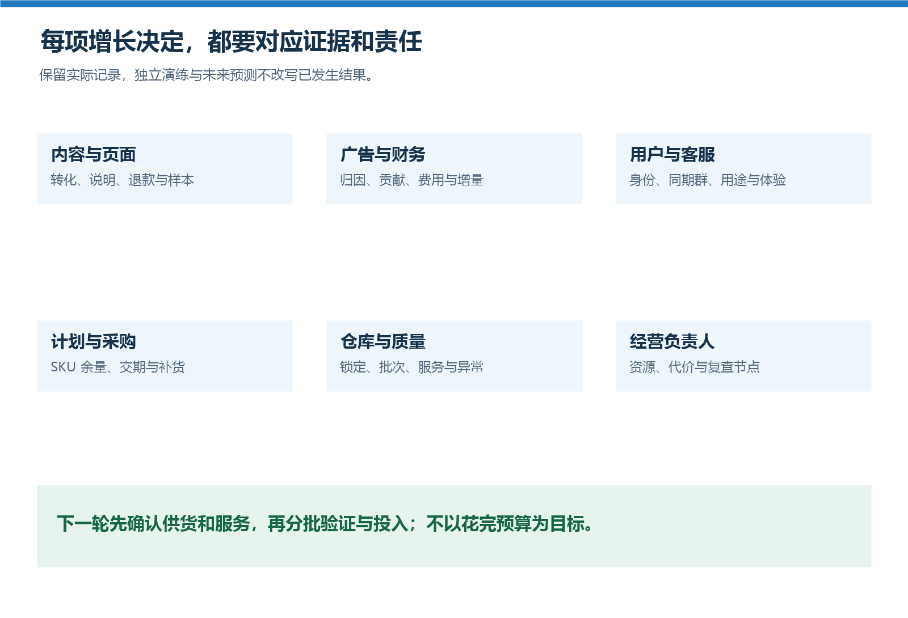

*图 7-14　不同结论对应不同证据，把增长、服务、供货与现金放回同一份方案。*

| 结果 | 下一步决定 | 证据与责任 |
|---|---|---|
| 新页支付与保留比例较高 | 保留完整样本和窗口，继续验证，避免只看最好几天 | 运营核分组、成本与售后 |
| 广告退款后 ROAS 4.91 | 同时看 789 来源贡献和全店共同费用，设计增量验证 | 投放与财务核对口径 |
| 14 位老客保留再购 | 继续了解用途，不把 17 笔当 17 人，也不认定全是券的增量 | 用户运营维护客群与窗口 |
| 咨询和退回有商品线索 | 更新说明并调查米白异常，不先记赔款 | 客服、商品、质量负责 |
| 期末现货降到 26 件 | 先更新需求和补货方案，再放下一轮名额 | 运营、计划、采购、仓库协同 |
| 经营结果为正、资产能闭合 | 继续核实共同费用、未来资金与库存代价 | 财务和经营负责人评审 |

### 8.6　综合作业与参考答案

**任务。** 提交一页下一轮增长建议，并附四张表。

1. 增长与转化表：定义目标、入口、顾客、订单、页面分组、广告指标与约束。
2. 活动与实验表：核对优惠及退款，设计页面、优惠或广告中的一个实验，说明对照与边界。
3. 用户与服务表：区分新老客、顾客与订单、同期群窗口、咨询和体验，提出会员价值。
4. 库存与资金表：核对不同成本批次、销售、报损、费用、待结算与银行。

**参考答案要点。** 支付 80、取消 4、出库 76、退货 6、保留 70；支付顾客 76、保留顾客 67，其中新客 53、老客 14。保留老客订单 17，优惠 170 已进入净销售 7,820。

广告实际 600，点击率 5%，CPC 0.60，支付 ROAS 5.65、退款后 4.91；广告来源贡献 789 尚未分摊共同费用且不是已证实的增量。页面支付差 1.20 个百分点，相对观察提升 50%，仍需说明不确定性。

销售成本 2,864、新报损 42，期末可售黑 10、白 6、小杯 10，共 26、价值 1,032；加零账面隔离三件，在场 29。银行 213,934.88、待结算 400，列示资产 215,366.88，本章列示结果 1,862。

建议应先处理下一轮供需与服务边界，再分批安排增长预算；没有对照的实际老客券不能宣称确定增量，未来客户价值也不能当作已实现收益。

**延伸练习。** 假设其他实际事实不变，T28 新待结算 400 也全部到账，哪些结果会变化？再假设把未花广告额度 200 错记费用，会出现什么核对问题？

**参考答案。** 另一个到账情景下，银行变为 214,334.88、待结算零，存货 1,032、资产总额及结果不变。若仅把未花的 200 错记费用，利润会少记为 1,662，而现金、应收与存货没有对应真实变动，资产差额仍为 1,862，无法相互解释。实际本章仍留待结算 400。

**本章完成标准**　能把转化、广告、优惠、用户、服务和供应约束连起来，区分观察结果与因果判断，并提交数据闭合、责任和复查节点明确的增长方案。

### 8.7　交接到下一章

山禾已经能追踪一次增长动作的入口、订单、顾客和资金，但期末库存也明显下降。下一章把商品、渠道、需求、采购、仓配、预算与应急放进国内经营协同计划，讨论旺季、大促和季度资源取舍。

---

## 附录　参数与结果核对

用于完成全章后的复查，各节计算所需数据已在正文给出。

| 范围 | 本章实际口径与结果 |
|---|---|
| 起点 | 银行 208,899.88；待结 667；可售 97、成本 3,938；另隔离两件 |
| 期初批次 | 黑旧 2 × 42、黑新 40 × 44、白 28 × 42、小杯 27 × 34 |
| 本轮期间 | T1—T21 触达与支付；截至 T28 出库、签收及退货处理完成 |
| 入口归属 | 广告、自然搜索、内容、会员推荐或活动入口；支付 30、20、15、15，全部在 A 成交 |
| 保留与身份 | 各入口保留 26、18、13、13；其中新客 21、16、11、5，老客 5、2、2、8 |
| 订单 | 支付黑 36、白 24、小杯 20；取消 4、出库 76、退货 6、保留 70 |
| 顾客 | 支付新 60 人／60 单、老 16 人／20 单；保留新 53 人／53 单、老 14 人／17 单 |
| 老客优惠 | 本轮客池 80；20 笔支付用券，保留 17 笔；每单减 10，保留优惠 170 已抵销售 |
| 广告 | 上限 800、实际 600；展示 20,000、点击 1,000；支付实付 3,390，退款后 2,944 |
| 页面分组 | 500 人各组；支付 12、18，保留 10、16，包含在广告来源中 |
| 其他费用 | 内容 400、会员及客服 200、仓储 700，均实际支付，没有新增直播或推荐佣金 |
| 服务 | 咨询 40 人各一次，18 人各支付一单；首次按目标响应 36；问卷满意 12／15 |
| 退款与净销售 | 支付 8,920 − 取消 446 − 退货 654 = 保留销售 7,820 |
| 退回与报损 | 黑、白、小杯各退 2；恢复黑 2、白 1、小杯 2；白一件报损 42，无赔偿 |
| 销售成本 | 黑旧保留 2、黑新保留 30，白 21、小杯 17，合计 2,864 |
| 经营结果 | 平台 420、包装 228、快递 456、退回 48、报损 42；交易贡献 3,162；扣共同费用后 1,862 |
| 期末库存 | 黑新 10 × 44、白 6 × 42、小杯 10 × 34，共可售 26、成本 1,032；加隔离 3，在场 29 |
| 平台结算 | 应结 7,400，到账 7,000，新待结 400；上章 667 已收回 |
| 资金与资产 | 银行 213,934.88，待结 400，存货 1,032，合计 215,366.88；累计列示结果 15,366.88 |
| 边界 | 无采购、补发或资本投入；独立优惠对照、促销、客户价值及到账情景均未加入实际 |
