# 第三章　从单店到多渠道经营

第二章结束，山禾已有三个在售 SKU：500mL 黑色、500mL 米白色、350mL 雾蓝。原店还在卖，新的合作机会也找上门。

一位达人想在内容平台直播卖杯子，需要活动价、佣金和现货。客服发现部分老顾客希望从品牌自己的交易页面复购。另一家经销商也来问批量供货价。

创始人问：“多开几个渠道，销量是不是就能加起来？”

你要先弄清谁下单、谁收款、谁负责交付，再把每个渠道的价格、费用、库存和资金放回同一门生意。

**本章完成目标**　能画出渠道及交易关系，比较渠道单笔收益，安排价格与库存，处理直播峰值和售后，核对渠道损益及全店现金，并判断下轮资源怎样分配。

## 阅读顺序

| 节次 | 要解决的业务问题 | 交付物 |
|---|---|---|
| [第一节　多一个入口，多的是哪一种生意？](#section-01) | 区分获客入口、交易渠道和交易模式 | 渠道关系图 |
| [第二节　同一只杯子，各渠道留下多少钱？](#section-02) | 把平台费、佣金、固定费用和服务成本算清 | 渠道报价与贡献表 |
| [第三节　直播卖 109 元，原店怎么办？](#section-03) | 管理到手价、活动范围与渠道冲突 | 活动价格与承诺表 |
| [第四节　三个渠道共享一仓，怎样分货和发货？](#section-04) | 避免重复承诺，规划订单高峰 | SKU 配额及履约计划 |
| [第五节　货架、直播和老客页分别怎样运营？](#section-05) | 按顾客路径组织内容、流量与转化 | 三渠道运营记录 |
| [第六节　110 笔支付，最后留下多少订单？](#section-06) | 同时核对售后、库存和流量归因 | 订单与退货记录 |
| [第七节　哪个渠道真正值得继续投？](#section-07) | 比较实际贡献、渠道费用与增量证据 | 渠道经营评估 |
| [第八节　把渠道计划放回利润与现金](#section-08) | 对账、排付款并作出下一轮决策 | 联合经营方案 |

每节所需数据就近给出。完成正文与作业后，可用[章末参数与结果核对表](#chapter-check)复查。

## 案例约定与起点

本章的渠道、费率、合同、平台功能、访客及订单均为教学设定，金额为人民币。实际业务按具体合同、平台当期规则及适用要求核实。本章继续使用列示收支口径，未加入税费、工资、仓租等其他费用；新增客服外包费用会明确计入。

承接第二章，银行为 185,373 元，无平台待结算和采购尾款。可售库存为黑色 92、米白色 131、小杯 60，共 283 个，成本 11,406 元。另有第一章已报损的一件黑色杯隔离存放，账面为零。

本轮观察 14 天，记为 T1—T14。案例按以下顺序展开。

| 时点 | 事项 |
|---|---|
| T1—T3 | 确认渠道合同、活动价格、库存配额与排班，支付本章准备及合作固定费用 |
| T1—T14 | 原货架店继续经营，品牌自营页小范围试运营 |
| T7 | 内容店通过合作达人开展一场活动 |
| T14 截止 | 案例所列发货均已签收，取消、退货及退款均已处理；部分渠道款待结算 |

本轮使用现有库存，没有新增采购。第二章的未来投放和追单仍属于建议，本章写明的新费用才进入本轮记录。原有 60,000 元仍作后续支出预留，未发生对应费用和付款。

“保留订单”指截至 T14 顾客保留商品的订单，后续变化仍需更新。为便于核算，取消均在出库前完成，包装与快递没有发生；退货均为签收后全额退款，每笔一个杯子。

---

## 第一节　多一个入口，多的是哪一种生意？

运营把搜索、短视频、直播、社群都写进“渠道销量”。你发现，同一位顾客先看直播，再到原店搜索下单，可能被记了两次。

先把路径拆开，才有办法核对经营结果。

**本节目标**　区分顾客从哪里来、在哪里完成交易、由谁承担销售与库存责任。

### 1.1　先看三个维度

| 维度 | 关注什么 | 本章例子 |
|---|---|---|
| 获客与接触 | 顾客从哪里认识商品 | 搜索、推荐内容、直播、老客社群 |
| 交易 | 订单在哪里成立、付款与退款怎样记录 | 货架店 A、内容店 B、品牌自营页 C |
| 履约 | 谁备货、谁发货、谁处理售后 | 山禾统一国内仓，按渠道订单执行 |

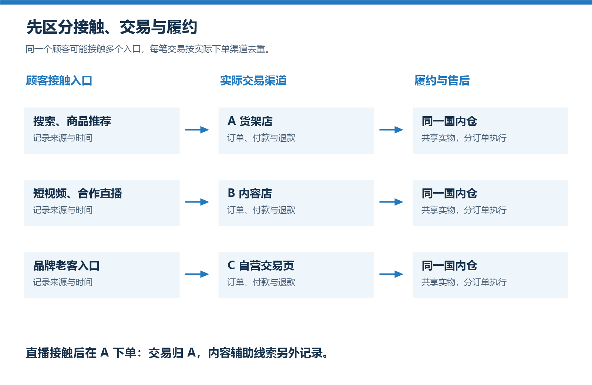

*图 3-1　同一订单可以有多个接触来源，但在本章渠道销售表中只归入一个实际交易渠道。*

山禾本轮的交易渠道定义如下。

- **A，原有货架店。** 顾客搜索或浏览商品后，在 A 下单，山禾承担库存、发货与售后。
- **B，内容店与达人合作。** 顾客看内容和直播，在 B 下单。达人按合同取得报酬，山禾仍是本案例销售与库存责任主体。
- **C，品牌自营交易页。** 顾客从品牌维护的老客入口进入并在 C 付款，山禾负责交易、交付与客服，支付服务商收取约定费用。

私域或老客运营描述的是顾客关系与触达方式，具体订单仍需归到实际交易系统。本章把 C 单独建订单与结算记录，便于核算。

### 1.2　平台自营采购、经销与代销怎样区分

若平台或经销商先向山禾采购，再自行向顾客销售，会形成另一种合同及结算关系。需要确认货权、风险、定价安排、退货、费用和应收账期。

| 模式 | 山禾需要核对的业务问题 |
|---|---|
| 自己开店零售 | 谁收款、扣什么费、退款怎么处理、什么时候可提现？ |
| 平台采购或经销买断 | 对方何时接收商品及承担约定风险，供货价多少，如何验收付款？ |
| 代销 | 库存由谁承担，按什么销量结算，滞销及退回怎样处理？ |
| 托管或代运营 | 谁决定价格、投放与发货，收费怎样算，谁承担超预算和售后？ |

这些名称不能代替合同检查。本章实际执行 A、B、C 三个直接面向顾客的渠道，经销询价先留作练习。

### 1.3　为每个渠道设一个验证任务

| 渠道 | 本轮要验证什么 | 主要限制 |
|---|---|---|
| A | 维持可控获客与稳定成交 | 广告费用、搜索与页面表现 |
| B | 内容和达人能否带来可保留订单及组合增量 | 佣金、固定费用、退货与峰值 |
| C | 小规模老客承接是否顺畅、服务是否可持续 | 受众规模、维护与客服成本 |

多一个渠道，会增加页面、合同、库存同步、客服和对账工作。经营目标要把这些工作及成本考虑进去。

### 1.4　练习与参考答案

**练习。** 五笔订单先看过 B 的直播，最终在 A 付款。如果 A 有 50 笔支付，能否再加这五笔，报告为 55 笔 A 交易？怎样记录直播影响？

**参考答案。** A 仍按 50 笔实际交易记录，把这五笔保留在“直播接触或辅助来源”字段。交易汇总与接触分析各用自己的口径，并通过订单号去重。

**本节交付物**　一张渠道关系图，标明获客、下单、收款、库存与售后主体。

---

## 第二节　同一只杯子，各渠道留下多少钱？

达人提出 109 元活动实付价、20% 佣金，另收固定合作费。创始人说：“比原店便宜 10 元，多卖一点应该可以。”

你先取一笔 500mL 保留订单，把不同渠道的账算到同一层。

**本节目标**　区分固定费用、按销售额收费、逐单费用和广告投入，理解贡献与渠道结果。

### 2.1　本轮已确认的费用条件

| 条件 | A 货架店 | B 内容店与达人 | C 品牌自营页 |
|---|---|---|---|
| 原款实付 | 119 元 | 活动 109 元 | 119 元 |
| 小杯实付 | 99 元 | 本轮未上小杯 | 99 元 |
| 平台或支付费 | 最终保留订单每笔 6 元 | 最终保留销售额 5% | 最终保留销售额 1% |
| 达人佣金 | 无 | 最终保留销售额 20% | 无 |
| 广告 | 本轮实际支出另记 | 本轮无另购广告 | 本轮无付费广告 |
| 逐单客服外包 | 暂不另列 | 暂不另列 | 实际出库订单每笔 2 元，退货后仍收费 |
| 固定准备与合作 | 本轮无新增 | 内容制作 600 元、固定合作费 300 元 | 自营页与客服模板 300 元 |

B 的 300 元固定合作费在本例不因销量或退货返还。各渠道取消、退货订单的原平台或支付费已全部冲回，B 佣金也已按约冲回。本章费率按精确金额核算，期末到分，不另设最低收费。

所有杯子的包装仍为每笔出库 3 元、快递 6 元；退回运费由山禾承担，每件 8 元。库存成本沿用原款 42、小杯 34 元。

### 2.2　同一原款的未退款单笔比较

| 一笔保留原款订单 | A | B | C |
|---|---:|---:|---:|
| 顾客实付 | 119 | 109 | 119 |
| 商品成本 | 42 | 42 | 42 |
| 平台／支付费 | 6 | 5.45 | 1.19 |
| 达人佣金 | 0 | 21.80 | 0 |
| 包装与出库快递 | 9 | 9 | 9 |
| 广告参考费用 | 20 | 0 | 0 |
| 逐单客服 | 0 | 0 | 2 |
| **单笔贡献参考值** | **42** | **30.75** | **64.81** |

A 的 20 元用于这张事前比较，实际全店广告在第五节按报告重新核算。C 没有付费广告，本轮仍承担服务与准备费用，老客触达能力也有规模限制。

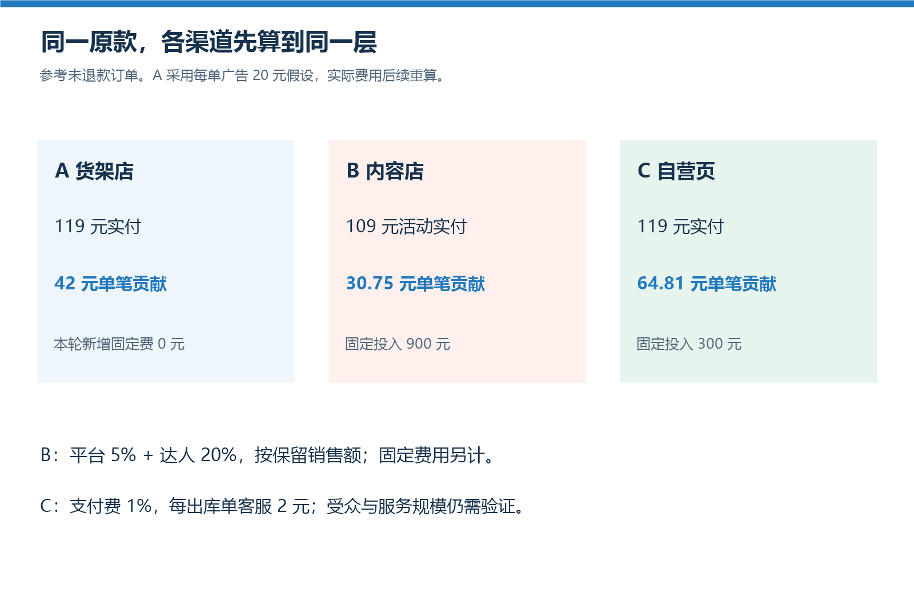

*图 3-2　先比较同一商品的单位收益，再把退款损失、固定投入和可实现规模放进经营结果。*

### 2.3　固定费用需要多少贡献覆盖

B 固定投入共 900 元。暂按每笔 30.75 元贡献、无额外退款损失估算：

**900 ÷ 30.75 ≈ 29.27，至少 30 笔保留订单。**

如果已经发出又退回，包装、快递、退回运费和异常损失会继续发生，实际需要更多保留订单才能覆盖这些支出。

内容制作可能帮助后续经营，但本章把本轮 600 元全部计入 B 的当期渠道固定费用。以后决定是否再做时，继续评估复用范围、费用归属和新增投入。

### 2.4　经销报价的对照练习

**练习。** 经销商拟以每只 79 元买断原款，另由山禾承担每只 2 元批量运输和 3 元约定返利；商品成本 42 元。先按这些费用算每只贡献，正式签约还要问什么？本例未执行。

**参考答案。** 79 − 42 − 2 − 3 = 32 元。还需核对数量、收货验收、付款时间、退回及库存责任、返利条件、信用风险、供货与售后安排。比较零售时，把节省或新增的运营工作及资金周期一起算入。

**本节交付物**　渠道条款表，写清收费基数、退款冲回、固定费用、结算日和责任人。

---

## 第三节　直播卖 109 元，原店怎么办？

运营担心顾客在 A 花 119 元后，发现直播只要 109 元。客服还不知道活动规则，页面却已经准备上线。

你要把到手价、数量、时间和服务条件写清，并让客服、仓库和财务用同一份活动资料。

**本节目标**　核算促销、识别渠道冲突，落实可以兑现的价格与交付安排。

### 3.1　先拆开每个到手价

| 渠道 | 原款标价 | 山禾承担优惠 | 实付 | 本轮范围 |
|---|---:|---:|---:|---|
| A | 129 元 | 10 元 | 119 元 | 按原店条件销售 |
| B | 129 元 | 20 元 | 109 元 | T7 活动，累计支付限 40 单 |
| C | 129 元 | 10 元 | 119 元 | 小范围自营页 |

小杯在 A、C 仍为标价 109、优惠 10、实付 99 元。B 本轮仅卖原款，活动颜色额度为黑色 10、米白色 30 单。

B 的活动名额按累计支付计，取消或退货后本场不追加名额；释放的实物按仓库状态恢复，留待后续安排。营销名额与实物库存分别记录。

### 3.2　按比例收费时，降价要重算

B 每个保留原款订单扣平台和佣金后留下实付的 75%。再扣商品 42、包装与快递 9：

**单笔贡献 = 实付 × 75% − 51。**

实付 109 元时为 30.75 元。如果临时改成实付 99 元：

**99 × 75% − 51 = 23.25 元。**

这次少了 7.50 元贡献，平台与佣金也随实付减少。应按本渠道费用基数计算。

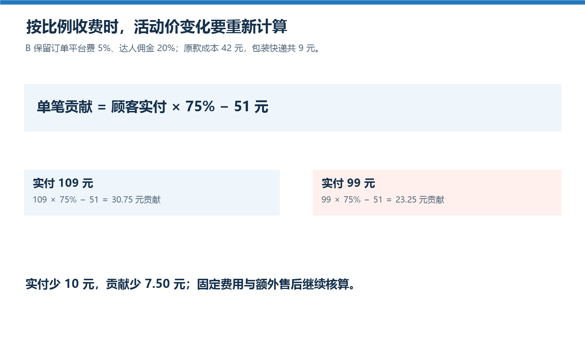

*图 3-3　B 平台 5% 与达人 20% 使用本例相同收费基数，固定费用另计。*

### 3.3　让渠道差异能被解释

同一商品可以有明确期间、数量及适用条件的活动。页面和直播说明应让顾客看清，到手价和领取条件是否符合自己。

顾客咨询价格差异时，客服依据已经公布且适用的活动与服务安排处理，记录问题和解决结果。对于复购、礼赠、不同规格或服务组合，说明实际差异，核算新增成本。

若与经销商合作，应事先沟通商品、活动供货和售后责任，按合同与适用要求安排。这个项目目前还未执行，因此不在本章订单中混入批发销量。

### 3.4　活动发布前的一张检查表

| 检查 | 本轮确认事项 |
|---|---|
| 价格与优惠 | B 实付 109，限定 T7 与累计支付 40 单，无额外叠券 |
| 商品与库存 | 黑 10、白 30，小杯不参加 |
| 达人费用 | 固定 300，按保留销售额计 20% 佣金 |
| 对外表述 | 使用已核实规格、演示与适用条件 |
| 履约 | 仓库接单、揽收及异常处理能力已确认 |
| 客服 | 优惠、取消、退换和价格咨询有清楚的处理路径 |
| 复核与变更 | 运营提出，经营负责人核算确认，留下生效时间 |

### 3.5　练习与参考答案

**练习一。** B 继续按同样费率，想保留每笔至少 25 元的贡献，实付最低多少？以分为单位给出。

**参考答案。** 满足实付 × 75% − 51 ≥ 25，实付至少 76 ÷ 0.75 ≈ 101.3333 元，向上到分为 **101.34 元**，固定与额外售后另计。

**练习二。** 本场已累计支付 40 单，其中 4 单取消，能否因为仓库恢复 4 个可售就直接再卖 4 个活动名额？

**参考答案。** 本场约定累计支付限 40，取消不补名额。应分别核查营销规则和可售状态，需要变更活动时重新确认并记录。

**本节交付物**　一份价格、优惠、费用、数量、时间及服务安排完整的活动说明。

---

## 第四节　三个渠道共享一仓，怎样分货和发货？

三个店铺都想显示全部库存。如果黑色最后只有 10 个，三个后台却各显示 10 个，就可能接受超出实物的订单。

本章先用明确配额管理小规模多渠道，同时记录全仓可用与订单锁定。

**本节目标**　把渠道销售额度、已付锁定和实物分清，安排活动前的库存与仓配能力。

### 4.1　先分配现有可用库存

| SKU | 全仓可售 | A 可承诺配额 | B 活动配额 | C 可承诺配额 | 共享待分配 |
|---|---:|---:|---:|---:|---:|
| 原款黑色 | 92 | 30 | 10 | 0 | 52 |
| 原款米白色 | 131 | 30 | 30 | 15 | 56 |
| 小杯雾蓝 | 60 | 15 | 0 | 15 | 30 |
| 合计 | 283 | 75 | 40 | 30 | 138 |

每行配额加共享数等于全仓可售，设定配额本身没有发生出库，也没有形成销售收入。

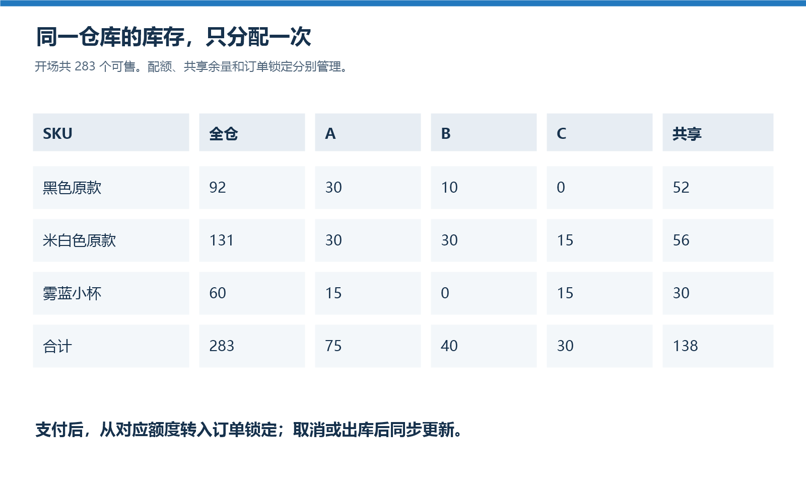

*图 3-4　订单锁定从对应渠道尚可承诺额度转出，全仓同步更新，避免把同一限制重复扣两次。*

当黑色 A 支付一单，A 的尚可承诺量减少一，全仓增加对应订单锁定。确认取消则按约释放。真实系统字段可能已包含某些扣减，先核对含义。

### 4.2　什么时候需要调配

若 A 的白色配额不足、共享还有库存，可以核对全仓未占用数量后调整 A 配额，记录时间、数量和批准依据。B 的活动名额仍受活动规则限制。

连接多个订单系统时，应明确库存更新频率、失败重试、取消解锁和异常报警。按订单号和动作记录避免重复执行；出现同步异常，及时控制受影响入口，并查清已承诺订单。

### 4.3　直播高峰也要排进仓库能力

设一个活动前排班演练，仓库每小时可稳定处理 20 单，直播结束到本次揽收还有 2 小时，能处理约 40 单。若届时 A 待发 18、C 待发 6、B 最多新来 40 单，共 64 单，就超过 24 单。

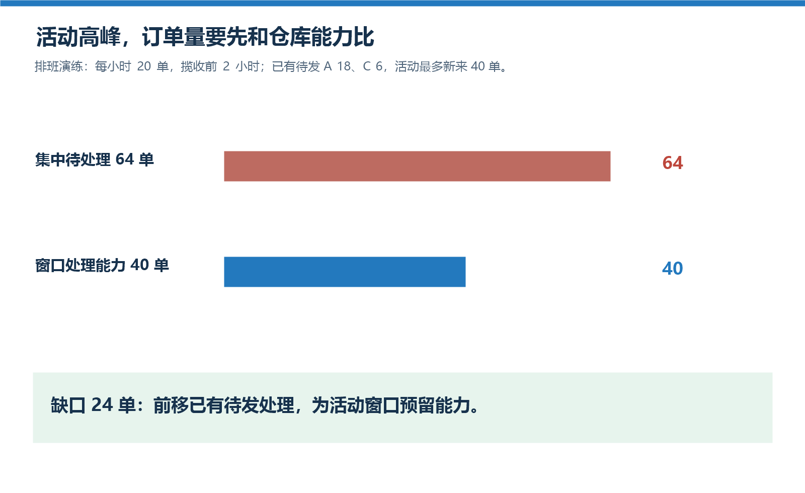

*图 3-5　这是排班演练，18 与 6 是已有订单在假设截面的子集，不能另加进本章支付总数。*

本次安排在既有班次内前移处理相应待发订单，为活动窗口预留能力。按较保守的 40 笔新单准备，实际直播有取消时仍按有效订单出库。案例未产生额外加班或揽收费用，真实安排如增加费用应入预算。

### 4.4　把承诺交给具体负责人

运营确认活动时间、价格和名额；仓库确认可用与处理能力；客服确认咨询和售后承接；财务确认费用和付款节点。任何一项变化都可能影响其他岗位。

承诺发货时间时，把接单截点、检查包装、交接承运商及特殊地区条件合起来确认。若临时超出能力，先核对受影响订单，再落实可以兑现的处理与沟通。

### 4.5　练习与参考答案

**练习一。** 黑色给 A、B 分别分配 30、10，全仓 92，共享多少？A 又从共享获得 8 个后，这三项怎样变化？

**参考答案。** 初始共享 52；调整后 A 配额 38、B 10、共享 44，全仓仍为 92。没有订单或出库时，不改变实物总数。

**练习二。** 仓库每小时处理能力降为 15 单，同样只有两小时、预计 40 笔新单，缺口多少？

**参考答案。** 两小时能力 30 单，缺 10 单。重新评估活动额度、处理窗口、班次或揽收安排，并明确成本和外部承诺。

**本节交付物**　分 SKU 配额、订单锁定规则、高峰排班和异常责任表。

---

## 第五节　货架、直播和老客页分别怎样运营？

同一组杯子进入三个渠道，顾客作决定的过程不同。A 的顾客可能主动搜索，B 的顾客可能先被演示吸引，C 的顾客则已对品牌有一些认识。

你需要按具体路径安排内容和记录，而不是把同一张图复制后等待销量。

**本节目标**　认识不同国内电商路径的运营动作，读懂基本转化，并安排达人合作与内容交付。

### 5.1　货架店 A，先回答主动比较的问题

A 继续维护商品标题、类目属性、搜索展示、主图、详情、规格、评价与客服。关注顾客找什么、点进后是否理解差异、有没有库存和交付障碍。

本轮 A 广告预算上限 600 元，实际全部使用。报告为展示 12,000 次、点击 600 次、广告归因支付 30 单；另外有 20 笔自然渠道支付订单，全店 A 共 50 单。

**点击率 = 600 ÷ 12,000 = 5%。**

**点击到支付订单比率 = 30 ÷ 600 = 5%。**

**广告计划每支付订单费用 = 600 ÷ 30 = 20 元。**

把全部 A 支付订单作为分母，则本次广告支出平均为 12 元。这两个数用途不同。按实际渠道费用评估时保留 600 元，后面加入退款和出库费用。

### 5.2　内容店 B，让顾客理解并核对商品

短视频或直播可以从携带场景进入，演示实际尺寸、开盖、清洗和颜色选择。已核实的事实、演示条件和使用说明应当一致。

与达人合作前，核对受众场景、相近商品的支付与保留订单、退款及合作履约记录。展示观看人数时，还要问统计窗口和去重方法；用历史结果推测未来，仍需保留误差。

| 直播脚本环节 | 本次准备 |
|---|---|
| 场景 | 通勤携带，怎样选择容量和颜色 |
| 商品 | 本场仅 500mL 原款，展示已确认资料 |
| 演示 | 尺寸、重量、拆洗与正确使用，说明条件 |
| 交易 | 实付 109 元，黑 10、白 30，累计支付限 40 |
| 履约 | 说明已确认的发货和售后安排 |
| 结束 | 核对成交、有效订单、投诉及后续退货 |

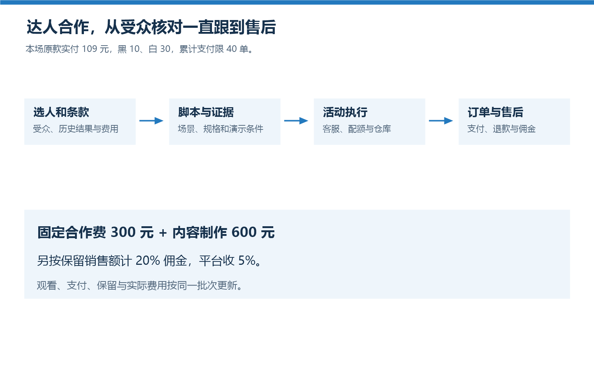

*图 3-6　达人、山禾运营、客服与仓库共同确认信息和执行条件，合作报酬按合同核算。*

本场去重直播访问 800 人、支付 40 单，支付订单数与访客人数之比为 5%。后续留下多少，需要等取消和售后结果更新。

### 5.3　自营页 C，把关系维护和交易服务接起来

C 面向本轮小范围老客受众。页面清楚说明品牌主体、商品、收款、订单查询、发货和售后入口，客服能够查到订单并处理异常。

本轮去重访问 200 人、支付 20 单，比率为 10%。没有付费广告，新增页面与客服模板费 300 元，客服外包按实际出库每笔 2 元收费。

老客需求、信任基础和受众规模与公开流量不同。若要继续扩大，仍需估计触达和维护成本、支付转化、复购周期与服务能力。沟通按顾客同意及适用要求安排。

### 5.4　把流量和交易结果放在各自范围

| 渠道 | 本轮观察入口 | 支付订单 | 重要口径 |
|---|---|---:|---|
| A | 广告 600 次点击，另有自然访问 | 50 | 广告归因 30，自然 20 |
| B | 去重直播访问 800 人 | 40 | 活动累计支付口径 |
| C | 去重老客页访问 200 人 | 20 | 本轮小范围受众 |

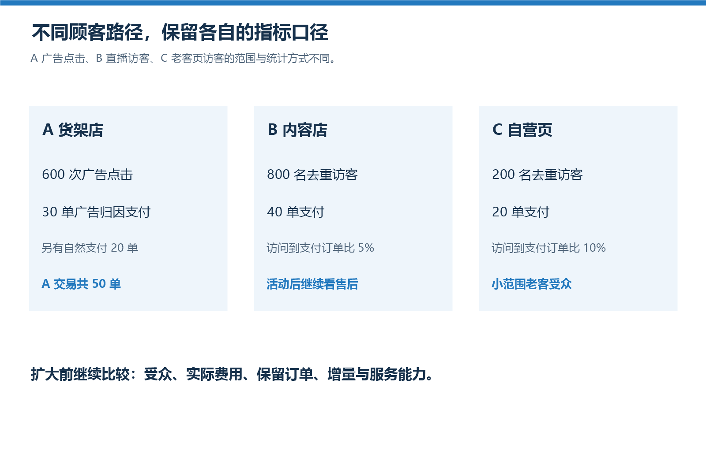

*图 3-7　广告点击次数、直播访客与老客页访客的统计条件不同，先保留各自定义。*

C 的 10% 不能直接用于预测陌生人群的投放效果；B 的观看也不自动等于新顾客。要比较增量或新客，进一步核对人群、来源、身份去重和可比条件。

### 5.5　练习与参考答案

**练习一。** A 有 50 笔支付，B 有 40 笔支付。如果另有五笔 A 订单看过 B 内容，交易总数是多少？

**参考答案。** A、B 交易共 90 笔，五笔仍包含在 A 中。直播辅助影响可以另做分析。

**练习二。** C 每支付订单没有广告费用，是否可以把它的获客、运营及交易成本都记为零？

**参考答案。** 需要保留已发生的页面准备、支付、客服、包装、快递与售后；未来继续触达和维护的投入也要评估。判断获客成本时再明确新客与老客范围。

**本节交付物**　每个渠道一份顾客路径、内容任务、指标口径和实际费用记录。

---

## 第六节　110 笔支付，最后留下多少订单？

T14，运营先报告了 110 笔支付。客服说有 7 笔在发货前取消，仓库收到了 9 件退货。

你让各渠道用同一张状态表核对。

**本节目标**　按渠道与 SKU 追踪售后，核对期末可售库存，并将交易归属与接触归因连接起来。

### 6.1　支付、出库和保留订单

| 渠道 | 支付 | 发货前取消 | 实际出库并签收 | 签收后退货 | 保留订单 |
|---|---:|---:|---:|---:|---:|
| A | 50 | 2 | 48 | 2 | 46 |
| B | 40 | 4 | 36 | 6 | 30 |
| C | 20 | 1 | 19 | 1 | 18 |
| 合计 | **110** | **7** | **103** | **9** | **94** |

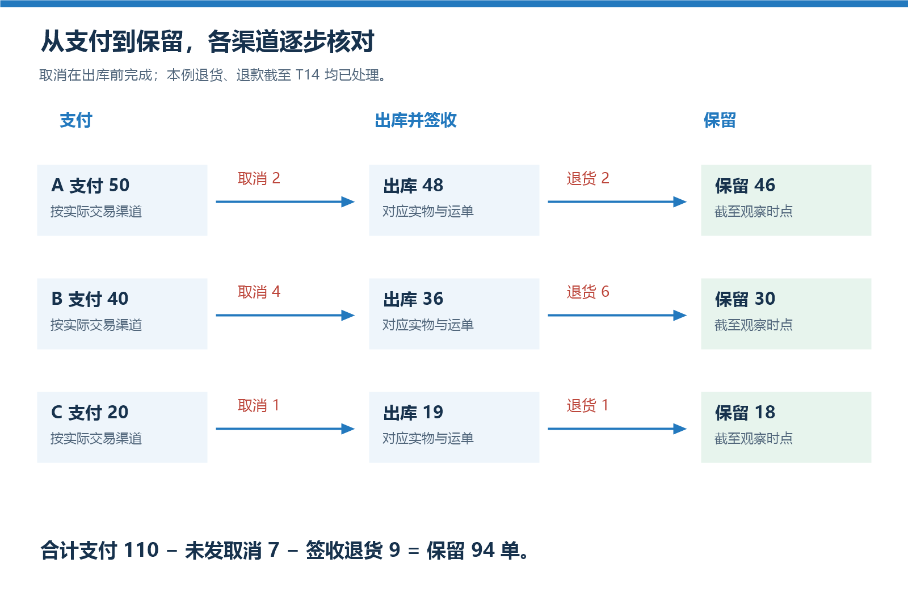

*图 3-8　每笔一只杯子；本例截至 T14 各项处理完成。*

B 按出库计算的退货率为 6 ÷ 36，约 16.67%；按支付计算的保留率为 30 ÷ 40 = 75%。如果与 A、C 比较，必须使用同样分母与观察时点。

### 6.2　把颜色与容量也列出来

| 渠道与状态 | 黑色原款 | 米白色原款 | 小杯雾蓝 | 合计 |
|---|---:|---:|---:|---:|
| A 支付 | 20 | 20 | 10 | 50 |
| A 未发取消 | 1 | 0 | 1 | 2 |
| A 退货 | 1 | 1 | 0 | 2 |
| A 保留 | 18 | 19 | 9 | 46 |
| B 支付 | 10 | 30 | 0 | 40 |
| B 未发取消 | 1 | 3 | 0 | 4 |
| B 退货 | 1 | 5 | 0 | 6 |
| B 保留 | 8 | 22 | 0 | 30 |
| C 支付 | 0 | 10 | 10 | 20 |
| C 未发取消 | 0 | 0 | 1 | 1 |
| C 退货 | 0 | 1 | 0 | 1 |
| C 保留 | 0 | 9 | 9 | 18 |

三渠道保留的原款合计 76 个，小杯 18 个。每笔退款金额按原订单实付计算。

| 渠道 | 原支付金额 | 取消及退货退款 | 退款后销售额 |
|---|---:|---:|---:|
| A | 40 × 119 + 10 × 99 = 5,750 | 456 | 5,294 |
| B | 40 × 109 = 4,360 | 1,090 | 3,270 |
| C | 10 × 119 + 10 × 99 = 2,180 | 218 | 1,962 |
| 合计 | **12,290** | **1,764** | **10,526** |

例如 A 退款包括一笔黑色取消 119、一笔小杯取消 99，以及两笔原款退货 238，共 456 元。

### 6.3　九件退货怎样进入库存

A 退回黑一、白一，均检验后恢复可售；B 退回黑一、白五，其中白色五件可再售，黑色一件杯盖变形，隔离报损 42 元；C 退回白一，检验后恢复可售。

B 报损件的制造、运输或使用责任仍需核查，暂未确认供应商赔偿。本章没有因该件取得赔款，按现有证据先保留实物、记录损失并继续核对批次风险。

九件退回运费共 72 元。包装、出库快递和 C 的逐单客服按已经发生的出库保留；平台或支付费用及 B 佣金按本章条款冲回。

### 6.4　核对全仓可售

| SKU | 期初可售 | 实际出库 | 退回恢复可售 | 期末可售 |
|---|---:|---:|---:|---:|
| 黑色原款 | 92 | 28 | 1 | 65 |
| 米白色原款 | 131 | 57 | 7 | 81 |
| 小杯雾蓝 | 60 | 18 | 0 | 42 |
| 合计 | **283** | **103** | **8** | **188** |

期末无未发锁定、在途和待检退货。按商品去向核对：

**期初可售 283 = 顾客保留 94 + 期末可售 188 + 本章报损 1。**

加上第一章隔离的旧报损件，仓库实际有 190 件：188 件可售，2 件报损隔离。两件报损的账面价值均为零。

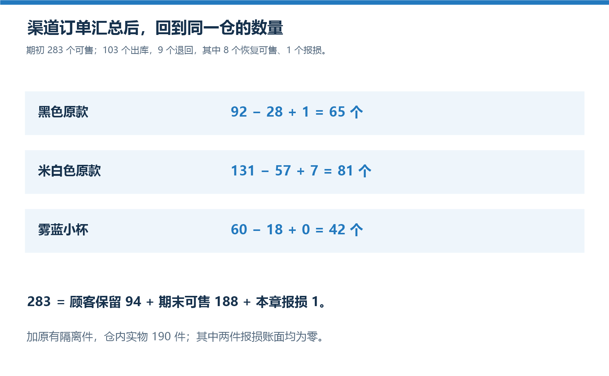

*图 3-9　渠道订单最终汇到同一仓库数量，报损和可售分别保留记录。*

### 6.5　那五笔受直播影响的 A 订单怎样看

本例记录发现，A 的 20 笔自然支付中有五笔顾客曾接触 B 内容。它们仍是 A 的交易，由 A 结算；“内容辅助”字段保留接触线索，不再加到 B 的交易销量。

这些线索有助于讨论内容投入的作用，但不足以证明五笔全部由内容新增。可以进一步做受众或时间对照，并观察全店保留订单与贡献变化。

### 6.6　练习与参考答案

**练习一。** B 支付 40，取消 4，发出 36，退货 6。若只报告“退货占支付 15%”，与按发出计算的比例有什么差别？

**参考答案。** 6 ÷ 40 = 15%，6 ÷ 36 ≈ 16.67%，各自分母不同。评价已经发出的商品及履约体验时，保留按出库计算的指标，并结合取消原因看支付后整体流失。

**练习二。** 如果 B 的黑色退货也检验合格，其他条件相同，黑色可售、总可售和存货价值分别增加多少？

**参考答案。** 黑色为 66、总可售 189，存货价值增加 42 元；本章报损费用减少 42 元，退款和已发生运费保持本题条件。

**本节交付物**　渠道、订单、退款、运单、SKU 和实物处置能互相追溯的记录。

---

## 第七节　哪个渠道真正值得继续投？

创始人看到 C 每单贡献高，想全部转去自营页。达人则希望继续合作，强调直播带来过不少关注。

你把渠道实际费用逐项列出，再讨论扩大后的变化。

**本节目标**　核算渠道实际贡献与固定费用，区分已实现结果、增量线索和未来扩张假设。

### 7.1　三渠道实际贡献

| 项目，元 | A | B | C | 合计 |
|---|---:|---:|---:|---:|
| 退款后销售额 | 5,294 | 3,270 | 1,962 | 10,526 |
| 销售商品成本 | 1,860 | 1,260 | 684 | 3,804 |
| 平台／支付费用 | 276 | 163.50 | 19.62 | 459.12 |
| 达人佣金 | 0 | 654 | 0 | 654 |
| 包装 | 144 | 108 | 57 | 309 |
| 出库快递 | 288 | 216 | 114 | 618 |
| 退回运费 | 16 | 48 | 8 | 72 |
| 实际广告 | 600 | 0 | 0 | 600 |
| 逐单客服 | 0 | 0 | 38 | 38 |
| 本章商品报损 | 0 | 42 | 0 | 42 |
| **扣以上费用的渠道贡献** | **2,110** | **778.50** | **1,041.38** | **3,929.88** |
| 本轮固定费用 | 0 | 900 | 300 | 1,200 |
| **本轮列示渠道结果** | **2,110** | **−121.50** | **741.38** | **2,729.88** |

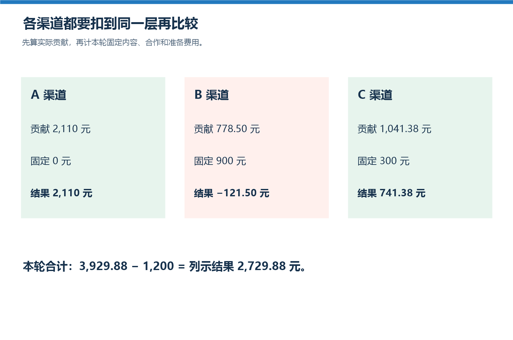

*图 3-10　固定内容与准备费用按本轮约定一次计入，工资、仓租等其他未列费用继续按章首口径处理。*

A 商品成本为 37 个原款 × 42 + 9 个小杯 × 34 = 1,860 元。C 为 9 × 42 + 9 × 34 = 684 元。包装与快递按出库数计算，C 客服为 19 × 2 = 38 元。

### 7.2　为什么 B 有订单，结果却为负

30 笔保留原款本可贡献 30 × 30.75 = 922.50 元。实际还承担六件退货已花的包装与出库运费 54 元、退回运费 48 元、报损 42 元。

**922.50 − 54 − 48 − 42 = 778.50 元。**

再扣固定 900 元，为 −121.50 元。

暂时把额外售后损失维持为 144 元，若其他条件不变，再多四笔保留订单可增加 123 元，刚覆盖缺口。但订单更多时，售后与服务压力也可能增加，不能把四笔当作必然补救结果。

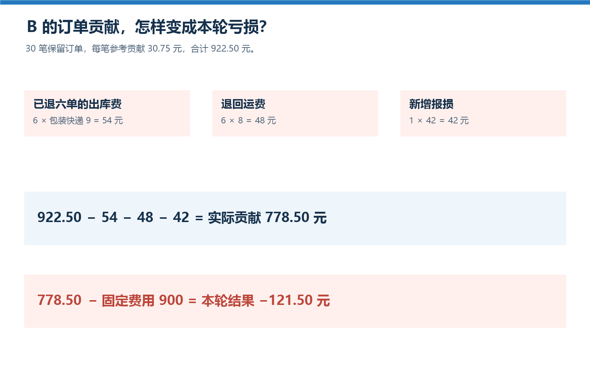

*图 3-11　单笔模型、实际退货与固定费用三层逐步核对。*

下一轮可以讨论素材与受众、商品讲解、真实需求、活动价格、佣金和固定收费等。先定位问题，再比较投入与预期保留订单。

### 7.3　C 的结果好，怎样判断能否放大

C 本轮 18 笔保留订单、列示结果 741.38 元，受众却来自小范围老客。扩到陌生人群可能需要广告，也可能改变客服、转化和退款。

做一个扩张练习，假设 C 新获客原款仍实付 119，费用保持单笔参考，另需每单广告 30 元，则贡献从 64.81 变为 34.81 元，固定与额外售后另计。后续应验证这样的费用和订单规模能否取得。

### 7.4　渠道结果与全店增量怎样一起看

B 可能影响 A 的自然成交，也可能把原本在 A 购买的人吸引到活动价渠道。五笔接触线索帮助提出问题，不能直接推导完整增量。

实际费用表按已发生费用归集，以便核对本期结果。另做一个对照分析，比较没有活动时的全店保留订单与贡献；再计入需要继续投入的固定费用。

若未来内容素材被 A、B 共用，应提前确定归集及分摊方法，并在合并报表中只计一次。本轮 600 元内容费用全部归 B，没有再分配给 A。

### 7.5　练习与参考答案

**练习一。** 下一场若固定投入降到 600 元，其余实际结果与本轮完全相同，B 列示结果多少？

**参考答案。** 778.50 − 600 = 178.50 元。这是下一轮情景，实际仍需确认新合同、成交与退货结果。

**练习二。** 可以把本轮 B 的 −121.50 元，与 A 的五笔辅助来源订单全部利润直接相加，宣布内容已盈利吗？

**参考答案。** 先明确要评价的范围和对照方案。A 的订单利润已在全店表中计算，归因分析还需验证哪些真正新增；合并结果要避免重复加订单或费用。

**本节交付物**　一份渠道评估，分别写已发生结果、原因线索、增量不确定性和下一轮验证条件。

---

## 第八节　把渠道计划放回利润与现金

财务核对完账单：三渠道应该结给山禾 9,412.88 元，银行本轮只收到 7,942.38 元。仓库报告还有 188 个可售杯子。

创始人需要你解释资金在哪里，再决定下一轮把钱和库存给谁。

**本节目标**　闭合渠道销售、费用、结算和库存，提出可执行的多渠道经营计划。

### 8.1　渠道款应该怎样核对

| 渠道 | 退款后销售额 | 平台／支付费 | 佣金 | 应结山禾 | 已到账 | 待结算 |
|---|---:|---:|---:|---:|---:|---:|
| A | 5,294 | 276 | 0 | 5,018 | 4,500 | 518 |
| B | 3,270 | 163.50 | 654 | 2,452.50 | 1,500 | 952.50 |
| C | 1,962 | 19.62 | 0 | 1,942.38 | 1,942.38 | 0 |
| 合计 | **10,526** | **459.12** | **654** | **9,412.88** | **7,942.38** | **1,470.50** |

本例平台、支付费和 B 佣金直接从结算款扣除。内容制作 600、固定合作 300、自营准备 300、广告及客服等则从山禾银行另行支付。

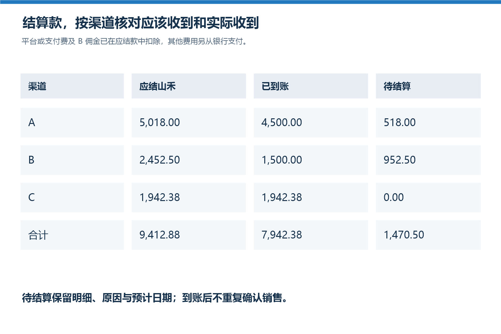

*图 3-12　按渠道和订单核对费用基数、冲回、账单与到账日期。*

对待结算的 518 和 952.50 元，记录预计日期与原因，按实际情况跟进。余额转入银行时减少待结算，对应销售已在本章确认。

### 8.2　银行余额核对

| 银行收支 | 金额 | 累计余额 |
|---|---:|---:|
| 承接第二章 | +185,373.00 | 185,373.00 |
| 本轮实际到账 | +7,942.38 | 193,315.38 |
| 广告 | −600.00 | 192,715.38 |
| 包装 | −309.00 | 192,406.38 |
| 出库快递 | −618.00 | 191,788.38 |
| 退回运费 | −72.00 | 191,716.38 |
| C 逐单客服 | −38.00 | 191,678.38 |
| 固定内容、合作与准备 | −1,200.00 | **190,478.38** |

以上费用本章均已支付，余额表按用途累计展示，每日收付仍要记录具体时间。没有新采购，已预留 60,000 元仍在银行余额之中。

扣除这项预留，按当前安排有 130,478.38 元可继续评估用途。下一轮采购、投放和渠道合同形成承诺后，还要一起排进资金日历。

### 8.3　存货与经营结果闭合

| 可售存货 | 数量 | 单位成本 | 成本金额 |
|---|---:|---:|---:|
| 原款黑色 | 65 | 42 | 2,730 |
| 原款米白色 | 81 | 42 | 3,402 |
| 小杯雾蓝 | 42 | 34 | 1,428 |
| 合计 | **188** | 分 SKU | **7,560** |

期初列示资产为第二章末的 196,779 元。本轮没有采购，存货减少为销售成本 3,804 元和新增报损 42 元：

**11,406 − 3,804 − 42 = 7,560 元。**

期末核对：

**银行 190,478.38 + 待结算 1,470.50 + 存货 7,560 = 199,508.88 元。**

**期初 196,779 + 本章列示结果 2,729.88 = 199,508.88 元。**

累计相对 20 万元启动资金为 −491.12 元，仍按本书列示范围计算。各章准备费用在发生的章节计入，库存成本随着销售和报损变化，避免跨章重复扣除。

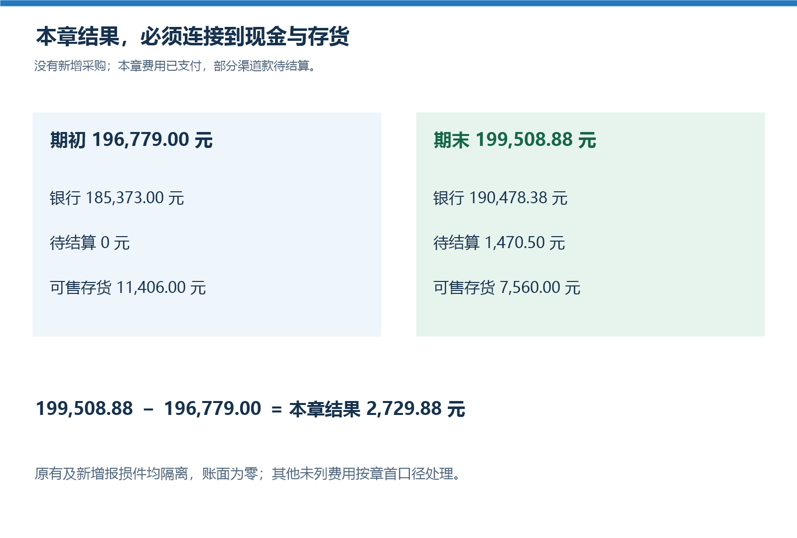

*图 3-13　费用和库存关系能互相解释，实际经营需补齐其他资产、负债及未列费用。*

### 8.4　下一轮渠道也会改变补货需求

以前白色库存覆盖较长，本轮 B 重点卖白色，情况已经变化。暂用本轮 14 天的库存净减少速度估算：

| SKU | 期初到期末净减少 | 每日净减少 | 当前覆盖粗算 |
|---|---:|---:|---:|
| 黑色 | 92 − 65 = 27 | 27 ÷ 14 | 65 ÷（27 ÷ 14）≈ 33.7 天 |
| 米白色 | 131 − 81 = 50 | 50 ÷ 14 | 81 ÷（50 ÷ 14）≈ 22.7 天 |
| 小杯 | 60 − 42 = 18 | 18 ÷ 14 | 42 ÷（18 ÷ 14）≈ 32.7 天 |

黑色的净减少含本轮一件报损。白色受到一次活动影响，未来能否延续要另做判断。与常规 25 天交期比较，白色需要提前讨论下一阶段需求和供应；下一批加急条件应重新确认。

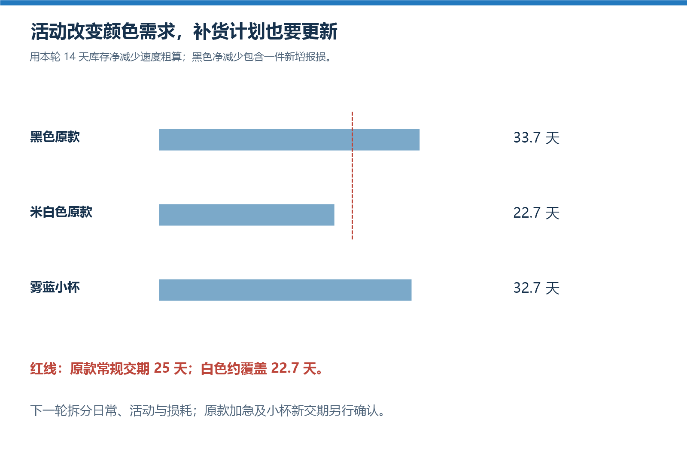

*图 3-14　从渠道活动推到分 SKU 需求，预测时拆开日常销量、活动及损耗。*

### 8.5　写出下一轮经营建议

本章参考提案为，A 维持受控经营并复核投放；B 先确认退货原因、合作费用和活动增量，再决定下一场规模；C 继续小范围承接，评估触达和客服能力后逐步测试扩张。

| 动作 | 负责人 | 下一次复查 |
|---|---|---|
| 核对 B 退货与商品讲解 | 客服、商品、质量 | 下一场合作确认前说明原因与改进 |
| 跟进待结算 | 财务 | 下个工作日核对 1,470.50 元明细及预计日期 |
| 评估下一场合作 | 运营、经营负责人 | 将价格、固定费、佣金与保留订单放在一起 |
| 核对 C 的服务投入 | 客服、运营 | 评估每单费用、触达规模与用户体验 |
| 形成分 SKU 需求计划 | 计划、采购、仓库 | 拆日常与活动，确认交期、可售和补货选项 |

下一轮预算或采购要形成新的方案，本章没有执行。比较方案时，保持全店与单渠道的口径清楚，明确对其他渠道的影响。

### 8.6　章节综合作业

请提交一页经营建议，并附四张表。

1. **渠道与合同表。** 写明订单在哪、谁承担库存和售后、费用如何计、何时结算。
2. **价格与库存表。** 为 A、B、C 分配同一批 SKU，说明活动名额和库存锁定的关系。
3. **渠道损益表。** 从 110 笔支付核对至 94 笔保留及本章列示结果 2,729.88 元。
4. **资金及后续需求表。** 核对银行、待结算和存货，提出下一轮分 SKU 的需求与采购调查项。

建议中回答，是否续约 B、是否把全部预算转给 C、下一场是否继续 109 元，以及是否需要为白色安排补货。写出假设、替代方案和复查时间。

### 8.7　参考方向与完成标准

关键计算应得到：销售额 10,526、渠道贡献 3,929.88、固定费用 1,200、列示结果 2,729.88；期末银行 190,478.38、待结算 1,470.50、存货 7,560。

B 的实际结果为负，但下一轮可比较费用、转化与售后改善情景；C 结果较好，但当前受众小且来源不同。全店增量仍需取证。白色受到活动影响，要把是否再次开展活动放进预测。

| 复查项 | 完成表现 |
|---|---|
| 口径 | 接触来源、交易渠道、履约与结算分清 |
| 合同与费用 | 固定、按额及逐单费用均有依据，退款冲回清楚 |
| 库存与履约 | 配额不重复、锁定可追踪，高峰能力经过测算 |
| 实际与增量 | 已发生结果能对账，对照假设明确 |
| 资金与采购 | 余额能闭合，需求与交期连接 |
| 执行 | 责任人、金额、时间和复查资料具体 |

**本章完成标准**　你能向创始人说明各渠道怎样赚钱、哪些结果仍需验证，并把下一轮渠道活动转成库存、履约和资金要求。

下一章，山禾要把“下次可能卖多少”变成分 SKU、分时间的需求与补货计划，继续处理活动波动和交期。

---

## 附录　参数与结果核对

用于完成全章后复查，所有费用与交易条件均按本章教学设定。

| 项目 | 结果 |
|---|---|
| 接续第二章 | 银行 185,373，无待结算；可售 283，成本 11,406 |
| 本章交易 | A、B、C 三渠道，山禾统一承担本案例库存及售后 |
| 固定费用 | B 内容 600、合作 300；C 准备 300；共 1,200 |
| 支付、出库、保留 | 110、103、94 笔；未发取消 7，签收退货 9 |
| 原支付与退款 | 12,290 − 1,764 = 销售额 10,526 |
| 商品销售成本 | 原款 76 × 42 + 小杯 18 × 34 = 3,804 |
| 平台／支付及佣金 | 459.12 + 654，均在结算中扣除 |
| 包装、快递、退回 | 309、618、72，均已另行支付 |
| 广告与客服 | A 广告 600；C 逐单客服 38 |
| 新增报损 | B 黑色一件，成本 42；原有隔离件仍为零账面 |
| 渠道贡献 | A 2,110；B 778.50；C 1,041.38；共 3,929.88 |
| 扣固定后 | 2,110 − 121.50 + 741.38 = 2,729.88 |
| 应结、已到、待结 | 9,412.88 = 7,942.38 + 1,470.50 |
| 期末可售与存货 | 黑 65、白 81、小杯 42，共 188，成本 7,560 |
| 期末银行 | 190,478.38，预留 60,000 元包含其中 |
| 期末核对 | 190,478.38 + 1,470.50 + 7,560 = 196,779 + 2,729.88 |

经销询价、扩大 C、下一场直播与未来补货均未执行。辅助来源五笔仍在 A 的交易中，未重复加入 B。仓内还隔离两件报损实物，未计入 188 个可售。

[返回课程总览](../00-课程总览与十二章介绍.md)　｜　[上一章：从一款杯子到商品组合](../第二章-从一款杯子到商品组合/第二章-从一款杯子到商品组合.md)　｜　[下一章：从需求预测到补货计划](../第四章-从需求预测到补货计划/第四章-从需求预测到补货计划.md)
