# 第九章　从国内生意到跨境市场选择

第八章结束，山禾已经能把国内活动、采购、仓配和资金放在同一份计划里。银行有 208,885.88 元，可售库存 158 件，但这并不表示公司已经拥有一套可以直接复制到海外的生意。

一次经营会上，运营拿来几张海外保温杯页面：“海外价格看上去更高，我们是不是也能卖？”采购说国内报告齐全，服务商说可以代发，创始人则问：“究竟卖给谁、由谁负责、赚什么钱？先用有限投入把这些问题弄清。”

你接下的任务，是提出一份有证据、有约束、能决定继续还是停止的跨境试点方案。国内业务同时继续；研究费用不能藏起来，海外销售也不能凭一张方案提前记入结果。

**本章完成目标**　能比较海外市场与客群，区分交易模式、渠道和履约方式，建立商品版本与准入核查清单，计算试点单笔贡献及学习成本，提交分阶段的跨境立项建议，并核对研究阶段的国内经营、库存和现金。

## 阅读顺序

| 节次 | 要解决的问题 | 交付物 |
|---|---|---|
| [第一节　跨境只是把价格换成外币吗？](#section-01) | 出口、交易对象、四种流与责任 | 跨境业务结构图 |
| [第二节　海外有人喜欢，就代表有生意吗？](#section-02) | 客群、场景、竞争和需求证据 | 市场研究与验证问题表 |
| [第三节　三个市场，怎样确定先研究哪一个？](#section-03) | 加权比较、硬门槛与信息缺口 | 市场优先顺序与待办 |
| [第四节　国内能卖的杯子，能直接拿到海外卖吗？](#section-04) | 区域版本、商品准入、本地化与品牌 | 商品资料及准入核查表 |
| [第五节　上平台、做独立站，还是找经销商？](#section-05) | 交易与渠道、履约、合同责任 | 模式选择及责任矩阵 |
| [第六节　海外标价高，试点就一定赚钱吗？](#section-06) | 净收入、汇率、贡献、固定投入与敏感性 | 跨境试点经济模型 |
| [第七节　怎样提交一份可控的跨境立项方案？](#section-07) | 分阶段放行、资源上限和退出 | 附条件的试点立项书 |
| [第八节　做研究的这两周，公司究竟发生了什么？](#section-08) | 国内订单、样品、费用、存货和现金 | 研究阶段复盘与综合作业 |

正文给出各节需要的数据。完成后可用[章末参数与结果核对](#chapter-check)复查。

## 案例约定与起点

本章承接第八章 U28 实际，接下来的两周称为 **N1—N14**。第八章 U29、U49 等后续采购仍是未来方案，本章没有执行它们，也没有把后八周预算视为已经发生。

N1 的滚动评审决定，先以现货支持国内业务并观察两周，原后续采购设想暂缓签单；这是调整尚未执行的方案，不是取消已经承诺的采购合同。期间继续按 SKU 复查实际需求与可发量，本轮国内实际出库 38 件。跨境尚未放行，也不以未来试点名义提前囤货；下一轮仍需结合常规交期重新做补货评审。

| N1 起点项目 | 金额或数量 |
|---|---|
| 银行余额 | 208,885.88 元 |
| 国内平台旧待结算 | 911 元 |
| 黑色原款可售 | 55 件 × 42 元＝2,310 元 |
| 米白原款可售 | 48 件 × 42 元＝2,016 元 |
| 小杯可售 | 55 件 × 34 元＝1,870 元 |
| 可售库存合计 | 158 件，成本 6,196 元 |
| 旧隔离实物 | 4 件，账面价值零，不可售，仍在仓 |
| 实际在场实物 | 162 件 |
| 案例资产合计 | 215,992.88 元 |
| 其他状态 | 无采购在途、采购预付、货物应付、未发订单锁定 |

银行内尚有用途预留 **57,000 元**，已经包含在银行余额中；不得再加一次资产或从银行实际余额再扣一次。本章研究从普通可用资金支付，该项用途预留未动用。

N1—N14 **没有实际跨境订单、出口、海外仓备货、外币收付、新采购或新增固定资产**。发生的是国内继续经营，以及人民币支付的研究服务和国内送样。海外市场访谈、评分、费用报价、SGD 模型和未来试点均为教学设定，不能作为真实市场排名、物流报价或投资建议。

涉及监管、税务与产品资料的官方页面核查日期为 **2026-11-17**；正文给出核查方法和适用边界。具体杯体、杯盖、密封件、材料来源、用途及交易链尚未完成逐项适用性确认，所以本章结论不会等同于“获准销售”。

本章继续使用案例经营模型，未列明的全部真实工资、租金、税费等仍需在实际预算补齐。跨境模型中的税费口径另行明确，不与国内简化口径混用。

---

## 第一节　跨境只是把价格换成外币吗？

运营把国内详情页翻成英文，又把 119 元换成了外币。你先请他暂停上线：“先画出这笔交易，再判断我们缺少什么。”

**本节目标**　从购买者、合同、货物、资金和责任认识跨境生意，避免把渠道名称当作完整商业模式。

### 1.1　先回答谁向谁买，而不是先选网站

电商描述数字化获客、交易和协作；跨境则增加不同关境、币种、制度和交付链。出口与进口取决于所讨论的一方和货物流向。山禾从中国境内向海外销售并发运，是山禾讨论的出口；海外进口手续及责任仍要有人承担。

本章研究的是**实物商品出口业务**。数字服务、跨境进口到中国、保税零售进口等也属于广义跨境业务范围，但不是这次杯子试点的流程，不能直接照搬。

| 业务关系 | 谁向山禾购买 | 山禾首先要管理什么 |
|---|---|---|
| 面向消费者零售，B2C | 海外消费者 | 商品承诺、零售交易、获客、交付、售后及相应义务 |
| 面向经销商或企业，B2B | 海外企业买方 | 批量规格、采购合同、价格付款、贸易条件及责任边界 |
| 供应给平台或零售商自营，常称 1P | 平台或零售商作为买方采购 | 供货、验收、扣款、账期；终端售价和订单由谁控制要看合同 |
| 作为第三方卖家入驻，常称 3P | 通常由卖家面向终端买家销售，具体以合同为准 | 店铺经营、销售主体和平台服务；不能只凭“入驻”判断责任 |

1P、3P 是常见业务说法，实际合同与税务身份要逐项确认。平台提供仓配，不自动意味着平台已经买走商品；平台展示页面，也不自动意味着平台承担全部产品与进口责任。

### 1.2　把四种流画出来，找出没有负责人的环节

前面课程学习了信息、商品和资金。本章再把**责任与证据**单独画出来：合同、产品资料、申报、税务、消费者承诺、追溯和召回应当能找到对应主体。

以一个尚未放行的候选方案为例：山禾拟作为卖家在海外平台面向消费者零售，从国内发货；支付机构处理收款，物流服务商提供运输和清关协作。此时必须继续问：谁是出口方、进口申报主体、纳税或代收主体？谁提供当地要求的主体资料？谁处理产品安全问题？

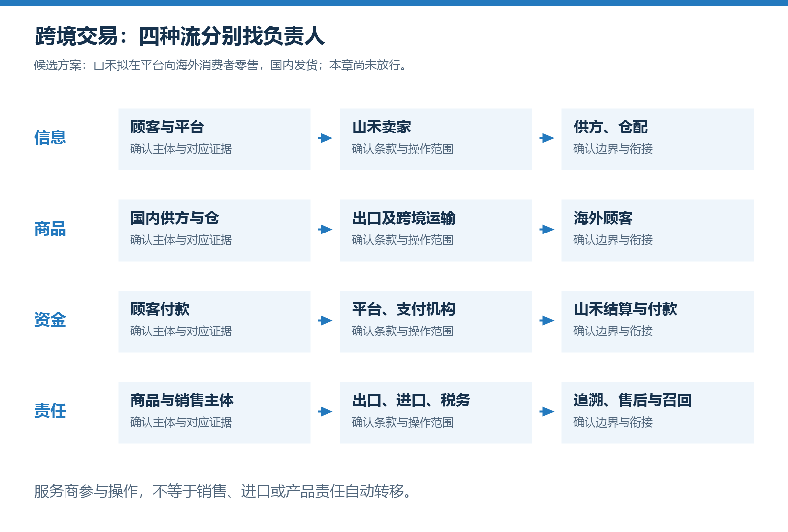

*图 9-1　货物经过某个服务商，不代表所有权、销售收入或全部责任转给了它。*

“包清关”“包税”“全托管”等商业描述必须拆成合同约定、合法服务范围、申报和付款凭证。服务商替你操作的事项、山禾仍承担的事项，以及服务商履约失败时的追索，分别写清。

### 1.3　监管方式代码不是经营模式的万能答案

跨境零售出口、跨境 B2B 直接出口、出口海外仓等，可能对应不同监管安排。例如 9710 对应跨境电商 B2B 直接出口、9810 对应跨境电商出口海外仓。**业务模式、交易证据和实际物流应先清楚，再由实际业务参与方核实适用监管方式与当期要求**。代码不能代替产品准入、进口手续或税务核查。[江门市商务局：跨境电商 B2B 出口模式答问](https://www.jiangmen.gov.cn/gzhd/zhzw/content/post_2619652.html)

本章只认识区别，不依据历史介绍页面推断现在的完整申报、备案或优惠条件。正式业务还需核对海关现行要求、实际口岸与服务安排，第十章再连接具体交付资料。

**练习 9-1**　服务商说：“你用我们的海外仓，平台就负责卖货，也负责进口和产品安全。”这句话至少漏了哪三项核实？

**参考答案**　要核实终端销售合同中的卖方是谁、进口申报及税务由谁负责、商品所有权及风险何时转移、产品安全与售后义务由谁承担。海外仓通常描述履约环节，不能仅凭仓型推定平台购货或全部责任转移。还需检查各方资格及书面合同能否覆盖真实商品与交易。

**本节交付物**　一张写出买方、卖方、货物流向、收款主体及责任主体的业务结构图；未知项标为待核查。

---

## 第二节　海外有人喜欢，就代表有生意吗？

研究服务商发来十份访谈记录。有受访者喜欢杯子的颜色，运营想把这些人全部填进销售预测。你要求先分清“听懂了”“感兴趣”“愿意支付”和“实际保留订单”。

**本节目标**　从客群与使用情境形成可验证的需求假设，理解访谈、竞品和交易证据各能说明什么。

### 2.1　先写具体的顾客与任务

山禾拟研究的客群是：在新加坡生活、日常通勤、需要便携饮水容器的成年消费者。这是一个待验证的选择，不代表所有当地消费者，也不代表儿童、医疗或特殊功能用途。

先问顾客如何解决问题：在家灌水还是途中买饮料？杯子要放在什么包里？饮料温度、清洗方式、重量、容量和防漏要求是什么？购买时顾客能否理解材料与使用限制，是否接受交付时长和退货安排？

| 研究问题 | 可以找的证据 | 可能改变的业务决定 |
|---|---|---|
| 有没有高频且未被满足的使用任务 | 分群访谈、使用观察、同类评价 | 选客群、规格和主张 |
| 顾客目前用什么替代 | 实际用品、竞品和线下选择 | 是否有差异、价格是否有依据 |
| 愿意为什么付钱 | 带价格与服务条件的选择测试 | 价格、交期、售后和页面重点 |
| 能否以可承受成本触达 | 渠道样本、广告实验设计、费用口径 | 渠道与获客预算 |
| 能否交付并留下贡献 | 可核实的供应、合规、物流和回款资料 | 是否进入下一阶段 |

研究不能只收集好评。应记录招募渠道、时间、人数、筛选条件、问题原文和负面反馈，避免把熟人样本包装成当地市场统计。

### 2.2　理解市场空间，但不要凭人口乘售价立项

TAM 表示所定义需求的总体市场空间；SAM 是在区域、商品、规则与渠道条件下可服务的部分；SOM 是特定时间及能力约束下有可能获取的部分。三个数的定义、期间和计量单位必须一致。

例如“当地人口 × 人人买一个 × 售价”既没有证明购买频次，也没有扣除不符合客群的人，更没有证明山禾能触达和交付。SOM 也不能简单等于一个想要的市场份额。

本章没有可靠的真实市场规模数据，因此**不编造当地杯具市场金额**。先提交证据缺口和验证方法，比给一个看似精确的市场规模更有用。若以后用行业报告，要核对杯具范围、含税与币种、线上线下、销量与销售额、年份及数据方法。

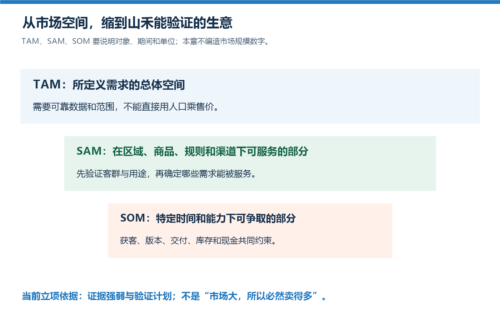

*图 9-2　市场规模帮助理解空间，山禾的可执行试点仍受证据、库存和资金约束。*

### 2.3　十个人的访谈，到底说明了什么

本次十位候选用户的访谈为**虚构教学样本**，不代表概率抽样，也不用于估计当地总体转化率。服务费 600 元已包含本轮资料整理及访谈协作；没有另付下列人物购买补贴，也没有海外成交。

| 访谈观察 | 人数 | 本轮可以解释什么 |
|---|---|---|
| 参与同一轮访谈 | 10 | 样本基数，不是店铺流量 |
| 能正确复述英文草稿主要用途和限制 | 9 | 这个草稿在这些人中的理解情况 |
| 愿意继续了解价格与服务条件 | 6 | 有进一步沟通意愿，不是下单 |
| 上述六人中要求更多防漏或清洗依据 | 3 | 属于六人的子集，应补证据与说明 |
| 已支付并保留的海外订单 | 0 | 没有验证实际成交、复购或获客成本 |

九人与六人来自不同问题，可能重叠；三人包含在六人中。不能相加成十八人，也不能把“六人感兴趣”写成“海外转化率 60%”。还没有曝光、访问、支付和退货的完整链路。

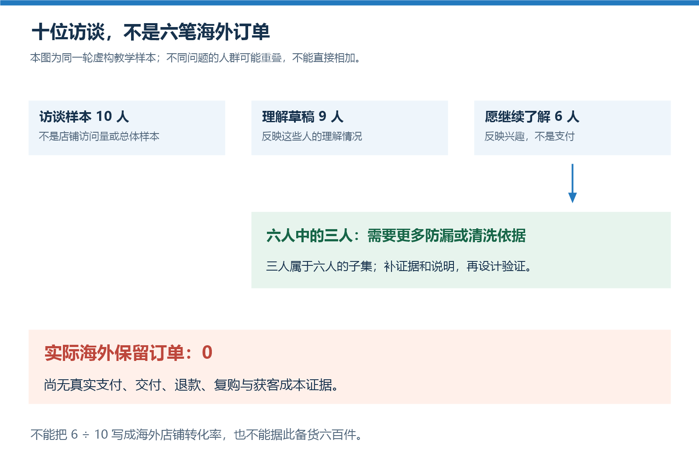

*图 9-3　理解和兴趣是前期证据；真实支付、交付及保留结果要在放行后的试点验证。*

竞品研究也要统一比较条件。记录容量、材料、品牌、实付价格、优惠、税与运费、交付、售后、评价内容和采集日期。标价很高但销量未知的商品，不能直接当成山禾可取得的成交价。复制竞品图片、品牌名或未经证实的功能宣传，还会引入知识产权及误导风险。

**练习 9-2**　请改写：“新加坡用户转化率达到 60%，可以按月销 600 件备货。”

**参考答案**　“十位候选用户中有六位愿意继续了解，其中三位要求补充防漏或清洗证据；样本不代表总体，也未发生实际支付。建议先补齐商品证据和价格、交付条件，再设计小规模交易验证。现阶段不能据此确认月销 600 件或下采购单。”

**本节交付物**　一份含研究对象、证据来源、已知结果、反例、信息缺口及下一步验证的研究表。

---

## 第三节　三个市场，怎样确定先研究哪一个？

团队把美国、德国、新加坡放在一起比较。有人认为美国需求大，应该直接选美国；有人认为距离近就一定便宜。你要求把比较依据和不能绕过的门槛分别列出。

**本节目标**　用统一口径比较候选市场，理解评分只能帮助安排验证顺序，不能授予销售资格。

### 3.1　先定义标准，再填写分数

本轮先做相对比较：每项 1—5 分，分数越高表示对山禾当前阶段越有利。需求证据既看问题强度，也看证据质量；运营适配看语言、客服和渠道能力；供应履约看当前商品、交付和售后安排；准入准备度只评价资料距离下一次核查有多远。

**下表全部是教学设定，不能解释为三个国家的真实营商、合规难度或市场吸引力排名。** 团队应在实际使用时重新采集证据、评分并记录分歧。

| 市场比较项目 | 权重 | 美国 | 德国 | 新加坡 |
|---|---|---|---|---|
| 需求证据 | 25% | 5 | 4 | 3 |
| 单笔经济性假设 | 25% | 3 | 3 | 3 |
| 现有运营能力适配 | 20% | 2 | 2 | 4 |
| 供应与履约适配 | 15% | 2 | 2 | 4 |
| 准入资料准备度 | 15% | 2 | 1 | 3 |
| 加权总分 | 100% | 3.00 | 2.60 | 3.35 |

例如新加坡：3 × 25%＋3 × 25%＋4 × 20%＋4 × 15%＋3 × 15%＝3.35。这里的“经济性 3 分”来自待询价的粗模型，不表示已取得有效物流、平台和税务报价。

### 3.2　硬门槛不能被高分抵消

如果某杯盖材料缺少可适用的安全资料，即使需求满分，也不能用其他优势抵消；进口责任主体不清，也不能用“平台流量好”替代。

| 放行前必须回答的问题 | 本章状态 | 未完成时允许做什么 |
|---|---|---|
| 具体产品、材料、用途和目标市场要求是否匹配 | 未完成逐项确认 | 收集资料、询问合资格机构，不作准入承诺 |
| 销售、出口、进口、税务、当地所需主体责任是否清楚 | 初步设计，尚未合同确认 | 比较方案，索取主体和合同资料 |
| 知识产权与页面宣传能否使用 | 初筛计划，未完成检索审查 | 修改草稿、检索、补证据，不直接发布 |
| 实际渠道、物流及售后是否可用 | 报价和条款待确认 | 询价与服务评估，不承诺消费者时效 |
| 资金、库存和试验损失是否在批准范围内 | 形成条件方案，尚未启动试销 | 复查经济模型和国内需求 |

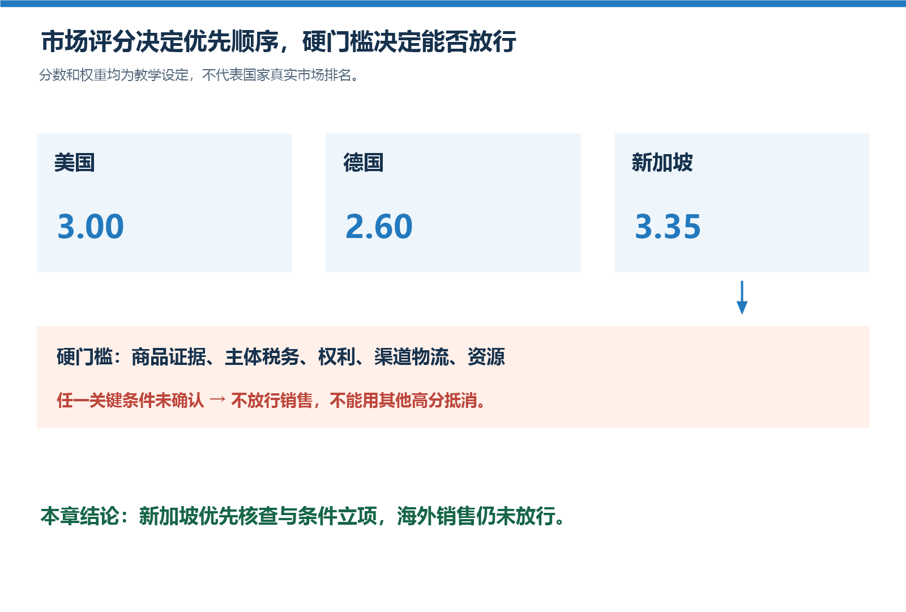

*图 9-4　3.35 分决定优先核查，不改变“门槛未完成”的状态。*

本章因此选择**新加坡作为优先研究和条件立项对象**，美国、德国保留为候选市场，不是认定它们不值得做，也不是同时启动三个国家。若新加坡资料或实际成本不符合要求，就退回研究或停止，不能为了维护原评分而修改事实。

### 3.3　把分数变成后续问题

一个有用的结论应说明：为什么此刻优先、依据有多弱、还缺什么、由谁补、何时再评审。山禾给每项关键假设标记“官方规则已查入口”“服务商待书面报价”“用户小样本”“未核实”，避免把同样的分数误当成同样强的证据。

还要做权重敏感性。例如若负责人更重视需求规模，应调整需求权重并相应减少其他权重，再看顺序是否改变；不能只给美国加权而不让总权重回到 100%。若换一种合理权重就改变结论，说明需要更多证据，而不是证明某一个权重绝对正确。

**练习 9-3**　新加坡准入准备度从 3 分降到 1 分，其他不变，总分是多少？若材料核查仍未完成，分数是否决定能否上线？

**参考答案**　总分减少（3−1）× 15%＝0.30，变为 3.05。它仍高于表中美国的 3.00，但未完成的硬门槛仍阻止销售放行。可以继续比较研究投入，不能凭 0.05 分优势宣告可售。

**本节交付物**　一份带证据强弱、硬门槛、责任人和复查条件的市场优先顺序，不只交一张评分榜。

---

## 第四节　国内能卖的杯子，能直接拿到海外卖吗？

采购发来一份旧报告：“同一家工厂的杯子，以前测过。”你继续追问：“测的是哪一款、哪些部件、哪种用途？是不是这次供货的材料来源？报告结论能否支持目标市场的要求？”

**本节目标**　建立区域商品版本、资料证据及准入核查路径，连接本地化、品牌、产品质量和供应链追溯。

### 4.1　先定义准备卖的商品版本

本轮先研究黑色 500 ml 原款，国内供货标识为 **SH500-BK**。团队创建区域候选版本 **XB500-BK v0** 的资料草稿，它还不是已放行商品，也没有因此增加两份实物库存。

| 区域版本资料项 | 要固定的内容 | 不完整会带来什么问题 |
|---|---|---|
| 基本身份 | 供方型号、山禾标识、容量、颜色、照片和版本日期 | 报告、页面和发货实物对不上 |
| 材料与部件 | 杯体、内胆、杯盖、密封件、涂层等及来源 | 无法判断食品接触、化学或其他安全要求 |
| 预期用途 | 饮料类型、温度、接触时长、清洗方式、限制与目标人群 | 测试条件或宣传超出证据 |
| 包装与标签 | 语言、标识、警示、责任主体信息及追溯字段 | 顾客误用、信息不完整或不能追踪 |
| 质量控制 | 批次、验收标准、变更审批和不合格处理 | 原报告不能覆盖变更后的供货 |
| 页面与品牌 | 商标、图文授权、功能主张及对应证据 | 侵权、误导或无法解释投诉 |

资料应能连接供应商、生产批次、采购接受、仓库实物和终端页面。换密封圈、涂层、材料来源或标签，不一定意味着所有旧证据都失效，但必须评估影响并确认是否重审、补测或更新声明；采购不得自行替料后继续沿用旧版放行。

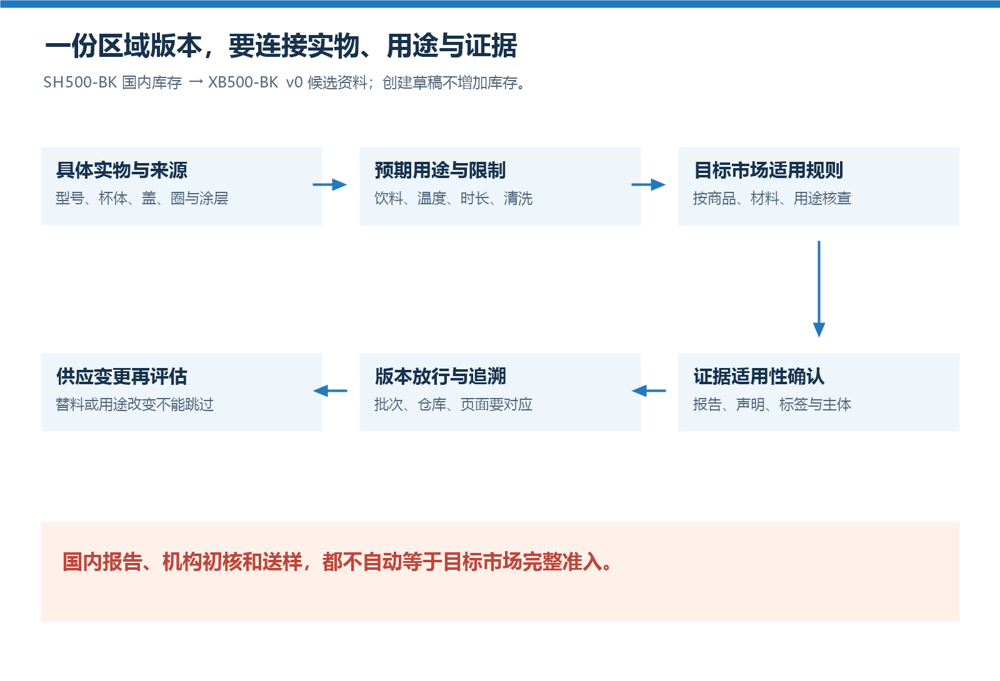

*图 9-5　从具体实物、用途到适用规则和证据，不从一张报告名称反推全球可售。*

### 4.2　不同市场要分别查，不能寻找一张“全球通行证”

管理者不必背完所有法规，但要知道从哪里查、按什么对象查、谁能确认，以及未确认时怎样阻止上线。

美国 FDA 的食品接触资料强调按组成物质、适用授权、材料来源和使用条件判断；其中 FCN 的适用还与所列制造商、物质和使用条件有关。因此“工厂有一张 FDA 证书”不足以证明本次整杯、所有材料和全部用途都适用。[FDA：食品接触材料组成物质的监管状态](https://www.fda.gov/food/packaging-food-contact-substances-fcs/determining-regulatory-status-components-food-contact-material)

欧盟食品接触材料有通用框架 Regulation (EC) No 1935/2004 及良好生产规范 Regulation (EC) No 2023/2006；特定材料还可能有专门措施，且部分情形要核对成员国规则。德国候选市场因此不能仅用“欧盟报告”四个字结束核查，材料、用途、当期修订和德国适用要求都要继续确认。[欧盟委员会：食品接触材料法规框架](https://food.ec.europa.eu/food-safety/chemical-safety/food-contact-materials/legislation_en)

新加坡候选市场先按商品分类确认主管要求。一般消费品安全规则与受控商品安全要求是不同入口，应核实本款空杯及部件的适用分类、相关标准、标签与安全证据；还需核查食品接触等具体问题对应的适用要求。**本章没有据此判定这款杯子已经合规，也不把食品进口许可自动当成所有空杯的许可要求。**[新加坡 CPSO：消费品安全规则概览](https://www.consumerproductsafety.gov.sg/suppliers/cgsr/overview-of-cgsr/)

不要把“有 CE 标志”“某平台能上传报告”当成普遍准入证明。先确认具体适用的法律与商品类别，再判断是否需要某项标识、测试、声明或注册。对于本章非电动杯，团队仍按具体材料和用途核查，不凭经验宣布统一所需证书清单。

本轮 **900 元**为国内机构的文件整理和初步技术核查服务费；不代表已完成全部测试、取得任何政府许可，或使全部候选国家都可销售。机构的资格、项目范围、交付物、适用性结论及补充工作需另行核实。

### 4.3　本地化要覆盖体验，品牌要覆盖使用权

本地化不止翻译：规格和单位是否清楚，图片是否展示真实容量与结构，警示和清洗限制能否理解，配送和退货是否兑现，客服时间与语言能否覆盖，都影响顾客决策。不能为了转化把“不适用的使用方式”从页面删掉。

本轮英文草稿测试及修改花费 500 元。九位受访者能理解草稿，不等于标签已经满足法规；消费者理解测试与法律技术审查是两类证据。

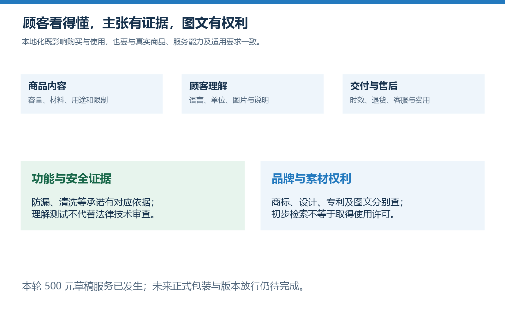

*图 9-6　承诺、证据、图文权利及售后能力应互相匹配。*

品牌还包括名称、标识、包装、素材授权和商标布局。WIPO 的全球品牌数据库可以作为商标检索入口，但应继续检索相关国家或地区注册簿；“查不到”不等于没有冲突，更不等于取得注册或使用许可。外观设计、专利、图片、字体及第三方素材的权利另行审查，不能用商标检索代替。[WIPO：Global Brand Database](https://www.wipo.int/en/web/global-brand-database)

本轮从黑色原款中领出 **2 件 × 42 元＝84 元**，交给**国内**核查机构作为测试样品，已耗用或由机构留存且不再返回销售。山禾将 84 元计入研究样品消耗；没有开出销售订单，没有出口，也没有海外客户签收。这两件与仓内原有四件零账面隔离品分开记录。

**练习 9-4**　供应商提供另一型号的旧报告，并说密封圈只是换了来源，不影响卖货。你应做什么？这次送样 84 元是否等于新增现金支付？

**参考答案**　对照本次型号、部件、材料来源、用途和报告范围，要求供应商说明变更并由合资格人员评估证据是否适用、是否需补测或重审。在确认前不放行对应版本。两件样品已从原有库存转入研究消耗，84 元减少存货并增加费用，不再次减少银行；机构服务费 900 元则是另付的现金费用，二者不能漏记或重复。

**本节交付物**　一份区域版本资料表和准入证据清单：每项写适用对象、来源、范围、状态、责任人及放行条件。

---

## 第五节　上平台、做独立站，还是找经销商？

创始人问：“独立站不交平台佣金，是不是更赚钱？”运营补充：“平台仓发货快，是不是风险也小？”你把白板分成三栏：谁向谁买、在哪里成交、从哪里交货。

**本节目标**　分别选择交易模式、获客成交渠道和履约网络，用责任矩阵识别能力缺口。

### 5.1　把三个选择拆开再组合

**交易模式**回答买卖双方及收入关系；**渠道**回答如何触达与成交；**履约方式**回答存放、运输和交付。不同维度可以组合，不应互相替代。

| 候选交易与渠道 | 可能的优势 | 山禾必须补齐的能力或代价 |
|---|---|---|
| 第三方平台面向消费者零售 | 可利用平台场景、交易工具和既有消费者习惯 | 准入、竞争、费用、规则、账户与结算风险；山禾的商品及售后义务仍要核实 |
| 独立站面向消费者零售 | 页面和品牌体验更可控，便于经营直接关系 | 自建获客、信任、支付风控、数据保护、税务和客服；软件费与支付费也需计入 |
| 向当地经销商批量销售 | 可借助本地渠道及服务能力 | 批发价、账期、渠道控制、信用风险及终端信息透明度 |
| 向平台或零售商自营供货 | 由采购关系切入，可能减少直接零售操作 | 供货验收、扣款、退供、价格和账期条件；不能把其终端 GMV 全算山禾收入 |

平台费用少，不代表获客费用少；经销商承担部分工作，也会要求相应毛利和条款。独立站可以与平台并存，但山禾目前团队小，不能把多个渠道同时上线当成低成本试点。

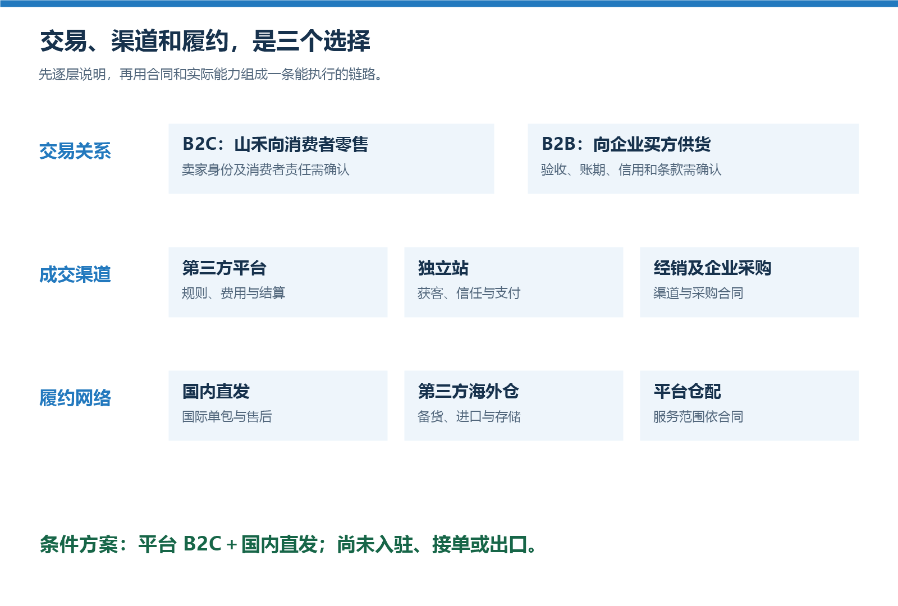

*图 9-7　交易主体、渠道和履约分别确认，再形成能执行的一套组合。*

本轮**条件方案**选择“第三方平台 B2C、山禾拟作为卖家、国内直发”。原因是先集中验证一种客群、一个区域候选版本和一条链路。平台尚未确定并开通，报价和合同尚未确认，因此此处不是宣布已经入驻。

### 5.2　直发、海外仓和平台仓各改变什么

国内直发减少先把一批货放到海外的需要，但国际单包运输、交付不确定性和售后可能更难；海外仓让商品更接近顾客，却增加头程、进口、库存、仓储、滞销与逆向处理。平台仓是由平台体系提供的仓配服务，具体支持与责任取决于合同，不是一种必然的买断采购模式。

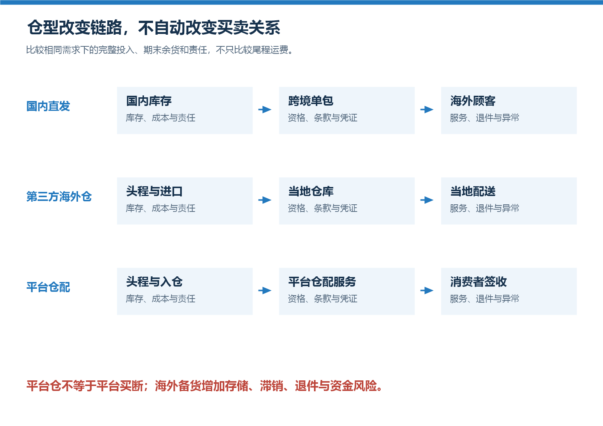

*图 9-8　比较完整链路和期末余货，不仅比较最后一段运费。*

山禾当前只有小规模候选试点，没有海外需求保留订单证据，先不批准海外备货。以后若比较海外仓，应在相同需求情景下加入入仓、储存、订单作业、尾程、退件、销毁或调拨、税费、结算与库存资金，不能把国内直发的 35 元教学假设直接改名为“海外仓全包价”。

### 5.3　用责任矩阵确认“有人操作”与“谁承担义务”

负责日常操作的服务商，与法律、合同或税务上的责任主体可能不同。下面是一份**待确认的分工草案**，不是已经签订的授权或合规结论。

| 责任事项 | 本轮拟主责或核查人 | 放行前需要的依据 |
|---|---|---|
| 商品版本、供应变更、追溯及质量 | 山禾商品质量负责人，供方配合 | 版本、材料、适用证据及放行记录 |
| 卖家身份、消费者条款和售后 | 山禾运营负责人，法务支持 | 平台合同、页面、退货和投诉流程 |
| 中国出口申报安排 | 山禾供应链负责人核查，合资格服务商操作 | 适用路径、主体资格、申报资料及合同 |
| 海外进口及当地所需主体 | 山禾供应链与法务共同核查 | 明确进口责任及当地要求，不能仅写“物流解决” |
| GST、其他适用税费及票据 | 山禾财务核查，实际主体依法履行 | 平台、卖家、进口环节各自适用义务及凭证 |
| 收款、外汇和结算对账 | 山禾财务，支付机构协作 | 收款资格、扣费、准备金、周期、退款和汇兑规则 |
| 运输、丢损、退回与召回协作 | 山禾供应链与客服，承运和仓配方协作 | 承诺时效、排除事项、索赔、应急和追溯能力 |

以新加坡 GST 为例，IRAS 对海外供应商、电子市场运营方等分别列明适用情形和条件；特定条件下平台可能被视为相关供应的供应商。因而要按实际交易、主体和注册等条件确认，而不能直接说“平台一定代缴一切”或“低金额一定免税”。本章不据此判定山禾当前必然需要注册或不需要注册。[IRAS：向新加坡供应远程服务与低价值货物的海外企业](https://www.iras.gov.sg/taxes/goods-services-tax-%28gst%29/gst-and-digital-economy/overseas-businesses)

另需明确顾客数据的收集目的、最少字段、访问权限、保存和删除，核查适用的数据保护及营销规则；用平台并不自动免除卖家的数据使用责任。本轮不导出真实海外顾客信息，也不把访谈联系人当作可任意营销名单。

**练习 9-5**　如果将国内直发改为平台海外仓，需要重新核对什么？是否只需把运费改小？

**参考答案**　需重做头程、进口和主体安排、入仓和仓储、当地配送、税费、结算、退件与滞销处理，以及所有权、风险和产品责任分工。还要重算备货、资金时点与期末存货。运费只是其中一项；平台仓不自动买断山禾库存，也不使所有责任转给平台。

**本节交付物**　一份“交易模式＋成交渠道＋履约方式”组合说明，附责任主体、操作方、合同证据和未完成项。

---

## 第六节　海外标价高，试点就一定赚钱吗？

运营看到“29.90”这个外币金额，觉得一单比国内更值钱。财务把物流、渠道、获客和售后逐项填入，又问：“这是什么价格口径？试点固定投入算在哪里？”

**本节目标**　建立明确币种和税费口径的单笔模型，区分单笔贡献、项目结果和现金支出，并测试假设变化。

### 6.1　先写净收入口径，再计算贡献

以下是**未来候选试点模型，尚无实际订单与外币收款**。SGD 为新加坡元。本章假设每个保留订单一件原款，**29.90 SGD 是扣除适用税费或代收税款后的商品净收入口径**，已扣商家承担的优惠，未扣下面列示的平台支付费、物流及其他成本。它不是已验证的消费者前台含税标价，也不是当前竞品成交价。

实际运营时应从顾客支付金额逐项扣除适用税费、退款、优惠及代收款，得到同口径商品净收入；消费者是否另付运费及其税费也要另行确认。本模型假设消费者不另付运费，由山禾承担列示的交付成本；如更改，收入和费用两侧同时更新。

模型汇率 **1 SGD＝5.20 RMB** 是固定教学换算，既不是当日汇率，也不是承诺可成交的结汇价。未来实际的支付、平台与汇兑扣费须按报价重做；下表 14 元已假设覆盖渠道、支付及换汇服务费，不能再用同名费用重复扣减。

| 单笔模型项目 | 人民币元／保留订单 | 本轮定义 |
|---|---|---|
| 商品净收入 | 155.48 | 29.90 × 5.20，未扣下面成本 |
| 商品成本 | 42.00 | 当前黑色原款账面成本；不等于未来任意采购数量可维持该价 |
| 区域包装 | 6.00 | 候选版本新增包装及处理假设，替代国内每单包装口径 |
| 跨境交付服务 | 35.00 | 候选链路运输及配套服务假设，真实全链路报价待确认 |
| 平台、支付及换汇服务 | 14.00 | 统一教学费用假设，不是平台现行费率 |
| 获客 | 20.00 | 每保留订单分摊的假设获客支出，尚未验证 |
| 售后损失准备口径 | 8.00 | 退货、退款、丢损等预期净损失的模型均摊，不是已支付服务费或已确认实际准备 |
| 变动客服服务 | 4.00 | 每保留订单额外服务，不与未来固定投入重复 |
| 变动成本合计 | 129.00 | 42＋6＋35＋14＋20＋8＋4 |
| 单笔贡献 | 26.48 | 155.48−129，用于覆盖未来固定试点投入 |

35 元并不代表已经取得含所有税费的“包税价”。所有适用税费必须进入净收入扣减或成本模型的对应位置，每项只计一次。若后续查出遗漏费用、运输条件或不可用路径，必须修改或停止方案，不能以本教学数字覆盖实际要求。

8 元是经济评估所用的风险损失均摊。为便于比较，29.90 SGD 采用最终保留订单的商品净收入，8 元用于不保留订单及交付异常对这些保留订单形成的**额外净损失**，不再重复扣保留订单的同一笔收入。真实试点需要按支付、取消、出库、退回、恢复及报损分别记录，不能只用这个均摊数对账。

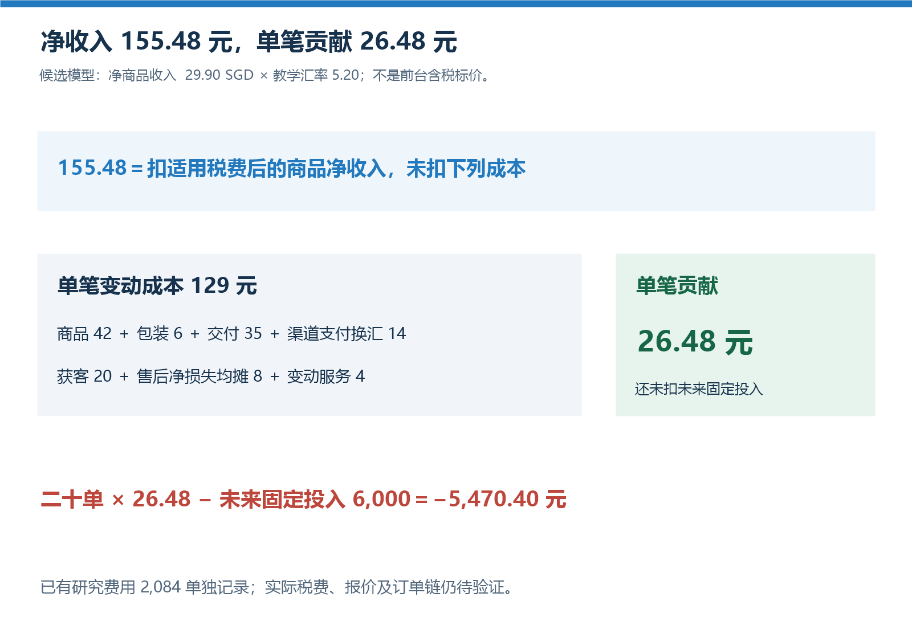

*图 9-9　海外价格先统一成净收入，再扣完整且不重复的增量成本。*

### 6.2　二十单试点的目的是什么

计划另需 **6,000 元未来固定试点投入**，用于尚未发生的后续验证、设置和启动工作，待拿到有效范围及报价后才可能支出；未发生任何预付或应付。这 6,000 元**不含本章已经发生的 2,084 元研究费用**，不把旧费用换个名字再收一次。

候选首轮控制在 **20 个最终保留订单**。20 不是需求预测已被证实，也不是现在已接单。若实际有取消、退件、补寄或样品需求，出库数和库存占用可能超过保留订单数，因此上线名额还需受实际可发量及异常缓冲约束，不能先超卖再解释。

在恰好完成二十个保留订单、其余均按模型分摊的情形下：

> 预计试点结果＝20 × 26.48−6,000＝**−5,470.40 元**。

这是一项可能获准的小额学习投入，不是盈利扩张。即使一单贡献为正，也不足以覆盖二十单试点的固定投入。负责人应明确愿意为哪些新证据承担多少损失，以及缺少学习结果时怎样停止。

若所有单笔条件不变，覆盖 6,000 元固定投入所需保留订单为：

> 向上取整（6,000 ÷ 26.48）＝**227 单**。

227 只是同一假设下的数学结果，不是需求预测，也不是采购指令。当前黑色可售仅 41 件，还要支持国内业务；要扩大必须重做商品版本、获客、供应、起订、质量、库存及资金计划。原款常规黑白各起订 100 件的约束并未取消，不能无依据地写成“随时追加 60 件，每件仍然 42 元”。

模型总成本 6,000＋20 × 129＝**8,580 元**。其中商品账面成本 840 元来自已拥有的库存，售后净损失假设 160 元未必在同日实际支付，平台费用可能从结算扣除。因此 8,580 元也不是一笔需要立即全额预付的新现金；第十章再按真实条款拆日期、扣费、回款和资金低点。

### 6.3　先看敏感性，再讨论能否放大

下面每行只改变一个假设，其他保持基准；金额均为人民币。它们都是独立演练，不进入本章实际。

| 独立模型情景 | 单笔净收入 | 单笔变动成本 | 单笔贡献 | 二十单扣固定投入后 | 覆盖固定投入所需保留单 |
|---|---|---|---|---|---|
| 基准：汇率 5.20、交付 35 | 155.48 | 129.00 | 26.48 | −5,470.40 | 227 |
| 汇率改为 5.00 | 149.50 | 129.00 | 20.50 | −5,590.00 | 293 |
| 交付改为 45 | 155.48 | 139.00 | 16.48 | −5,670.40 | 365 |
| 交付改为 65 | 155.48 | 159.00 | −3.52 | −6,070.40 | 无正单笔贡献，不能靠放量覆盖 |

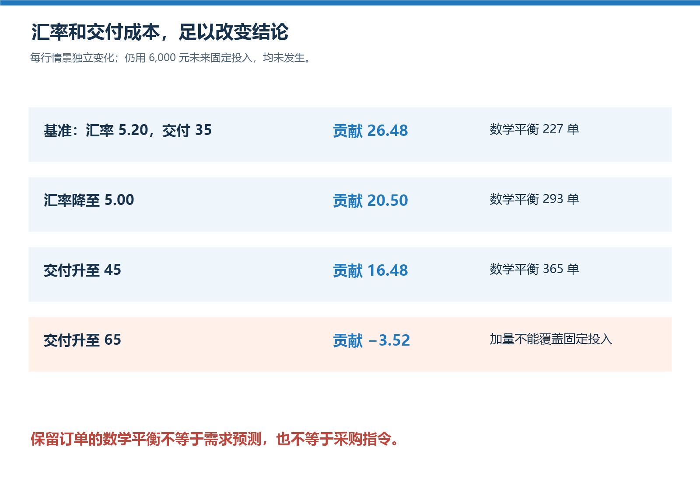

*图 9-10　单笔贡献转负时，继续加量会扩大损失；单笔贡献为正也不代表小试点能盈利。*

长期经营还需考虑经营主体税费、人员和管理、持续合规、产品责任、固定系统等完整成本，不能把 26.48 元称为企业净利润。汇率变化可能同时影响其他外币费用，本表暂时只变净收入，真实模型要检查所有相关币种。

**练习 9-6**　若交付费用上升到 45 元，运营建议把首轮从二十单增加到一百单，“这样就不会亏”。按本模型判断，并说明还有哪些执行约束。

**参考答案**　单笔贡献变为 16.48 元，一百单结果＝100 × 16.48−6,000＝−4,352 元，仍不能覆盖固定投入；数学盈亏平衡需 365 个保留订单。实际还缺需求证据、已放行版本、有效报价、库存和供应能力，不能为摊薄固定费而扩大未验证采购。需要重新评估学习目标、资源和停止条件。

**本节交付物**　一张注明收入税费口径、汇率、成本范围、固定投入、敏感性和现金差异的试点经济模型。

---

## 第七节　怎样提交一份可控的跨境立项方案？

团队研究完，创始人问：“结论是不是现在就卖？”你把申请分成研究结项、补证和试点启动：“可以决定下一步核查，但商品和交易链未放行，不能先收款试试看。”

**本节目标**　把研究转成有阶段、预算、证据、负责人及退出条件的立项方案，并保护国内经营。

### 7.1　区分研究支出、未来预算和实际承诺

本章已经发生的人民币现金研究上限为 **3,000 元**，实际使用 2,000 元；另耗用库存样品 84 元，所以研究总费用为 2,084 元。剩余现金预算 1,000 元没有自动变为费用、应付或可售商品。

未来条件试点另设拟议**新增现金支出累计上限 9,000 元**；只有逐项条件完成并经公司内部批准后才可能启动。目前没有拨款、划转、付款或签订不可撤销承诺。这个上限不同于“允许亏损 9,000 元”，也不是已经认可全部费用齐全。

| 项目阶段 | 支出或资源口径 | N14 实际状态 |
|---|---|---|
| 本章市场研究、文件初核及本地化 | 现金预算上限 3,000，实际现金 2,000 | 研究服务已交付并支付 |
| 本章国内测试样品 | 2 件 × 42，非新增现金 84 | 库存已减少，研究费用已确认 |
| 后续补证和固定启动工作 | 模型 6,000，属于未来新增范围 | 待范围、报价和阶段批准；未支出 |
| 首轮试点 | 至多二十个保留订单目标，实际名额还受库存及异常约束 | 未接单、未发货、未发生收入 |
| 未来现金约束 | 拟议新增现金上限 9,000 | 只是条件预算，不改变银行实际余额 |

6,000 元固定投入若存在先后依赖，应按验证里程碑拆分，而不是一次支付以求“更快上线”。若实际补证成本已超过预算、准入无法满足或物流路径不可用，应退回立项，不必先花完预算再承认不成立。

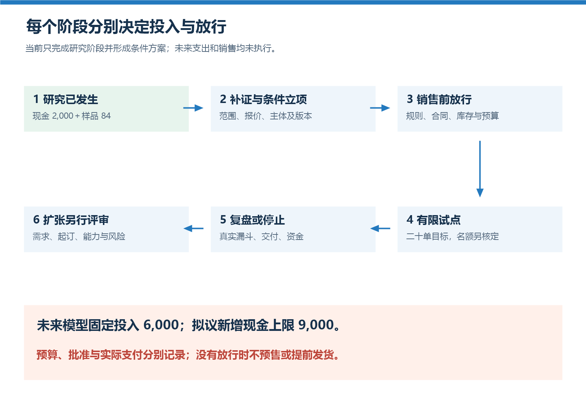

*图 9-11　研究完成、条件立项、销售放行和扩张，是不同决策。*

已花的 2,084 元需要如实复盘；在决定是否继续时，应评估未来新增投入和收益，而不是说“已经花钱，必须继续”。如果评估整个项目累计结果，还要将 2,084 加回项目费用口径，不能让它从历史中消失。

### 7.2　国内业务还要卖，试点库存从哪里来

第八节将核对本期实际：黑色期末可售 41 件。团队拟为下一个国内窗口保留 20 件，这是**未来工作分配假设**，不是已有未发订单，也不是经过统计计算的安全库存。

> 候选跨境库存空间＝41−国内工作保留 20＝**21 件**。

所以提出二十个保留订单的上限目标仍处于当前数量空间内，但这只是立项时的检查。剩下一件不能被当成足以覆盖全部退换补寄风险；上线前还要根据真实服务方案确认异常缓冲、实际可发量、取消退款及出库名额。若需要更多备用件，应减少首次开放名额或重新审批供应，不能挤占国内承诺。

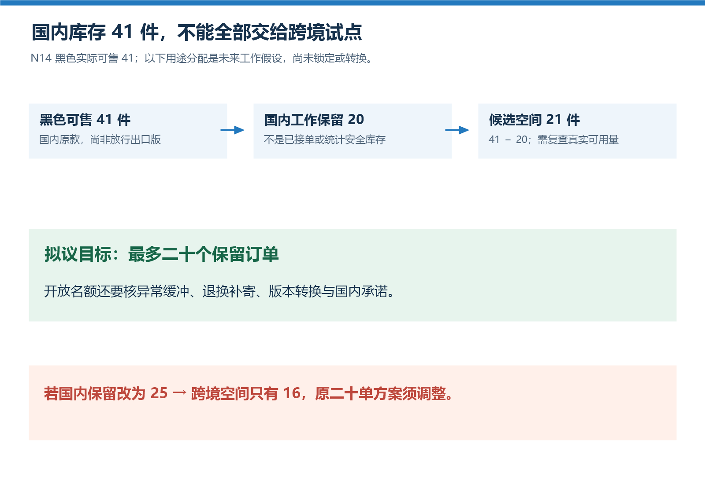

*图 9-12　41 是当前实际，20 是国内未来工作保留，21 是候选空间；本章尚未锁定或扣减跨境库存。*

区域版本未放行时，41 件仍是原有国内库存。待确认现有批次可转换、包装及资料齐全后，才能依据批准方案变更库存状态及用途；若需更换部件或新生产，必须重新评审成本、起订、交期、验收和资金，不能直接把国内库存全部改名出口版。

### 7.3　立项书要能支持否决和退回

山禾 N14 的结论是：“研究阶段结束；将新加坡列为优先验证市场，同意形成附条件试点方案，**尚不放行海外销售或出口**。”以下是管理文件的最小结构。

| 立项字段 | 山禾的条件方案 |
|---|---|
| 目标与假设 | 验证具体通勤客群对区域原款、价格、交付和售后的真实接受情况，以及实际单笔贡献 |
| 市场与版本 | 新加坡优先；XB500-BK v0 仍待准入和版本放行 |
| 模式 | 拟平台 B2C、国内直发，实际平台与链路合同待确认 |
| 范围与上限 | 二十个保留订单目标；现金新增累计上限拟 9,000；开放名额另按可发量及缓冲批准 |
| 前置条件 | 商品准入证据、主体及税务分工、品牌图文权利、渠道和收款资格、物流与售后、预算和库存全部确认 |
| 责任分工 | 运营统筹；商品质量负责版本；供应链负责运输库存；财务负责模型资金；法务及专业机构支持适用性核查 |
| 验证指标 | 访问到保留订单的完整漏斗、实测获客与贡献、交付及异常、客服问题、退款、期末存货与现金 |
| 暂停条件 | 安全或适用性缺口、主体不清、费用超限、单笔贡献恶化、库存或交付承诺失守、账户和结算异常 |
| 恢复与复查 | 对应负责人提交修正证据，重新审批后恢复；不以投放团队自行承诺替代 |
| 扩张条件 | 获得可解释交易与交付结果，重算固定成本、采购起订及现金；另行评审，不自动放大 |

正式试点还应在启动前冻结观察窗口、统计口径和可接受界限，并用实际条款制定订单、发运和退款截止状态。模型二十个“保留订单”不能直接写成前台无限收单，也不能预先保证二十单全部保留。

如果涉及停止销售或产品安全异常，不能仅停广告；还要识别关联批次、冻结出库，按适用要求评估通知、退换、召回及报告等行动，并保存可追溯资料。

**练习 9-7**　负责人已经同意继续研究。运营能否据此预售二十单、支付 6,000 元、锁定二十件并把银行减去 9,000？

**参考答案**　不能。研究继续与实际销售放行、付款授权和库存转换不是同一事项。应完成前置条件、确认合同及具体阶段支出，经相应内部批准后执行；预算不等于支付。本章没有海外订单锁定、预收款或未来付款，因此银行与库存只按本章实际事项变化。

**本节交付物**　一份可以被批准、退回或否决的试点立项书，写明证据、边界、资源、责任和停止恢复条件。

---

## 第八节　做研究的这两周，公司究竟发生了什么？

立项会上大家讨论外币价格时，国内仓库已经发出新一批订单。你最后要求把国内业务和研究投入放回同一家公司核对：“先解释本期结果，再谈未来试点。”

**本节目标**　核对订单状态、存货、现金、研究投入和资产变动，形成可供下一章接手的实际起点。

### 8.1　国内订单没有暂停，也没有凭研究增加海外收入

国内店仍在 A 成交，每单一杯，原款实付 119 元、小杯 99 元，无新券、赠品或其他折扣。平台只按最终保留订单每单收 6 元；本轮取消和退回相应不留该平台费。每次实际出库包装 3、快递 6；顾客退回运费每件 8，均由山禾承担。本期无换货或补寄，三件退回均合格恢复可售。

| 国内订单状态 | 黑色原款 | 米白原款 | 小杯 | 合计 |
|---|---|---|---|---|
| 支付订单 | 14 | 12 | 14 | 40 |
| 发货前取消 | 1 | 0 | 1 | 2 |
| 实际出库 | 13 | 12 | 13 | 38 |
| 签收后退回并退款 | 1 | 1 | 1 | 3 |
| 最终保留订单 | 12 | 11 | 12 | 35 |
| 退回恢复可售 | 1 | 1 | 1 | 3 |

支付额＝26 × 119＋14 × 99＝4,480 元。发货前取消退款＝119＋99＝218；签收后退款＝2 × 119＋99＝337。最终净销售＝4,480−218−337＝**3,925 元**，也等于 23 × 119＋12 × 99。

本期广告 500 元，会员客服 100 元，仓储操作 500 元，均已交付、付款并费用化；范围各自独立，不与包装、运输、研究或未来启动服务重复。无其他本期实际费用或采购，本章模型也不补记尚未执行的未来方案。

| 国内经营核算项目 | 人民币元 | 计算或说明 |
|---|---|---|
| 净销售 | 3,925.00 | 35 个保留订单 |
| 已售商品成本 | 1,374.00 | 23 × 42＋12 × 34 |
| 平台费用 | 210.00 | 35 × 6 |
| 出库包装 | 114.00 | 38 × 3 |
| 出库快递 | 228.00 | 38 × 6 |
| 顾客退回运费 | 24.00 | 3 × 8 |
| 广告 | 500.00 | 本轮实际 |
| 国内交易贡献 | 1,475.00 | 净销售减以上成本及费用 |
| 会员客服 | 100.00 | 本期国内服务 |
| 仓储操作 | 500.00 | 本期国内服务 |
| 国内模型经营结果 | 875.00 | 1,475−100−500 |

本期国内平台净应结＝3,925−210＝3,715 元，已经到账 3,500，期末待结算 **215 元**。旧待结算 911 元在 N1 收回，属于旧应收转现金，不再次产生销售或利润。

### 8.2　把研究现金与样品消耗都记进去

| 本章研究项目 | 本期现金支付 | 本期费用 | 处理说明 |
|---|---|---|---|
| 市场资料及访谈协作 | 600.00 | 600.00 | 本期完成的教学服务 |
| 文件与国内机构初步核查 | 900.00 | 900.00 | 初核，不等于完成准入 |
| 本地化草稿及理解测试 | 500.00 | 500.00 | 本期交付，不是未来固定启动费 |
| 国内测试样品两件 | 0.00 | 84.00 | 从现有黑色库存耗用，2 × 42 |
| 研究合计 | 2,000.00 | 2,084.00 | 现金预算未用的 1,000 不计费用 |

> 本章模型经营结果＝国内 875−研究 2,084＝**−1,209 元**。

样品原本购买时已付过款，本期才从存货转为研究费用。不再减银行，也不继续保留为可售存货或新资产。若真实业务中样品仍可收回、能带来后续价值，应按实际状态和适用核算处理；本案例已明确耗用或留存且不再销售。

### 8.3　库存、银行和资产要核到同一个结果

本期没有新收货、报损、盘点差异或跨境发运。三件国内退货全部回到原成本可售状态；原有四件零账面隔离品仍在原隔离区。

| N14 库存核对 | 期初可售 | 国内出库 | 退回恢复 | 研究耗用 | 期末可售 | 单位成本 | 期末成本 |
|---|---|---|---|---|---|---|---|
| 黑色原款 | 55 | 13 | 1 | 2 | 41 | 42.00 | 1,722.00 |
| 米白原款 | 48 | 12 | 1 | 0 | 37 | 42.00 | 1,554.00 |
| 小杯 | 55 | 13 | 1 | 0 | 43 | 34.00 | 1,462.00 |
| 合计 | 158 | 38 | 3 | 2 | 121 | — | 4,738.00 |

存货成本＝6,196−已售成本 1,374−研究耗用 84＝**4,738 元**。仓内实物＝162−国内出库 38＋退回 3−交国内机构样品 2＝**125 件**，等于可售 121＋旧隔离 4。样品既已离开仓库，就不能同时算入仓内实物。

| 银行实际变动 | 人民币元 |
|---|---|
| 期初银行 | 208,885.88 |
| 收回旧平台待结算 | +911.00 |
| 本期国内平台到账 | +3,500.00 |
| 广告付款 | −500.00 |
| 出库包装付款 | −114.00 |
| 出库快递付款 | −228.00 |
| 退回运费付款 | −24.00 |
| 会员客服付款 | −100.00 |
| 仓储操作付款 | −500.00 |
| 研究服务付款 | −2,000.00 |
| 期末银行 | 209,830.88 |

平台费 210 元已经从应结款中扣除，不另列银行重复付款；已售成本和样品成本来自存货，也不再从银行扣一次。本期现金支出合计 3,466 元，收款 4,411 元，银行净增 **945 元**，与期初期末之差一致。

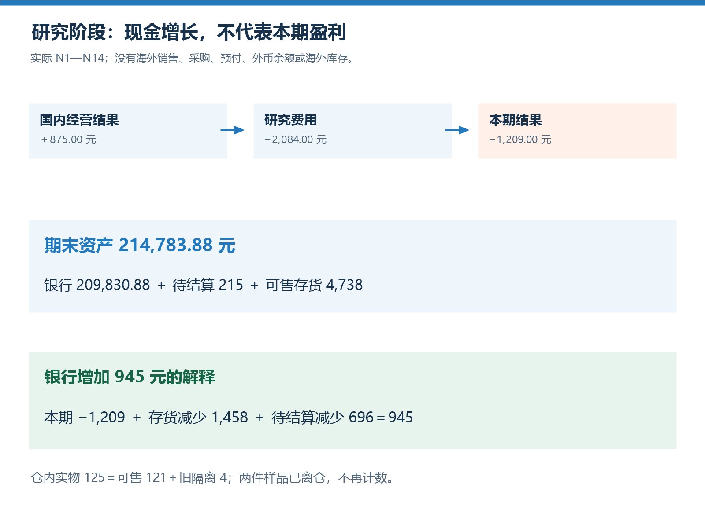

*图 9-13　银行增加 945 元与本期结果 −1,209 元可以同时成立；应收和存货变化解释差异。*

| N14 案例资产核对 | 人民币元 |
|---|---|
| 银行 | 209,830.88 |
| 国内平台待结算 | 215.00 |
| 可售存货 | 4,738.00 |
| 其他列示资产 | 0.00 |
| 案例资产合计 | 214,783.88 |
| 相对期初资产变动 | −1,209.00 |
| 相对最初 200,000 的累计案例结果 | 14,783.88 |

也可从现金变化解释：本期结果 −1,209，存货减少 1,458，平台待结算减少 696，因此银行变化＝−1,209＋1,458＋696＝**945 元**。库存变现和旧款回收让现金增加，不能据此说研究阶段已经盈利。

期末没有采购预付、在途、应付、未发锁定、海外库存、外币余额或待收海外货款。57,000 元用途预留仍包含在 209,830.88 元银行内；二十单、6,000 元和 9,000 元仍是未来条件方案，不改变本章实际。

### 8.4　综合作业：主持一次跨境立项评审

你要向创始人和运营、质量、采购、仓配、财务共同提交一份方案。除下面独立追问外，统一使用本章实际数据与模型，不另加未说明的成交、采购或付款。

1. 画出候选跨境业务的买卖关系、信息、商品、资金和责任，列出至少五个尚未放行的问题。
2. 解释十位访谈与三个市场评分为什么只支持“优先验证”，不能支持销售资格或销量承诺。
3. 提交 XB500-BK v0 的资料表：列出材料、用途、标签、主张、品牌及供应变更的证据缺口与责任。
4. 比较平台零售、独立站和经销，说明为什么本轮拟选平台 B2C 国内直发，以及什么证据可能推翻选择。
5. 算出基准贡献、二十单试点结果及数学盈亏平衡，解释 8,580 元模型成本、9,000 元现金上限与 2,084 元历史研究费用的不同。
6. 核对 N14 国内订单、库存、银行和资产，说明银行增加为什么不等于本期盈利。
7. 写出结论、下一步、责任、预算和停止条件。独立追问：若下一个国内工作保留从 20 调成 25 件，当前可分配给跨境的数量空间怎样变？

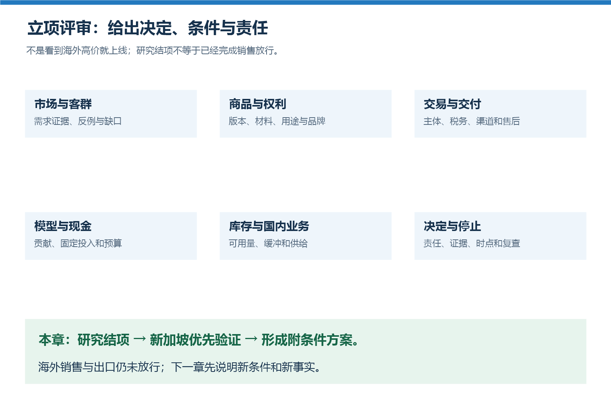

*图 9-14　评审应得出有范围、有条件、有责任的决定，而不只批准“尝试出海”。*

**综合作业参考答案**

1. 山禾拟面向海外消费者零售，平台与支付提供交易收款服务，国内仓和物流负责相应作业。商品准入、实际卖家及进口主体、税务、品牌与图文、平台准入收款、物流与售后等仍需核实；“服务商全包”不能替代各自证据。
2. 六人兴趣不等于六个保留订单；评分基于教学资料且带不确定性。3.35 只确定优先核查，硬门槛未通过仍不放行。
3. 将本次实物型号、部件来源和用途与报告对应，确认标签和限制、材料与功能证据、品牌权利及供方变更控制。900 元初核和两件样品不等于已经取得目标市场全部准入。
4. 平台方案暂时聚焦一条小试点链路；独立站需要额外获客与基础能力，经销有批发毛利和信用条款。若平台费用、主体要求或物流售后不可行，须重做比较或停止，并非必须维持初选。
5. 基准贡献 26.48；二十单扣固定投入后 −5,470.40；按不变条件数学平衡 227 单。8,580 是未来经济模型总成本，含已有存货成本及预期损失，并非全部新现金预付；9,000 是拟议未来现金支出上限，未发生；2,084 是本期实际研究费用。若计算含历史研究的累计项目情景结果，则为 −5,470.40−2,084＝−7,554.40 元，但本章实际仍只记 −1,209。
6. 国内保留 35、净销售 3,925、国内经营结果 875；研究费用 2,084；本期结果 −1,209。期末可售 121、成本 4,738，实物在场 125；银行 209,830.88、待结算 215，资产 214,783.88，累计案例结果 14,783.88。旧款回收和库存减少使银行增加 945，不创造额外利润。
7. 建议研究结项，优先补齐新加坡候选版本与交易链证据，形成附条件试点立项；海外销售仍未放行。若国内工作保留改为 25，则数量空间为 41−25＝16 件，原二十单方案不再满足数量约束，应减少名额、调整方案或另行评审供应。此独立追问不改写 N14 实际库存，也不是自动批准补货。

**本章完成标准**　能说清“卖给谁、由谁卖、从哪里交付、谁负责、依据是什么、如何赚钱、最多投入多少、何时停止”，并能核对实际经营结果。只写“市场很大、平台很强、海外价格高”不足以完成立项。

下一章《从跨境订单到海外交付与回款》将在具体条件完成的业务背景下，继续学习订单、贸易与交付资料、收款结算、运输、海外仓和逆向物流。届时必须先说明哪些条件已完成、发生了哪些新事实；不会把本章未执行的试点直接当成已有海外销售。

---

## 附录　参数、结果与核查资料

### 实际与未来方案对照

| 口径 | 本章结论 |
|---|---|
| 实际期间 | N1—N14，两周；国内经营与研究服务发生，未启动跨境销售 |
| 国内支付／取消／出库／退回／保留 | 40／2／38／3／35；退回三件全部恢复 |
| 国内净销售／国内模型经营结果 | 3,925／875 元 |
| 研究实际现金／样品／费用 | 2,000／84／2,084 元 |
| 本章实际模型经营结果 | −1,209 元 |
| 期末可售 | 黑 41、白 37、小杯 43；共 121，成本 4,738 元 |
| 期末实物 | 可售 121＋旧零账面隔离 4＝125；样品两件已离仓 |
| 期末银行／平台待结算 | 209,830.88／215 元 |
| 期末资产／累计案例结果 | 214,783.88／14,783.88 元 |
| 未动用的用途预留 | 57,000 元，包含在银行内 |
| 候选市场／版本 | 新加坡优先核查；XB500-BK v0 草稿，未放行 |
| 未来单笔模型 | 净收入 29.90 SGD，教学汇率 5.20，贡献 26.48 元 |
| 未来固定投入／拟议现金上限 | 6,000／9,000 元，均未执行 |
| 未来二十单结果／数学平衡 | −5,470.40 元／227 个保留订单，均非需求或销量承诺 |

### 官方资料与核查范围

以下页面于 **2026-11-17** 核查。资料解释核查入口和部分概念，不是对本款商品、全部税务或全部运输安排作出的放行。发生规则、材料、用途、主体、市场或链路变化时重新确认；正式启动应保存适用条文版本、机构意见、报告和合同。

| 官方页面 | 本章使用范围 | 仍需继续确认 |
|---|---|---|
| [江门市商务局：跨境电商 B2B 出口模式答问](https://www.jiangmen.gov.cn/gzhd/zhzw/content/post_2619652.html) | 仅用于 9710、9810 术语和路径对照；该答问发布于 2022 年 | 当期海关要求、实际监管方式和申报条件；不据此推断完整现行手续或税收优惠 |
| [FDA：食品接触材料组成物质的监管状态](https://www.fda.gov/food/packaging-food-contact-substances-fcs/determining-regulatory-status-components-food-contact-material) | 组成物质、使用条件和 FCN 来源范围的重要性 | 本款各部件的具体适用依据及完整市场要求 |
| [欧盟委员会：食品接触材料法规](https://food.ec.europa.eu/food-safety/chemical-safety/food-contact-materials/legislation_en) | 通用框架、GMP、材料专门措施和国家规则入口 | 本款具体材料、用途、当期修订及德国要求 |
| [新加坡 CPSO：CGSR 概览](https://www.consumerproductsafety.gov.sg/suppliers/cgsr/overview-of-cgsr/) | 消费品安全的分类、标准和供应者责任入口 | 本款空杯、各材料及部件的适用分类和证据，不据此直接宣布合规 |
| [IRAS：海外企业与低价值货物 GST](https://www.iras.gov.sg/taxes/goods-services-tax-%28gst%29/gst-and-digital-economy/overseas-businesses) | 按主体、交易及条件核实税务，平台义务有适用条件 | 山禾、平台和实际进口环节的注册、代收及申报责任 |
| [WIPO：全球品牌数据库](https://www.wipo.int/en/web/global-brand-database) | 商标初步检索入口及补充国家／地区检索的必要性 | 实际品牌可用性、注册布局及其他知识产权问题 |

访谈、市场评分、费用与汇率均为教学设定。准入、税务、知识产权及数据保护的具体适用问题，应由实际经营主体结合主管机关资料和合资格专业支持确认，并纳入经营放行流程。

[返回课程总览](../00-课程总览与十二章介绍.md)　｜　[上一章：从单项优化到国内经营协同](../第八章-从单项优化到国内经营协同/第八章-从单项优化到国内经营协同.md)
