# 第二章　从一款杯子到商品组合

第一章结束，山禾留下 42 笔成交，可售库存还有黑色 74 个、米白色 83 个。创始人觉得方向有希望，拿出两张新产品图。

“再做一个轻便小杯和一个大容量杯，会不会卖得更多？”

采购说，多一种容量、多一种颜色，就可能多一份最低订量。运营担心小杯把原来愿意买 500 毫升杯的人吸引走。财务打开账户，想知道新计划会占多少钱。

本章，你要把“多上几个款”的想法，变成一份有需求证据、商品分工、采购条件、试销结果和资金安排的计划。

**本章完成目标**　能够判断一个新品机会是否值得试，安排商品与 SKU，核算首单和试销，解释新增商品对整个生意的贡献，并提出继续、调整或退出的决定。

## 阅读顺序

| 节次 | 要解决的问题 | 本节交付物 |
|---|---|---|
| [第一节　旧款还在卖，为什么要做新品？](#section-01) | 怎样确定品类方向和本轮边界？ | 机会清单与预算边界 |
| [第二节　顾客说喜欢，足够支持订货吗？](#section-02) | 怎样把需求线索变成可验证假设？ | 需求证据表与测试记录 |
| [第三节　三种容量，怎样组成一盘生意？](#section-03) | 怎样分工、定价和控制 SKU？ | 商品组合与单品贡献表 |
| [第四节　从样品到首单，怎样向工厂下要求？](#section-04) | 怎样把规格、质量和报价落实成采购？ | 产品要求、报价比较及首单 |
| [第五节　新品到了，怎样安排第一轮试销？](#section-05) | 怎样设定试销范围和记录结果？ | 上市检查与试销表 |
| [第六节　新品卖出 20 个，到底带来多少增量？](#section-06) | 怎样分清商品贡献和组合增量？ | 试销评估与替代情景 |
| [第七节　库存还剩很多，什么时候该追、改、停？](#section-07) | 怎样管理生命周期、补货与退出？ | 分 SKU 的后续动作 |
| [第八节　把商品、采购和现金放回同一份计划](#section-08) | 怎样闭合第二章经营结果？ | 资金核对与章节综合方案 |

每节需要的数字都在附近给出。先完成判断与练习，再阅读答案。学完后可用[章末参数与结果核对表](#chapter-check)检查自己的计算。

## 案例约定与时间线

本章公司、报价、访谈、测试和订单均为教学设定。金额为人民币，使用第一章的列示收支口径，税费、工资、仓租等其他实际费用在真实业务中需另行核算。每单购买一个杯子，只设一个国内仓。

接续第一章的银行余额为 184,671 元，平台待结算 746 元，可售库存成本 6,594 元，另有 1 件已报损隔离的旧杯，账面价值为零。旧报损件继续保留处置记录，本章未变卖、未取得赔偿。

第一章提出的 300 元后续广告和普通补货仍是提案。本章明确写出的订单、费用和采购，才进入本轮记录。

| 时点 | 发生的事 |
|---|---|
| R0 | 本轮开始，承接第一章的余额与库存 |
| R1—R3 | 收回原待结算 746 元；做新品调查、样品和页面验证，共支付 1,500 元 |
| R3 | 签署原款补货与 350mL 新品首单，均付 30% 预付款 |
| R3—R15 | 跟进生产与到货，发货前支付尾款 |
| R1—R15 | 原款持续销售，本阶段合计保留 64 笔订单 |
| R15 | 原款 200 个、新品 80 个到仓并按约验收合格 |
| R16—R29 | 新品上线试销 14 天，原款保留 70 单、新品保留 20 单 |
| R29 | 核对本轮贡献、库存和现金，决定下一阶段 |

为把重点放在新品决策，本轮设定以上销售均完成签收，没有取消、退货或新增报损，平台应结款也已在各阶段末全部到账。真实经营仍需逐单跟踪第一章学过的售后和待结算。

60,000 元仍留给后续扩员及软件等计划，本章未发生相应费用或付款。新品研究支出为本章新增费用，独立于第一章的 10,000 元启动支出。

---

## 第一节　旧款还在卖，为什么要做新品？

创始人想让两款新品一起上架。你先把第一章的库存表放到桌上：黑色 74 个，米白色 83 个；黑色消耗更快；一件密封问题还需要完成原因核查。

“我们要先解决原款的问题，再确定新品服务谁，以及这轮愿意投入多少。”

**本节目标**　认识品类经营、机会选择与资源约束，给新品计划写出边界。

### 1.1　从单品走到品类

第一章经营的是一款 500mL 杯子，有两种颜色。继续发展时，你要考虑多个商品怎样共同满足顾客的饮水需要。

**品类**可以理解为围绕某类顾客需求组织的一组商品。山禾本轮先研究通勤随身饮水，观察不同携带空间、接水便利程度和容量需求。

这个边界能帮助筛选机会。一个顾客喜欢礼盒，并不意味着本轮立刻加入礼赠业务；一个运动爱好者要求大水壶，也需要重新检查与当前顾客、渠道和供应能力的关系。

### 1.2　先把原款的交付问题说清

本章新增一个已确认的进展：质量与采购核对了原报损件、对应批次和其他投诉，完成对现有可售库存的复核；案例设定其余库存满足约定的继续销售条件。供应商确认后续批次按双方修订的检查要求交付，原报损件赔偿尚未达成。

相关基础核查由现有团队执行，本章没有单列新增现金支出。实际若产生加检、返工或赔偿，应记录金额与责任。

这次复核支持继续经营原款，也给新品提出要求：产品性能、使用说明和批次检查应在下单时写清。

### 1.3　三类机会，用同一张表讨论

| 机会 | 顾客线索 | 需要继续确认 | 本轮方向 |
|---|---|---|---|
| 350mL 小杯 | 小包、短程通勤，觉得 500mL 占空间 | 容量是否够，愿付多少钱，会替代多少原款 | 进入调查与样品比较 |
| 750mL 大杯 | 长时间外出，补水不方便 | 装满后的重量、携带、运费与采购量 | 进入调查与样品比较 |
| 礼盒与多配色 | 有人提到送礼、想选更多颜色 | 礼赠需求是否稳定，包装成本和起订条件 | 先记录，后续再评估 |

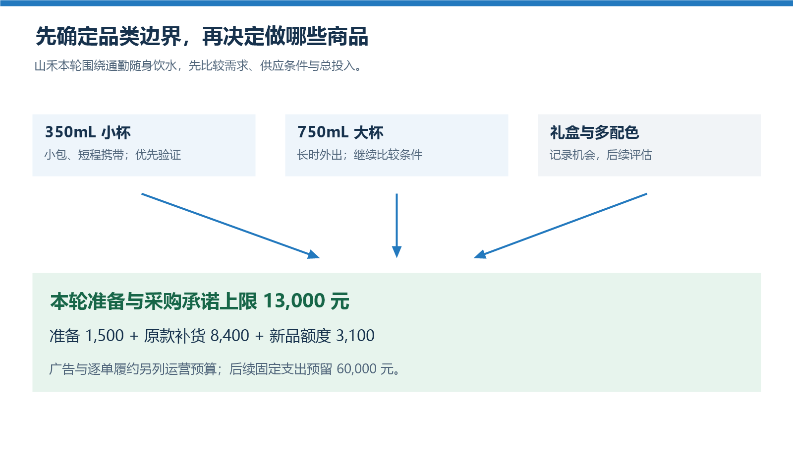

*图 2-1　先明确服务的需求，再把机会与现有能力、资金和验证方式对照。*

### 1.4　写出本轮投入边界

团队给出一项教学决策：本轮准备与采购的总承诺上限暂定 13,000 元。这个上限涵盖原款补货、新品首单、样品及页面验证，广告和逐单履约另列运营预算。

| 用途 | 本轮安排 |
|---|---|
| 样品与验证准备 | 最高 1,500 元 |
| 原款补货 | 先按 200 个、8,400 元讨论，交期需另外确认 |
| 新品首单 | 研究小批方案，先看总货款，再看预付款 |
| 后续固定支出 | 原有 60,000 元继续保留 |

这份预算属于公司自己设定的经营约束。取得新信息后可以重新讨论，但每次调整都要说明新增投入与预期收益。

### 1.5　练习与参考答案

**先做练习。** 若原款补货 8,400 元、准备费用 1,500 元，新品首单还剩多少承诺额度？如果新品供应商要求先订 5,800 元，三个项目合计是否在 13,000 元内？

**参考答案。** 新品额度为 13,000 − 8,400 − 1,500 = 3,100 元。采用 5,800 元首单会承诺 15,700 元，超出 2,700 元。应调整首单、原款补货或总预算，并重新检查交付与资金，不能只用“先付 30%”判断是否符合总额。

**本节交付物**　写下本轮服务的顾客需求、三个机会、验证安排和投入上限。

---

## 第二节　顾客说喜欢，足够支持订货吗？

团队找来 24 位新的受访者。他们都有通勤或外出带水的经历，分别试拿两款样品。

其中有人说：“小杯挺好看。”另一个人说：“大杯容量够，可放进包里会不会太沉？”

你需要把这些话变成可继续验证的问题。

**本节目标**　区分需求描述、意向行为和付费成交，确定本轮能服务的需求。

### 2.1　先追问发生过的事情

| 新访谈样本 | 人数 | 具体线索 | 接下来问什么 |
|---|---:|---|---|
| 小包、短程携带 | 10 | 有人因杯子体积而减少携带 | 最近一次没带水发生在什么场景？350mL 够多久？ |
| 外出时间长、接水不便 | 8 | 希望减少找水或接水的次数 | 实际喝多少，装满后能否接受重量？ |
| 礼赠、颜色或其他需求 | 6 | 关注送人或外观 | 购买频次、预算与使用者是谁？ |
| 合计 | 24 | 均为新的教学访谈样本 | 与第一章 20 人分别记录 |

问“你会不会买”，容易得到客气回答。继续追问最近一次经历、现有替代品、实际支出和放弃购买的原因，才能形成具体假设。

例如，小杯的假设可写为：在短程通勤、包内空间有限的人中，一部分人愿意以 99 元实付价购买 350mL 杯，并能接受少于原款的容量。

### 2.2　把证据分成几个阶段

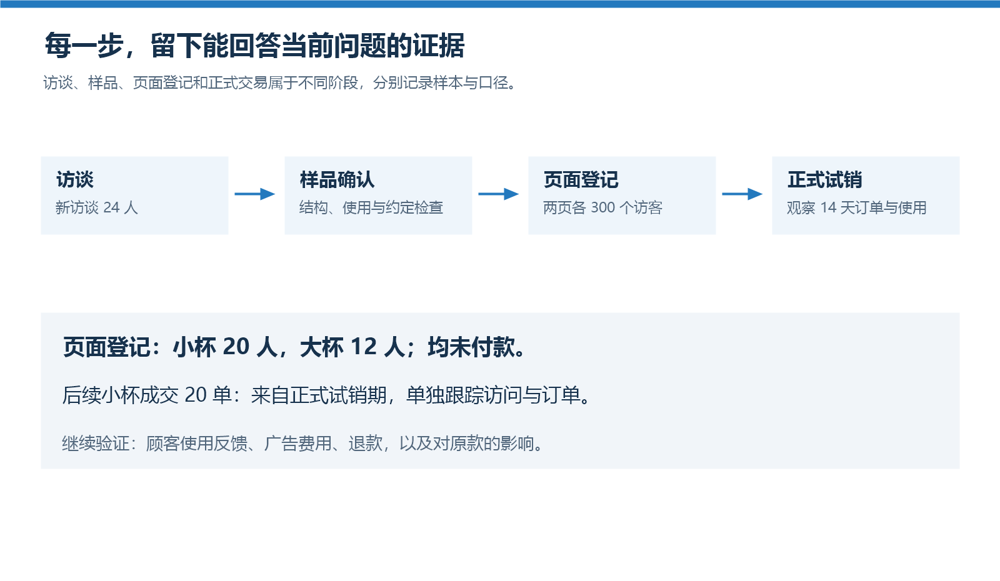

*图 2-2　每个阶段回答的问题不同，样本、价格、时间和行为都要留下记录。*

访谈帮助理解问题；样品试用帮助发现体验限制；页面意向帮助检查信息和初步接受度；付费与使用结果继续检验价值、质量和交付。

进入下一步需要多少证据，取决于错误投入的代价。首单越大、模具越贵、交期越长，就越需要先减少关键不确定性。

### 2.3　这一轮页面测试记录什么

团队在 R1—R3 为两款候选分别制作信息页，展示预期实付价，设置“登记上市通知”入口。入口明确说明尚未开售，未收钱，也没有承诺预售订单。

| 候选 | 页面展示的实付价 | 本轮去重访问人数 | 登记通知人数 | 登记比例 |
|---|---:|---:|---:|---:|
| 350mL | 99 元 | 300 | 20 | 约 6.67% |
| 750mL | 149 元 | 300 | 12 | 4% |

访问来自本轮安排的目标受众测试。样品费用两款各 300 元，页面制作与访客测试各 450 元，共支出：

**300 + 300 + 450 + 450 = 1,500 元。**

每款分摊的直接准备费用为 750 元。实际已经花出，即使最后决定暂缓某款，也保留这笔支出。

两组人数相同，商品、价格与使用任务却不同。这组数据支持继续调查小杯机会，但不能直接证明它上线后的销量或利润更高。尤其不能把 20 个登记人直接当作 20 笔付款订单。

### 2.4　从需求很大，缩到本轮能做到多大

可以依次问三件事：有哪些人可能需要，我们能触达谁，本轮能以什么成本服务多少订单。

例如，团队另做一个预算练习，假设下轮能得到 400 次有效访问、支付订单数与访问人数之比暂按 5%估算，则预期为 20 笔支付订单。这里的 5% 是待验证情景，与前面的登记比例分别记录。

如果补货前可售仅 15 个，就需要调整投放、交付安排或备货。需求估计和交付能力要放在一起。

### 2.5　练习与参考答案

**练习一。** 有人按 350mL 的登记比例，把下轮 3,000 个访客乘 6.67%，建议直接订 200 个。你还需要问什么？

**参考答案。** 核对访问人群、价格、信息和渠道是否可比；继续验证登记到付款及付款后保留的比例；再看首单、资金、交期和滞销后果。可以将 200 个作为一个情景，再用小批付费试销补证据。

**练习二。** 暂缓 750mL 后，它的 750 元准备费用应怎样记录？

**参考答案。** 作为本轮已经发生的准备费用继续保留。未来是否再投入，比较未来新增收益和新增支出，同时复盘这笔费用取得的信息。

**本节交付物**　一张需求假设表，附上样本来源、证据、未解决问题及下一步验证方式。

---

## 第三节　三种容量，怎样组成一盘生意？

供应商建议三种容量都上两种颜色。“看起来更丰富。”运营把页面铺开，却发现 350mL 与 500mL 都在讲同一句通勤卖点。

你要先确定每款服务什么任务，再决定颜色和价格。

**本节目标**　区分品类、商品与 SKU，计算不同商品贡献，安排组合中的角色。

### 3.1　商品数量与 SKU 数量

第一章的 500mL 杯是一款商品，有黑色和米白色两个 SKU。若新增 350mL 和 750mL，且都做两色，就变为三款商品、六个 SKU。

每个 SKU 都要单独安排规格资料、起订、库存、预测、拣货和售后。颜色越多，需求分配越容易偏斜，某个颜色缺货时，另一个颜色的存货未必能满足顾客。

本轮先讨论三个容量，只让新品采用一个颜色测试。

| 商品 | 顾客任务假设 | 颜色安排 | 当前状态 |
|---|---|---|---|
| 原款 500mL | 日常通勤随身饮水 | 黑、米白 | 在售，保留两个 SKU |
| 350mL 小杯 | 小包、短程携带 | 雾蓝 | 优先考虑一个 SKU 小批试销 |
| 750mL 大杯 | 长时间外出、接水不便 | 深灰 | 保留候选，先算投入与可行性 |

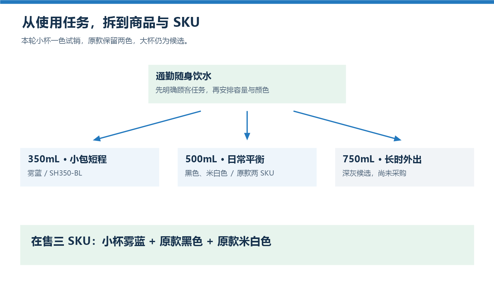

*图 2-3　候选商品和已启用 SKU 分别记录。本轮启动小杯后，在售 SKU 共三个。*

### 3.2　先用相同口径算单笔贡献

以下均为每单一个杯子、未退款的教学费用。原款按此前单价，小杯与大杯按候选报价及预计广告费。

| 项目 | 350mL | 原款 500mL | 750mL |
|---|---:|---:|---:|
| 计划标价 | 109 | 129 | 159 |
| 商家券 | 10 | 10 | 10 |
| 顾客实付 | 99 | 119 | 149 |
| 商品成本，含入指定国内仓运输 | 34 | 42 | 58 |
| 平台最终费用 | 6 | 6 | 6 |
| 每单包装 | 3 | 3 | 4 |
| 每单出库快递 | 6 | 6 | 8 |
| 预计每单广告 | 18 | 20 | 24 |
| **单笔贡献** | **32** | **42** | **49** |

**350mL 贡献 = 99 − 34 − 6 − 3 − 6 − 18 = 32 元。**

**750mL 贡献 = 149 − 58 − 6 − 4 − 8 − 24 = 49 元。**

这些数还要支持准备费用和其他经营支出。实际广告与履约发生后再替换估算。

### 3.3　贡献高，还要看多少订单与多少投入

750mL 每单贡献高，但候选首单为 100 个，货款 5,800 元；350mL 有 80 个、2,720 元的小批方案。本轮新品承诺额度为 3,100 元，投入限制不同。

比较商品时，应同时看顾客匹配、可实现销量、贡献、质量、交期和资金。可以给需求强度、供应可行性等打分，帮助团队明确判断。权重和评分要写依据，适用条件未满足的事项需要先解决，评分本身不能替代必要的产品与交付确认。

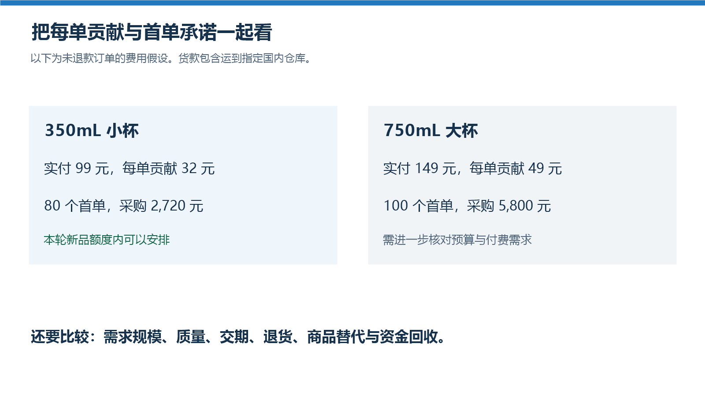

*图 2-4　49 元与 32 元是单笔贡献；5,800 元与 2,720 元是首单采购承诺。两类数字共同影响决策。*

### 3.4　让顾客看得懂选择理由

小杯强调小包与短程，原款强调日常容量平衡，大杯强调长时外出。页面可以并排展示容量、尺寸、空杯与装满后的重量、清洗和适用场景，让顾客按实际需要选择。

“引流款、利润款、形象款”可以帮助讨论经营作用，但要用实际获取的顾客、贡献和复购验证。本轮先把小杯定义为需求试验，把原款作为持续经营基础，大杯继续收集证据。

### 3.5　练习与参考答案

**练习一。** 三个容量各做两色，每个 SKU 最低 80 个，总首单多少？若小杯只做一色，原款保留两色，大杯暂缓，在售 SKU 为多少？

**参考答案。** 六个 SKU 合计至少 480 个。后一方案在售三个 SKU。不同商品真实起订要求可能不同，计算时逐项核对。

**练习二。** 小杯每单广告升到 28 元，其他费用相同，贡献多少？是否还应直接沿用 32 元制定预算？

**参考答案。** 贡献降为 22 元，经营计划要使用更新后的成本，并继续检验退款和获客增量。

**本节交付物**　一张商品组合表，说明每款的顾客任务、SKU、费用、状态和继续推进条件。

---

## 第四节　从样品到首单，怎样向工厂下要求？

采购拿回两个小杯方案：一家最低 120 个，每个 32 元；另一家最低 80 个，每个 34 元。

创始人想选便宜的。你决定先把规格、检查、运输和付款条件对齐。

**本节目标**　从产品要求走到样品确认、报价和首单，比较采购单价与总投入。

### 4.1　写一页产品要求

产品要求至少包括顾客场景、容量与尺寸、材料及接触部件、重量、开盖与密封结构、清洗复装、颜色、包装、标识、检查方法和交付日期。

对每一项写清资料来源、允许差异、怎样检查、由谁确认。供应商说“和样品一样”，也需要把确认样品、图纸版本和关键要求关联起来。

| 要求示例 | 需要确认的内容 | 对业务的影响 |
|---|---|---|
| 小包携带 | 成品尺寸、实际容量及重量资料 | 页面选择与顾客使用 |
| 旋盖与密封 | 部件、装配、使用条件与测试方案 | 投诉、报损与后续批次 |
| 清洗复装 | 结构、说明及复装验证 | 使用体验与售后 |
| 物流包装 | 单杯包装、运输保护、标识 | 破损、运费与拣货 |
| 雾蓝颜色 | 颜色样与量产确认方式 | 色差投诉与 SKU 识别 |

本案例设定，两家均通过约定的样品与供货核查，所比方案采用已具备的杯型，没有新增模具费用。特定商品合规资料仍须在真实经营中按市场和商品核实。

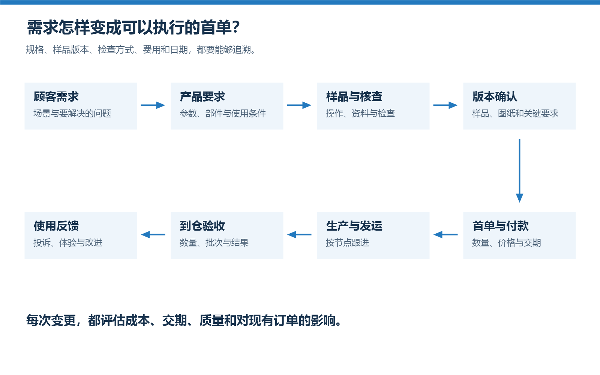

*图 2-5　版本、检查依据、费用与日期在每次确认时留下记录。*

### 4.2　把报价放进同一张表

| 条件 | 方案 A | 方案 B |
|---|---:|---:|
| 商品 | 350mL 雾蓝 | 350mL 雾蓝 |
| 最低首单 | 120 个 | 80 个 |
| 含入仓运输单价 | 32 元 | 34 元 |
| 首单总货款 | 3,840 元 | 2,720 元 |
| 交期 | 25 天 | 12 天 |
| 付款 | 30% 预付、发货前 70% | 30% 预付、发货前 70% |

A 的最低首单比 B 多 1,120 元，且多承诺 40 个库存。如果同样购买 120 个，B 按每个 34 元为 4,080 元，A 可便宜 240 元。这里比较的数量不同，含义也不同。

本轮新品额度 3,100 元，因此选择 B 的 80 个方案，保留小批观察空间。报价中的交期从确认订单并付预付款起算，到指定仓库为止。

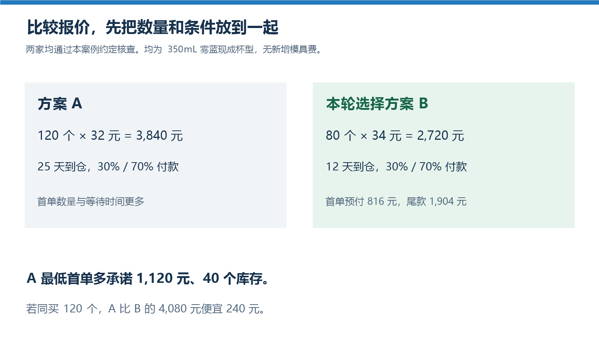

*图 2-6　单价较低的方案，需要更多首单资金和更长等待。*

### 4.3　同时解决原款补货

原款黑色库存较紧。采购取得一项新条件：原供方仅对本次 200 个补货，书面确认 12 天到仓、黑白各 100 个，含运费单价仍为 42 元，付款仍为 30%／70%。加急成本已包含在这次报价中。

这是本章新增的本批条件。第一章的普通补货交期 25 天仍作为常规条件记录，未来每批需要重新确认。

R3，两个订单确认并支付预付款：

| 采购 | 数量与总额 | 30% 预付款 | 发货前 70% 尾款 |
|---|---|---:|---:|
| 原款 500mL | 两色各 100，共 8,400 元 | 2,520 元 | 5,880 元 |
| 新品 350mL | 雾蓝 80，共 2,720 元 | 816 元 | 1,904 元 |
| 合计 | 280 个，11,120 元 | **3,336 元** | **7,784 元** |

准备费用 1,500 加采购承诺 11,120，共 12,620 元，低于本轮 13,000 元上限，剩 380 元承诺空间。广告与履约仍需另列预算。

### 4.4　把交付条件跟到 R15

确认采购后，核查关键部件、排产、检查和发运时间。发货前核对约定记录与尾款条件，支付 7,784 元；R15 到仓后按约验收，本案例 280 个均合格入库。

旧款最低订量两色绑定，会增加白色库存。把这个结果留在下一轮供应商谈判清单，继续讨论分色起订、分批交货和缩短常规交期。

### 4.5　练习与参考答案

**练习一。** 选择 A 的 120 个小杯时，准备费、原款补货和新品货款合计多少？比 13,000 元上限高多少？

**参考答案。** 1,500 + 8,400 + 3,840 = 13,740 元，超出 740 元。

**练习二。** 如果原款仍按 25 天交货，从 R3 开始按黑色每日 4 个净消耗测算，还需要核对什么？

**参考答案。** 先查 R3 时点黑色可用、已锁定和在途数量，再算交期内需求 100 个。R0 黑色仅 74 个，后续又在销售，需要及早确认供货空档及可执行安排。不能把 R0 库存直接当作 R3 可用数。

**本节交付物**　产品要求、确认样品与版本、报价比较、采购订单、预付款及尾款安排。

---

## 第五节　新品到了，怎样安排第一轮试销？

R15，新品到仓。运营想立刻把 80 个全部分配给广告计划，创始人则希望先看一周。

你把要验证的问题写在白板上：99 元能否成交、费用能否支持贡献、小杯有没有挤占原款、顾客使用后是否满意。

**本节目标**　把首单转成有范围、预算、观察期和复查条件的试销，并建立可以持续更新的商品记录。

### 5.1　先核对等待期里原款卖了多少

R1—R15，原款持续经营，共完成并保留 64 笔订单，黑色 40、米白色 24。本阶段每单实付 119 元，广告实际平均 20 元，平台 6 元、包装 3 元、快递 6 元，无取消退货。

**原款阶段贡献 = 64 × 42 = 2,688 元。**

R15 到仓前，黑色剩 74 − 40 = 34 个，米白色剩 83 − 24 = 59 个。随后原款新到两色各 100 个，新品到 80 个，验收后形成试销开场库存。

| SKU | 原有可售 | 等待期售出 | 新到合格 | R15 入库后可售 |
|---|---:|---:|---:|---:|
| 500mL 黑色 | 74 | 40 | 100 | 134 |
| 500mL 米白色 | 83 | 24 | 100 | 159 |
| 350mL 雾蓝 | 0 | 0 | 80 | 80 |
| 合计 | 157 | 64 | 280 | 373 |

这一阶段原款没有断货。本批加急为补货提供了时间，后续仍要用实际交期与成本检验它能否稳定执行。

### 5.2　确定试销的范围

R16—R29 试销 14 天，小杯只上雾蓝一色，标价 109 元、券后实付 99 元。原款仍按实付 119 元销售，大杯尚未下单或上线。

| 项目 | 试销安排 |
|---|---|
| 重点顾客 | 小包、短程携带人群 |
| 核心展示 | 容量、尺寸、重量、使用与清洗条件，按已核实资料制作 |
| 本轮广告上限 | 小杯最高 600 元，原款本阶段最高 1,600 元 |
| 库存 | 小杯 80 个，按颜色和可用状态逐日更新 |
| 复查 | 上线前检查，试销中每日跟踪，结束后汇总 |
| 调整线索 | 费用高于方案、体验或质量异常、库存与交付失配时及时复核 |

原款等待期广告上限另设 1,500 元，实际花 1,280 元。上述 600 元和 1,600 元是后一个 14 天阶段的额度。预算、消耗与剩余额度分别记录。

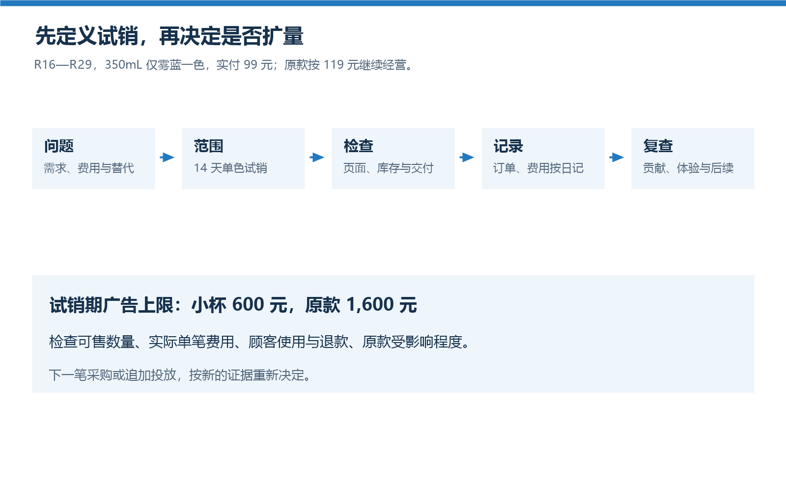

*图 2-7　先写待验证问题和预算，再记录结果；发生变更时留下日期与原因。*

### 5.3　上线检查沿用第一章的方法

给小杯建立新编码 SH350-BL。确认页面雾蓝选项、内部 SKU、采购规格、实物标签和仓库货位一致，核对价格优惠、运费、发货、取消与售后路径。

原款继续使用 SH500-BK、SH500-WH。三者分别记库存，且后台能同时按商品、SKU、渠道和日期汇总。

有些系统还会区分商品组、变体与店铺商品链接。先确认各字段怎样映射，避免把不同容量误当同一规格发出。对应本轮的成本也要按采购批次记录。

### 5.4　14 天后，先收集事实

| 试销期结果 | 500mL 原款 | 350mL 新品 | 合计 |
|---|---:|---:|---:|
| 完成并保留的订单 | 70 | 20 | 90 |
| 其中颜色 | 黑 42、白 28 | 雾蓝 20 | 三个 SKU |
| 实付单价 | 119 元 | 99 元 | 分商品计算 |
| 销售额 | 8,330 元 | 1,980 元 | 10,310 元 |
| 实际广告费用 | 1,400 元 | 360 元 | 1,760 元 |
| 每单广告 | 20 元 | 18 元 | 分商品计算 |
| 列示商品贡献 | 2,940 元 | 640 元 | 3,580 元 |

本案例试销期所有订单均完成，没有取消、退货或新增报损。试销结束时各商品的贡献使用实际费用计算，与原先估算恰好相同。

第二节的 300 个访客与登记人数属于开售前测试；此处 20 笔是正式上线后的订单。评价支付转化时，应使用同一期间、同一来源的正式访问与订单数据。本章没有给出该期间完整访问人数。

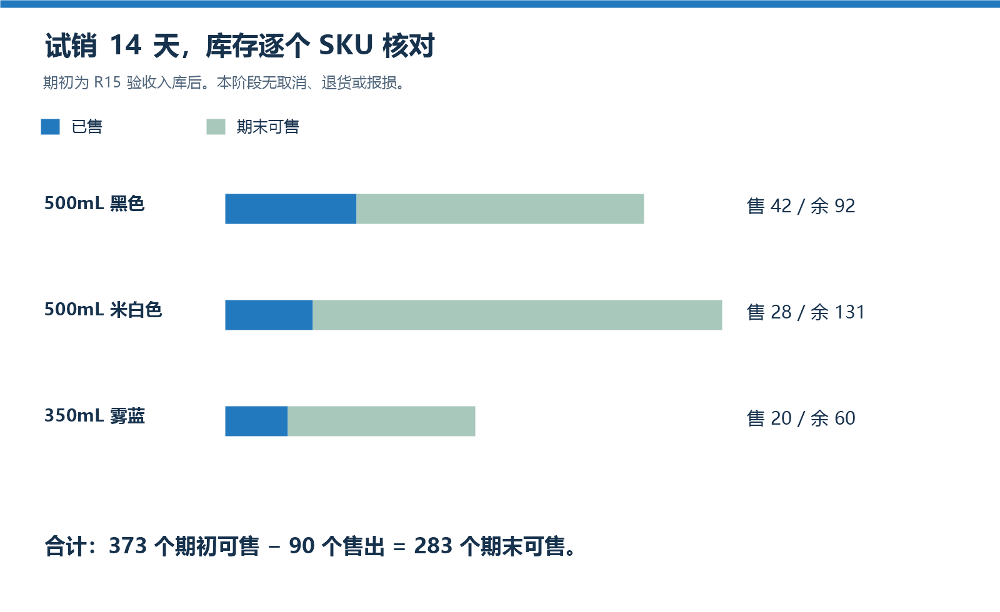

*图 2-8　期初可售、售出、期末可售按同一 SKU 核对。取消、退货或异常发生时也应另列。*

### 5.5　小样本怎样支持下一步

20 笔成交验证了有人愿意在本次条件下付款，14 天内也没有记录到退款。接下来还要看后续使用反馈、投放扩量后的费用、复购或推荐，以及更长观察期的售后。

比较不同页面或不同价格时，尽量保持受众、期间和其他条件可比，记录谁看到了哪个版本。自然波动、渠道变化和原款活动也可能改变结果，需要继续提出并验证原因。

### 5.6　练习与参考答案

**练习一。** 小杯预算最高 600 元，实际消耗 360 元，余下多少？若把未花部分直接当费用，贡献会被少算多少？

**参考答案。** 剩 240 元，直接当费用会少算 240 元贡献。尚未执行的预算按计划保留，不计作本阶段实际消耗。

**练习二。** 小杯 80 个到仓，售出 20 个，若另有 2 个留作展示且无法继续当新品出售，应怎样更新？这是额外练习，不计入本章实际结果。

**参考答案。** 将 2 个从可售转为展示或相应用途，并按实际处置核算；可售为 58 个。不能只在备注里写“展示”，却仍向顾客承诺 60 个。

**本节交付物**　试销安排、上线检查记录、逐日商品表和期末结果。现在需要回答，640 元新品贡献是否等于它给公司带来的增量。

---

## 第六节　新品卖出 20 个，到底带来多少增量？

创始人看到小杯贡献 640 元，想继续订一批。运营提出一个疑问：“这 20 位买小杯的人里，有多少原本会买我们的 500mL？”

你把原款 42 元、小杯 32 元的单笔贡献写到一起。

**本节目标**　计算商品贡献，理解同品牌商品之间的替代，并用不同情景检验组合收益。

### 6.1　先核对已经实现的贡献

小杯的 20 单贡献为：

**1,980 − 商品 680 − 平台 120 − 包装 60 − 快递 120 − 广告 360 = 640 元。**

原款在同一试销期完成 70 单，贡献 2,940 元。两者合计 3,580 元，这是已给定事实能够算出的组合贡献。

若把小杯直接准备费用 750 元单独对照，当前小杯贡献尚差 110 元覆盖它。两款候选的准备费用合计仍为 1,500 元，完整章节经营结果在第八节统一扣除一次。

### 6.2　被替代的原款订单也有贡献

**商品替代**在这里指，原本会买山禾 500mL 的一部分订单，改买了 350mL。替代数量无法直接从两款已经发生的订单反推出，需要对照、追踪和情景判断。

假设 20 个小杯订单中，有 8 个本来会买原款，其余 12 个为相对该对照情景新增。则新增组合贡献为：

**小杯贡献 20 × 32 − 被替代原款贡献 8 × 42 = 304 元。**

在这个假设下，没有小杯时原款本可能是 78 单，贡献 3,276 元；现在原款 70 单加小杯 20 单贡献 3,580 元，两者差额同样为 304 元。

78 单是反事实情景，未作为真实订单登记。准备费用、其他变化和较长期效果应继续加入完整评估。

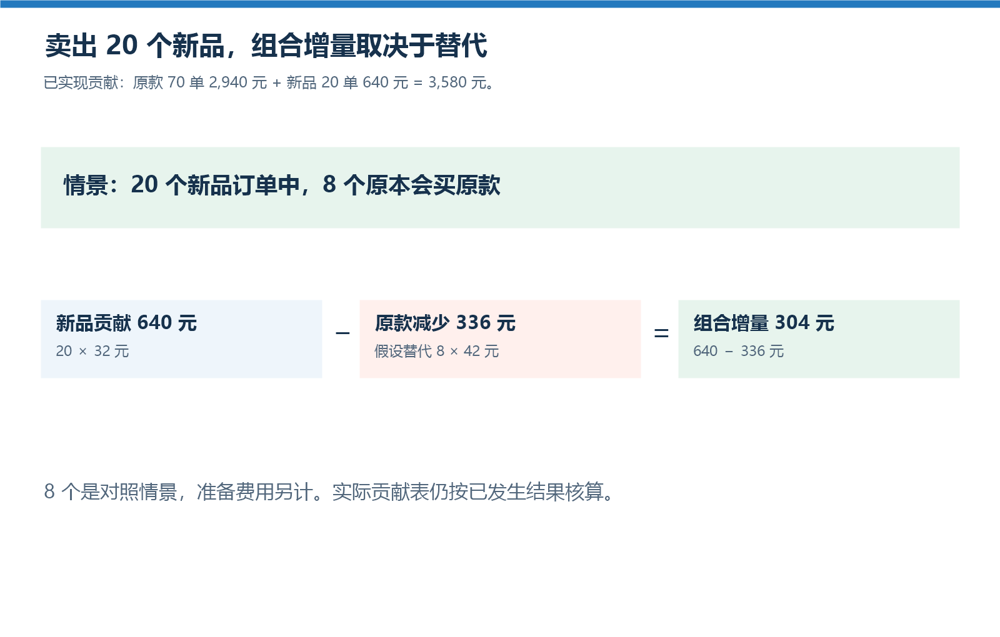

*图 2-9　8 个替代订单仅为情景假设。实际增量需要进一步证据。*

### 6.3　把不确定性写进表格

| 20 单小杯中的替代假设 | 小杯贡献 | 原款贡献减少 | 本阶段组合贡献增量 |
|---|---:|---:|---:|
| 0 个 | 640 元 | 0 元 | 640 元 |
| 8 个 | 640 元 | 336 元 | 304 元 |
| 16 个 | 640 元 | 672 元 | −32 元 |

这张表帮助判断，项目对哪一个假设最敏感。若多数人是在同品牌内换到低贡献商品，单看新品销量就可能误判。

也可能出现互补效应，例如新品带来更多品牌访问，部分人购买原款。此时要把原款额外成交和成本一并观察，仍需能解释变化来源。

### 6.4　覆盖准备费用，需要多少贡献

先做一个简化计算，假设每个小杯订单都带来独立新增贡献 32 元，且实际费用保持不变。覆盖分配给小杯的 750 元准备费，至少需要：

**750 ÷ 32 ≈ 23.44，即 24 单。**

如果长期仍按本题的 40% 替代比例估算，每个小杯订单的组合新增贡献平均为：

**32 − 40% × 42 = 15.2 元。**

**750 ÷ 15.2 ≈ 49.34，即 50 单。**

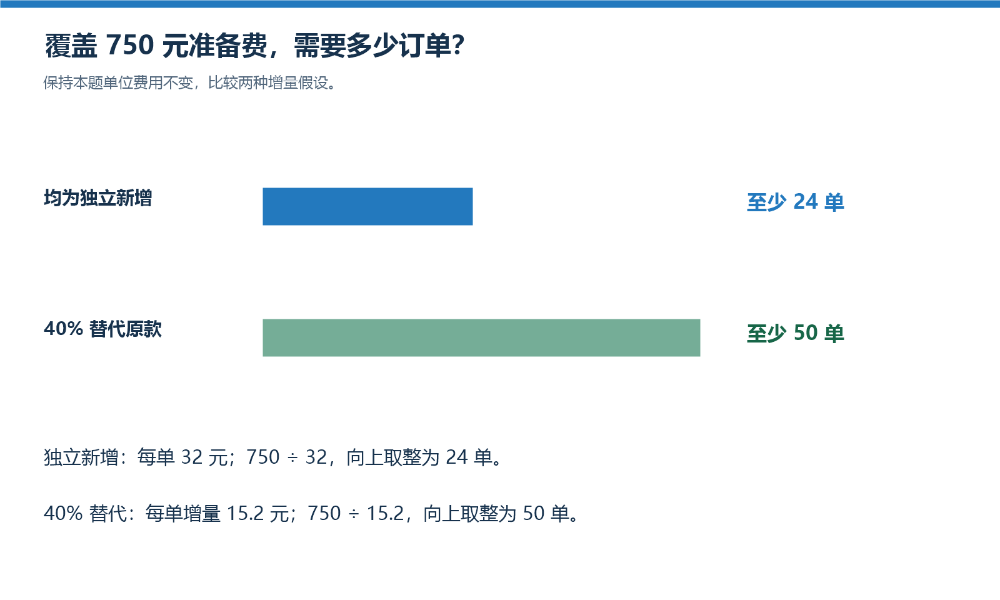

*图 2-10　24 单与 50 单对应不同的增量假设，费用、退货或替代比例变化时重算。*

大杯已经花掉的 750 元仍是本轮费用。以后比较继续做大杯还是把资源给别处，应比较未来新增投入与未来收益，避免为了追回已花的钱而持续追加缺少依据的库存。

### 6.5　下一步怎样收集增量证据

可以记录顾客购买前看过的商品、需求场景与原有购买计划，结合访问路径判断线索。顾客回答也可能有偏差，需要与实际行为对照。

条件允许时，在可比受众或时间段安排受控展示，观察有无小杯时全店订单、贡献和退款的差异，并记录受众分配、预算和其他变化。访问或订单较少时继续保留区间判断，先控制下一笔投入。

本章没有取得足以识别真实替代数量的对照数据，因此参考决策是继续利用现有 60 个库存验证，同时完善比较记录。

### 6.6　练习与参考答案

**练习一。** 小杯仍售 20 单，假设其中 10 单替代原款，组合贡献增量多少？

**参考答案。** 640 − 10 × 42 = 220 元，准备费用还需另计。

**练习二。** 原款 70 单、小杯 20 单的已实现组合贡献 3,580 元，是否应在实际贡献表再扣一次 336 元假设替代损失？

**参考答案。** 实际表按已发生的订单与费用计算 3,580 元；336 元用于对照情景，比较另一种可能结果。把它再扣入实际表，会把机会比较和实际费用混在一起。

**本节交付物**　一份试销评估，分别列出已实现结果、增量假设、敏感因素和下一步取证安排。

---

## 第七节　库存还剩很多，什么时候该追、改、停？

R29，仓库发来三个 SKU 的期末数。小杯还有 60 个，白色原款有 131 个。采购又接到供应商催单：“提前做下一批，价格还可以谈。”

你需要决定库存怎样继续使用，下一笔钱先投哪里。

**本节目标**　把商品生命周期转成经营动作，结合覆盖天数、库龄、需求与贡献安排补货、调整和退出。

### 7.1　先把期末库存算完整

| SKU | R0 可售 | 本章到货 | R1—R15 售出 | R16—R29 售出 | R29 可售 |
|---|---:|---:|---:|---:|---:|
| 500mL 黑色 | 74 | 100 | 40 | 42 | 92 |
| 500mL 米白色 | 83 | 100 | 24 | 28 | 131 |
| 350mL 雾蓝 | 0 | 80 | 0 | 20 | 60 |
| 合计 | 157 | 280 | 64 | 90 | **283** |

库存关系为 **157 + 280 − 154 = 283 个**。本章没有新增报损、在途或待处理退货，R29 没有未发订单锁定。

原有一件隔离报损的黑色杯仍有实物记录，账面价值为零；仓内实物总数因此为 284 件，其中 283 件可售。

### 7.2　用最近窗口估算覆盖

以下暂用试销期 14 天销量估算，假设之后保持相同速度，不考虑新增退货和报损。

| SKU | 最近每天销量 | 库存覆盖估算 | 本次 12 天交期的参考需求 |
|---|---:|---:|---:|
| 黑色 | 42 ÷ 14 = 3 | 92 ÷ 3 ≈ 30.7 天 | 36 个 |
| 米白色 | 28 ÷ 14 = 2 | 131 ÷ 2 = 65.5 天 | 24 个 |
| 雾蓝小杯 | 20 ÷ 14 ≈ 1.43 | 60 ÷（20 ÷ 14）= 42 天 | 约 17.1 个 |

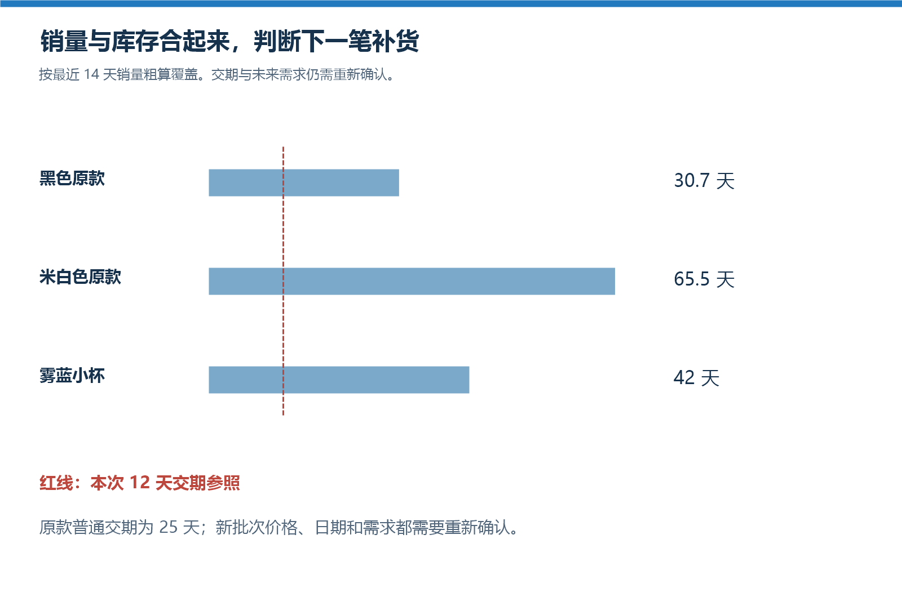

*图 2-11　12 天是本次已确认批次的交期参照；下一批仍要重新确认。原款常规交期为 25 天。*

即使按原款普通 25 天估算，黑色需求为 75 个、白色为 50 个，当前数量在这个简化情景下仍有覆盖。还需检验每日波动、下一轮活动和所需安全余量，避免把覆盖天数直接当作精确补货日期。

### 7.3　生命周期对应哪些动作

| 状态 | 需要看的证据 | 常见动作 |
|---|---|---|
| 新品验证 | 场景、成交、质量、费用、替代 | 小批试销、修正商品与页面 |
| 可重复增长 | 多轮表现稳定，能交付且贡献符合目标 | 分步扩量、稳定供应与补货 |
| 稳定经营 | 需求较可预测，竞争与费用变化 | 优化成本、颜色、服务和效率 |
| 调整或退出 | 持续需求弱、贡献差、质量风险或资金低效 | 缩减采购、转用库存、清理或退出 |

同一款商品的不同颜色，也可能处在不同状态。山禾暂把小杯留在验证阶段，原款继续经营并控制颜色库存，大杯保留候选、暂缓采购。

大杯每单预计 49 元贡献仍有吸引力，但本轮缺少足够付费验证，首单又超过新品额度。先明确下一次需要新增什么证据，再决定是否重启。

### 7.4　白色卖得慢，怎样调整

先看库龄、采购批次、页面曝光、转化、实际场景和颜色偏好，再判断是展示不足、需求较少，还是产品本身不合适。R15 才收到的新货，尚不能仅凭数量直接归为长期滞销。

未来可比较调整展示、减少下批白色、独立促销或转移渠道。每个方案都重新核算费用与顾客体验。

例如，另设一个促销练习，白色实付降到 109 元，其他每单费用保持原款假设，则贡献为：

**109 − 42 − 6 − 3 − 6 − 20 = 32 元。**

如果原价本能卖 30 单，贡献 1,260 元，降价后至少要 40 单才达到不低于这个贡献：40 × 32 = 1,280 元。还要考虑活动广告费用是否改变，以及库存回收资金的速度。这个促销未执行，R29 实际结果不变。

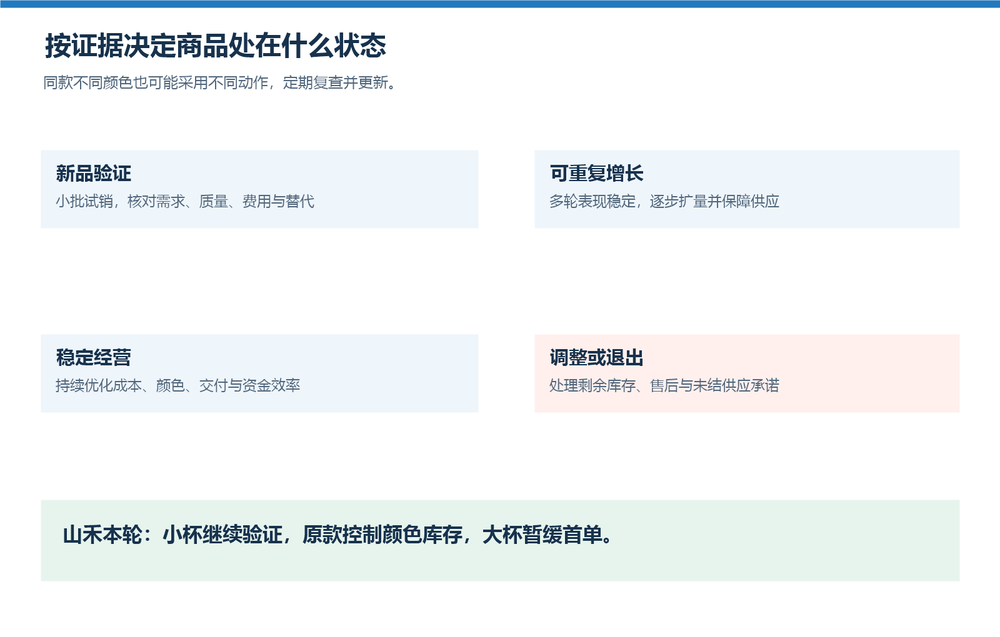

*图 2-12　用需求、贡献、质量和占款决定动作，退出时一并处理库存、售后与供应承诺。*

### 7.5　退出要把剩余责任交完

决定停采后，记录剩余库存及处理方案，检查未结采购、模具或包装承诺，维护已售商品的售后，更新页面和系统状态。若继续销售尾货，按适用条件如实说明商品状态与服务。

库存可能通过促销、返工、转渠道、供应商协商退换或报废处理。分别核算回收金额、额外费用和适用条件，取得确认再执行。

### 7.6　练习与参考答案

**练习一。** 供应商为小杯提出立刻再订 80 个。若当前日均销量不变，60 个可售库存能支撑多久？先下单还需要什么依据？

**参考答案。** 约 42 天。先确认下一批交期、需求与活动计划、实际贡献和替代，再决定补货日期与数量。12 天只是上一批已确认的条件，未来要重新核实。

**练习二。** 白色降到实付 109 元后只从 30 单增长到 35 单，列示总贡献怎样变？

**参考答案。** 原来 30 × 42 = 1,260 元，后来 35 × 32 = 1,120 元，少 140 元。若还有清库存的资金目标，另算回款和腾出的占款，并说明接受的贡献代价。

**本节交付物**　给三个在售 SKU 和一个候选商品各写下一步动作，标明证据、复查时间与未来采购条件。

---

## 第八节　把商品、采购和现金放回同一份计划

创始人问：“这一轮我们加了商品、花了研究费，又补了旧款。到底赚了多少，手里还剩多少？”

你拿出销售记录、采购付款和期末库存，准备逐项核对。

**本节目标**　闭合第二章的实际收支与存货，并提交兼顾商品组合、交付和资金的下一阶段方案。

### 8.1　本轮实际贡献

| 阶段与商品 | 保留订单 | 单笔列示贡献 | 总贡献 |
|---|---:|---:|---:|
| R1—R15 原款 | 64 | 42 元 | 2,688 元 |
| R16—R29 原款 | 70 | 42 元 | 2,940 元 |
| R16—R29 小杯 | 20 | 32 元 | 640 元 |
| 合计 | 154 | 分商品计算 | **6,268 元** |
| 本章样品、页面与测试费用 | — | 两款各 750 元 | **−1,500 元** |
| **本章列示经营结果** | — | — | **4,768 元** |

其中原款共 134 单，销售额 15,946 元；小杯 20 单，销售额 1,980 元，合计 17,926 元。

也可以按实际总费用重算：

**17,926 − 商品成本 6,308 − 平台 924 − 包装 462 − 快递 924 − 广告 3,040 = 6,268 元。**

商品成本为 134 × 42 + 20 × 34 = 6,308 元。1,500 元准备费在经营结果里扣一次，750mL 未上线也保留其 750 元已发生成本。

第六节的替代情景用于判断增量，不作为本张实际费用表中的扣项。

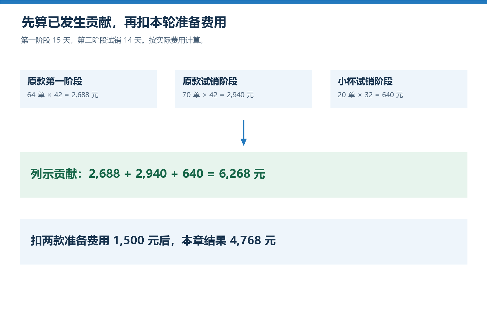

*图 2-13　已发生结果按实际订单核算，未来情景与机会成本另外用于决策比较。*

### 8.2　平台应该结给公司多少

本章 154 笔销售无退款，按每笔平台费 6 元，共收费 924 元。

**本章结算款 = 17,926 − 924 = 17,002 元。**

分阶段核对，第一阶段 64 ×（119 − 6）= 7,232 元；试销阶段 10,310 − 90 × 6 = 9,770 元，两者合计 17,002 元，均已到账。

第一章留下的 746 元在 R1 另行到账，它增加银行现金，减少此前待结算余额。对应销售已在第一章确认。

### 8.3　银行余额变成多少

| 银行收支 | 金额 | 累计余额 |
|---|---:|---:|
| 接续第一章银行 | +184,671 元 | 184,671 元 |
| 收回第一章待结算 | +746 元 | 185,417 元 |
| 本章采购预付与尾款合计 | −11,120 元 | 174,297 元 |
| 样品、页面及测试 | −1,500 元 | 172,797 元 |
| 本章广告实际消耗 | −3,040 元 | 169,757 元 |
| 本章包装 | −462 元 | 169,295 元 |
| 本章出库快递 | −924 元 | 168,371 元 |
| 本章平台结算到账 | +17,002 元 | **185,373 元** |

这张表按用途汇总展示累计变化，具体每日付款和回款还要保留原流水。平台费已经在结算款中扣除，不再从银行额外扣一次。

如果把准备与采购承诺 12,620 元、广告预算上限 3,700 元都当作已付款，会高估支出。实际广告为 3,040 元，上限剩余 660 元未消耗。

做时间压力测试时，还可以假设 R1—R15 所有相关费用先付、销售款最后到：185,417 − 11,120 − 1,500 − 1,280 − 192 − 384 = 170,941 元。这是付款顺序情景，供检查资金余量，实际最低余额按每日流水确定。

### 8.4　钱少了多少，商品又增加多少

| R29 可售存货 | 数量 | 单位成本 | 成本金额 |
|---|---:|---:|---:|
| 500mL 黑色 | 92 | 42 元 | 3,864 元 |
| 500mL 米白色 | 131 | 42 元 | 5,502 元 |
| 350mL 雾蓝 | 60 | 34 元 | 2,040 元 |
| 合计 | **283** | 分商品计算 | **11,406 元** |

原款新批次仍为 42 元，小杯本批次为 34 元，所以本题可以直接按对应单价算。若以后同一 SKU 不同批次价格变化，应统一存货计价口径，并保留批次资料。

期初银行、平台待结算与库存合计：

**184,671 + 746 + 6,594 = 192,011 元。**

本章末无待结算、在途或应付采购尾款，银行与存货合计：

**185,373 + 11,406 = 196,779 元。**

两者相差 **4,768 元**，与本章列示经营结果一致。

若从第一章的 20 万元启动资金看，累计列示结果为 −7,989 + 4,768 = −3,221 元，200,000 − 3,221 = 196,779 元。这个核对限于本章约定的列示范围，真实经营还需加入其他资产、负债和费用。

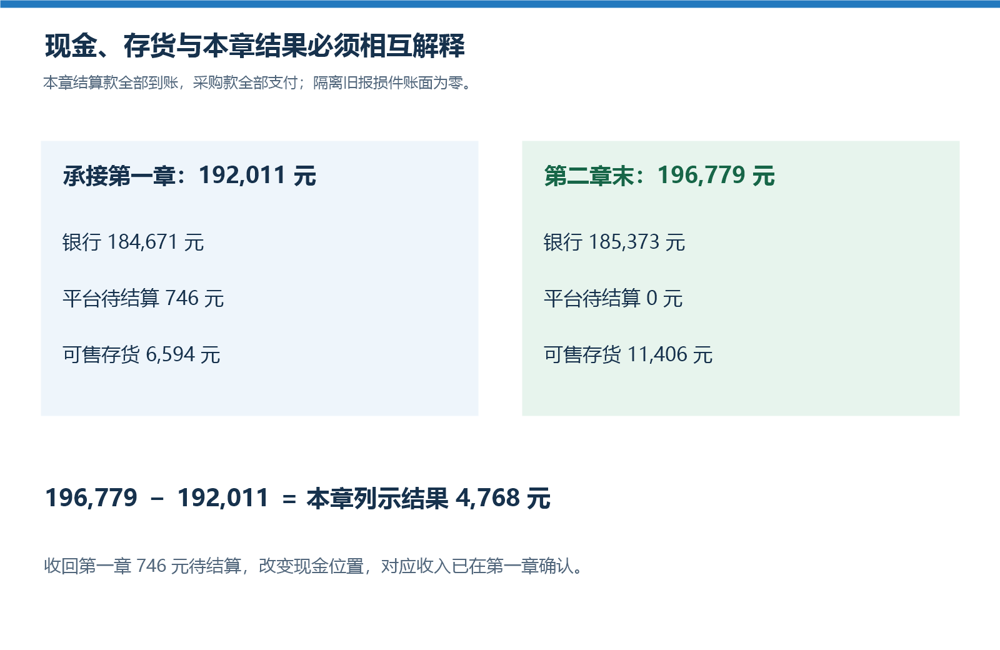

*图 2-14　银行、待结算、存货与期间结果相互解释，第一章到账不重复算本章收入。*

### 8.5　一份可讨论的下一阶段建议

本章参考决定为，保留三个在售 SKU，继续用现有小杯库存验证需求与增量，大杯暂缓首单。原款重点跟踪黑色消耗与白色覆盖差异，与供方讨论分色起订、常规交期及分批交付。

| 动作 | 负责人 | 复查内容 |
|---|---|---|
| 延续小杯测试 | 运营 | 各来源订单、实际费用、使用反馈和替代线索 |
| 监控三 SKU 库存 | 计划／仓库 | 可用、锁定、批次、库龄与活动需求 |
| 讨论下批供应条件 | 采购 | 分色起订、价格、常规与加急交期、质量记录 |
| 核查资金与预算 | 财务 | 日历化收支、60,000 元预留和新增承诺 |
| 评估大杯重启条件 | 商品负责人 | 付费证据、首单条件、独立获客及投入回报 |

下一轮广告或采购需要形成新预算与订单，本章尚未执行。复查可安排在下一周，也应在活动、成本或交期出现重要变化时提前进行。

### 8.6　章节综合作业

请给创始人一页建议，附以下三张表。

1. **商品组合表。** 写清 350、500、750mL 各服务谁，谁在售、谁候选，SKU 与贡献是多少。
2. **采购与库存表。** 从期初 157 个可售，核对到 R29 的 283 个；说明三 SKU 覆盖和下一次采购依据。
3. **贡献与资金表。** 核对 4,768 元本章结果、185,373 元银行和 11,406 元库存；另列零替代、8 单替代、16 单替代时的小杯增量。

在一页建议中回答，是否再订 80 个小杯、是否让大杯上线、白色是否降价，以及下次复查需要取得什么信息。对方案中的预测标明假设，实际结果使用本章已给数据。

### 8.7　参考答案与复查标准

计算结果应包括：采购 11,120 元、预付 3,336 元、尾款 7,784 元；实际广告 3,040 元；原款售出 134、小杯售出 20；贡献 6,268 元、扣准备费后 4,768 元。小杯三种替代情景的增量分别为 640、304、−32 元。

参考判断是先用现有小杯库存继续验证，取得独立增量和更长使用反馈后再讨论追单；大杯继续收集付款与供货依据；对白色先定位原因，再比较展示、采购结构和促销。你也可以提出其他方案，但要算清承担的库存、贡献与资金代价。

| 复查项目 | 完成表现 |
|---|---|
| 需求证据 | 分清访谈、登记、成交和使用结果 |
| 商品组合 | 各款有明确场景，SKU 与成本能追溯 |
| 采购选择 | 单价、数量、质量、交期、付款一起比较 |
| 增量判断 | 已实现贡献与对照情景分别计算 |
| 库存和现金 | 数量与金额能闭合，预算与已发生支出分清 |
| 执行动作 | 负责人、条件、日期和复查资料明确 |

**本章完成标准**　你能独立解释为什么本轮先试小杯、怎样限制首单投入、销量怎样影响组合收益，并让期末现金与库存相互核对。

下一步，山禾会面对不同渠道对商品、价格和供货的要求。带着这三个在售 SKU，我们继续学习怎样规划渠道与经营目标。

---

## 附录　参数与结果核对

用于完成正文与作业后复查，所有结果均按本章教学约定。

| 项目 | 结果 |
|---|---|
| 承接第一章 | 银行 184,671，待结算 746，存货成本 6,594 |
| 在售与候选 | 500mL 两色、350mL 一色在售；750mL 保留候选 |
| 准备费用 | 两款各 750，共 1,500，均已支付 |
| 采购 | 原款 200 个 × 42，小杯 80 个 × 34，共 11,120 |
| 采购付款 | 预付 3,336，尾款 7,784，期末均已付清 |
| 本批交期 | R3 下单，12 天后 R15 到仓；原款常规 25 天另行记录 |
| 原款销售 | 第一阶段 64，试销阶段 70，共 134 单 |
| 小杯销售 | 试销 20 单，无取消退货 |
| 销售额与结算 | 17,926 − 平台费 924 = 本章到账 17,002 |
| 实际广告 | 1,280 + 1,400 + 360 = 3,040 |
| 包装与快递 | 154 × 3 = 462；154 × 6 = 924 |
| 商品销售成本 | 134 × 42 + 20 × 34 = 6,308 |
| 列示贡献与结果 | 6,268 − 准备费 1,500 = 4,768 |
| R29 可售 | 黑 92、白 131、小杯 60，共 283 个 |
| R29 存货成本 | 9,366 + 2,040 = 11,406 |
| R29 银行 | 185,373，待结算与采购尾款均为零 |
| 期末核对 | 185,373 + 11,406 = 192,011 + 4,768 = 196,779 |

正文中的替代数量与未来促销均为单独情景。原来已报损的一件杯子继续隔离，账面价值为零，未混入 283 个可售库存。

[返回课程总览](../00-课程总览与十二章介绍.md)　｜　[上一章：山禾生活的第一次开业](../第一章-山禾生活的第一次开业/第一章-山禾生活的第一次开业.md)　｜　[下一章：从单店到多渠道经营](../第三章-从单店到多渠道经营/第三章-从单店到多渠道经营.md)
