# 第五章　从供应商报价到稳定交付

第四章的补货接上了销售，但起订量也带来了余货。山禾期末还有黑色 96、米白色 103、小杯 83 个可售，采购想找到能小批、按色交付的备选工厂。

一家备选原款厂愿意试做 40 个黑色杯，每个 44 元。现厂仍是每个 42 元、黑白各 100 个起订。创始人问：“单价更贵，为什么还值得谈？”

你要比较需求、总投入、质量和交付，把口头承诺变成有依据的供应安排。试单过程中还会遇到部分不合格、补供延迟和付款核对。

**本章完成目标**　能制定寻源与准入计划，拆解报价与总成本，核实物料产能，写清采购条件，处理质量异常及部分验收，并用绩效和资金记录决定是否继续合作。

## 阅读顺序

| 节次 | 要解决的问题 | 交付物 |
|---|---|---|
| [第一节　库存不少，为什么还要找新供应商？](#section-01) | 寻源目的、供货结构与准入 | 供应需求和核查清单 |
| [第二节　42 元与 44 元，怎样比较报价？](#section-02) | 成本拆解、同口径询价与总投入 | 报价与成本比较 |
| [第三节　怎样把谈判结果写成可执行订单？](#section-03) | 数量、质量、日期、付款与责任 | 采购条款及订单 |
| [第四节　工厂说能交，怎样核实物料和产能？](#section-04) | 物料清单、产能、良率和排程 | 生产节点计划 |
| [第五节　出厂说合格，到仓为什么还发现问题？](#section-05) | 从样品、过程到验收的质量控制 | 检查与批次记录 |
| [第六节　收到 40 个，只接受 36 个，怎样处理？](#section-06) | 部分验收、退回、补供与结算 | 异常和付款追踪 |
| [第七节　到货准时就算好供应商吗？](#section-07) | 质量、足量、交期、协同和分层 | 供应商绩效与改进 |
| [第八节　把采购、库存成本与资金核对回来](#section-08) | 不同成本批次、经营结果与后续选择 | 联合方案及章节作业 |

正文所需数据就近给出。完成后可用[章末参数与结果核对](#chapter-check)复查。

## 案例约定与起点

本章公司、报价、合同、生产与检验结果均为教学设定。实际产品、采购及责任处理需要核实具体资料、合同和适用要求。本章继续使用列示收支范围，税费、工资、仓租等实际项目需在真实业务中另行补齐。

承接第四章，银行为 192,571.88 元、平台待结算 2,125 元；可售库存为黑色 96、米白色 103、小杯 83，共 282 个，成本 11,180 元。另有三件旧报损实物隔离、账面为零。期初没有在途采购、欠交或未发锁定。

本轮记为 G1—G28，新增销售均由 A 成交。原款实付 119、小杯 99，平台按保留订单每笔收 6 元，包装 3、出库快递 6 元。本轮销售全部完成签收，无取消、退货或新增顾客端报损，重点观察供货端异常。

| 日期 | 业务进展 |
|---|---|
| G1 | 收回第四章待结算 2,125 元，明确本轮寻源任务 |
| G1—G3 | 报价、资料、样品与供货核查，支付 600 元 |
| G4 | 确认备选厂试单 40 个黑色原款，单价 44，预付 528 元 |
| G5—G15 | 核实物料、排产、出厂检查与运输 |
| G16—G17 | G16 实收 40，判定接受 36、隔离拒收 4；G17 完成报告，期间支付外检费 240 |
| G18—G19 | 四件退回供方，按合格货值支付余款 1,056 元 |
| G26—G28 | 供方承诺 G26 补供的四件尚未到仓，持续跟进 |
| G28 | 核对销售、存货、未完成采购承诺与资金 |

现厂与备选厂在本章按供货角色称呼；备选厂为新的原款供方，与第二章小杯方案的代号分别记录。小杯本轮没有采购。

本章成本采用先进先出，并将对应批次按此顺序出库。原有黑色为 42 元，新接受的黑色试单为 44 元；期初黑色足以满足本轮销售，所以新试单批次尚未售出。

60,000 元仍作为后续扩员与软件等资金预留，本章未发生对应费用或付款。样品、核查和外检为本章新增支出；以前已报损件未取得赔偿，也未处置变现。

---

## 第一节　库存不少，为什么还要找新供应商？

现厂没有涨价，也完成了上一批交付。采购却希望改变黑白必须各订 100 个的条件，让未来需求偏向某色时可以更灵活。

寻源先从业务问题开始，再决定要验证什么供方。

**本节目标**　认识寻源策略、供货结构及准入，给备选供方设定清楚的验证任务。

### 1.1　本轮想改变哪项约束

| 现状 | 影响 | 寻源要验证的能力 |
|---|---|---|
| 原款两色各 100 起订 | 单色需求变化时带来另一色余货 | 单色、小批、分批供货 |
| 常规交期 25 天，个别批次另议 | 活动变动时需要提前锁量 | 稳定交期和可承诺产能 |
| 历史有质量问题与报损 | 需要追溯并改善检查 | 关键部件、过程和问题闭环 |
| 核心商品集中于现厂 | 中断时替代空间有限 | 具备真实替代能力的供方 |

本轮试单用于核实能力，不是因为已经缺黑色。新增库存与验证支出要计入决策，后续还需比较谈判现厂、预留产能或改变商品结构的方案。

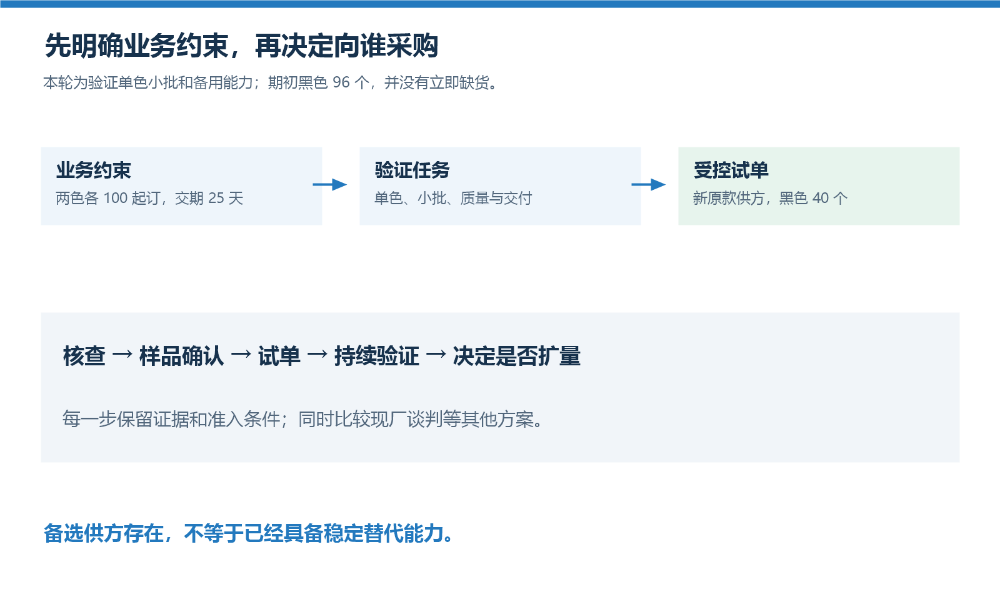

*图 5-1　明确约束，再选择寻源、谈判和试单手段。*

### 1.2　自己做、委外还是采购现成商品

自制需要设备、人员、工艺与产能投入；委外按要求生产，需要管理规格、过程和交期；采购现成产品则要核对产品适用性、资料、供货持续性和可追溯性。

山禾当前采用供方现有杯型、按确认要求供货，没有新建工厂或模具。本章试单也未引入模具资产。以后若开发专用模具，要确认费用、权属、维护、使用限制和更换供应商的安排。

### 1.3　准入先核对哪些证据

| 核查领域 | 需要了解的内容 | 可以取得的资料 |
|---|---|---|
| 主体与交易 | 实际签约、收款、生产和开票主体 | 主体资料、收款及生产关系 |
| 产品和工艺 | 是否真正具备相应制造或组织能力 | 样品、工序、设备和操作记录 |
| 质量与追溯 | 关键要求怎样控制，批次能否查到 | 检查方案、记录、问题处置 |
| 产能与供应 | 可分配产能、关键物料及交期 | 排程、物料确认和在手订单 |
| 经营与持续性 | 资金、核心人员、场所及中断风险 | 核查记录、持续经营线索 |
| 适用要求 | 产品资料、材料、生产与经营要求 | 与商品及市场匹配的证明资料 |

提供资料、通过样品与最终稳定供货是不同阶段。关键事实需要交叉核对，必要时现场核查或委托具备能力的专业方。

### 1.4　给本轮试单设定边界

本轮先核对备选厂样品及关键资料，再以 40 个黑色原款做受控试单；出现不合格时隔离并按约处理。只有后续表现和改进得到验证，才讨论扩大供货。

现厂继续作为原款供货基础，备选资格、试单资格和批量供应资格分别记录。双供还会增加资料、样品、库存与维护成本，需要确认它能降低哪些风险。

### 1.5　练习与参考答案

**练习。** 现有黑色 96 个，为什么仍可以提出 40 个试单？在批准前至少应说明什么？

**参考答案。** 可以为未来单色小批和备用能力取得证据。需要说明验证目标、库存用途、总投入、验收及退出安排，评估能否通过其他更低投入方式取得相同信息。

**本节交付物**　供应需求、准入证据、试单目标和风险记录。

---

## 第二节　42 元与 44 元，怎样比较报价？

现厂单价低 2 元，却需要买 200 个。备选厂单色 40 个即可试，另外还需要核查和检验费用。

采购先对齐商品、数量和费用范围，再做比较。

**本节目标**　拆解价格与成本，理解最低订量、一次性费用、质量和资金对总投入的影响。

### 2.1　询价资料先一致

给供方相同版本的规格、样品、关键要求、颜色、数量、包装、检查与到仓条件。分别问清价格是否包含运输、检验、打样、模具及其他费用，明确报价有效期和可变更条件。

如果一个报价含入仓运输、另一个只到工厂门口，需要把运费补进同一范围。交期也要问从什么动作开始，到什么动作结束。

### 2.2　做一张成本拆解练习

下面是为练习分析而设的成本结构，不代表已审计的工厂实际成本。

| 项目，元／只 | 现厂参考 | 备选小批参考 | 后续核对 |
|---|---:|---:|---|
| 材料与部件 | 24 | 24 | 内胆、外壳、杯盖、密封圈及配件 |
| 加工、人工与能耗 | 6 | 7 | 工艺、效率、良率和批量 |
| 装配及检查 | 4 | 5 | 检查范围、装配工时和返工 |
| 包装及入仓运输 | 3 | 4 | 包装要求、运输批量和线路 |
| 管理及制造费用分摊 | 3 | 2 | 分摊范围和计算方式 |
| 利润 | 2 | 2 | 报价形成与谈判空间 |
| 合计 | **42** | **44** | 与报价口径核对 |

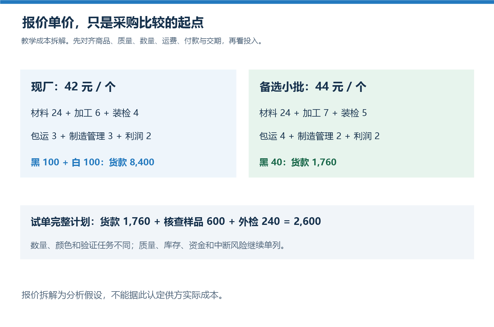

*图 5-2　成本拆解帮助形成问题，材料价格、工时、良率和分摊还需证据。*

材料节省如果影响密封、耐用或适用要求，可能带来返工和售后。先定义可接受性能，再讨论工艺、批量、运输和效率改善。

这里的供方包装与入仓运输包含在采购报价中；后面每笔顾客订单另花的 3 元包装和 6 元快递，属于从山禾仓库向顾客履约的支出，环节和用途不同。

### 2.3　比较同一任务下的投入

| 项目 | 现厂原条件 | 备选试单 |
|---|---|---|
| 数量 | 黑 100、白 100，共 200 | 黑 40 |
| 含运单价 | 42 | 44 |
| 完整货款承诺 | 8,400 | 1,760 |
| 本轮样品与供货核查 | 沿用现有资料，本题未新增 | 600 |
| 本轮外部入仓检验 | 本题未新增 | 240 |
| 本轮计划货款加验证支出 | **8,400** | **2,600** |

两种方案支持的数量与验证任务不同。备选单只更贵，但本次采购承诺少；现厂的资料和能力已积累，备选还要付出试验与维护成本。

总拥有成本（TCO）可以帮助把采购之外的质量、交付、库存、资金、服务和退出成本一起看。难以准确量化的风险先单列情景及依据，避免把未知值都当成零。

### 2.4　价格谈判可以改变哪些条件

可讨论批量、单色起订、运输频次、交货拆分、交期、付款、标准包装和长期合作条件。给供方较清楚的预测可能有助于排程，但预测与已确认采购承诺要分别写明。

报价便宜 1 元，如果增加 50 个难销售的库存或提前很多天付款，应核算相同需求期间的后果。尚未确认的年度量不要直接当作采购订单给出去。

### 2.5　练习与参考答案

**练习一。** 备选厂以后提出单色 200 个、每只 41 元，货款是多少？比现厂总货款少多少？是否能直接取代本次试单？

**参考答案。** 8,200 元，比现厂 8,400 少 200。颜色结构、资格与验证阶段不同，还需核对需求、库存、产能、质量和合同；本轮仍按 40 个试单执行。

**练习二。** 原款每只材料减少 1 元、预计全批 200 个，可少多少采购成本？决策前还要核查什么？

**参考答案。** 名义节省 200 元。核查材料与产品要求、变更验证、过程及交付，估计可能的良率、投诉和返工影响，再决定是否改变。

**本节交付物**　同口径报价表、成本问题清单及总投入比较。

---

## 第三节　怎样把谈判结果写成可执行订单？

备选厂口头同意小批，采购准备转预付款。质量人员问：“不合格怎么处理？收 40 个、只能用 36 个时，还要付全部尾款吗？”

本次把这些条件写进确认资料，再签订单。

**本节目标**　写清买什么、怎样验收、何时付款和变化怎样处理，使各岗位能按同一份资料执行。

### 3.1　采购文件至少承载什么

| 信息 | 本章确认内容 |
|---|---|
| 主体和商品 | 山禾与备选原款厂，500mL 黑色，SKU SH500-BK |
| 版本 | 已确认样品、图纸及关键要求有编号和日期 |
| 数量与价格 | 40 个，44 元／只，含运到指定国内仓 |
| 日期 | G4 确认并预付，约定 G16 到仓 |
| 检查与接受 | 按双方约定检查，仅接受合格数量 |
| 异常 | 不合格隔离、记录并按约退回，补供数量与日期另行确认 |
| 付款 | 30% 预付，接受后按合格货值扣预付结清相应款项 |
| 变更与沟通 | 价格、数量、材料、工艺和日期变化留下确认记录 |

这是一组教学合同条件，真实交易需要核实完整合同及其适用安排。

### 3.2　本次付款与以前有什么变化

原来的现厂订单通常在发货前付 70%。这次备选试单约定，预付 30%，其余按已验收接受的货值结算。两个供方及订单条件分别记录。

**预付款 = 40 × 44 × 30% = 528 元。**

如果 40 个全部接受，剩余为 1,232 元。本章实际部分接受的结算在第六节展开。

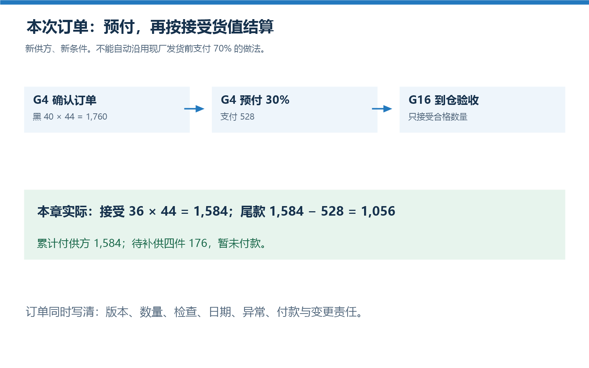

*图 5-3　付款与验收条件来自本次确认文件，不能自动套用上一张订单。*

### 3.3　预测、预留与订单承诺

给工厂未来需求预测时写明版本、适用期间和变动可能；若希望它提前备料或留产能，要约定费用、取消或变更的责任。

采购订单、提前备料指令和口头加急都可能带来执行后果。内部授权、对外确认和系统登记应能对应，避免不同人员分别答应不同数量或日期。

### 3.4　变更怎样跟到实物

例如供方想换密封圈，先核对影响和验证方案，确认后更新版本、材料批次和检查要求。仓库、客服与运营也需要知道是否影响已售和在售商品。

原材料、模具、工艺、外协场所或检查方式发生变化，都应按其对产品的影响管理。每次变更记录申请、确认人、日期、影响批次和验证结果。

### 3.5　练习与参考答案

**练习。** 备选厂发来一条“货已做完，请按老规矩付 70%”。采购应核对什么？

**参考答案。** 核对本次订单付款条件、检查与发货记录、此前预付和未结金额。按本次约定推进验收与结算；如需改变条件，明确影响并重新确认，保留记录。

**本节交付物**　一份数量、版本、质量、日期、付款与异常责任清楚的采购订单。

---

## 第四节　工厂说能交，怎样核实物料和产能？

供方说产线一天能做 50 只。你继续问，这条线现在有多少别人的订单、关键密封圈是否齐料、检查和运输需要多久。

**本节目标**　认识物料清单、关键路径、可分配产能和良率，将 G16 到仓向前排成节点。

### 4.1　从物料清单找到约束

物料清单（BOM）列出成品所需的部件、数量和版本。杯子可包括内胆、外壳、杯盖、密封圈、涂装材料及包装等，不同结构和工艺的清单不同。

核实关键物料的规格、供应者、库存、在途、损耗、最小批量和检验状态。成品数量够，某个关键部件不齐，也可能无法装配交付。

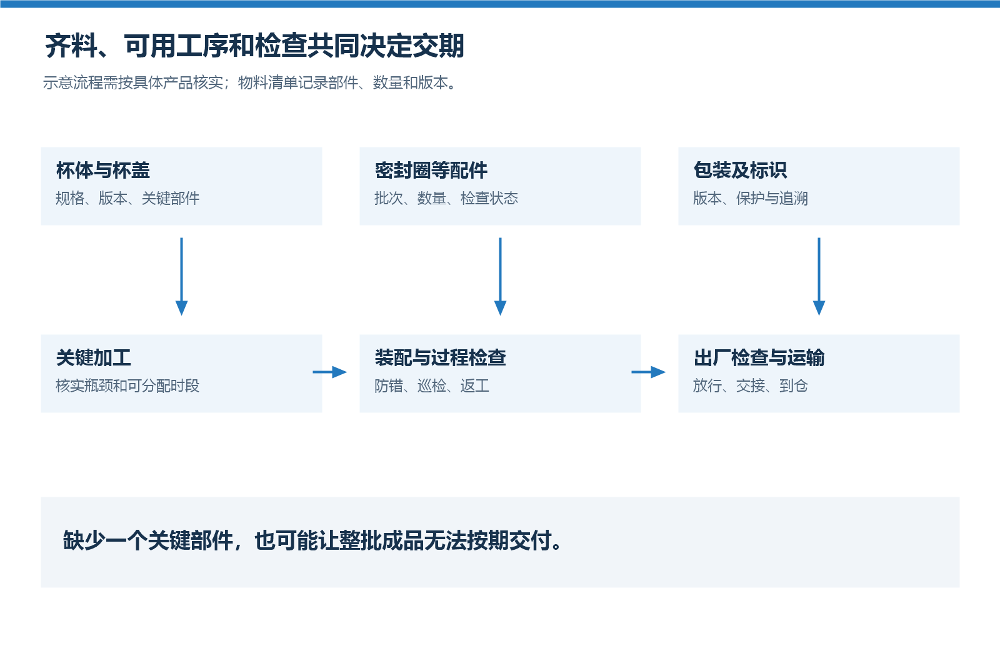

*图 5-4　关键物料、工序和检查都可能成为交期约束，按具体产品核查。*

### 4.2　名义产能与可分配产能

做一道独立排程演练：某工序每天名义投入 50，只能分给山禾 15 个投入量；假设工序合格率 95%，想取得 40 个合格结果。

**计划投入 = 40 ÷ 95% ≈ 42.11，向上取整 43 个。**

**计划工序天数 = 43 ÷ 15 ≈ 2.87，向上取整 3 天。**

这是用假设良率安排投入的估算，不保证三天一定产出 40 个合格品；实际执行还要跟踪产出与波动。

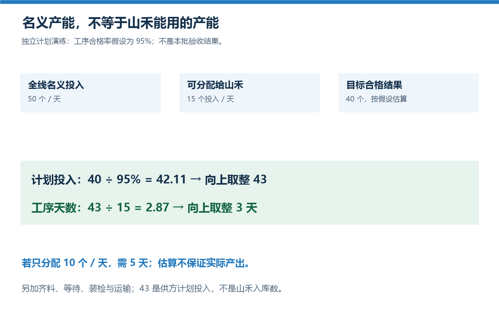

*图 5-5　这是计划估算，停机、切换、缺料、返工和实际良率会改变结果。演练投入量不计入山禾采购库存。*

检查瓶颈工序、班次、设备与人员、切换损耗和其他订单占用。若工序串联，还要看等待和衔接，不能只把某台机器最快速度当作全流程产能。

### 4.3　把交付拆成确认节点

| 节点 | 本章跟进安排 | 核对内容 |
|---|---|---|
| G4 | 订单及预付确认 | 规格、数量、版本、付款 |
| G5 | 关键物料确认 | 数量、检查、到料及替代风险 |
| G6—G8 | 关键加工安排 | 可分配时段、瓶颈和进度 |
| G9—G11 | 装配与过程检查 | 关键装配、问题和返工 |
| G12—G13 | 出厂检查与包装 | 方法、结果、标识、批次 |
| G14 | 交接运输 | 数量、运单和到仓日期 |
| G16 | 到仓 | 收货、验收及异常 |

供方出厂记录称本批检查通过，山禾仍按约到仓检查。第五节会看到检查方法与实际结果的差异。

把有先后依赖的任务连起来，决定最早完成日期、没有可延迟余地的任务链称为关键路径。瓶颈强调处理能力的约束，关键路径强调时间与依赖，二者有关但不相同。关键密封圈到料推迟，即使装配设备空闲，也可能推迟整批交付。

### 4.4　让提前预警有具体信号

关键物料未齐、瓶颈时段被占用、关键检查失败、返工增加、物流日期变化，都应触发复核。写清谁在何时给出证据、替代方案和更新日期。

供方承诺的日期要与山禾的收货、验收和顾客需求衔接。分批交付时，逐批确认可用数量和费用，避免只得到一部分货却仍沿用全部可售计划。

### 4.5　练习与参考答案

**练习。** 同一演练中，可分配投入变为每天 10，计划工序天数多少？若只剩两天，能否按原假设支持 40 个合格结果？

**参考答案。** 43 ÷ 10 向上取整为 5 天。两天预计仅投入 20，在原合格率假设下约 19 个合格结果。需要重新核对资源、工艺和日期，并评估可执行方案。

**本节交付物**　关键物料、可分配产能、排程节点与预警记录。

---

## 第五节　出厂说合格，到仓为什么还发现问题？

G16，40 个试单杯到仓。供方发来出厂检查记录，称本批通过。山禾按照双方确认的收货检查要求逐个检查，发现两个密封异常、两个杯盖装配不符。

采购不能只在“相信供方”和“全部拒收”之间选择。先确认要求、方法、实物和批次，再作出有依据的验收决定。

**本节目标**　建立从样品到收货的质量控制链，区分过程良率、抽样检查和入仓验收结果。

### 5.1　质量要求要能被双方执行

“质量好”“不能漏”还不足以直接指导检验。需要将关键要求写成可观察、可重复的检查项目，说明样品版本、条件、工具、操作步骤、判定及记录方法。

| 项目 | 需要写清的内容 | 本批怎样记录 |
|---|---|---|
| 材料、部件与资料 | 确认版本、适用性、材料及证明资料 | 按资料和批次核查，不凭外观确认材质 |
| 密封功能 | 确认的装配、测试条件、步骤及判定 | 按约定方法逐个检查，两个未通过 |
| 杯盖装配 | 型号、配合、装配位置与操作要求 | 两个与确认要求不符 |
| 外观与标识 | 颜色、缺陷示例、标识和批次要求 | 留存检查结果和照片 |
| 包装与数量 | 单件防护、外箱、数量与混装检查 | 实收 40，与运单核对 |

这里给出检查设计思路，未提供可直接代替真实产品检验的技术规范。本批的功能检查是双方已确认的方法；没有凭空把某个温度、时长或抽检比例写成通用要求。销售前仍需核实商品及目标市场的适用要求与证据。

### 5.2　从源头、过程到入仓分别设控制点

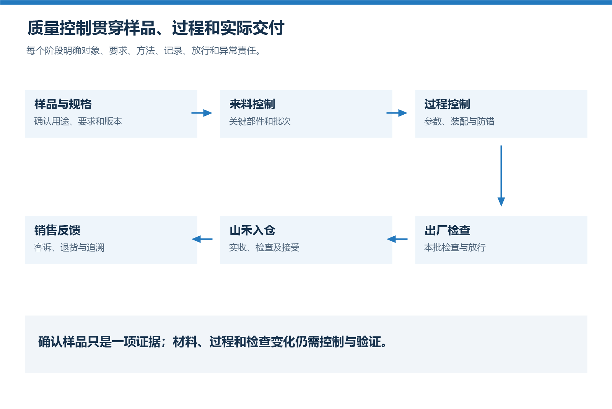

*图 5-6　样品确认后，仍需控制物料、生产变化与交付批次。*

| 控制阶段 | 主要任务 | 需要留下的证据 |
|---|---|---|
| 样品与规格确认 | 明确能否满足用途、关键要求和版本 | 确认样、版本及检查方法 |
| 供方来料检查 | 核对关键部件及异常批次 | 部件批次、检查、放行或隔离 |
| 生产过程检查 | 防止装错、漏装、参数偏离及问题扩散 | 工序记录、巡检、返工及变更 |
| 出厂检查 | 核对准备交付的实物与要求 | 出厂报告、数量和批次 |
| 山禾入仓验收 | 确认实收与可接受数量 | 收货记录、检查、拒收及处置 |
| 销售反馈 | 发现使用中的问题与批次关联 | 客诉、退货、原因和改进效果 |

来料、过程和出厂检查在业务中也常用 IQC、IPQC、OQC 等简称。先明确检查对象、责任和放行权限，比记住简称更重要。

### 5.3　全检与抽检分别解决什么问题

本批仅 40 个，山禾按约对列示的密封、装配等项目逐个检查，并支付外部检验费 240 元。逐个检查这些项目，不代表把所有性能、使用寿命和潜在风险都检验完毕。

数量较大时，可以在风险评估基础上约定抽样方案。抽样要明确批的组成、取样方式、项目、判定规则和不通过后的处理。它存在漏判和误判风险，不能把“样本通过”说成“整批零缺陷”。涉及关键风险的项目需要单独确定控制方式。

第四节的 95% 是独立产能演练的工序良率假设；这里的 36 ÷ 40 = 90% 是实际教学批次的首次验收合格率。统计对象、环节和时间不同，不能互相替代。

### 5.4　面对两份相反的检查结论

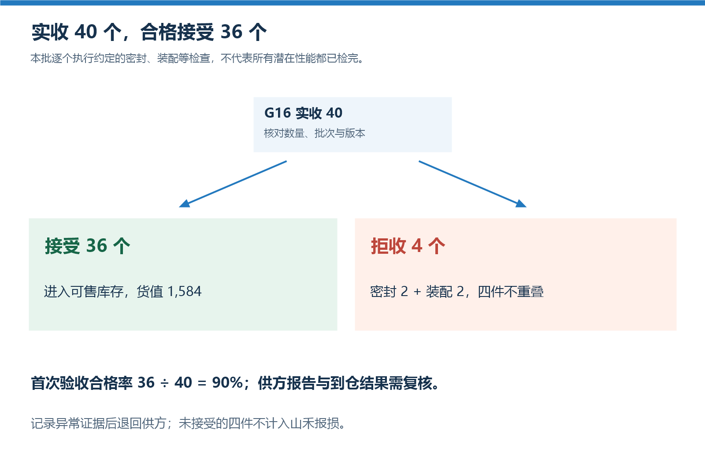

*图 5-7　40 个实收到仓，36 个接受入库，4 个隔离拒收。*

山禾先给异常件编号，保留照片、方法和操作记录，核对是否同一批、同一要求、同一测试条件、同一判定尺度，并邀请供方复核。两个密封问题和两个装配问题来自四件不同实物，没有重复计算。

双方复核确认四件不符合要求。36 件接受并进入可售批次；4 件隔离，不能为了完成收货任务先改成可售。记录中写明供方责任及补供安排，根因仍需继续调查，不能仅凭现象就认定是材料或人员造成。

供方报告通过可能与取样、执行方法、判定或记录有关。本章没有足够证据确定是哪一种，后续要追溯，不能把推测写成已查明原因。

### 5.5　练习与参考答案

**练习。** 供方出厂报告通过，是否可以取消山禾验收？36 件合格是否说明后续批次也有 90% 合格率？

**参考答案。** 应按本次约定和风险决定验收，报告是证据之一。36／40 仅描述这一批、这些检查项目的首次结果，不能据此确定后续批次水平。还要分析异常、核实控制措施并持续验证。

**本节交付物**　规格版本、检查方法、批次结果与异常证据。

---

## 第六节　收到 40 个，只接受 36 个，怎样处理？

G17，采购收到请款：“40 个已经到仓，支付剩余 1,232 元。”仓库却只放行了 36 个。

合同约定按验收合格货值结清，剩余数量继续补供。采购、仓库、财务必须用同一验收结果核对。

**本节目标**　处理部分验收、退回、补供、付款和异常改进，避免把物理到仓误当作全部履约。

### 6.1　三种记录要互相核对

| 记录 | 本批实际状态 | 容易混淆的地方 |
|---|---|---|
| 实物流转 | 到仓 40，接受 36，拒收隔离 4 | 到仓数量不等于可售数量 |
| 合同履约 | 订 40，已接受 36，待补供 4 | 退回四件后，采购订单仍有欠交 |
| 付款与存货 | 合格货值 1,584，已预付 528 | 按约扣预付后只付 1,056 |

四件未被山禾接受，G18 退回供方，由供方承担退回运费。这四件未计入山禾存货，也没有再记一笔山禾报损。本章没有收到质量赔款、退款或其他补偿，不虚构抵扣收入。

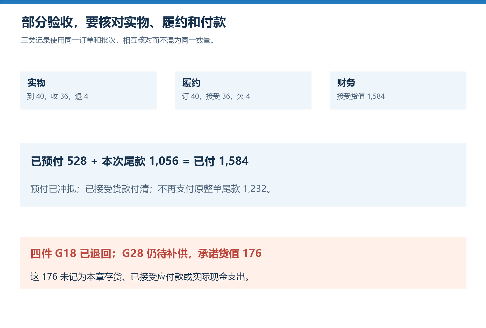

*图 5-8　付款按接受的货值核对，余下四件继续留在合同履约追踪中。*

### 6.2　把实际付款一笔一笔算清

| 项目 | 计算 | 金额，元 |
|---|---|---:|
| 原订单完整货值 | 40 × 44 | 1,760 |
| G4 预付 | 1,760 × 30% | 528 |
| 若全合格原应付尾款 | 1,760 − 528 | 1,232 |
| 本次接受货值 | 36 × 44 | 1,584 |
| G19 本次实际尾款 | 1,584 − 528 | **1,056** |
| 累计已付供方 | 528 + 1,056 | **1,584** |
| 尚待补供货值 | 4 × 44 | **176** |

本章按案例合同，以接受时确认存货和相关应付款。预付的 528 全部冲抵已接受货款，支付 1,056 后，已接受部分没有未付货款，也没有预付余额。剩余 176 是未完成采购承诺，本章未确认为存货或已接受货物的应付款。

真实业务还需要根据合同中的控制权、运输安排、验收条款和实际情况判断确认时点，并核对单据。本案例不能直接套用到所有货到付款、在途货或拒收场景。

### 6.3　补供没有完成，异常就没有全部关闭

供方承诺 G26 补供四件，但 G28 仍未到仓。采购登记新日期待供方书面确认，继续追踪；不把承诺日期当作实收，也不补写一笔并未发生的付款。

| G28 项目 | 数量／金额 | 状态与责任 |
|---|---:|---|
| 已接受试单 | 36 个／1,584 元 | 入库、货款已付清 |
| 拒收退回 | 4 个 | 已于 G18 交回供方，留交接记录 |
| 原订单待补供 | 4 个／176 元 | 未到仓，供方落实新日期，采购每日跟进 |
| 外部检验费 | 240 元 | 已支付，作为本章验证费用 |

本轮销售可以由旧库存覆盖，但供应商的交付缺口依然存在。若未来顾客订单依赖这四件，必须重新核对承诺与替代方案，不能继续向顾客承诺原到货日期。

### 6.4　纠正措施要有证据和验证

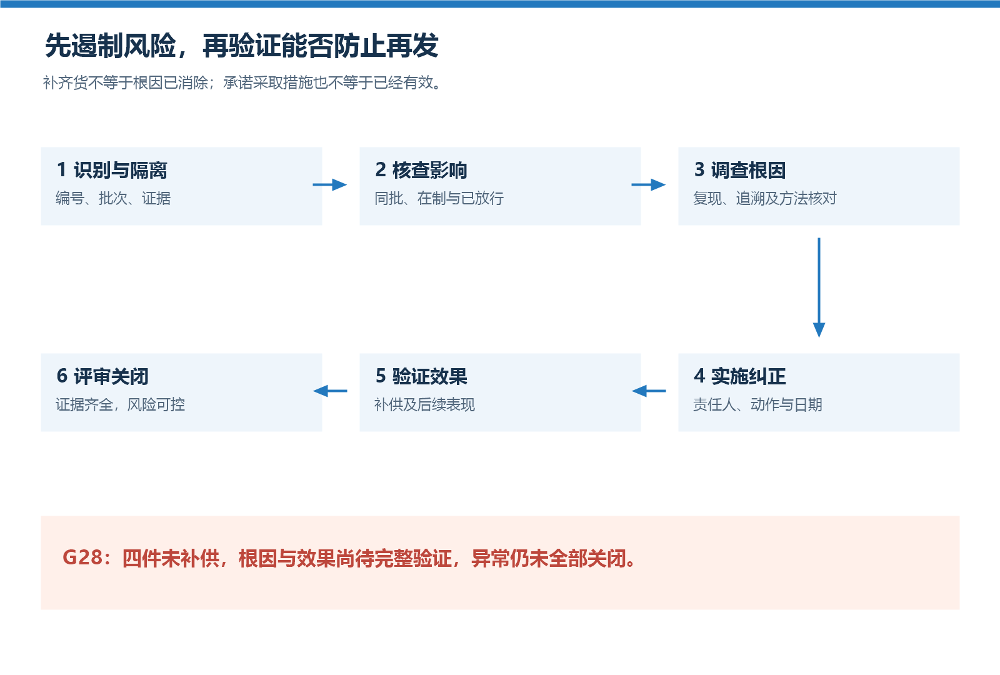

*图 5-9　隔离和补供解决眼前问题，根因分析及效果验证决定是否能防止再发。*

先遏制：隔离异常批、核查同批及在制品风险，确认已放行 36 件的检查记录；若发现关联风险，重新评估放行。再找原因：追溯部件、版本、装配和检查，复现问题，区分制造缺陷与检查失效。

例如，“装配错误”是现象；部件混用、装配定位、工位防错或检查执行可能是调查方向，未经验证不能认定。供方提出措施后，要有负责人、完成日期和验证方式。后续补供及批次表现是效果证据，未验证前保留异常未关闭状态。

### 6.5　练习与参考答案

**练习。** 财务已经预付 528，若再付 1,232，会有什么问题？G28 四件未到，能否把 176 元计入期末库存？

**参考答案。** 累计将付 1,760，比当前接受货值多 176，违背本例付款条件；如实际误付，还需要追踪额外付款及追回，不能消失。实际本章只再付 1,056。未到且未接受的四件不计入本例期末库存，继续记录采购承诺与交付风险。

**本节交付物**　收货验收、退回交接、付款核对、剩余承诺和纠正措施记录。

---

## 第七节　到货准时就算好供应商吗？

备选厂说：“40 个在 G16 到仓，我们没有晚。”运营说：“但合格可用的只有 36 个。”

两人观察的事件不同。绩效指标首先要写清日期、数量、合格状态和统计单位。

**本节目标**　识别供应商指标的口径，建立有边界的评分和分层，制定可验证的改进计划。

### 7.1　把到仓、足量与合格放在一起看

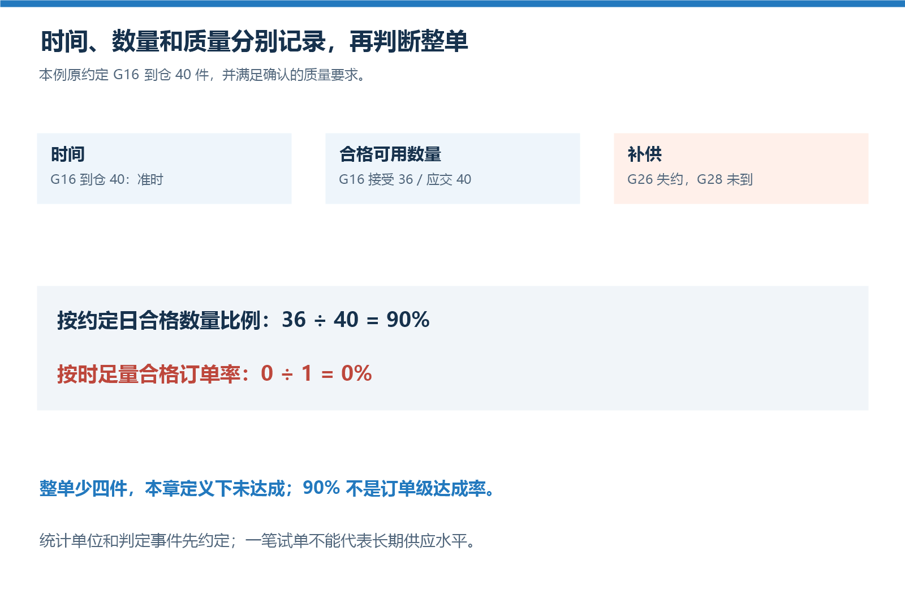

*图 5-10　到仓准时只能回答时间问题；按时足量合格还要看可用数量。*

| 指标 | 本章定义 | 本批结果 |
|---|---|---|
| 到仓是否准时 | 原约定 G16，到仓记录是否不晚于 G16 | 是，40 个 G16 到仓 |
| 首次验收合格率 | 首次接受数量 ÷ 实收检查数量 | 36 ÷ 40 = **90%** |
| 不合格比例 | 不合格数量 ÷ 实收检查数量 | 4 ÷ 40 = **10%** |
| 截至约定日足量合格交付比例 | 不晚于 G16 接受的合格数 ÷ 应交数 | 36 ÷ 40 = **90%** |
| 按时足量合格订单率 | 同时按时、足量、合格的订单数 ÷ 到期订单数 | 0 ÷ 1 = **0%** |
| 补供承诺履行 | G26 前是否完成四件合格补供 | 未完成，G28 仍待补供 |

本例到仓检查在 G16 完成合格数量判定，G17 完成报告与结算确认。若其他案例验收跨日，应明确交付时间按何事件计，不能追溯改写结果。

企业常用 OTIF 表示按时足量交付，但对“合格”、分批、允差、订单行或整单的定义可能不同。本章把合格明确放入订单级达成标准，90% 是数量比例，不能写成订单级 OTIF 90%。仅一笔订单也不足以证明供方长期水平。

### 7.2　用评分帮助讨论，保留证据与门槛

下面为评分方法演练。分数来自本题设定，范围 1—5、越高越好，不是根据单批数据推定的长期评级。真实应用需预先定义分档规则、观察周期和证据；关键产品或合规要求不通过，不能靠价格高分抵消。

| 维度 | 权重 | 现厂演练分 | 备选演练分 | 本章关注 |
|---|---:|---:|---:|---|
| 质量 | 35% | 4 | 2 | 首次验收及根因验证 |
| 交付 | 25% | 3 | 2 | 合格数量缺口、补供失约 |
| 成本 | 25% | 4 | 3 | 同口径总投入、改善能力 |
| 协同 | 15% | 3 | 3 | 资料、响应和措施执行 |
| 加权得分 | 100% | **3.60** | **2.40** | 证据、短板及限制条件 |

现厂 = 4 × 35% + 3 × 25% + 4 × 25% + 3 × 15% = 3.60。备选 = 2 × 35% + 2 × 25% + 3 × 25% + 3 × 15% = 2.40。

不能因本次备选分数低，就证明现厂必须长期独供；也不能因为需要双供，就降低质量要求。本轮结论是维持受控试单状态，追踪四件补供及纠正措施，暂不扩大采购量。

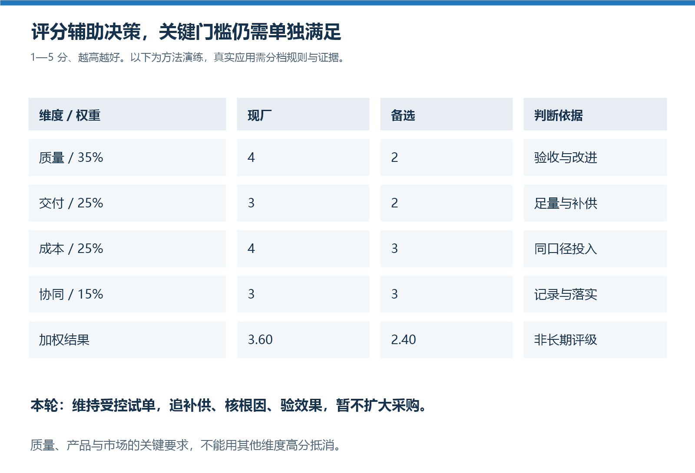

*图 5-11　权重和分数辅助讨论，准入门槛、样本量与关键风险要单独判断。*

### 7.3　区分库存单价与项目验证投入

完整采购计划是 1,760 货款加 840 验证支出，共 2,600 元。实际到 G28，接受并付款 1,584，加已发生验证费用 840，共投入 **2,424 元**；还剩采购承诺 176。

如果管理者想看这次验证活动为每件已接受商品付出了多少，可计算 2,424 ÷ 36 ≈ **67.33 元／件**。这个指标包含本章全部样品、核查和外检费用，且分母仅为当前已接受件数，是项目评估口径。

本章 840 元作为期间验证费用，不分配进存货；36 件入账单价仍为 44，库存价值 1,584。不能把 67.33 当作存货单价后又扣一次 840。真实成本归集要结合费用性质与会计政策确认。

### 7.4　供应商关系与退出也要有安排

对核心且难替代的供应，定期审视工艺、产能、关键物料和中断预案；对有替代但表现不稳的供应，限定试单、核查及改善条件；对不符合关键要求或持续失约的供应，暂停扩量并评估退出。

退出前要核对未交订单、预付、可接受库存、模具资料与交接责任。所谓双供也需要第二家真正具备可用产能、相同版本和质量能力，不能只有一个联系人或一份报价。

采购岗位还应对利益冲突、报价变更、供方收款变更与付款权限做记录和复核。采购建议、验收放行与付款复核尽量有不同责任人，资源有限时也要指定交叉复核。

### 7.5　练习与参考答案

**练习。** 为什么不能把本批表现概括为“准时率 100%，可以扩量”？67.33 元能否直接代替 44 元计算期末新批次库存？

**参考答案。** 到仓准时不代表足量合格，且补供失约，样本也只有一单；应保留各项结果和验证条件。67.33 是包含验证费用的本次项目分摊指标，44 才是本章已经约定的入账单价，不能混用。

**本节交付物**　指标口径、证据与评分、供应商状态及改进条件。

---

## 第八节　把采购、库存成本与资金核对回来

G28，运营认为本月卖得不错，采购提醒试单仍有四件待补，财务要求先把本轮实际收支和库存核对清楚。

**本节目标**　把合格入库、销售出库、验证费用、平台结算与未完成采购承诺分开记录，再形成联合决策。

### 8.1　旧批次与新批次分别算

本轮顾客订单为黑色 50、米白 44、小杯 30，共 124 笔，均一单一杯，已出库、签收且保留，无取消或退货。采用先进先出，对应实物也先发旧批次。旧黑色 96 足以覆盖 50 件销售，新接受的 36 件全部留存。

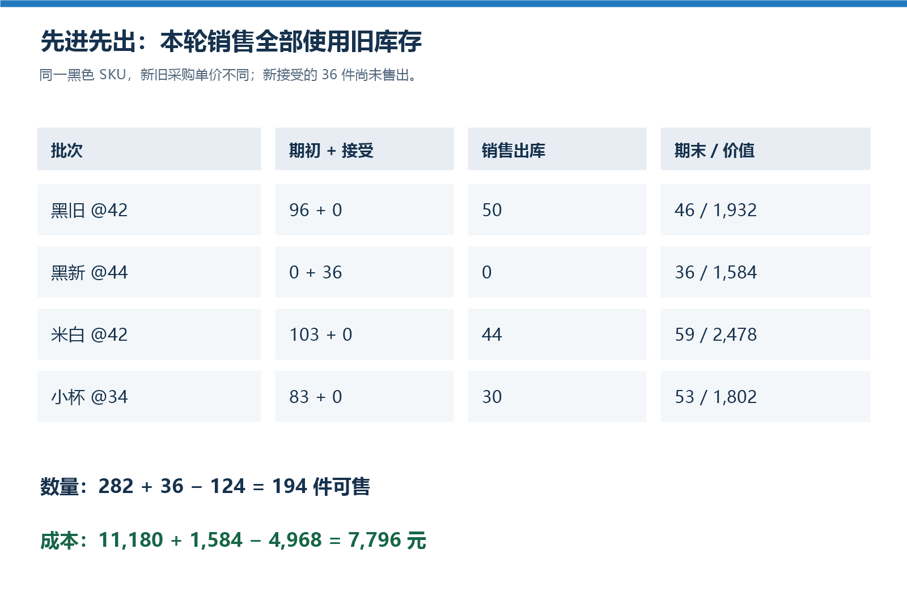

*图 5-12　同一 SKU 可以有多个成本批次；SKU 没变，不代表成本单价永远相同。*

| 批次 | 期初可售 | 本章接受入库 | 销售出库 | 期末可售 | 单位成本 | 期末价值 |
|---|---:|---:|---:|---:|---:|---:|
| 黑色旧批次 | 96 | 0 | 50 | 46 | 42 | 1,932 |
| 黑色新试单 | 0 | 36 | 0 | 36 | 44 | 1,584 |
| 米白旧批次 | 103 | 0 | 44 | 59 | 42 | 2,478 |
| 小杯旧批次 | 83 | 0 | 30 | 53 | 34 | 1,802 |
| 合计 | **282** | **36** | **124** | **194** | — | **7,796** |

黑色合计 82 件、价值 3,516 元。销售商品成本 = 50 × 42 + 44 × 42 + 30 × 34 = **4,968 元**。没有把采购的 1,584 再全部当成销售成本。

库存成本核对：11,180 + 1,584 − 4,968 = **7,796 元**。

可售数量核对：282 + 36 − 124 = **194 件**。G28 库房还保留原来三件零账面隔离实物，实际在场共 197 件；本次四件拒收品已退回供方，不在山禾库房。

物理流转也可核对：期初在场 285 + 实收到货 40 − 退回供方 4 − 顾客出库 124 = **197 件**。四件待补供在采购记录中，没有混进这个实物数。

### 8.2　经营结果看本章实际发生

| 项目 | 计算口径 | 金额，元 |
|---|---|---:|
| 保留销售额 | 94 × 119 + 30 × 99 | 14,156 |
| 销售商品成本 | 94 × 42 + 30 × 34 | −4,968 |
| 平台费 | 124 × 6 | −744 |
| 包装 | 124 × 3 | −372 |
| 出库快递 | 124 × 6 | −744 |
| 广告实际花费 | 本章实际支出 | −2,000 |
| 交易贡献 | 以上各项相抵 | **5,328** |
| 样品与供货核查 | G1—G3 支付 | −600 |
| 外部检验 | G16—G17 支付 | −240 |
| 本章列示范围经营结果 | 5,328 − 840 | **4,488** |

本章未发生逆向运费由山禾承担，拒收退回运费由供方支付；也没有再次沿用第四章的 800 元协作支出。工资、税费、仓租等不在本模型列示范围内，所以不能把 4,488 宣称为真实企业完整净利润。

### 8.3　银行、待结算和存货共同核对

本轮平台应结算 14,156 − 744 = **13,412 元**，已到账 12,000，待结算 **1,412 元**。第四章留下的 2,125 已在 G1 全部到账，只是收回旧应收，没有增加本章销售额。

| 银行变动 | 金额，元 |
|---|---:|
| 承接第四章期末 | 192,571.88 |
| 收回前章平台款 | +2,125.00 |
| 本章平台结算到账 | +12,000.00 |
| 试单实际付供方 | −1,584.00 |
| 广告支付 | −2,000.00 |
| 包装支付 | −372.00 |
| 出库快递支付 | −744.00 |
| 样品、核查、外检支付 | −840.00 |
| G28 银行余额 | **201,156.88** |

平台费已经从结算中扣除，银行表不能再扣一次。预付 528 和尾款 1,056 已合计包含在供方付款 1,584 内。

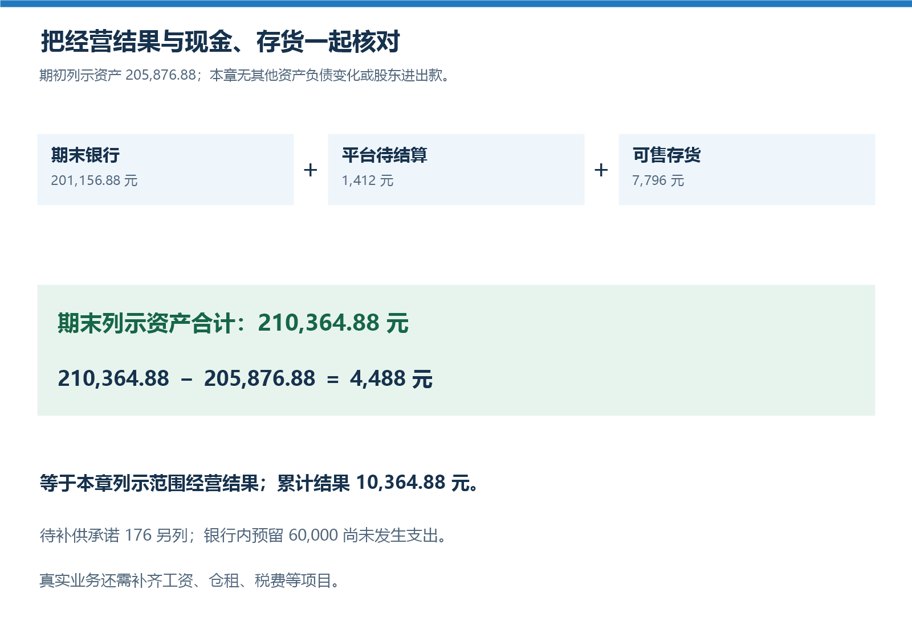

*图 5-13　利润增加与银行增加不同步，需要同时观察待结算和库存变化。*

期初列示资产 = 192,571.88 + 2,125 + 11,180 = **205,876.88 元**。

期末列示资产 = 银行 201,156.88 + 待结算 1,412 + 存货 7,796 = **210,364.88 元**。

两者差额 **4,488 元**，与本章经营结果一致；自最初投入 200,000 起，累计列示经营结果为 **10,364.88 元**。本例没有其他资产负债变动或股东进出款。

60,000 预留仍在银行中。若为安排后续资金，再扣除这项预留和待补供承诺 176，管理上剩余 **140,980.88 元**；它只是当前列示事项下的安排参考，不能代替未来现金预算。176 没有在实际银行余额中提前扣除。

### 8.4　从“催交货”升级为联合计划

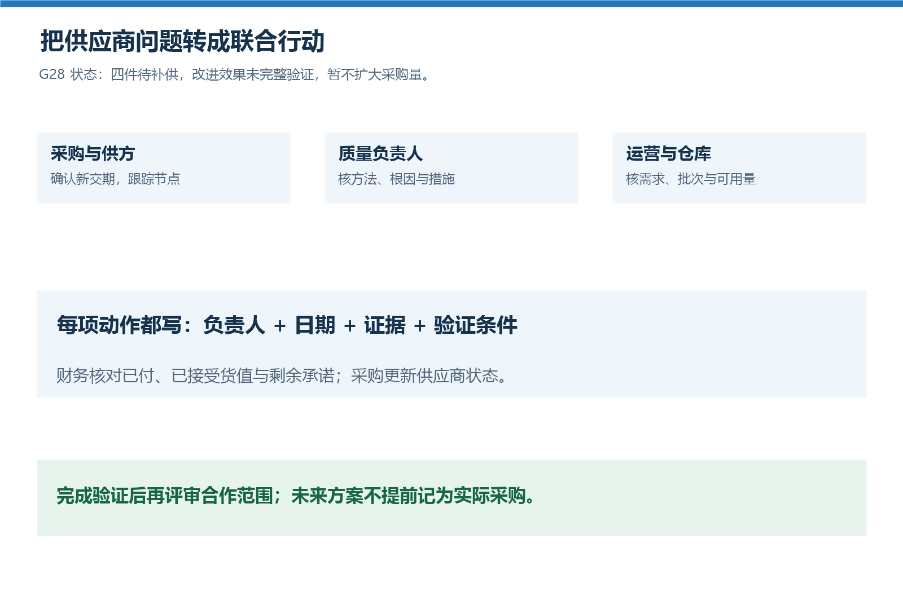

*图 5-14　每个改进动作都要有责任、日期、证据和继续合作条件。*

| 问题 | 下一步动作 | 负责人及证据 | 当前状态 |
|---|---|---|---|
| 四件未补供 | 确认新交期，复核物料与生产节点 | 采购跟进，供方书面计划、发运和验收记录 | G28 未完成 |
| 密封及装配异常 | 追溯、复现、纠正，并验证有效性 | 供方实施，质量负责人复核根因与结果 | 尚待完整验证 |
| 出厂与到仓结论不同 | 对齐检查方法，核实执行记录 | 双方质量人员复核版本及实物 | 不能只改报告结论 |
| 单色小批需求 | 继续比较现厂谈判与备选成本 | 采购、运营、财务比较情景 | 不直接扩大试单 |
| 未来销售与库存 | 用 SKU、日期及批次更新供需计划 | 运营给需求，采购与仓库核库存 | 新采购均为待评估方案 |

下一轮评审先看补供和质量措施是否有证据，再决定是否安排新的受控验证。任何后续批量、单价改善和新订单，在本章都只是建议，没有加入实际存货、付款或销售。

### 8.5　综合作业与参考答案

**任务。** 你向创始人提交一份采购评审，至少包含以下四张表，并写出下一步决定。

1. 报价与方案表：现厂原条件、备选试单、可谈判条件，注明数量与验证投入是否可比。
2. 订单执行表：40 件的到仓、验收、退回、待补供与付款，分别列证据和日期。
3. 批次库存与资金表：期初、接受、出库、期末及银行、待结算、存货价值。
4. 绩效与行动表：时间、足量、合格及补供表现，措施、责任人、节点和验证条件。

**参考答案要点。** 单价分别为 42、44；原条件数量 200 与试单 40 不同，试单完整货款加验证预算为 2,600，实际已投入 2,424，尚有 176 采购承诺。实收 40、接受 36、拒收退回 4、仍欠供 4；付供方 1,584，其中预付 528、尾款 1,056。期末可售 194、在场 197、存货 7,796，银行 201,156.88、待结算 1,412，本章经营结果 4,488。

到仓准时，但约定日合格数量比例为 90%，按本章整单标准未达成按时足量合格；G26 补供承诺也未完成。暂不扩大采购，完成补供、根因及效果验证，继续比较现厂灵活供货与备选的实际能力。

**延伸练习。** 假设四件改为在 G28 当天补供、合格接受并支付 176，且没有新增检验、运输、销售或其他费用，哪些期末数会变？这只是另一个情景，不改本章实际。

**参考答案。** 可售增加到 198，其中黑色 86；存货增加至 7,972，银行减少至 200,980.88，待结算仍为 1,412，列示资产仍为 210,364.88，经营结果仍为 4,488。因为补供商品尚未售出，新增付款对应库存，不能直接全算当期费用；剩余采购承诺归零。实际案例仍为四件未到。

**本章完成标准**　能用同一套业务状态解释报价、物料产能、质量、验收、付款、绩效和期末结果；能说明哪些是已发生、哪些是未履约、哪些只是未来方案。

### 8.6　交接到下一章

山禾已经会制定需求与采购计划，也知道到仓需要验收。下一章继续进入仓库与物流：不同状态和批次怎样收货、上架、锁定、拣配、复核、发运与盘点，库存准确性和履约时效怎样共同保证顾客收到正确商品。

---

## 附录　参数与结果核对

这份汇总用于完成学习后的检查，正文计算所需数据均已在相应位置列出。

| 范围 | 本章实际口径与结果 |
|---|---|
| 期初资金 | 银行 192,571.88；待结算 2,125；G1 旧款全部到账 |
| 期初库存 | 可售黑 96、白 103、小杯 83，成本 11,180；另有旧隔离实物 3、账面零 |
| 采购合同 | 40 黑 × 44 = 1,760；G4 预付 30% 即 528；按接受货值结尾款 |
| 收货与异常 | G16 实收 40、首次接受 36、拒收 4；四件 G18 退回，供方承担运费 |
| 付款 | 接受货值 1,584；G19 尾款 1,056；累计供方款 1,584；预付及已接受应付余额零 |
| 待补供 | G26 承诺未完成，G28 欠 4、货值 176；未记库存或已接受应付 |
| 验证费用 | 样品与供货核查 600、外检 240，合计 840，已付且本章费用化 |
| 顾客订单 | A，黑 50、白 44、小杯 30，共 124，均出库签收保留，无取消退货 |
| 销售和成本 | 销售额 14,156；先进先出销售成本 4,968 |
| 经营支出 | 平台 744、包装 372、快递 744、广告 2,000；另验证费用 840 |
| 经营结果 | 交易贡献 5,328；列示范围本章结果 4,488；累计 10,364.88 |
| 平台结算 | 应结 13,412；到账 12,000；新待结 1,412 |
| 期末批次 | 黑旧 46 × 42、黑新 36 × 44、白 59 × 42、小杯 53 × 34 |
| 期末库存 | 可售 194、成本 7,796；加旧隔离 3，在场 197 |
| 期末资金与资产 | 银行 201,156.88；待结 1,412；存货 7,796；合计 210,364.88 |
| 预留和后续 | 银行内预留 60,000 未动；未来扩量、改善价及新订单均未作为实际发生 |
| 独立演练 | 产能、工序良率、供应商评分及 G28 补供假设均按对应练习条件，不改实际结果 |
