# 第八章　从单项优化到国内经营协同

第七章结束，山禾的增长动作留下了正贡献，也把现货压到黑色 10、米白 6、小杯 10，共 26 件。运营想继续推广，采购说原款常规交期 25 天，仓库则要知道活动哪天集中发货。

创始人提出：“接下来十二周，商品、活动、补货、仓库和钱，给我一份能一起执行的计划。”

这次你不再只优化某一项指标，而要协调不同岗位的目标：活动想要销量，采购希望稳定批量，仓库需要平衡负荷，财务要保护现金，顾客需要收到正确且符合承诺的商品。

**本章完成目标**　能形成国内经营协同方案，连接需求情景、采购日期、大促项目、仓配能力、利润与现金预算，处理异常和预算差异，组织滚动评审并明确下一步责任。

## 阅读顺序

| 节次 | 要解决的问题 | 交付物 |
|---|---|---|
| [第一节　各部门都有目标，怎样形成同一份计划？](#section-01) | 目标、约束、版本和责任 | 联合经营任务与决策记录 |
| [第二节　旺季要卖多少，活动假设怎样进入需求？](#section-02) | 十二周需求、生命周期和情景 | 分 SKU、分时间的需求方案 |
| [第三节　只剩二十六件，怎样等到第一批补货？](#section-03) | 低库存衔接、起订和订单日期 | 供需与采购日历 |
| [第四节　大促不是上线一个链接就结束](#section-04) | 项目节点、名额、履约和复盘 | 大促执行与资源计划 |
| [第五节　季度预计赚钱，为什么还要做现金预算？](#section-05) | 利润、采购、存货、预付与预留 | 联动经营预算 |
| [第六节　供应晚三天，原计划要怎样改？](#section-06) | 风险信号、缺口、停止与恢复 | 异常决策和应急安排 |
| [第七节　销量比预算多，结果就一定更好吗？](#section-07) | 实际、差异、批次与滚动修正 | 四周经营复盘 |
| [第八节　怎样主持一次有决定的经营评审？](#section-08) | 资金核对、取舍和管理交接 | 国内经营方案与综合作业 |

正文提供各节需要的数据。完成后可用[章末参数与结果核对](#chapter-check)复查。

## 案例约定与起点

承接第七章，银行 **213,934.88 元**、平台待结算 **400 元**；可售黑色 10 × 44、米白 6 × 42、小杯 10 × 34，合计 **26 件、1,032 元**。原零账面隔离实物三件仍在场，期初实际在场 29 件。没有在途采购、预付、已接受货物应付款或未发锁定。

本章编制 **U1—U84 的十二周经营方案**，用 M1、M2、M3 各表示四周、28 天的管理期。这是便于练习的滚动“季度”，不等同于自然月、自然季度或完整财务报表期间。

先冻结预算 **V0**；然后只执行并复盘 M1，即 U1—U28；后八周还是计划。U28 后提出的滚动版本称 **V1**，不得将未来计划提前加入实际库存、销售或现金。

所有实际顾客订单在 A 成交，每单一杯，原款实付 119、小杯 99。上一章老客券已到期，本轮没有其他降价、满减或赠品；本次活动依靠内容、投放和集中排期，不因称为“大促”就必须打折。平台按保留订单每单收 6，实际出库包装 3、快递 6，顾客退回运费每件 8。

| U1—U28 实际事项 | 结果 |
|---|---|
| 原款本批补货 | 原供方黑白各 100，含运每件 42；本批书面另议 12 天，U13 到仓 |
| 小杯本批补货 | 80 件 × 34，U13 到仓；本批同样确认 12 天 |
| 付款 | U1 预付共 3,336，U11 发货前付尾款 7,784，全部合格接受 |
| 顾客订单 | 支付 160，取消 5，出库 155，签收后退货 8，保留 147 |
| 退回处理 | 恢复可售 7，米白报损 1；未收到赔款 |
| 营销与服务 | 广告 2,800、内容 450、会员客服 320、仓储操作 1,100 |
| 新增协作 | 计划与数据协作服务 3,000，本期已支付并费用化 |
| 临时支援 | U18 两小时高峰增加打包支援，支付 200 |
| 平台结算 | 旧款 400 收回；本期到账 15,000，余款留待结算 |

原款常规 25 天继续记录，本批 12 天不能直接变成以后所有订单的固定交期。未来 M2、M3 的采购价格和日期只是 V0 假设，还要重新询价、确认质量产能与签单。备选原款厂也没有因需要备用就自动升级为不限量供应。

本章首次从原 60,000 资金预留用途内批准支付协作服务 3,000，**实际银行扣款已包含这 3,000，期末尚未使用的该项资金预留为 57,000**。它不是新增损失，也不是要再扣一次现金。仓储操作、会员客服、协作及临时支援范围分别确认，包材和运输另列，不重复记人工。

公司、报价、时间、费用及风险均为教学设定。真实经营仍需补齐本模型未列的全部工资、租金、税费等项目，不能把案例结果当作已经计算完整的企业净利润。

---

## 第一节　各部门都有目标，怎样形成同一份计划？

运营提出“活动不断档”，采购提出“按最低批量下单”，财务提出“不让现金被库存压住”。如果每人只交自己的表，矛盾会在活动当天集中出现。

**本节目标**　从共同结果出发，明确业务取舍、约束、版本和责任。

### 1.1　共同目标不是每个部门都取最大值

本轮任务是在可兑现的商品和服务范围内取得经营贡献，保持资金可用，建立下一阶段可修正的国内经营方案。销售、转化、采购单价和仓库效率分别有用，但不能替代共同结果。

| 岗位关注 | 单独最大化容易发生什么 | 联合评审要回答什么 |
|---|---|---|
| 运营希望多卖 | 超出可发库存或作业窗口 | 哪些 SKU、哪天、多少订单能兑现 |
| 采购希望低单价 | 起订余货、预付和仓储增加 | 对相同需求，完整投入与风险怎样 |
| 仓库希望作业平稳 | 可能与活动集中成交冲突 | 截单、波次、物料和交接怎样安排 |
| 财务希望少占款 | 过低库存也可能损失服务 | 支付日期、缓冲和收益代价怎样平衡 |
| 商品与质量关心体验 | 证据和改进需要时间资源 | 能否放行、追溯、处理关联风险 |

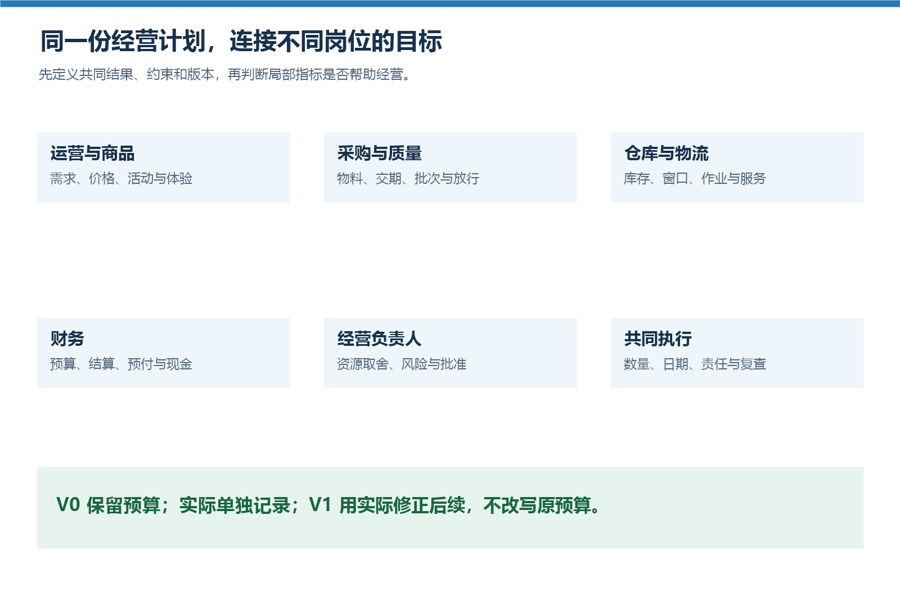

*图 8-1　对共同结果负责，再用岗位指标定位行动。*

### 1.2　把目标、预测、承诺和预算分开

目标表达经营期望；预测估计需求；已确认订单和交付是执行承诺；预算安排费用、资金和资源。本章 V0 预计第一管理期出库 154，实际支付 160、出库 155，它们不是同一指标。

计划至少写出 SKU、数量、时间、状态、价格费用、责任人与版本。发生变化时，更新后续方案并留下原因，原预算仍保留用于复盘，不能改成实际后再宣布“全部达标”。

### 1.3　用责任和节奏把计划落地

需求由运营提出，供应由采购确认，库存与作业由仓库核实，费用与现金由财务核对，质量负责放行与异常证据。经营负责人处理不能同时满足的目标，明确取舍与风险承担。

每日看异常，每周滚动校正需求、供应与资源，每管理期评审经营结果和下一期预算。销售与运营计划常称 S&OP；涉及产品、费用和资金的整体经营协调，也常称 IBP。名称不是额外开会的理由，关键是形成同一套可执行数字和决定。

### 1.4　练习与参考答案

**练习。** 运营提出多开 30 单，仓库说当前窗口可用能力只剩十单，是否应让各自先执行自己的目标？

**参考答案。** 要先确认额外需求的 SKU、日期、库存和窗口，比较错峰、增加能力、修改名额与放弃部分机会的代价，由负责人决定并同步承诺，不能先卖出去再把问题留给仓库。

**本节交付物**　共同目标、约束、版本和责任记录。

---

## 第二节　旺季要卖多少，活动假设怎样进入需求？

创始人希望十二周保持增长。你先把日常需求、活动增量和供应限制分开，而不是把上一轮广告放大三倍。

**本节目标**　形成有日期、SKU 与情景的需求计划，识别生命周期和渠道变化。

### 2.1　冻结一版十二周需求

下表均为 **预计出库件数**。M1 前两周受补货衔接约束，第 3 周安排集中活动；M2 用稳定基线，M3 加入教学旺季假设。所有时期每单一杯，所以件数与出库订单数在本题相同。

| V0 需求窗口 | 黑色 | 米白 | 小杯 | 合计 |
|---|---:|---:|---:|---:|
| 第 1 周，U1—U7 | 4 | 2 | 4 | 10 |
| 第 2 周，U8—U14 | 12 | 12 | 9 | 33 |
| 第 3 周，U15—U21 | 25 | 30 | 16 | 71 |
| 第 4 周，U22—U28 | 15 | 15 | 10 | 40 |
| M1 合计 | **56** | **59** | **39** | **154** |
| M2，四周合计 | 60 | 60 | 40 | 160 |
| M3，四周合计 | 80 | 80 | 48 | 208 |
| 十二周合计 | **196** | **199** | **127** | **522** |

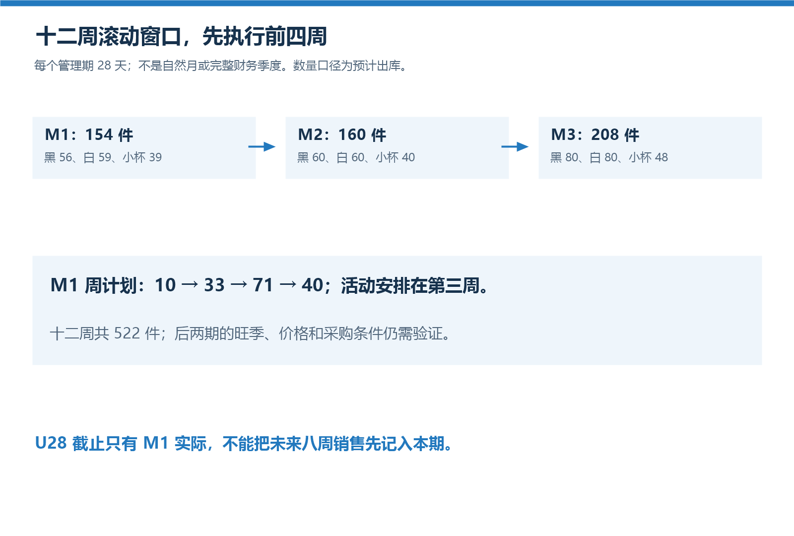

*图 8-2　M2、M3 是预算假设；U28 的实际截止不会把未来销售计入。*

M2 的每周基线为黑 15、白 15、小杯 10；M3 假设每周黑 20、白 20、小杯 12。旺季假设需要市场、历史与活动证据验证，本章没有把这种教学设定当作真实市场季节规律。

### 2.2　对商品和渠道作不同判断

原款是目前经营基础，但颜色需求会变，小杯继续验证用途与增量，不能只看总件数。生命周期管理要结合需求、贡献、体验、库存和替代，不因“新品”或“成熟品”的标签自动决定加量或退出。

本轮仍在 A 实际成交。是否再做 B 内容合作、扩大 C 或开发经销，需要比较价格、固定费、佣金、库存和服务；这些选项没有加入已执行销售。预测不能把多个入口的同一批顾客重复计算。

### 2.3　活动强弱要保留可讨论的范围

第 3 周的工作需求是在日常黑 15、白 15、小杯 10 上，额外加黑 10、白 15、小杯 6，共 31 件活动增量。假设取消活动或增量翻倍，M1 需求不同。

| M1 情景，暂不计退回回流 | 活动取消 | V0 工作方案 | 活动增量翻倍 |
|---|---:|---:|---:|
| 黑色预计出库 | 46 | 56 | 66 |
| 米白预计出库 | 44 | 59 | 74 |
| 小杯预计出库 | 33 | 39 | 45 |
| 出库合计 | **123** | **154** | **185** |
| 26 期初 + 280 来货 − 出库 | **183** | **152** | **121** |

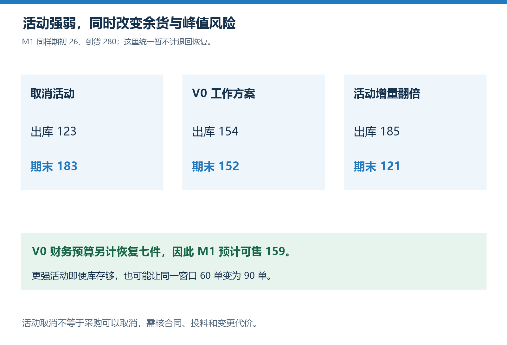

*图 8-3　三种情景采用相同的采购和不计回流口径；财务预算另行纳入预计退货。*

有货不代表峰值能发完。较强情景还可能让同一作业窗口从 60 升到 90 单，需要重新核能力、费用与承诺。较弱情景则可能让已不能取消的采购形成更多余货。

### 2.4　练习与参考答案

**练习。** 为什么工作情景期末 152 与第五节预算库存 159 不同？活动取消后，能否直接把已付款采购减掉 31 件？

**参考答案。** 152 暂不计退回，预算另含预计恢复可售七件，所以为 159。取消活动不等于供方允许取消采购，要核合同、已投料与日期；不可变更的采购仍要承担库存和资金代价。

**本节交付物**　十二周需求日历、活动假设、商品和渠道情景。

---

## 第三节　只剩二十六件，怎样等到第一批补货？

原款普通补货 25 天，当前只有黑十、白六。你不能只拿到一张采购单，就按全部到货后的库存继续推广。

**本节目标**　把到货前供需、批次、最低订量和付款安排到日期，区分确认与假设。

### 3.1　先确认本批能执行的条件

U1，现原款供方对本批黑白各 100 书面确认 12 天、含运单价 42，30% 预付、70% 发货前支付；小杯本批 80 件、34 元，交期和付款也确认。全部在 U13 到仓，检查合格接受。

| M1 已确认采购 | 数量 | 货值 | U1 预付 30% | U11 尾款 70% |
|---|---:|---:|---:|---:|
| 黑白原款 | 各 100，共 200 | 8,400 | 2,520 | 5,880 |
| 小杯 | 80 | 2,720 | 816 | 1,904 |
| 合计 | **280** | **11,120** | **3,336** | **7,784** |

含运价格已包括本次已确认的采购安排，没有另外编造加急费。第七章留下的黑色十件是 44 成本，新批为 42；SKU 不变，批次仍需保留。

### 3.2　到货前只承诺现货支持的量

V0 将 U1—U12 的出库限制在黑 8、白 4、小杯 8，合计 20。实际也按这组数量执行，且没有在这段时间额外接超过可兑现现货的未发订单。

| U13 到仓前 | 黑色 | 米白 | 小杯 |
|---|---:|---:|---:|
| U1 合格现货 | 10 | 6 | 10 |
| U1—U12 安排出库 | 8 | 4 | 8 |
| U12 日终剩余 | **2** | **2** | **2** |

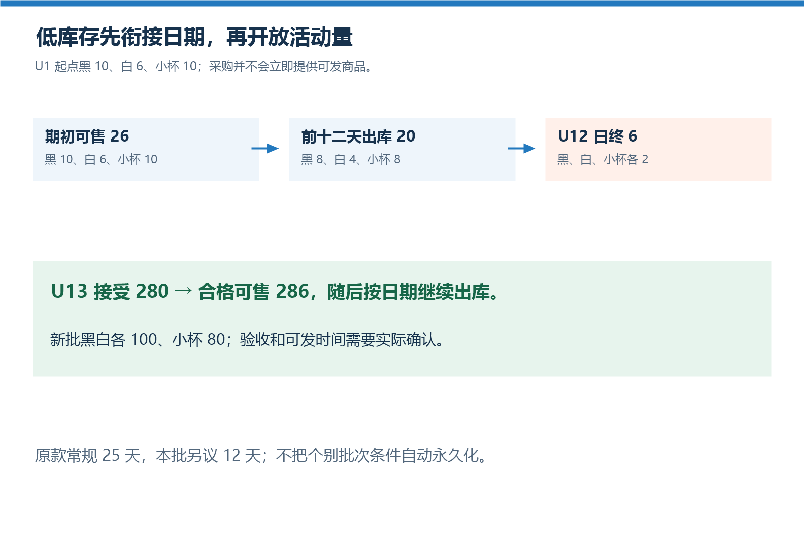

*图 8-4　来货之前按现货限量；U13 检查接受后才释放新批可发量。*

到货计划要约定运输、验收和可发时间。本例 U13 在相关销售出库前完成接受，才能按计划使用；若只到门口未检查，不自动变成可售。

### 3.3　未来采购也要放在日历中

| V0 后八周采购假设，未执行 | 假设下单／预付 | 假设尾款 | 假设接受到仓 | 现金与库存跨期 |
|---|---|---|---|---|
| 原款黑白各 100，8,400 | U29，预付 2,520 | U39，5,880 | U41 | 全部货款与接受都在 M2 |
| 小杯 80，2,720 | U49，预付 816 | U59，1,904 | U61 | 预付在 M2，尾款和接受在 M3 |

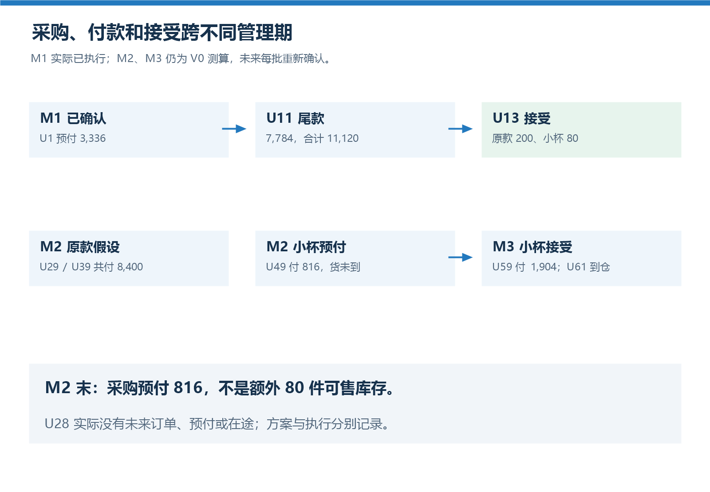

*图 8-5　U28 时这两笔仍是方案；V0 不等于已经签单或付款。*

按 V0，M2 期初黑 57、白 49，前十二天需求各不超过 26，可衔接 U41；小杯 M3 期初 15，U57—U60 工作需求七件，剩八件后在 U61 接到 80。

未来交期 12 天与单价只是测算前提，未确认时要留条件和备选，不可用于无条件对顾客承诺。起订导致 M2 末库存上升，也是选用当前方案所付出的代价，不能只说“采购单价没有涨”。

### 3.4　练习与参考答案

**练习。** M2 支付小杯预付 816，货未到，是否有 80 件可售？若不等 U49，直到 U57 才按同样 12 天交期下单，是否只看月末库存就足够？

**参考答案。** 未接受到仓，预付不是可售库存。U57 下单将假设 U69 才到，必须重新查每天需求与现货，不能凭 M3 月末仍有库存就认定中间不缺货。

**本节交付物**　已确认供需安排、到货前限量、未来采购前提和付款日历。

---

## 第四节　大促不是上线一个链接就结束

U18 准备集中交接 60 笔订单。运营看见货已到，仓库却提醒打包窗口只有两小时。

**本节目标**　把活动当作跨岗位项目，核对上线、资源、异常与复盘。

### 4.1　活动倒排到可以检查的节点

| 节点 | 核对事项 | 未通过怎样处理 |
|---|---|---|
| 方案确认前 | 商品、需求增量、价格、费用、名额和收益 | 修改方案，明确不确定条件 |
| 采购与投料前 | 到货、付款、物料和变更责任 | 取得供方确认，保留应急选项 |
| 到仓及活动前 | 验收、库位、库存锁定、页面、客服和运费 | 限量、延后或关闭不能兑现的选项 |
| 高峰前 | 人员、设备、包材、波次、承运窗口 | 提前补资源或改截单 |
| 活动中 | 实际订单、库存、费用、响应和异常 | 按阈值提交停止、改期或扩容决定 |
| 活动后 | 退款、服务、库存、结算、增量与贡献 | 保留原方案，复盘差异和后续动作 |

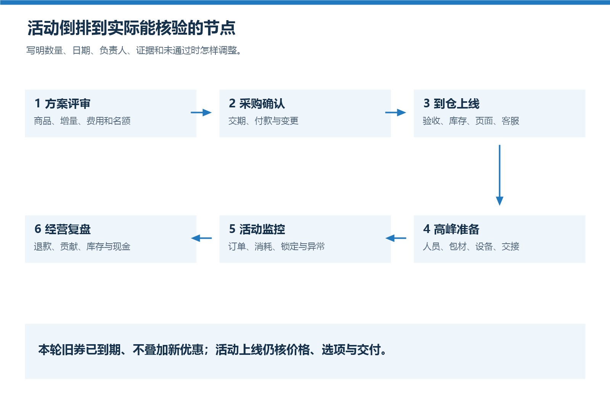

*图 8-6　节点需要负责人和证据；检查清单不是自动通过的形式。*

本轮页面没有新增优惠叠加，仍检查旧券到期、SKU、到手价、库存名额、发货和取消路径，防止沿用上章设置造成误售。没有支付预售或订金订单。

### 4.2　沿用方法，重新核实际能力

本次核定两小时窗口：拣货 72 笔、交接 65 笔，打包两人各每小时 15，预留 15% 给补料、异常等，计划可用能力 **51 笔**。

60 笔任务比打包能力多九笔。增加一名熟练辅助人员做一小时，保守增加 15 × 85% 向下取整 **12 笔**，打包变为 63；与其他工序衔接后，简化可用窗口为 **63 笔**。

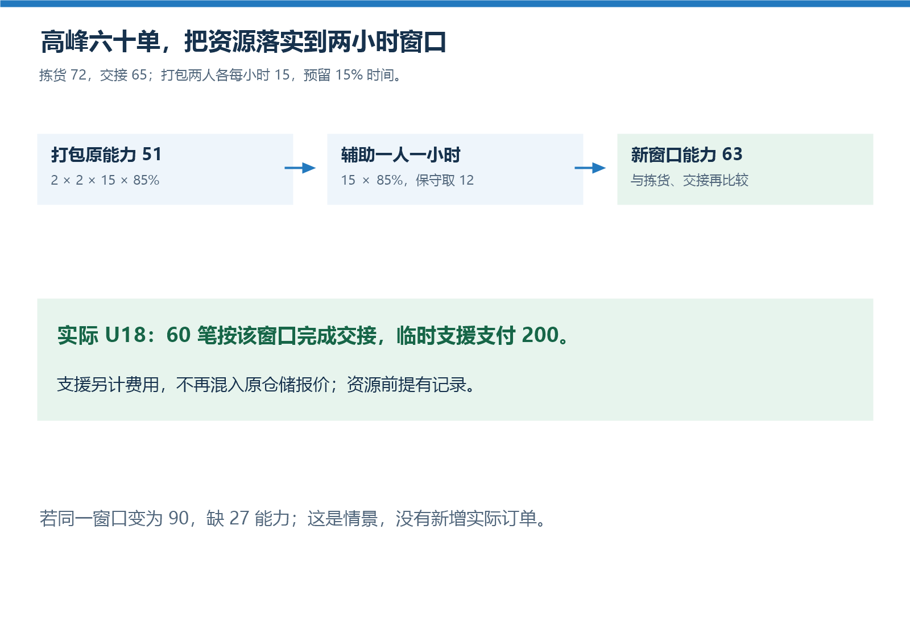

*图 8-7　方法承接第六章，但本章实际批准并发生支援费 200。*

现场确认人员能上岗、设备物料齐备和波次连续衔接，U18 两小时实际 60 笔均在这次约定窗口交接。本轮额外支援 200 从风险预算额度中批准，作为实际费用；不包含在另付的 1,100 仓储操作费里。

### 4.3　活动名额要与锁定和停止动作对应

名额不能只写总单数，要区分 SKU、日期和作业窗口。多个触达入口使用同一库存时，锁定和取消释放保持统一。需要扩大时先取得新资源与承诺，不靠“平均每天能发很多”证明峰值一定能发。

活动后也要跟踪退款和实际体验。60 笔按窗口交接只描述这次高峰，不证明所有运输或以后旺季都不存在风险。

### 4.4　练习与参考答案

**练习。** 旺季加强情景把同一窗口推到 90 单，现有 63 能力是否能支撑？用“货够”回答是否完整？

**参考答案。** 少 27 笔能力。要比较错峰、增加已验证资源、延长经承运确认的窗口或降低名额，并确认费用和顾客承诺。库存够只解决一项约束，不能代替作业能力。

**本节交付物**　活动节点、上线核验、峰值能力和资源批准记录。

---

## 第五节　季度预计赚钱，为什么还要做现金预算？

V0 显示十二周预计为正，采购却在销售前就要付货款。财务提醒：商品买回来不等于全部卖出去，风险额度也不等于已经发生的费用。

**本节目标**　连接利润、采购、存货、预付、结算和现金，明确预算范围。

### 5.1　先写假设，再算经营结果

V0 按各 SKU 预计出库，采用约 5% 退货工作假设，并按整件安排：M1 退回黑 3、白 3、小杯 2；M2 同样；M3 退回黑 4、白 4、小杯 2。各期假设米白一件报损，其余恢复。实际比率因取整不同，不能把它们都说成精确 5%。

三个管理期预计保留分别为 146、152、198 笔，合计 496。M1 原黑色十件按 44，均先售出且保留，其余原款 42、小杯 34，后续假设价格与收费不变。

| V0 利润预算，元 | M1 | M2 | M3 | 十二周合计 |
|---|---:|---:|---:|---:|
| 保留销售额 | 16,634 | 17,328 | 22,642 | 56,604 |
| 销售商品成本 | −5,856 | −6,080 | −7,948 | −19,884 |
| 平台费 | −876 | −912 | −1,188 | −2,976 |
| 出库包装 | −462 | −480 | −624 | −1,566 |
| 出库快递 | −924 | −960 | −1,248 | −3,132 |
| 退回运费 | −64 | −64 | −80 | −208 |
| 报损成本 | −42 | −42 | −42 | −126 |
| 广告消耗 | −3,000 | −2,800 | −3,500 | −9,300 |
| 内容制作 | −500 | −500 | −700 | −1,700 |
| 会员及客服 | −300 | −300 | −400 | −1,000 |
| 仓储操作 | −1,000 | −1,000 | −1,200 | −3,200 |
| 计划与数据协作 | −3,000 | −3,000 | −3,000 | −9,000 |
| 基准列示经营结果 | **610** | **1,190** | **2,712** | **4,512** |
| 另备风险额度，未触发不计费用 | 800 | 800 | 1,000 | 2,600 |

M1 销售额 = (53 + 56) × 119 + 37 × 99 = **16,634**。销售成本 = 10 × 44 + 43 × 42 + 56 × 42 + 37 × 34 = **5,856**。商品购买额 11,120 不能再全部当作本期销售成本扣除。

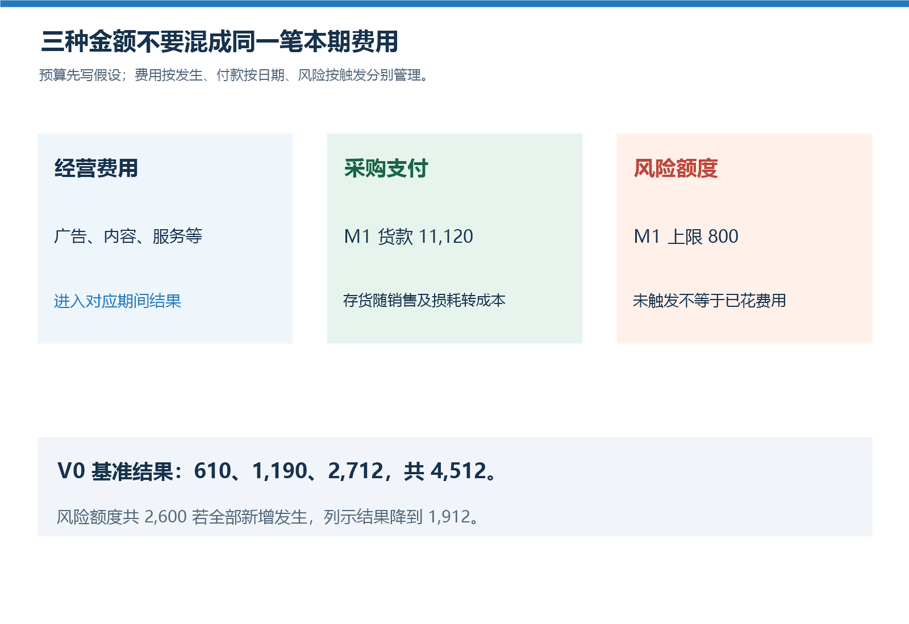

*图 8-8　费用、采购付款和风险额度各有口径，不能合成一行“本期成本”。*

如果 M1 风险额度 800 全部作为新增费用发生、其余假设不变，结果将为 **−190**；全十二周风险额度都发生，结果为 **1,912**。基准 4,512 不是收益保证，更未包含真实企业所有未列项目。

### 5.2　库存计划解释采购的去向

| V0 期末存货 | M1 | M2 | M3 |
|---|---|---|---|
| 黑色数量 | 57 | 100 | 24 |
| 米白数量 | 49 | 91 | 14 |
| 小杯数量 | 53 | 15 | 49 |
| 可售合计 | **159** | **206** | **87** |
| 存货成本，元 | **6,254** | **8,532** | **3,262** |

例如 M2 黑色 57 + 接受 100 − 出库 60 + 恢复 3 = 100；M3 小杯 15 + 接受 80 − 出库 48 + 恢复 2 = 49。

M2 多买原款是两色起订约束带来的阶段性占款，M3 小杯期末 49 也受 80 起订影响。比较拆批、协商起订或减少活动时，要把新的单价、运费、交期与缺货风险一并算，不把降低库存当作无代价目标。

### 5.3　现金按付款和到账日期排

V0 假设 M1、M2、M3 期末平台待结算分别为 1,000、1,000、1,200，每期前期余额当期收回。现有期初 400 也在 M1 收回。以下均为计划，只有第七节的 M1 实际另行记录。

| V0 现金与资产预算，元 | M1 | M2 | M3 |
|---|---:|---:|---:|
| 当期销售结算到账，不含旧款 | 14,758 | 15,416 | 20,254 |
| 收回前期平台余额 | 400 | 1,000 | 1,000 |
| 采购实际付款计划 | −11,120 | −9,216 | −1,904 |
| 广告、包装、运输与服务付款 | −9,250 | −9,104 | −10,752 |
| 期末银行 | **208,722.88** | **206,818.88** | **215,416.88** |
| 期末平台待结算 | 1,000 | 1,000 | 1,200 |
| 期末可售存货成本 | 6,254 | 8,532 | 3,262 |
| 期末采购预付余额 | 0 | 816 | 0 |
| 列示资产合计 | **215,976.88** | **217,166.88** | **219,878.88** |

广告、包装、运输与服务付款不包含非现金报损，也不重复扣已从平台结算扣除的费用。M1 的 9,250 = 广告 3,000 + 包装 462 + 快递 924 + 退回 64 + 内容 500 + 客服 300 + 仓储 1,000 + 协作 3,000。

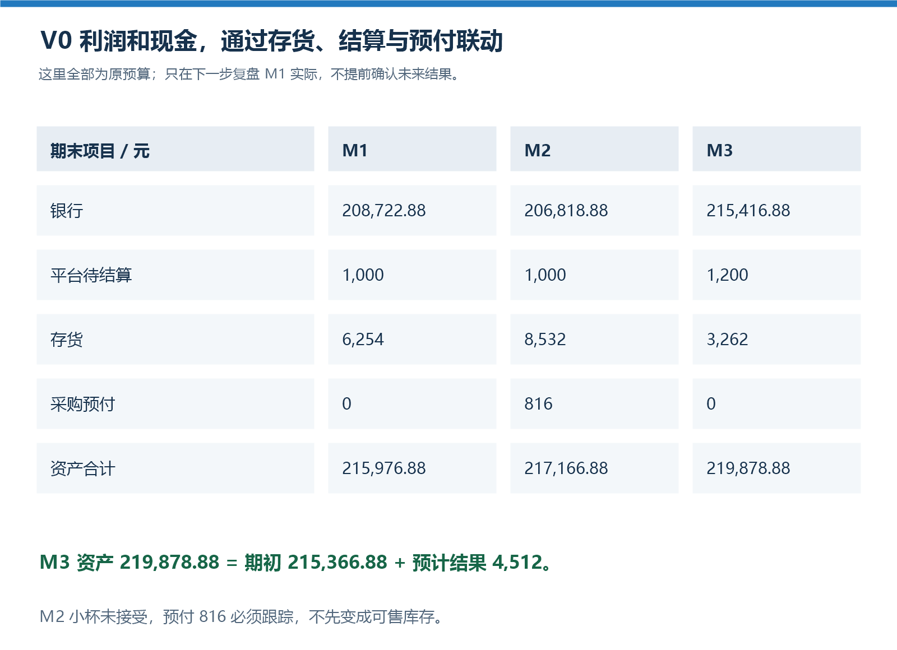

*图 8-9　V0 的 M2 末还有预付 816，不能漏掉这项资产，也不能先算成 80 件库存。*

M2 采购付款 9,216 = 原款 8,400 + 小杯预付 816。小杯 U61 才接受，M2 末预付 816 与尚未付尾款 1,904 分别跟踪；本案例该部分尚未作为已接受存货或相关应付款确认。M3 付尾款、接受后，预付全部转入货值。

预算资产 219,878.88 = 本章期初 215,366.88 + 预计列示结果 4,512。实际确认时点仍需按合同和业务事实核实，本例按列示接受条件处理。

### 5.4　银行预留不是第二笔现金

原 60,000 资金预留在 V0 中按三期协作各 3,000 使用，若均执行，未使用的该项预留依次为 57,000、54,000、51,000。这些余额仍包含在相应银行中，不另加为资产，也不再扣一次费用。

风险额度 800、800、1,000 是批准可能动用的费用上限，本身没有划出现金。触发时说明动作、价格、责任及付款日期，再更新结果和现金。未用完的额度是否移到下一期，需要重新确认，不能自动变成实际花费。

月末现金充足也不能代替日内或周内付款检查。本例若保守假设 M1 所有当期销售款最后才到、旧 400 已收、全部实际付款 20,449 已先支付，银行仍有 **193,885.88**；这是压力情景，不是已计算的真实每日最低点。

### 5.5　练习与参考答案

**练习。** 如果漏记 V0 的 M2 采购预付 816，预算资产会怎样？把 M1 风险额度全部花完，是否仍能实现基准 610？

**参考答案。** 银行已经支付，若预付资产也漏记，列示资产会少 816，与累计经营结果不能相互解释。风险新增费用若发生 800，结果应为 610 − 800 = −190，需要重新评估方案；额度不是无成本资源。

**本节交付物**　利润、现金、存货与预付联动预算，以及预留和风险边界。

---

## 第六节　供应晚三天，原计划要怎样改？

采购提出一次应急演练：U13 来货如果推迟到 U16，活动日期能否不动？

这次演练不改变实际到货；本章实际仍为 U13 接受。

**本节目标**　识别风险信号，按日期计算缺口，组织停止、替代、改期和恢复。

### 6.1　别等到缺货才发现风险

缺料、排产被占、关键检查失败、付款资料不齐、运输接收或预计到仓时间变化，都可能影响来货。活动流量超预期、关键员工不能上岗、包材不足、库存同步失败、退款或结算异常，也需要及时核对。

按影响、发生线索、可发现时间和准备代价排序。先处理会影响商品安全、质量范围、顾客承诺与资金支付的事项，而不是只挑最容易完成的任务。

### 6.2　把三天延期算到 SKU

V0 的 U12 日终黑、白、小杯各剩两件。工作日历中，U13 为黑 3、白 4、小杯 2，U14 为黑 5、白 6、小杯 3，U15 为黑 3、白 4、小杯 2。

| 延期演练，U13—U15 | 黑色 | 米白 | 小杯 | 合计 |
|---|---:|---:|---:|---:|
| 计划出库需求 | 11 | 14 | 7 | 32 |
| 现货可支持 | 2 | 2 | 2 | 6 |
| 如不改计划的潜在缺口 | **9** | **12** | **5** | **26** |

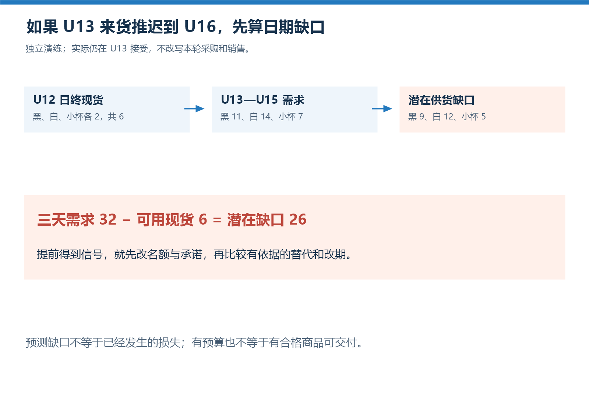

*图 8-10　26 是该独立情景的潜在缺口，不是本章已经发生的缺货订单。*

如果 U10 已得到可靠延期信号，就应在新增承诺前调整名额和活动。先核已锁定的顾客订单，区分不可随意变更的承诺和仍可暂停的未来推广。

### 6.3　应急方案各有前提和代价

可以核实是否有合格分批、已验证替代供方、其他可靠现货、活动改期或明确允许的分批交付。山禾没有凭空多出另一仓现货，备选厂也不是无需验证的随时供货池。

若没有可确认的替代，按可用 SKU 限量、暂停不能兑现的选项、调整推广与顾客承诺，并保留沟通记录。不能让系统先超卖，再把没有依据的到货日期发给顾客。

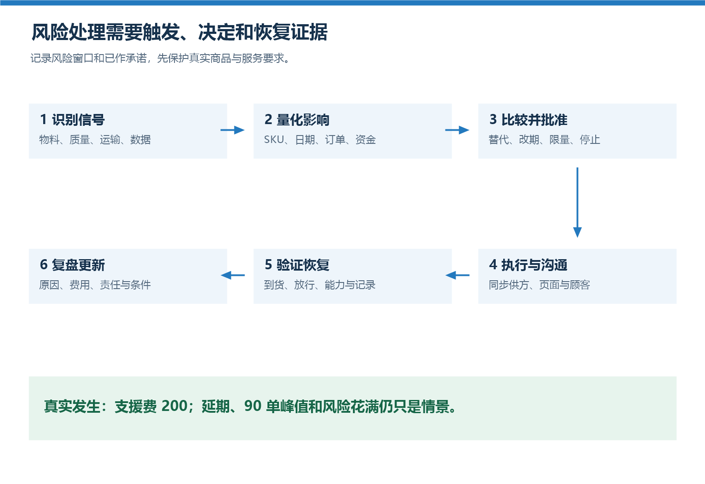

*图 8-11　采取动作后继续核实恢复条件，修改页面或日期不等于风险已经消除。*

质量异常还需要查关联批次、已放行与已售范围，决定隔离、复检及后续服务。赔偿与保险按实际依据追踪，未确认到账不提前冲减损失。

### 6.4　实际发生的支援与演练分开

本章实际发生的是 U18 临时打包支援 200，已经批准、支付并计费用；供方延期到 U16、活动升到 90 单、M1 风险用满 800 都只是情景。

风险登记写清事项、证据、影响窗口、触发阈值、责任人、批准人、动作和再次复查时间。恢复活动前重新核实货、数据与能力，不能只等一句“应该没问题”。

### 6.5　练习与参考答案

**练习。** 延期演练有 26 件缺口，是否等于已经损失了 26 单利润？能否直接用风险预算 800 把差额解决？

**参考答案。** 尚需区分预测与真实订单，以及改期、取消或替代后的结果，不能提前确认损失或收入。预算额度并不提供实物、质量或产能，要有实际可行的供应及服务方案；不能用“有预算”替代“能交付”。

**本节交付物**　风险信号、SKU—日期缺口、应急选择及恢复条件。

---

## 第七节　销量比预算多，结果就一定更好吗？

U28，M1 实际出库 155，比 V0 多一单。运营想宣布超额完成，你要求先把销售结构、费用、库存和现金一起核对。

**本节目标**　保留预算基线，分析差异，按实际更新后续计划。

### 7.1　实际需求与回流按周记录

| M1 实际出库 | 黑色 | 米白 | 小杯 | 合计 |
|---|---:|---:|---:|---:|
| 第 1 周 | 4 | 2 | 4 | 10 |
| 第 2 周 | 13 | 12 | 8 | 33 |
| 第 3 周 | 26 | 31 | 15 | 72 |
| 第 4 周 | 15 | 15 | 10 | 40 |
| 合计 | **58** | **60** | **37** | **155** |

第一、二周没有退回；第三周黑、白各退一件，黑恢复、白报损；第四周黑、白、小杯各退两件，全部恢复。本轮合计退回八件、恢复七件、米白损失一件。

同口径与 V0 的 12 项 SKU—周比较，绝对误差共五件，WAPE = 5／155 ≈ **3.23%**。总量只差一件，但不能据此证明每个日期、费用和资源都准确。

### 7.2　实际销售及期末批次

| M1 实际订单，笔／件 | 黑色 | 米白 | 小杯 | 合计 |
|---|---:|---:|---:|---:|
| 支付 | 60 | 62 | 38 | 160 |
| 发货前取消 | 2 | 2 | 1 | 5 |
| 出库并最终签收 | 58 | 60 | 37 | 155 |
| 签收后全额退货 | 3 | 3 | 2 | 8 |
| 最终保留 | 55 | 57 | 35 | 147 |

实际支付 = 122 × 119 + 38 × 99 = **18,280**；取消退款 575、退货退款 912，保留销售 **16,793 元**。本轮没有重新使用前章优惠券。

黑色原 44 成本十件均先发出并被保留，退回黑色三件均来自新采购的 42 成本批次。实际销售成本 = 10 × 44 + 45 × 42 + 57 × 42 + 35 × 34 = **5,914 元**。

| M1 实际批次 | 期初可售 | 合格接受 | 出库 | 退回恢复 | 期末可售 | 单价 | 期末价值 |
|---|---:|---:|---:|---:|---:|---:|---:|
| 黑色原 44 批 | 10 | 0 | 10 | 0 | 0 | 44 | 0 |
| 黑色本批 42 | 0 | 100 | 48 | 3 | 55 | 42 | 2,310 |
| 米白 42 | 6 | 100 | 60 | 2 | 48 | 42 | 2,016 |
| 小杯 34 | 10 | 80 | 37 | 2 | 55 | 34 | 1,870 |
| 合计 | **26** | **280** | **155** | **7** | **158** | — | **6,196** |

本例先进先出，退回保留来源批次，恢复件在 U28 前未再销售。米白原有六件与新批同单价，汇总展示但追溯记录仍区分批次。

可售：26 + 280 − 155 + 7 = **158**；也等于 26 + 280 − 保留 147 − 新报损 1。

库存价值：1,032 + 11,120 − 5,914 − 42 = **6,196 元**。在场实物：29 + 280 − 155 + 8 = **162**，对应可售 158 + 零账面隔离四件。本章未处置旧三件，也没有把拒收、欠交或未来采购混入实际。

### 7.3　从预算结果到实际结果

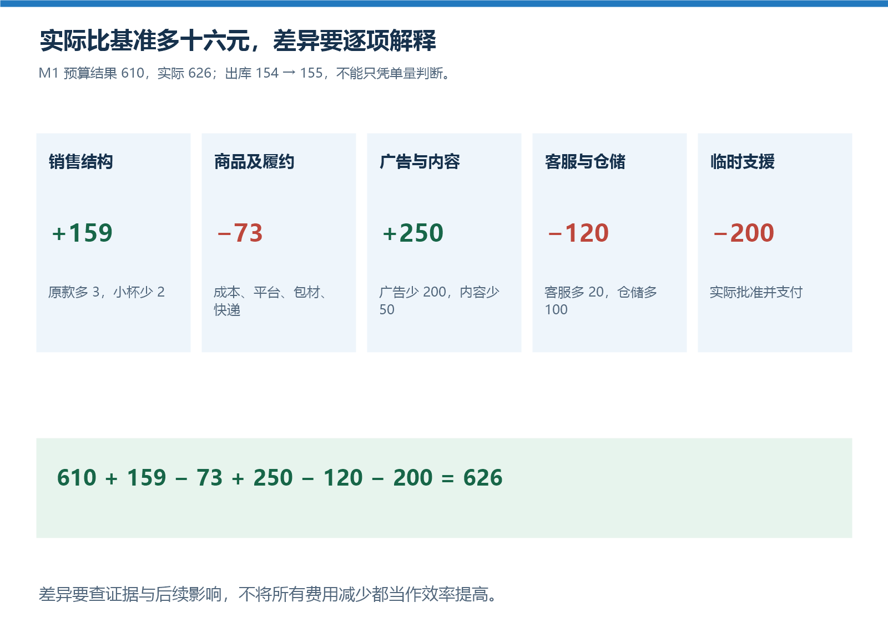

*图 8-12　正差异表示增加实际结果；销量多一单不能替代费用与结构复盘。*

| M1 差异，元 | V0 预算 | 实际 | 对经营结果的影响 |
|---|---:|---:|---:|
| 保留销售额 | 16,634 | 16,793 | +159 |
| 销售商品成本 | 5,856 | 5,914 | −58 |
| 平台费 | 876 | 882 | −6 |
| 包装 | 462 | 465 | −3 |
| 出库快递 | 924 | 930 | −6 |
| 退回运费 | 64 | 64 | 0 |
| 报损 | 42 | 42 | 0 |
| 广告 | 3,000 | 2,800 | +200 |
| 内容 | 500 | 450 | +50 |
| 会员客服 | 300 | 320 | −20 |
| 仓储操作 | 1,000 | 1,100 | −100 |
| 协作服务 | 3,000 | 3,000 | 0 |
| 临时支援实际费用 | 基准未发生 | 200 | −200 |
| 净差异 | — | — | **+16** |

实际保留原款 112 比预算 109 多三件，小杯 35 比预算 37 少两件，销售结构让收入增加 3 × 119 − 2 × 99 = **159**，不能只归因于“多一单”。

实际交易贡献为 **5,696**，再扣内容 450、会员客服 320、仓储 1,100、协作 3,000、临时支援 200，**实际列示结果 626 元**，比预算基准 610 多 16。

费用少不自动等于动作更有效。广告少 200 可能影响后续机会，仓储多 100 要核范围和单据；支援 200 则对应已确认的高峰资源。差异分析需要数量、结构、单价、效率与业务事实，不是把所有有利差异都写成管理成绩。

### 7.4　用实际更新后续，而不改原预算

U28 实际可售黑 55、白 48、小杯 55，与 V0 的 57、49、53 不同。若后八周需求、回流和采购假设不变，滚动 V1 的预计 M2 期末变为黑 98、白 90、小杯 17；M3 期末为黑 22、白 13、小杯 51。

这些仍是未来预测，不是实际库存。现金还要接实际银行、待结算和已确认承诺重新计算，不能只替换销量或期末库存中的某一行。

未来 U29、U49 的采购在 U28 均未执行，实际期末没有采购预付、在途或欠交。新订单前比较分色、拆批、价格、交期和现金，并决定是否保留原 V0 采购方案。

按本轮最后一周米白出库 15 件估算，实存 48 件约覆盖 22.4 天，短于原款常规交期 25 天。如果 M2 想按每周 15 件继续卖，就要在 U29 先核实本轮能否取得较短交期或其他供应。若决定暂缓签单，运营必须先降低活动和开放名额，采购同时列出复查日与提前行动条件。第九章从这次重排接续。

### 7.5　练习与参考答案

**练习。** 如果实际广告不是 2,800 而是 3,200，其他实际结果都不变，列示结果多少？是否仍能只凭出库超一单判断经营更好？

**参考答案。** 独立情景中费用多 400，结果为 626 − 400 = **226**。不能只看单量，还要看结构、费用、服务、未来机会与资源代价。实际本章仍按 2,800、结果 626 记录。

**本节交付物**　实际经营表、差异桥、原因与证据、滚动 V1 及条件。

---

## 第八节　怎样主持一次有决定的经营评审？

各部门的表已经能核对，会议仍可能停在“下次继续努力”。你要把结果转成具体取舍、责任和复查节点。

**本节目标**　完成实际资金核对，提交国内经营方案，并为跨境试点设定进入条件。

### 8.1　利润、现金与存货共同解释 M1

实际保留销售 16,793，平台费 147 × 6 = 882，当前应结 **15,911**；当期到账 **15,000**，新待结算 **911**。上章 400 已收回，只是旧应收变银行。

| M1 实际银行变动 | 金额，元 |
|---|---:|
| 承接第七章期末 | 213,934.88 |
| 收回前章平台款 | +400.00 |
| 本期销售结算到账 | +15,000.00 |
| 采购支付 | −11,120.00 |
| 广告支付 | −2,800.00 |
| 包装支付 | −465.00 |
| 出库快递支付 | −930.00 |
| 退回运费支付 | −64.00 |
| 内容支付 | −450.00 |
| 会员客服支付 | −320.00 |
| 仓储操作支付 | −1,100.00 |
| 协作服务支付 | −3,000.00 |
| 临时支援支付 | −200.00 |
| U28 银行余额 | **208,885.88** |

支付合计 20,449，收回及到账合计 15,400，银行比期初少 **5,049**。平台费已在结算扣除，报损 42 不再当现金重复扣，采购的 11,120 也不再全部当销售成本。

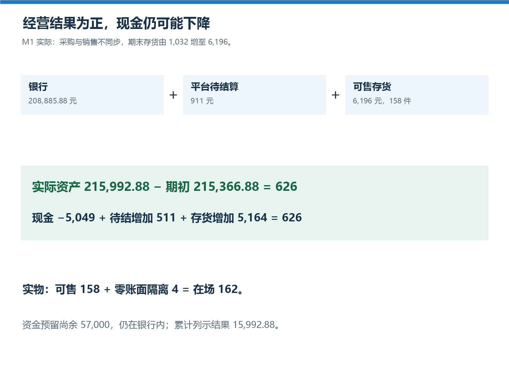

*图 8-13　列示利润 626 为正，银行却少 5,049，库存和应收变化解释两者差异。*

期初列示资产 = 银行 213,934.88 + 待结 400 + 存货 1,032 = **215,366.88 元**。

期末列示资产 = 银行 208,885.88 + 待结 911 + 存货 6,196 = **215,992.88 元**。

差额 **626 元**，与实际列示结果一致。另一种检查是：现金 −5,049 + 待结增加 511 + 存货增加 5,164 = **626**。没有其他资产负债变动或股东进出款。

自初始 200,000 起，累计列示结果为 **15,992.88 元**。批准用途的剩余预留 **57,000** 包含在银行中；风险额度 800 中实际用了 200，未用 600 没有发生费用，不自动挪到未来期。

### 8.2　用问题和决定组织经营评审

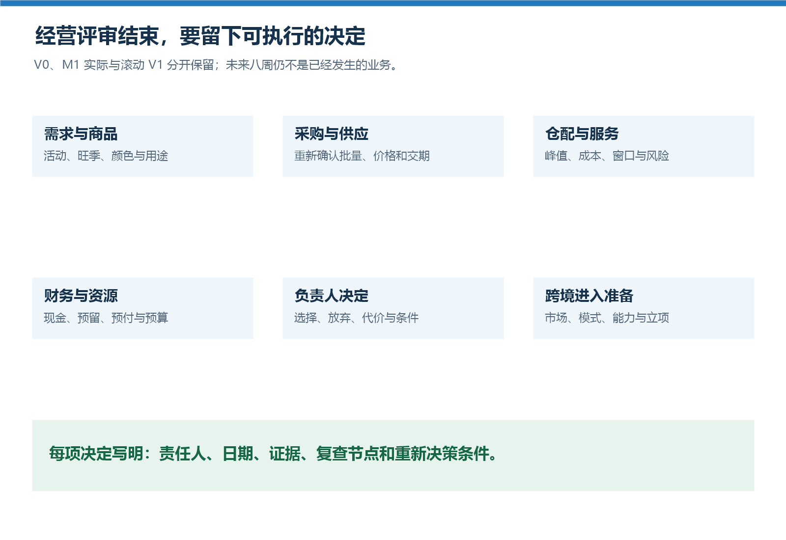

*图 8-14　会议结束应留下决定、负责人、证据、时间和重新评审条件。*

| 评审问题 | 本章参考决定 | 下一步责任与证据 |
|---|---|---|
| 需求是否延续 | 拆日常与活动，继续验证旺季及颜色结构 | 运营提交 SKU—周 V1 和假设 |
| 当前采购是否适合 | 不把后续 12 天当既定事实，重新确认或比较拆批 | 采购提供交期、起订、价格和合同条件 |
| 高峰是否可复制 | 记录 200 支援和资源前提，不直接承诺 90 单 | 仓库、物流核新峰值与窗口 |
| 共同费用能否支撑 | 协作 3,000、仓储及客服按范围复核 | 财务核单据，负责人评价后续必要性 |
| 风险怎样恢复 | 未触发情景不记实际，风险登记持续更新 | 责任人按触发与恢复条件复查 |
| 是否立即扩新业务 | 先提交跨境市场、模式和能力核查，不先采购海外库存 | 商品、运营、供应链和财务共同立项 |

评审不是一味压费用或一味保增长。需要说明选了什么、放弃什么、预计影响什么、什么条件下重新决定；各岗位使用同一版数字，不各自保留不同的对外承诺。

### 8.3　综合作业与参考答案

**任务。** 你作为国内经营负责人，提交一页经营建议及四张表。

1. 需求与情景表：十二周日常、活动、旺季与 SKU 需求，明确时间和验证条件。
2. 供应与资源表：到货前限量、已确认采购、未来采购假设、峰值与应急。
3. 预算联动表：V0 利润、银行、待结算、存货、预付、风险额度与资金预留。
4. 实际及滚动表：M1 实际、预算差异、风险动作、U28 余额与后续 V1。

**参考答案要点。** V0 十二周预计出库 522、保留 496，销售 56,604，基准列示结果 4,512；未触发的风险额度 2,600 不当作已花费用。M2 末采购预付 816，M3 末预计银行 215,416.88、待结 1,200、存货 3,262，合计 219,878.88。以上都是原计划，不能替代实际。

M1 实际支付 160、出库 155、保留 147，销售 16,793、销售成本 5,914、新报损 42，列示结果 626。期末可售 158、成本 6,196，在场 162；银行 208,885.88、待结 911，资产 215,992.88。原预算基准为 610，净差异 +16。

延迟到 U16 的演练缺口黑 9、白 12、小杯 5，共 26。强活动窗口 90 相对现有 63 少 27。这两项是演练。更新 V1 时，先检查米白 48 件按最近速度仅覆盖约 22.4 天的风险。若暂缓采购，需要同时收紧活动与开放名额，并列明复查和重启采购的条件。

**延伸练习。** 实际期末银行少 5,049，是否说明本期亏了 5,049？若 U28 新待结算 911 也到账，什么会变？

**参考答案。** 不能把现金减少直接当亏损，存货增加 5,164、待结增加 511 与现金变化共同解释利润 626。另一个到账情景下，银行变为 **209,796.88**、待结为零，库存和列示资产总额不变，利润仍为 626。实际案例仍保留待结 911。

**本章完成标准**　能把需求、供应、活动、服务和预算放在同一份可执行计划中；能区分基准、情景、实际和滚动版本，解释冲突与代价，并推动责任明确的经营决定。

### 8.4　交接到下一章

山禾已经建立国内经营协同框架。下一章进入跨境市场选择：先判断目标客群、交易模式、平台与自营渠道、本地化、产品及市场准入和责任，再决定试点。不能把国内售价换成外币，就认定跨境生意已经成立。

---

## 附录　参数与结果核对

用于完成学习后的复查。V0、实际 M1 和 V1 保持不同版本，各节已有相应数据。

| 范围 | 本章口径与结果 |
|---|---|
| 实际起点 | 银行 213,934.88、待结 400、可售 26、成本 1,032；隔离三件，在场 29 |
| 时间与版本 | U1—U84 为十二周管理窗口；只执行 U1—U28；后续 V0 与 V1 都是计划 |
| V0 出库预测 | M1 黑 56、白 59、小杯 39，共 154；M2 160；M3 208；合计 522 |
| V0 退货 | M1 8、M2 8、M3 10；各期米白报损 1；预计恢复 7、7、9 |
| V0 保留与结果 | 保留 146、152、198；销售 16,634、17,328、22,642；基准结果 610、1,190、2,712 |
| V0 十二周汇总 | 销售 56,604，基准列示结果 4,512；风险额度 2,600 未触发不计费用 |
| V0 未来采购 | U29 原款 8,400；U49 小杯预付 816、U59 尾款 1,904、U61 到仓，U28 均未执行 |
| V0 存货与预付 | M1 6,254，M2 8,532、另预付 816，M3 3,262；期末数量 159、206、87 |
| V0 银行及资产 | 银行 208,722.88、206,818.88、215,416.88；M3 列示资产 219,878.88 |
| 实际采购 | U1 预付 3,336，U11 尾款 7,784，U13 接受原款 200、小杯 80，共 11,120 |
| 实际订单 | 支付黑 60、白 62、小杯 38；取消 5、出库 155、退货 8、保留 147 |
| 实际退款 | 支付 18,280 − 取消 575 − 退货 912 = 保留销售 16,793 |
| 实际回流与成本 | 恢复黑 3、白 2、小杯 2；白一件报损 42；销售成本 5,914 |
| 实际费用 | 平台 882、包装 465、快递 930、退回 64、广告 2,800、内容 450、会员客服 320、仓储 1,100、协作 3,000、支援 200 |
| 实际经营结果 | 交易贡献 5,696；扣内容、客服、仓储、协作、支援后 626；比基准多 16 |
| 实际库存 | 黑 55 × 42、白 48 × 42、小杯 55 × 34，共可售 158、成本 6,196；加隔离四件，在场 162 |
| 实际结算 | 当期应结 15,911、到账 15,000、新待结 911；前期 400 已到账 |
| 实际资金 | 银行 208,885.88、待结 911、存货 6,196，合计 215,992.88；累计列示结果 15,992.88 |
| 实际采购状态 | 期末没有未完成采购、预付、已接受应付、未发锁定或待检退货 |
| 预留与风险 | 原资金预留动用协作 3,000，尚余 57,000 在银行；风险额度 800 实花 200，其余 600 未花 |
| 情景边界 | 供方延期、90 单高峰、活动取消、风险花满及额外到账均为独立演练，不改变实际结果 |
