# 第六章　从仓库库存到顾客签收

第五章结束，山禾可售库存有 194 个，备选厂还欠四件黑色试单杯。仓库收到新任务：接好补供、区分新旧批次，同时支持接下来的顾客订单。

运营问：“系统显示有货，为什么还会拣错、晚发或者找不到？”仓库说：“库存总数相同，库位和状态也可能不对。”

这一章，你要让供应商送来的货转成准确、可追踪、可兑现的顾客交付，并能解释库存、服务和费用之间的关系。

**本章完成目标**　能设计收货上架、库存锁定、拣配复核和运输交接流程，安排高峰能力，处理退货及盘点差异，核对批次成本、服务指标和期末资金。

## 阅读顺序

| 节次 | 要解决的问题 | 交付物 |
|---|---|---|
| [第一节　仓库里有杯子，为什么不一定能承诺？](#section-01) | 物理库存、状态、库位与锁定 | 库存状态及可承诺规则 |
| [第二节　四件补供到仓，怎样接入同一套记录？](#section-02) | 收货、验收、上架、批次与付款 | 入库与批次记录 |
| [第三节　接到订单，怎样把正确的杯子发出去？](#section-03) | 锁定、拣货、包装、复核和交接 | 出库流程及异常处理 |
| [第四节　高峰六十单，两个人够不够？](#section-04) | 需求窗口、瓶颈与仓配选择 | 高峰能力及费用方案 |
| [第五节　系统点了发货，顾客就能按时收到吗？](#section-05) | 承运、运费、轨迹和服务口径 | 物流追踪及履约指标 |
| [第六节　六件退货回仓，库存能直接加六吗？](#section-06) | 退款、退回、检查、恢复与报损 | 退货处置和成本记录 |
| [第七节　盘点少了一件，要不要直接报损？](#section-07) | 库位差异、复核、盘点与旧货处置 | 差异调查及调整记录 |
| [第八节　把仓配服务、库存和资金核对回来](#section-08) | 批次成本、经营结果和协同改进 | 仓配评审及综合作业 |

正文所需数字就近列出。完成后可使用[章末参数与结果核对](#chapter-check)复查。

## 案例约定与起点

承接第五章：银行 **201,156.88 元**、平台待结算 **1,412 元**；可售黑色 82、米白色 59、小杯 53，共 **194 个**，成本 **7,796 元**。黑色分成旧批 46 × 42 与新试单 36 × 44；米白单位成本 42，小杯 34。另有三件旧报损实物隔离，账面为零，期初实际在场共 197 件。

原采购订单还欠黑色四件、货值 176，没有预付余额或已接受货物应付款。本章没有新增采购订单，只有完成这四件补供。继续按先进先出计价，对应实物也先发旧批次。

本轮为 **L1—L14**，仍用一个国内合作仓，顾客交易均属于 A。原款实付 119，小杯 99，每单一杯。平台按最终保留订单每单收 6；每次实际出库包装 3、快递 6；顾客退回运费由山禾按每件 8 承担。本轮所有顾客出库发生在 L3—L9，退回处理在 L10—L12 完成，退回恢复件本轮没有再销售。

| 日期 | 已执行的业务 |
|---|---|
| L1 | 收回上章平台待结算 1,412，确认库存与库位 |
| L2 | 四件补供到仓并合格接受，支付 176；原采购承诺归零 |
| L3—L9 | 共 110 笔支付，5 笔发货前取消，实际出库 105 笔 |
| L10—L12 | 六笔签收后全额退货，恢复可售 4、报损 2，最终保留 99 笔 |
| L13 | 抽盘 20 条库位记录，查明一件米白存放位置未登记的问题 |
| L14 | 三件旧零账面报损实物按案例内部流程处置；核对结算、库存与服务 |

为讲清状态关系，案例设定截止 L14 所有本轮订单已签收、取消退款及退货均已处理，没有未发锁定、顾客在途或待检退货。真实业务应按实际截止状态记录，不需要等待全部结束才管理。

本轮仓储操作服务费 700，包含本案例收货、上架、拣配、复核、盘点及旧货处置操作，单独不再重复计人工费；不含另列的出库包装、快递和退回运费。标识与流程培训支出 200，广告实际 1,600，均已支付。60,000 资金预留仍在银行，没有购买系统或支付预留用途的费用。

公司、费用、流程及承诺时限均为教学设定。继续使用明确列示的成本与经营范围，没有计入真实企业全部税费、工资、租金等项目。

---

## 第一节　仓库里有杯子，为什么不一定能承诺？

L1，运营看见“在场 197”，想把 197 件全部打开销售。仓库提醒：其中三件已报损，黑色还有两个成本批次。

数量只是起点。对外承诺前，还要核对商品、状态、锁定、库位和可发时间。

**本节目标**　区分物理在场、可售、锁定与可承诺，建立商品、批次和库位的对应。

### 1.1　库存状态回答不同问题

| 状态 | 本章怎样理解 | 能否直接卖 |
|---|---|---|
| 待验收 | 已到仓，尚未完成检查及接受 | 不能 |
| 合格可售 | 已接受、满足销售要求的库存 | 还要扣除已锁定等占用 |
| 已锁定 | 已分配给有效未发订单的合格库存 | 不能再承诺给另一单 |
| 待拣或待发 | 已进入履约，但尚未完成出库交接 | 本例仍属于锁定占用 |
| 隔离或报损 | 不合格、待处理或已零账面记录 | 不能 |
| 顾客在途 | 已完成出库交接，尚未签收 | 不在仓内可发量中 |

一个杯子可以同时有“合格”“属于某订单”“在待发区”等属性。这些维度不是可以全部相加的互斥数量，报表要说明分别统计什么。

本章把合格未出库库存作为可售基础，其中可能有已锁定量。简化的当前可承诺量为：**合格未出库库存 − 有效未发订单锁定 − 其他明确占用**。锁定进入待拣、待发时不再重复扣一次。

本章未设置额外冻结或渠道预留。跨日期承诺还需要加入已确认的未来供应、到仓验收与运输时间，不能把未来到货当成今天能发的现货。

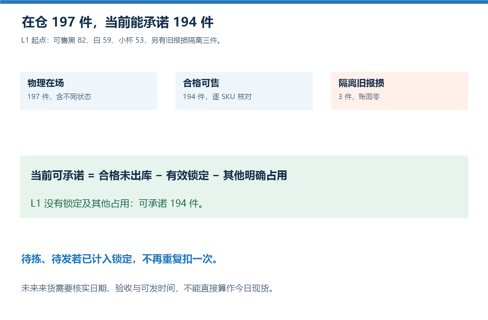

*图 6-1　在场、合格、锁定和可承诺分别回答不同问题。*

### 1.2　库位、批次与商品编码各管什么

SKU 标识是哪种商品；采购或生产批次说明来源与追溯；库位说明货在何处。本章继续使用 SH500-BK、SH500-WH、SH350-BL，不能因为进了新货就给同款随意换 SKU，也不能把批次信息删掉。

| 记录对象 | 示例 | 作用 |
|---|---|---|
| 商品 | SH500-BK 黑色 500mL | 防止颜色、规格拣错 |
| 批次 | 黑旧 42；第五、六章接受的试单批次 44 | 质量追溯、计价和出库顺序 |
| 库位 | 拣货位、储备位、待检位、隔离位 | 指导实物寻找、移动和核对 |
| 状态 | 合格、锁定、待检、隔离 | 限制不同操作权限 |

第五章 36 件和本章补供 4 件都按每件 44 记录价值，汇总时可一起展示，追溯时仍保留各自收货批次和来源，不能因价格相同就合并掉记录。

### 1.3　区域与货位服务于流程

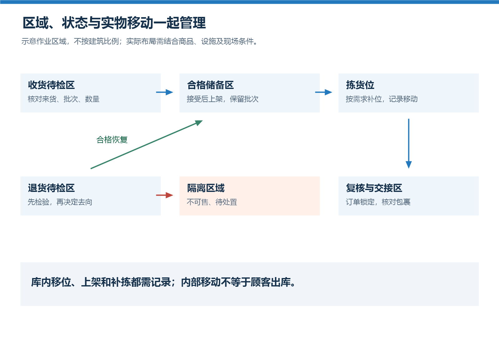

*图 6-2　示意图表达作业区域与状态隔离，不是按比例的仓库建筑设计。*

收货待检区接供应商来货，检查接受后转合格存储与拣货位；复核打包后进入待交接区。退货先到专门检查区域，隔离品不混进拣货位。

作业动线要考虑搬运距离、交叉、商品特性和现场条件。畅销品靠近拣货动线，重物与易损品按适宜方式存放，具体库区设计还需要核对安全、设施和操作条件。

ABC 分类可以按出库频次、金额或关键性选择口径，不必机械套用固定比例。第五章三种 SKU 出库 50、44、30，黑白两色更频繁，但小杯仍占 30／124，不能因为被分到较低频组就忽略补位与准确性。

### 1.4　练习与参考答案

**练习。** L1 仓内 197 件、三件零账面隔离、没有订单锁定，可承诺多少？后续订单被锁定后，能否再把待拣数量扣一次？

**参考答案。** 合格可售 194，按本例无其他占用，当前可承诺也是 194。待拣若已包含在有效锁定里，不能重复扣减。还要核对每个 SKU，不能拿小杯替黑色履约。

**本节交付物**　库存状态定义、区域与库位安排、SKU—批次—库位记录。

---

## 第二节　四件补供到仓，怎样接入同一套记录？

L2，备选厂补来上章欠的四件黑色杯。采购说：“这是补供，别再重复下一张四件采购单。”

仓库需要接收新实物，也要将它与旧订单未完成部分对应。

**本节目标**　连接采购承诺、实际收货、合格接受、上架、批次与付款。

### 2.1　到仓先核对来货身份

核对采购订单、补供说明、送货数量、外箱及商品版本，记录实际到仓时间、批次和经手人。箱数、杯数和订单数用各自单位，四件补供不是四笔顾客订单。

来货先进入待检状态。本批按第五章确认的方法核对，四件全部合格并接受。供方提供的措施资料仍需后续批次验证，本次接受不能直接宣布长期质量问题全部关闭。

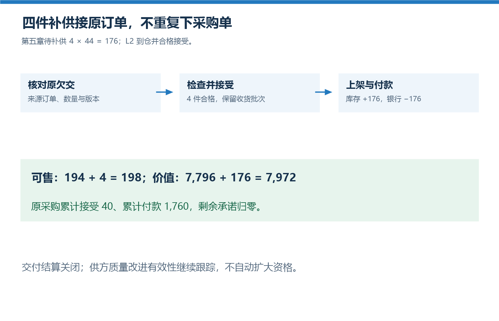

*图 6-3　新收货接原订单余额，合格后再进入可发库存。*

### 2.2　上架不是只按一个确认键

记录来源订单、接受数量、商品编码、收货批次、单位成本、目标库位、状态和操作时间。按实物扫描或可靠的人工复核，将移动与记录对应；待检改合格、库位移动和价值确认分别有依据。

上架后核对实物能否按拣货单找到。系统显示合格、实物仍在未交接的收货车上，也可能导致承诺有货但实际找不到。

| L2 补供完成后的可售批次 | 数量 | 单位成本，元 | 价值，元 |
|---|---:|---:|---:|
| 黑色旧批 | 46 | 42 | 1,932 |
| 黑色原试单接受部分 | 36 | 44 | 1,584 |
| 黑色本章补供 | 4 | 44 | 176 |
| 米白旧批 | 59 | 42 | 2,478 |
| 小杯旧批 | 53 | 34 | 1,802 |
| 合计 | **198** | — | **7,972** |

此时黑色合计 86。另三件旧隔离仍在场，所以总实物为 201，不能把它误写成 201 个可售。

### 2.3　交付关闭与改进关闭分别记录

四件接受货值 4 × 44 = **176 元**，本章已支付。上章采购的总接受量达到 40，总付供方款 1,584 + 176 = **1,760 元**，未完成数量与采购承诺归零。

没有新付一遍 528 预付款，也没有额外支付旧整单尾款 1,232。本章补供检查操作包含在仓储服务费内，没有再次发生第五章的外检费 240。

交付和结算完成后，采购关闭这张订单的欠交记录；质量改进有效性仍保留跟踪，备选供应商也没有自动升级为不限量供应。

### 2.4　练习与参考答案

**练习。** 若四件仅到仓、尚未接受，上章的采购承诺是否已经完成？本例实际接受并付款后，存货和现金各变多少，是否立即减少利润 176？

**参考答案。** 按本例约定，只有实收到仓还不能视为合格履约完成。实际接受且付款，存货增加 176、银行减少 176；商品尚未售出，不能把 176 再全部计入当期费用。

**本节交付物**　原采购订单补供记录、收货验收、批次库位及付款核对。

---

## 第三节　接到订单，怎样把正确的杯子发出去？

L3，第一批 18 笔支付订单到来：黑色 8、米白 6、小杯 4。付款后库存被锁定，随后其中一笔黑色订单取消。

这 18 笔是全章 110 笔支付的一部分，取消的一笔也包含在全章五笔取消中，不额外增加订单量。

**本节目标**　让订单状态、库存锁定、拣货复核和实际出库形成可追踪流程。

### 3.1　先锁定，再安排拣配

第一批锁定前没有销售出库或其他占用，L2 的库存全部在仓。

| SKU | 合格在库 | 第一批锁定 | 锁定后可承诺 | 一笔黑色取消后的可承诺 |
|---|---:|---:|---:|---:|
| 黑色 | 86 | 8 | 78 | 79 |
| 米白 | 59 | 6 | 53 | 53 |
| 小杯 | 53 | 4 | 49 | 49 |
| 合计 | **198** | **18** | **180** | **181** |

取消后释放一件黑色，剩余锁定 17。锁定与释放改变可承诺量，但没有让实物在库总数发生变化。本批其他 17 笔之后正常进入出库。

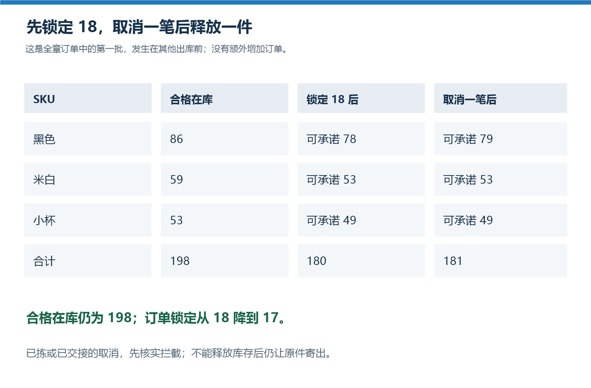

*图 6-4　同一件商品只分配一次；取消先核对实物进度，再释放锁定。*

取消请求在已拣、已包装甚至已交接后到来时，应先确认能否拦截。不能既把系统锁定释放给新单，又让原包裹继续寄出。异常订单应有单独的确认与通知流程。

### 3.2　从拣货单到承运交接

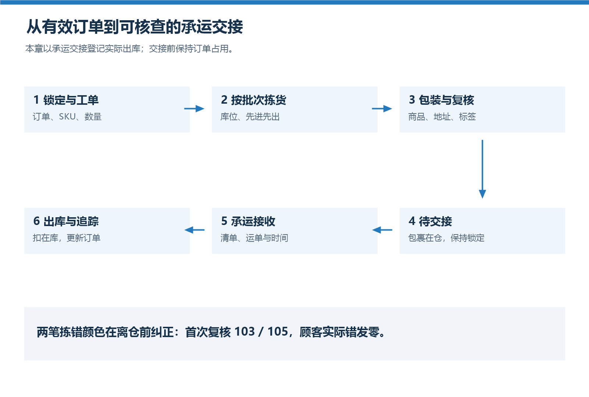

*图 6-5　打单、打包、库存出库和承运接收是不同事件，记录要能对应。*

拣货单给出订单、SKU、数量、批次与库位。先从旧批次取货，核对实物与记录，再包装、复核订单及收件信息，进入待交接区。与承运商交接时核对包裹数、运单和接收证据，本章以该交接事件登记实际出库。

上架移动、储备位向拣货位补货也是内部作业，不能当作销售出库。交接前商品仍在仓内，保持订单锁定，不重复开放销售。

### 3.3　本轮订单状态逐层核对

| 订单状态，笔／件 | 黑色 | 米白 | 小杯 | 合计 |
|---|---:|---:|---:|---:|
| 支付 | 48 | 34 | 28 | 110 |
| 发货前取消并全退 | 2 | 2 | 1 | 5 |
| 实际出库并最终签收 | 46 | 32 | 27 | 105 |
| 签收后全额退货 | 3 | 2 | 1 | 6 |
| 最终保留 | 43 | 30 | 26 | 99 |

本章每单一件，订单数与件数数值相同，多件订单时两者必须分别统计。105 件出库全部使用旧批次：黑旧正好 46，米白 32，小杯 27。本章没有发出黑色新批次的 40 件。

### 3.4　复核发现错误，怎样记录

105 笔中有两笔在首次打包复核时发现拣错颜色，均在离仓前更正；最终实际错发给顾客为零。不能把两次纠错记录删掉，否则看不见内部作业问题；也不能把它们直接记成两笔顾客错发。

首次复核通过率 = 103 ÷ 105 ≈ **98.10%**。分析出错库位、标签、工单和交接，核查防错措施。若错误已离仓，则按实际情况联系拦截、补发或售后，另行记录真实商品和费用。

### 3.5　练习与参考答案

**练习。** 第一批 18 笔锁定，取消一笔黑色且未出库后，在库是否变成 199？两笔出仓前纠错是否应计入顾客错发？

**参考答案。** 合格在库仍为 198，只是锁定从 18 变 17，可承诺从 180 变 181。另有三件旧隔离，实物在场仍为 201。两笔记为内部首次复核未通过并纠正，顾客错发按实际出仓结果统计，不能混用。

**本节交付物**　订单锁定、取消拦截、拣配复核、出库交接及错误记录。

---

## 第四节　高峰六十单，两个人够不够？

运营准备另一场活动，希望在一个两小时窗口内交接 60 笔订单。仓库说两名员工每人每小时能打包 15 笔，刚好 60。

你还需要问，休息、补料、异常和复核占用是否算过，拣货与交接能否跟上。

**本节目标**　从订单量、作业窗口与工序能力找瓶颈，比较自管和合作仓的服务、责任及总费用。

### 4.1　先统一需求与能力单位

以下是独立高峰演练，未新增本章订单、临时人员或付款。假设同类一件装订单，在两小时内，拣货能力 72、打包名义能力 60、交接能力 65 笔；打包还需预留 15% 时间给异常、补料等。

**打包计划可用能力 = 2 人 × 2 小时 × 15 笔／人时 × 85% = 51 笔。**

整个窗口受打包限制，只支持 51 笔，距 60 少 9。不能把三个工序的 72、51、65 相加，订单必须逐个经过它们。

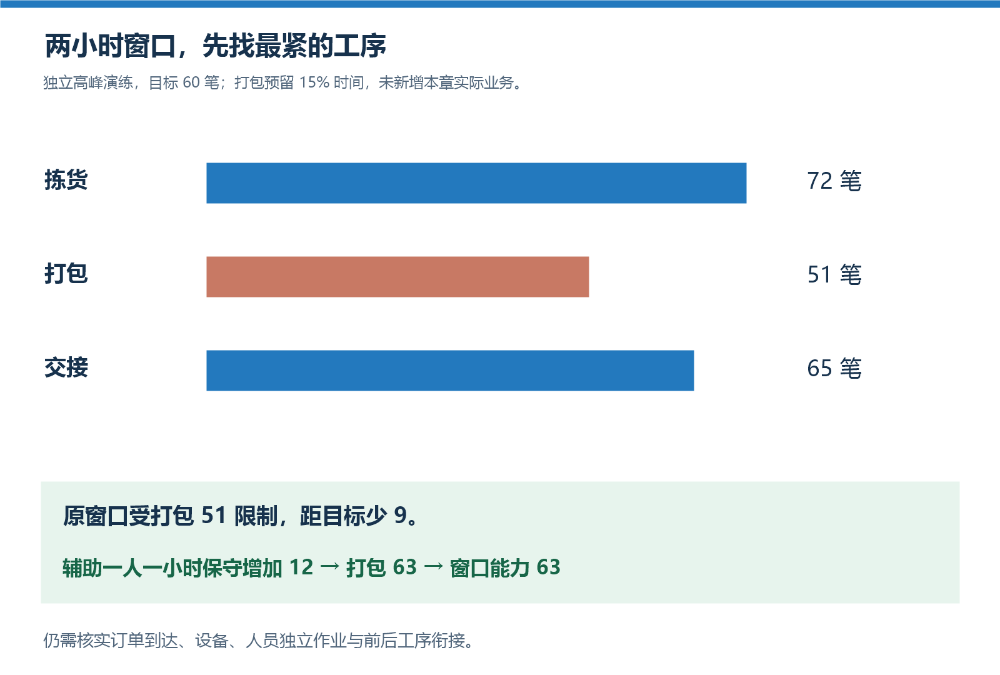

*图 6-6　演练中打包最紧；增加资源后仍要重新检查其他工序。*

### 4.2　增加一个人后还要重算

若安排一名具备同样熟练度的辅助人员做一小时打包，预计增加 15 × 85% = 12.75 笔。本题为保守排程，新增能力向下取整为 12，总打包能力变为 63。

在工序能够连续衔接、其他条件不变的简化假设下，拣货 72、打包 63、交接 65，窗口能力为 **63**，可以覆盖 60。实际排班还要检查订单到达时间、人员能否独立上岗、设备、物料、波次交接与前后工序等待，避免只看两小时平均值。

如果同一个人同时拣货又打包，不能把他的同一段时间在两道工序各算一次。也可以比较提前备料、调整截单、错峰活动或分批交接的方案，写明对顾客承诺的影响。

### 4.3　自管仓与合作仓分别承担什么

| 方式 | 需要管理的事情 | 容易漏看的投入 |
|---|---|---|
| 自管仓 | 场地、人员、设施、流程、安全、系统与承运商 | 淡旺季闲置、培训、管理及设备 |
| 合作仓／第三方仓配 | 合同范围、交接、库存、操作时效、费用与异常责任 | 最低收费、库位、操作、增值与退出费用 |
| 组合方式 | 按商品、地区或业务分配责任及库存 | 调拨、重复备货、系统与管理复杂度 |

山禾本章继续使用原来的一个国内合作仓，没有增加第二个仓或另租场地。700 元是本轮实际仓储操作服务费，范围已在章首列明。

### 4.4　把服务承诺写成可核查的条件

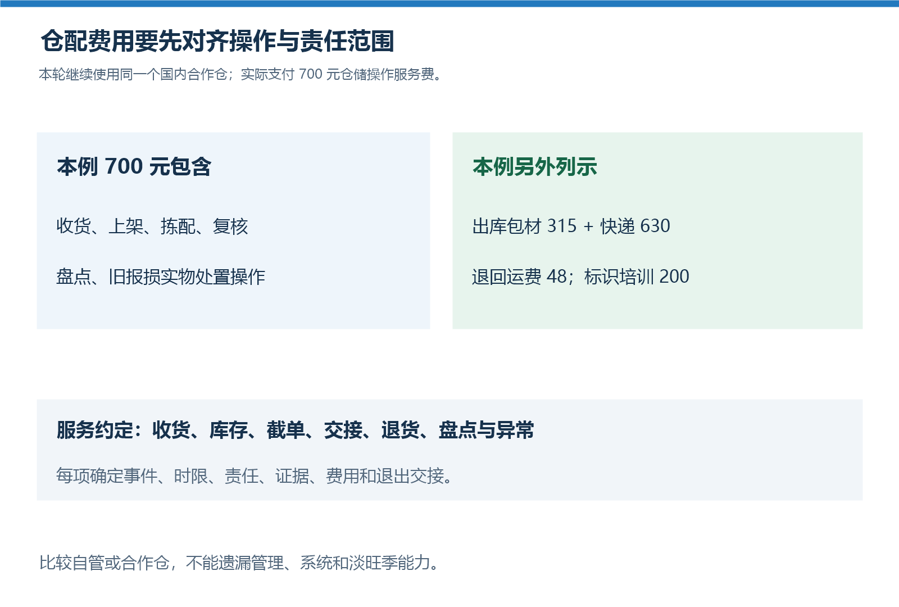

*图 6-7　比较相同作业和责任范围，再比较费用与旺季能力。*

写明收货、上架、库存更新、截单、复核、承运交接、退货、盘点和异常响应的事件与时限，以及证据、责任和收费。系统互传失败、错发、短少、报损与赔付要有处理安排，不能假定所有损失都会自动获赔。

对接系统时要核对商品、订单、库位和状态，处理重复回传、失败重试和人工更改。没有成熟系统的小团队，也应保持统一编号、操作记录和复核权限。

### 4.5　练习与参考答案

**练习一。** 为什么两人名义可做 60，不代表稳妥承诺 60？增加辅助人员后，本题简化窗口能力多少？

**参考答案。** 原计算未考虑预留时间和其他工序；加入假设后打包仅 51。辅助人员增加保守取整 12，打包 63，再与拣货 72、交接 65 比较，窗口为 63，仍需核实实际衔接。

**练习二。** 为下一期比较同服务范围、同质量时效的两个教学报价：甲固定 700，乙固定 500 加每笔出库 2 元，均不含包材与运输。若仍出库 105 笔，各多少？何时费用相同？

**参考答案。** 甲 700，乙 710；500 + 2N = 700，N = 100 笔时相同。实际选择还要比较服务、库存、弹性、退出及完整收费。本题只是未来报价演练，本章实际仍只支付原合作仓 700。

**本节交付物**　高峰能力表、瓶颈方案、仓配服务与费用比较。

---

## 第五节　系统点了发货，顾客就能按时收到吗？

顾客来问物流，客服只看到一条运单号。仓库说已打包，承运记录却还没有接收。

运营需要分清内部动作、实际交接与顾客收到，才能解释迟发或迟到。

**本节目标**　核对运输计费、交接与轨迹，区分仓库时效、承运时效和顾客承诺。

### 5.1　每个关键事件都要有证据

生成运单不等于已交给承运商；承运接收不等于已送达；显示签收也可能有需要核查的顾客反馈。保留订单、包裹、运单、交接清单、接收时间和后续轨迹的对应。

如果同单多包或补发，要说明包裹与商品数量，不能仅凭一个运单就判断整单交付。客服查询也应能追溯实际商品、批次和操作记录，并按工作需要管理顾客信息访问权限。

### 5.2　先核对费用条件，再比较快递单价

运输报价要核对始发与目的地、服务范围、时效事件、实重与体积重、起计及续计、附加费、退回和理赔条件。本章每件顾客出库快递 6 元属于教学合同口径，不代表市场统一运价。

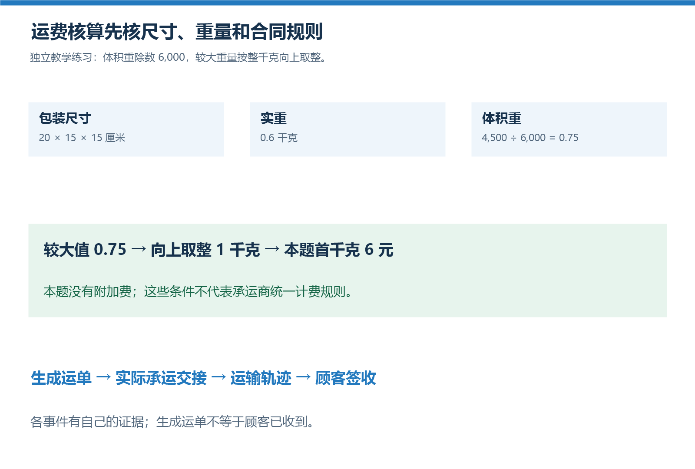

*图 6-8　尺寸、重量、计费规则和服务范围共同决定运费，先核对合同条件。*

做一个独立计费练习：假设包装后尺寸 20 × 15 × 15 厘米、实重 0.6 千克，教学合同约定体积重除数为 6,000，按实重与体积重较大值、再按整千克向上取整，本题首千克费用 6 元，无附加费。

体积重 = 20 × 15 × 15 ÷ 6,000 = **0.75 千克**；取较大值 0.75，再向上取整到 **1 千克**，本题费用为 6 元。这组除数、取整与费用只是演练，不是所有承运商的通用规则，也没有给本章额外增加快递支出。

### 5.3　将仓库承诺与顾客承诺分别评价

本轮 105 笔实际出库订单都有按本案例活动安排确认的承运交接期限和顾客预计送达期限。交接与送达的事件、截止日期在订单记录里预先确定，没有拿真实平台统一规则作假设。

| 指标 | 数量与分母 | 结果 |
|---|---|---:|
| 首次打包复核通过 | 103／105 实际打包订单 | 98.10% |
| 按承诺完成承运交接 | 101／105 应交接订单 | 96.19% |
| 顾客按承诺时间收到 | 100／105 已出库订单 | 95.24% |
| 最终实际顾客错发 | 0／105 已出库订单 | 0% |

本章没有未到期订单，105 笔均完成签收，后续六笔退货仍包含在首次送达的评价范围。不能为了提高准时率，就把晚到后退货的订单从分母删掉。

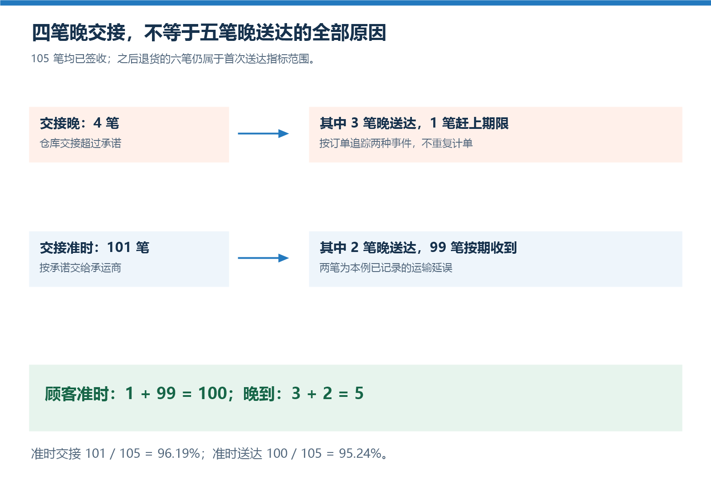

*图 6-9　内部准时与顾客准时分别统计，结合事件追踪解释差异。*

四笔仓库交接晚于承诺，其中三笔最终晚到，一笔通过后续运输赶上顾客期限；另外两笔准时交接，却因本案例已记录的运输延误晚到。因此晚交接四笔、晚送达五笔，不能相加成九笔顾客迟到。

### 5.4　异常先补服务，再核责任

对未接收、轨迹停滞、破损、遗失或顾客未收到的反馈，先定位包裹和事实，按实际约定推进追踪、通知、拦截、补救及索赔。给顾客的新承诺要有供货和物流依据。

本轮没有补发订单或额外理赔到账。后面两件退回后不能重售的商品，原因与责任仍待核实；本章按已发生退款、退回运费及损失记录，不提前记赔偿或冲减成本。

### 5.5　练习与参考答案

**练习。** 四笔晚交接、五笔晚送达，是否说明共有九笔不同订单异常？本章为什么用 105，而不是最终保留的 99 作送达指标分母？

**参考答案。** 不能相加。晚交接中的三笔也在晚送达里，另有一笔赶上；两笔是准时交接后晚到。本章评价的是全部出库订单的首次送达，包括之后退货的六笔，不能因售后改变历史送达范围。

**本节交付物**　承运费用边界、交接及轨迹记录、服务指标与异常处理安排。

---

## 第六节　六件退货回仓，库存能直接加六吗？

L10—L12，六件商品陆续退回。客服完成退款，仓库仍需要核对商品与状态。

顾客退款、收到退件、检查接受、恢复可售及损失确认，各自有不同证据。

**本节目标**　把逆向物流、退款、商品状态和成本连接起来，避免“退款就回库存”或“退回来就能卖”。

### 6.1　退回先进入待检

核对原订单、退货申请、数量、SKU、批次、包装和实际状态。先记录退回实物，再检查是否符合重新销售要求、是否需返修或隔离，以及责任和追偿依据。

本章六件均已退回、检查并完成退款。两件黑色、一件米白和一件小杯符合本案例重新销售条件，恢复可售；另黑色一件、米白一件因检查发现不能重新销售而报损隔离。

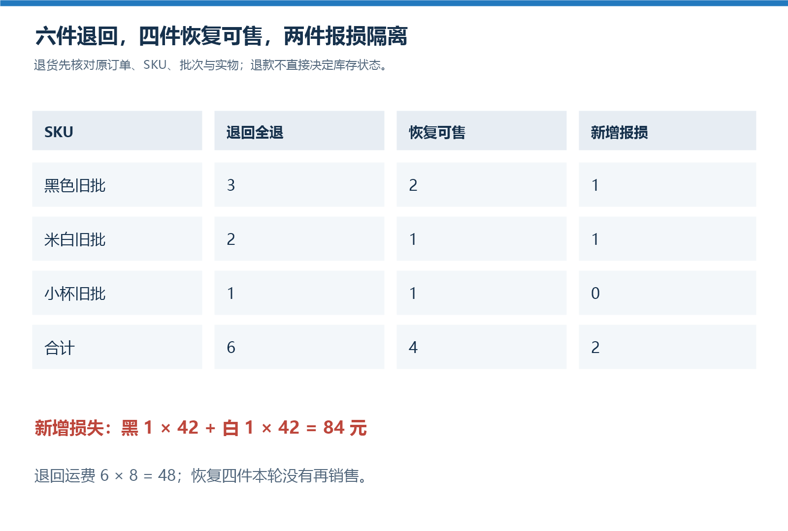

*图 6-10　退款改变订单结果，检查决定四件恢复可售、两件隔离报损。*

### 6.2　数量与商品成本分别核对

| 退货处理，件 | 黑色 | 米白 | 小杯 | 合计 |
|---|---:|---:|---:|---:|
| 已退回并全额退款 | 3 | 2 | 1 | 6 |
| 恢复可售 | 2 | 1 | 1 | 4 |
| 新增报损隔离 | 1 | 1 | 0 | 2 |

本轮顾客出库全部来自旧批，黑色退回成本仍按 42，不因仓内有新采购单价 44 就改按 44。两件新增报损成本 = 1 × 42 + 1 × 42 = **84 元**。

本章按最终保留商品计算销售额与销售商品成本，再单独列两件报损。这等价于发货时先记录成本、退货时冲回对应成本，再对不能重售的商品记损失；不能把退货成本不冲回，又重复加一笔报损。

四件恢复库存后保留来源批次，L14 前没有再次销售，避免将同一件退回恢复品又虚构卖出。两件报损仍在隔离区，账面零，不能作为可售。

### 6.3　退款、费用和责任分别跟进

六笔退货退款 = 5 × 119 + 1 × 99 = **694 元**。五笔发货前取消退款 = 4 × 119 + 1 × 99 = **575 元**。两类退款没有重叠。

支付总额 48 × 119 + 34 × 119 + 28 × 99 = **12,530 元**；减取消和退货退款 1,269，保留销售额 **11,261 元**。

本例平台取消与退货订单收费均已冲回，最终按 99 笔收 594。包装和出库快递按实际发出的 105 笔收取，不随退货冲回；退回运费 6 × 8 = **48 元**，山禾已支付。两件报损的责任核查没有形成已确认、已到账的补偿。

### 6.4　练习与参考答案

**练习。** 六件退回如果全部加为可售，会多算几件、多少价值？退回黑色如果按新单价 44 恢复，有什么问题？

**参考答案。** 应恢复四件，误加六件将多计两件可售，按原批次成本多记 84 元，并漏记损失。黑色原销售来自 42 元旧批，应追溯原成本，不能因为现有新批次就随意改价。

**本节交付物**　原订单、退款、退回检查、恢复及报损的对应记录。

---

## 第七节　盘点少了一件，要不要直接报损？

L13，收发和退货都处理完，仓库抽盘 20 条指定的“SKU—批次—库位”记录。米白拣货位账上应有 28，实际只有 27。

你没有立即批准报损，而是继续查实物、移动和时间。

**本节目标**　理解盘点范围、截止与复核，区分库位差异、状态错误和真实数量损失。

### 7.1　先固定盘点范围与时间

盘点可以做周期抽盘或全仓盘点。本章只是选定 20 条记录，包括相应空位记录，不能把抽盘结果直接称为整个仓库准确率。

盘点前定义 SKU、批次、库位、状态和截止时间；暂停相关作业或完整登记盘点期间的移动。独立记录实盘，再与账面比较，差异复点，查未登记收发、移位、状态、单位和重复记录。

### 7.2　两条库位差异可能对应同一件实物

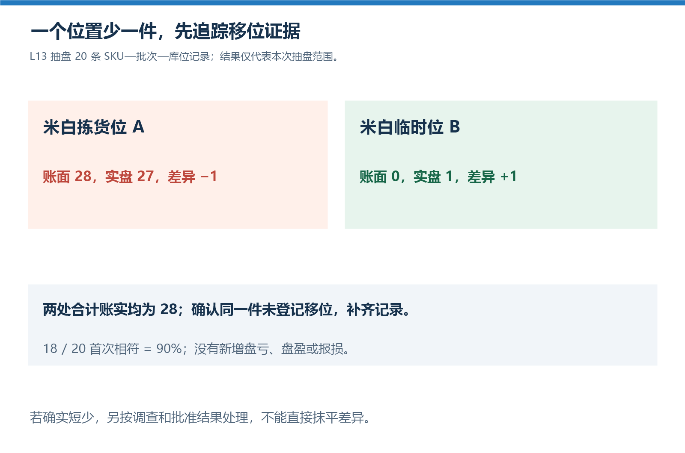

*图 6-11　一处少一件、另一处多一件，先查移动证据，不直接制造盘亏与盘盈。*

| 米白旧批库位 | 账面 | 首次实盘 | 实盘减账面 |
|---|---:|---:|---:|
| 拣货位 A | 28 | 27 | −1 |
| 临时位 B | 0 | 1 | +1 |
| 两处合计 | **28** | **28** | **0** |

调查确认同一件米白移到临时位，内部移位未登记，批次和实物可对应。补齐移动记录并复核后，两条库位记录正确，整仓可售数量和价值都不变，没有新增报损或采购。

本次 20 条记录首次有 18 条完全相符、两条存在上述库位差异，所以**首次记录准确率 = 18 ÷ 20 = 90%**。纠正后这次复核可达 20／20，但不能据此宣布未来长期准确率 100%。

若经过调查确实短少，再按实际原因、责任、权限和证据登记损失及追偿。不能为了账实一致，直接把差异清零而不保留调查记录。

### 7.3　旧报损实物处置，数量与金额分别处理

期初三件旧报损实物已在前章确认损失、账面零。L14 按本案例内部审批、清点和交接流程处置，三件离开仓库，没有变卖收入，相关操作已包含本轮仓储服务费，未发生单列处置费。

它们离仓会减少物理在场数量，但不能再扣一次存货成本或利润。具体处置方式在真实业务中按商品、材料和适用要求确定，不能让不可售品重新混入正常销售。

本章新产生两件报损仍留隔离区、账面零，单独交接给后章继续处理。

### 7.4　从盘点差异找到流程改进

本案问题不在米白总数，而在临时位移动没有登记。措施是明确临时位编号、移动登记与复核责任，减少“先放一下、稍后再录”的失联；后续按相同口径抽查，观察是否再发。

库存金额核对、可售数量核对和库位准确性都要做。金额正确并不能证明每个库位可按时找到货，数量正确也不能证明质量状态和批次正确。

### 7.5　练习与参考答案

**练习。** 如果只看到 A 少一件就报损 42，之后又找到 B 的一件并记盘盈 42，最终金额虽抵消，流程是否合理？三件旧零账面实物处置能否再记 126 元损失？

**参考答案。** 本案有可验证的移位事实，应更正库位移动，不能虚构一次损失和一次收益。三件原已零账面，处置不再重复确认成本损失；保留实物减少及交接记录。

**本节交付物**　盘点范围、初盘复点、差异原因、移动修正及旧货处置记录。

---

## 第八节　把仓配服务、库存和资金核对回来

L14，采购已补齐四件，仓库处理完退货与盘点，运营开始准备下一次活动。你需要先核对这轮实际，再讨论下一轮改善。

**本节目标**　用数量、价值、现金和服务结果共同评价仓配，不只看发出了多少包裹。

### 8.1　库存按批次、状态与实物核对

| 批次 | 期初可售 | 本章接受 | 实际出库 | 退回恢复 | 期末可售 | 单价 | 期末价值 |
|---|---:|---:|---:|---:|---:|---:|---:|
| 黑色旧批 | 46 | 0 | 46 | 2 | 2 | 42 | 84 |
| 黑色新批合计 | 36 | 4 | 0 | 0 | 40 | 44 | 1,760 |
| 米白旧批 | 59 | 0 | 32 | 1 | 28 | 42 | 1,176 |
| 小杯旧批 | 53 | 0 | 27 | 1 | 27 | 34 | 918 |
| 合计 | **194** | **4** | **105** | **4** | **97** | — | **3,938** |

黑色合计 42，其中旧批 2、新批 40。表中仅“退回恢复”加入可售；另两件退回已经报损，没有混进可售表。

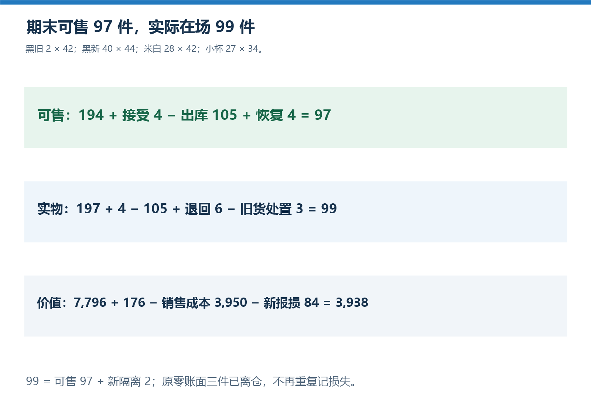

*图 6-12　97 件可售、两件新隔离，共 99 件在场；旧隔离三件已处置。*

**可售数量：194 + 接受 4 − 出库 105 + 恢复 4 = 97。**

也可从最终去向核对：194 + 4 − 顾客保留 99 − 新报损 2 = **97**。

**实物在场：期初 197 + 补供 4 − 顾客出库 105 + 退回 6 − 旧货处置 3 = 99。**

99 = 可售 97 + 新隔离 2。没有期末未发锁定、待检退回或顾客在途；原采购承诺也已归零。

销售商品成本 = 43 × 42 + 30 × 42 + 26 × 34 = **3,950 元**。新增报损为 84，旧报损处置不再扣成本。

**库存价值：7,796 + 接受 176 − 销售成本 3,950 − 新报损 84 = 3,938 元。**

### 8.2　经营结果不能漏掉服务与逆向费用

| 项目 | 计算口径 | 金额，元 |
|---|---|---:|
| 保留销售额 | 73 × 119 + 26 × 99 | 11,261 |
| 销售商品成本 | 73 × 42 + 26 × 34 | −3,950 |
| 平台费 | 99 × 6 | −594 |
| 出库包装 | 105 × 3 | −315 |
| 出库快递 | 105 × 6 | −630 |
| 实际广告 | 本轮已支付 | −1,600 |
| 顾客退回运费 | 6 × 8 | −48 |
| 新增报损成本 | 黑 1、白 1，均 42 | −84 |
| 列示交易贡献 | 以上相抵 | **4,040** |
| 仓储操作服务费 | 包含章首约定的操作范围 | −700 |
| 标识与流程培训 | 本章支出，费用化 | −200 |
| 本章列示范围经营结果 | 4,040 − 700 − 200 | **3,140** |

仓储服务费里的操作与另付包材、运输不同，已列费用范围不再重复加人工。700 和 200 没有取代尚未引入模型的全部工资、租金和税费。不能将 3,140 直接称为真实企业完整净利润。

### 8.3　平台、银行和存货共同核对

本轮应结算 = 11,261 − 594 = **10,667 元**，到账 10,000，留下新待结算 **667 元**。L1 收回旧款 1,412 只是收应收款，不是新增销售。

| 银行变动 | 金额，元 |
|---|---:|
| 承接第五章期末 | 201,156.88 |
| 收回前章平台款 | +1,412.00 |
| 本章平台结算到账 | +10,000.00 |
| 补供接受后支付 | −176.00 |
| 广告支付 | −1,600.00 |
| 出库包装支付 | −315.00 |
| 出库快递支付 | −630.00 |
| 顾客退回运费支付 | −48.00 |
| 仓储操作支付 | −700.00 |
| 标识与培训支付 | −200.00 |
| L14 银行余额 | **208,899.88** |

平台费已从结算扣除，不在银行再扣一次。报损 84 是库存转损失，不是本轮又付 84；采购支付 176 对应库存入库，不能既扣销售成本又把采购全部扣作费用。

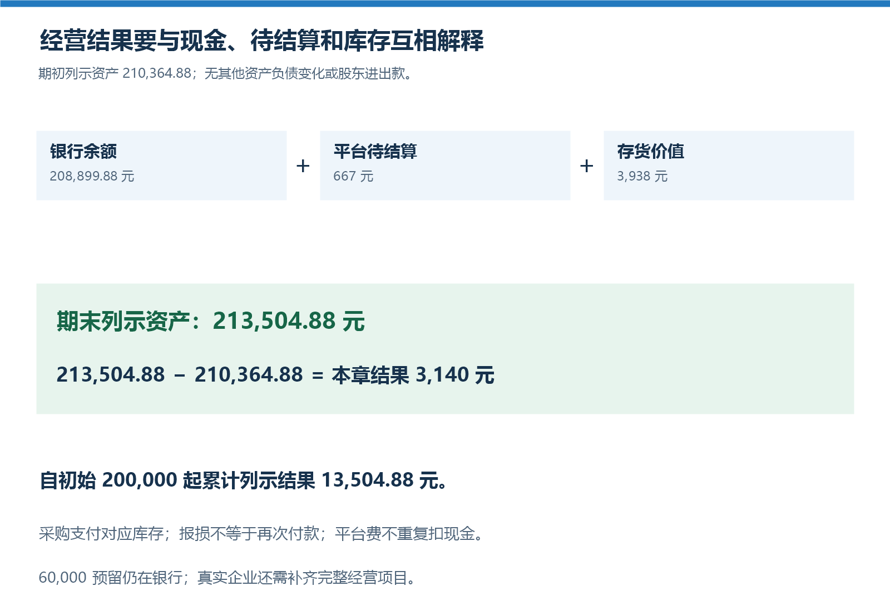

*图 6-13　期末列示资产比期初增加 3,140，与本章列示经营结果一致。*

期初列示资产 = 201,156.88 + 1,412 + 7,796 = **210,364.88 元**。

期末列示资产 = 银行 208,899.88 + 待结算 667 + 存货 3,938 = **213,504.88 元**。

差额 **3,140 元**，与本章结果一致；自 200,000 初始投入累计列示结果为 **13,504.88 元**。本例没有其他资产负债变动或股东进出款。60,000 预留仍在银行中，不能再作为已经发生的支出扣一次。

### 8.4　用结果选择改进，不只催仓库快一点

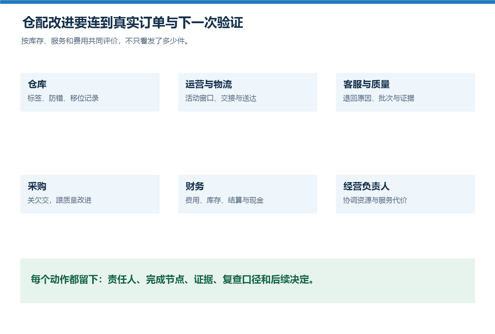

*图 6-14　改进需要对应问题、责任、证据和下一次复查。*

| 事实 | 改进方向 | 责任与复查证据 |
|---|---|---|
| 两笔首次复核发现拣错 | 核标签、库位与工单，验证防错 | 仓库负责，抽查同口径首次通过率 |
| 四笔交接晚，五笔顾客晚到 | 按订单查波次、交接与运输事件 | 运营、仓库、承运协同，复查承诺达成 |
| 一件移位导致两条记录不符 | 临时位编号，移动当次登记与复核 | 仓库负责，下一轮按相同口径抽盘 |
| 六件退回、两件不能重售 | 查商品、包装、运输与使用证据 | 客服、质量与物流跟进，不先认定责任 |
| 高峰能力有瓶颈 | 活动前验证窗口、人员、物料和交接 | 运营提供需求，仓库给可执行能力 |
| 补供已完成 | 关订单欠交，继续验证供方改进 | 采购、质量维护不同关闭状态 |

下一轮新增人员、运价、仓储报价和活动量都是待确认方案。本章没有把高峰演练的 60 笔加进订单，也没有把辅助人员方案记成实际支出。

### 8.5　综合作业与参考答案

**任务。** 为山禾提交一页仓配评审，并附四张表。

1. 库存与流程表：定义各状态、SKU—批次—库位、锁定、取消、出库和退货触发条件。
2. 能力与服务表：算两小时窗口能力、首次复核、交接和顾客送达指标，解释差异。
3. 异常与盘点表：记录退回六件的去向、两条库位差异、旧报损处置及跟踪责任。
4. 批次与资金表：从上章余额核对接受、销售、报损、库存、平台和银行。

**参考答案要点。** 本章补供四件接受付款 176 后，原欠交为零。110 笔支付减取消五笔，出库 105；退货六笔，保留 99，恢复四件、报损两件。可售期末黑 42、白 28、小杯 27，共 97，成本 3,938；另新隔离两件，旧隔离三件已处置，在场总计 99。

首次复核 103／105 = 98.10%，准时交接 101／105 = 96.19%，顾客准时送达 100／105 = 95.24%。四笔晚交接与五笔晚送达有重合，不能相加。首次盘点准确记录 18／20 = 90%，本次差异是库位移动，未造成新增数量损失。

银行 208,899.88，待结算 667，存货 3,938，合计 213,504.88；本章列示结果 3,140。高峰演练原瓶颈 51，补充辅助资源后按本题假设为 63；方案是否执行须另行确认。

**延伸练习。** 假设 L13 并未在其他库位找到那件米白，经调查确认真实短少、批准报损且没有当期补偿，其他结果都与本章相同，哪些数会变？这只是独立情景。

**参考答案。** 比实际案例少一件可售，变为 96；存货成本减少 42 至 3,896，本章列示结果减少 42 至 3,098，期末列示资产变为 213,462.88。银行和待结算不变；若实物确实遗失，期末在场也少一件，变为 98。实际案例已经查明移位，没有新增这笔损失。

**本章完成标准**　能让每笔订单追到实物、批次和运单，每次库存改变追到业务事件；能解释服务与费用的差异，并给出有责任、时间和复查证据的改进方案。

### 8.6　交接到下一章

山禾已经贯通商品、渠道、计划、供应商与仓配。下一章回到国内增长：怎样把流量、内容、投放、活动、客服和复购连接起来，在能够兑现的库存和服务能力内争取持续购买。

---

## 附录　参数与结果核对

用于完成本章后复查；正文已有各节计算所需数据。

| 范围 | 本章实际口径与结果 |
|---|---|
| 承接第五章 | 银行 201,156.88；待结 1,412；可售 194、成本 7,796；旧隔离 3 |
| 补供 | L2 接受黑色四件 × 44，支付 176；原采购欠交、预付及应付余额均零 |
| 实际订单 | A，支付黑 48、白 34、小杯 28，共 110；取消 5、出库 105、退货 6、保留 99 |
| 实际出库 | 黑 46、白 32、小杯 27，均为旧成本批次；退回恢复件未再销售 |
| 退货处理 | 黑 3、白 2、小杯 1；恢复黑 2、白 1、小杯 1；报损黑 1、白 1 |
| 退款 | 取消 575、退货 694；支付 12,530 减退款 1,269 = 销售 11,261 |
| 费用规则 | 平台按保留每笔 6，包装按出库每笔 3，快递按出库每笔 6，退回每件 8 |
| 实际服务与费用 | 平台 594，包装 315，快递 630，退回 48，广告 1,600，新报损 84 |
| 其他实际费用 | 仓储操作 700，标识与培训 200，均已支付；无单列补供外检或旧货处置费 |
| 绩效口径 | 首次复核 103／105，准时交接 101／105，顾客准时送达 100／105，顾客错发零 |
| 盘点 | 抽盘 20 条记录，首次正确 18；一件移位对应两条差异，整仓数量不变 |
| 旧货处置 | 旧零账面报损三件离仓，无收入；本章新报损两件仍隔离 |
| 期末批次 | 黑旧 2 × 42、黑新 40 × 44、白 28 × 42、小杯 27 × 34 |
| 期末实物 | 可售 97、存货 3,938；加新隔离 2，在场 99；没有待检、未发或顾客在途 |
| 经营结果 | 销售成本 3,950；交易贡献 4,040；本章列示结果 3,140；累计 13,504.88 |
| 平台结算 | 应结 10,667，到账 10,000，新待结 667；上章 1,412 已另行收回 |
| 期末资金 | 银行 208,899.88，待结 667，存货 3,938，列示资产共 213,504.88 |
| 预留与演练 | 60,000 仍在银行；高峰产能、未来仓储报价、运输计费、真实短少均为各自独立演练 |
