# 第十一章　从业务报表到组织与系统管理

第十章结束，运营有一张销售表，仓库有一张库存表，财务又有一张平台结算表。同一家公司，黑色杯子一会儿是十五件，一会儿是十三件；跨境平台既显示新加坡元，又显示人民币；有人把“平台有余额”理解成“银行能付款”。

这些数字未必矛盾。十五件包含国内可售十三件和跨境专用两件；平台待结算包含合同保留款，不能全部当成银行现金。真正的问题是：公司是否有共同的定义、可信的数据来源、明确的负责人，以及发现差异后能执行的流程？

创始人提出：“先用两周把关键数据和责任管起来。不要只给我一张漂亮看板，也不要一口气把所有系统都换掉。”

你这次要从管理者角度设计数据、流程、系统与组织，让前十章学过的业务能够持续运行。

**本章完成目标**　能建立商品与业务主数据、统一指标和期间口径，连接利润、库存与现金，设计经营预警、系统职责、权限与岗位协同，并完成一次有预算、有验收、有恢复安排的数据管理小项目。

## 阅读顺序

| 节次 | 要解决的问题 | 交付物 |
|---|---|---|
| [第一节　同一只杯子，为什么有几套名字？](#section-01) | 对象、主数据、版本及关系 | 主数据与业务对象映射 |
| [第二节　各部门说的销售和库存，是同一口径吗？](#section-02) | 指标、粒度、期间、币种及状态 | 指标字典与核对规则 |
| [第三节　怎样让看板支持经营决定？](#section-03) | 结果、原因、预算和预警 | 经营看板与异常任务 |
| [第四节　ERP、OMS、WMS，要怎样分工？](#section-04) | 系统职责、数据交换与质量 | 系统关系及数据质量方案 |
| [第五节　数据都打通了，谁可以改、谁可以付？](#section-05) | 权限、职责分离、日志与恢复 | 授权及变更控制表 |
| [第六节　怎样让部门指标帮助同一门生意？](#section-06) | 岗位、绩效、RACI 与会议 | 团队目标及协同机制 |
| [第七节　两周能完成什么样的系统改进？](#section-07) | 范围、预算、验收与交接 | 数据管理试点及验收记录 |
| [第八节　试点做完，公司经营是否也核清了？](#section-08) | 双业务结算、库存、项目费用及预算差异 | 期末核对与综合作业 |

正文提供各节所需资料，完成后可用[章末参数与结果核对](#chapter-check)复查。

## 案例约定与起点

本章 **Y1—Y14** 承接第十章 X28。历史报表复现、故障演练与未来系统选择，不会自动成为新订单、采购、付款或库存变化。

| Y1 起点项目 | 金额或数量 |
|---|---|
| 人民币银行 | 205,681.88 元 |
| 国内平台 A 待结算 | 244 元 |
| 跨境平台 P 待结算 | 124.40 SGD，按 5.00 折 622 元 |
| P 待结算内部结构 | 未到付款日 74.40 SGD，合同保留 50 SGD；两者均在总额内 |
| 国内可售 | 黑 13、白 28、小杯 32，共 73 件、成本 2,810 元 |
| 国内仓跨境专用可售 | 黑 2 件、成本 84 元 |
| 公司可售合计 | 75 件、成本 2,894 元 |
| 两地隔离实物 | 国内 4、当地退货点 1，均不可售、账面零 |
| 两地在场实物 | 国内 79＋新加坡 1＝80 件 |
| 案例资产合计 | 209,441.88 元 |
| 待办 | 运输索赔申请 120 元尚未确认；跨境整改及下一轮供需评审待完成 |

无采购预付、在途、应付、未发锁定或外币银行余额。银行内用途预留 **57,000 元**继续保留，本章没有动用，也不另外加减资产。

第十章已暂停扩大投放和海外备货。本期跨境不收新单、不补寄、不转换两件区域余量；国内按有限名额继续经营，不执行上章未来二十八天的全部需求设想。原黑白各一百件起订、交期和未来 8,400 元采购都没有变成合同或付款。

本轮做的是**受控资料、只读报表和并行核对试点**。现有成交、仓库、收款仍按原有执行渠道处理；不假装两周上线了一套完整 ERP，也没有真实软件品牌、账户或顾客数据参与。业务、费用、阈值、验收及人力安排均为教学设定。

本章案例结果延续前章简化核算范围。真实企业还需补齐未列示的税费、完整人员和管理成本等，不能将案例结果当作完整企业净利润。

---

## 第一节　同一只杯子，为什么有几套名字？

运营说“黑色保温杯”，仓库说“黑色原款”，跨境资料又写 XB500-BK v1。数据人员问：“这是三种商品，还是同一批实物？”

**本节目标**　识别商品、区域版本、批次、库存状态、订单及结算对象，建立可追溯映射。

### 1.1　先分清对象，再谈统一编号

主数据描述反复使用的基础对象，例如商品、供应商、仓库、渠道与币种。交易数据记录发生了什么，例如支付、收货、出库、退款和付款；库存快照说明某一时点处于什么状态。

| 对象 | 山禾例子 | 不能直接混成什么 |
|---|---|---|
| 商品与 SKU | 原款 500 mL 黑色 SH500-BK | 不是一个订单，也不代表任意市场都能卖 |
| 区域版本 | XB500-BK v1 | 是已确认用途及资料版本，不是凭空多出的实物 |
| 批次 | 供方、来源和本批接受记录 | 同一 SKU 不代表所有批次成本和证据相同 |
| 仓库、库位与状态 | 国内、当地代管；可售、专用、隔离 | 地理位置不等于销售资格 |
| 订单与明细 | A 或 P 的订单及行项目 | 一张订单以后可能含多个商品，不能一概当一件 |
| 包裹与运输 | 交给 L 的运单与签收 | 一单不一定永远只有一个包裹 |
| 结算与银行付款 | P 的结算批次、结汇和银行参考号 | 一笔银行款可能包含多张订单和扣费 |

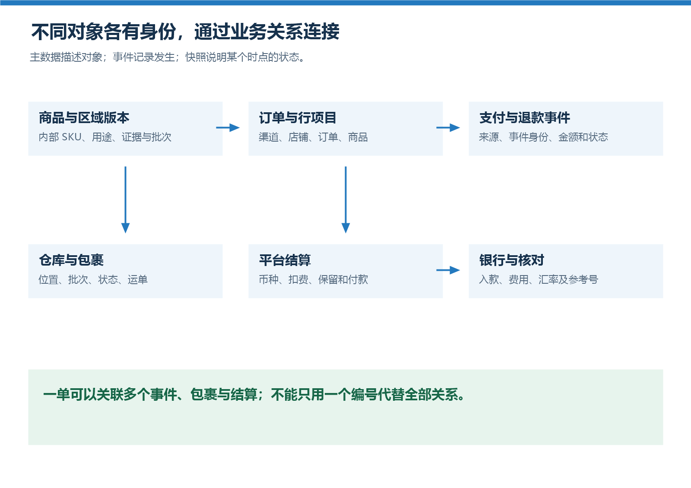

*图 11-1　商品、订单、包裹、结算和银行各有身份，通过业务关系连接。*

“所有表都用一个编号”通常做不到，也没有必要。需要的是能回答：这个包裹对应哪张订单、发了哪个批次、对应哪笔退款和结算，以及哪份证据。

### 1.2　内部 SKU、条码和区域版本要分别管理

SH500-BK 是山禾内部标识，不自动等于全球贸易项目代码 GTIN。GS1 将 GTIN 用于识别供应链中可以定价、订购或开票的贸易项目；内部码与对外识别要求需要映射，不能随手编一个数字就宣称取得有效商品条码。[GS1：GTIN 的定义](https://support.gs1.org/support/solutions/articles/43000734283-what-is-a-global-trade-item-number-gtin-)

本章不替任何商品分配真实 GTIN。是否需另分配代码、怎样处理包装或版本变化，应结合适用规则及渠道要求确认。

| 主数据字段 | 本案例内容或要求 |
|---|---|
| 内部 SKU 与名称 | SH500-BK、500 mL 黑色原款；名称不能作为唯一键 |
| 区域版本及映射 | XB500-BK v1 对应本次已放行的原款批次和区域用途 |
| 计量与包装单位 | 件、箱及换算；本轮每单一件，不默认以后都如此 |
| 材料与规格证据 | 来源、用途、版本、有效范围、审核与变更记录 |
| 库存属性 | 位置、批次、状态、用途、实际数量及可承诺数量 |
| 成本及生效日期 | 本批 42 元；其他批次不能被同名覆盖 |
| 维护和批准责任 | 商品质量负责定义，采购仓库核对，变更按授权批准 |

Y1 黑色总可售十五件＝国内十三＋跨境专用二。若两个系统各显示十五件并相加成三十件，会虚增库存；若把两件专用品直接开放给国内，又可能突破用途与承诺控制。

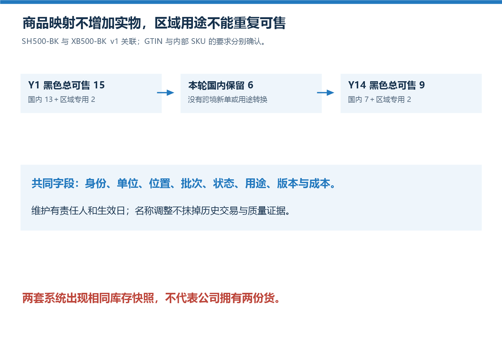

*图 11-2　一个商品族可以对应区域版本和不同库存状态，数量只在真实实物所在的位置计一次。*

### 1.3　编号统一还需要负责人和生效规则

每类主数据要明确谁提出、谁检查、谁批准、何时生效，以及旧交易是否继续关联旧版本。供应商改材料、财务改成本规则、运营改商品名称，都不应直接覆盖历史证据。

例如只是修正显示名称，可以保留同一身份并记录修订；若影响用途、材料或放行，应先评估版本和库存范围。停用商品也不应删除历史订单及追溯关系。

**练习 11-1**　财务把 SH500-BK 与 XB500-BK v1 合并后得到黑色三十件，理由是两个系统各有十五件。你会怎样核实？

**参考答案**　先查两表的时点、位置、用途及实物是否重叠。Y1 实际黑色总可售只有十五件，其中国内十三、跨境专用二；区域映射不增加数量。应确定权威库存记录和跨系统映射，保留版本与用途，不把相同实物快照重复相加。

**本节交付物**　一份主数据字典及对象关系图，包含唯一身份、单位、版本、来源、负责人和变更生效规则。

---

## 第二节　各部门说的销售和库存，是同一口径吗？

跨境运营说上期“卖了二十单”，财务说只有十六个保留订单，物流说发了十八包。三人都可能正确，但不能把这三种数量互相替代。

**本节目标**　建立指标字典，明确对象、粒度、状态、期间、币种、公式及来源。

### 2.1　一个指标至少回答七个问题

指标叫什么、为哪个决定服务、按什么对象计数、取什么状态、观察哪个期间、用什么单位与公式、由谁提供和复核。只在看板写“销售额”，无法判断含税、退款、币种和确认时点。

| 指标字典示例 | 定义与使用边界 |
|---|---|
| 支付订单数 | 业务支付成功的不同订单数；同一事件重复传输不多算订单 |
| 保留订单数 | 指定观察截止日，按约定扣取消及全额退款后的订单；部分退款另定义 |
| 实际发运数 | 按实际交承运包裹计；补寄、换货分别标识，不按保留单替代 |
| 商品净销售 | 按本案例交付确认及已知退款口径，不含代收税款；保留原币及人民币折算依据 |
| 可售与可承诺 | 区分位置、批次、用途、放行和锁定；在途、隔离不直接当可发 |
| 平台待结算 | 指定时点的应结余额，区分币种、付款日、合同保留与争议 |
| 银行可用现金 | 银行实际余额及限制、用途安排；平台待结算不自动成为银行资金 |

### 2.2　用第十章历史结果做一遍字典核对

以下均为 **X1—X28 历史窗口**，不计为 Y1—Y14 的新经营。跨境按 5.20 折收入，期末待结按 5.00 重估，两种汇率承担不同任务。

| X 窗口历史指标 | 国内 A | 跨境 P |
|---|---|---|
| 支付／最终保留订单 | 32／28 | 20／16 |
| 实际首次出库 | 30 件 | 18 件 |
| 商品净销售，人民币元 | 3,112.00 | 2,487.68 |
| 交易贡献，人民币元 | 1,170.00 | 152.88 |
| X28 待结算 | 244 元 | 124.40 SGD，期末折 622 元 |
| 典型不能混用的口径 | 支付额不等于扣退款后的净销售 | 含税顾客款 521.44 SGD 不等于净款 478.40 SGD |

合计净销售＝3,112＋2,487.68＝**5,599.68 元**，合计交易贡献＝1,170＋152.88＝**1,322.88 元**。再扣双方列示固定及服务费用、汇兑和手续费，才得到历史本章结果 −5,342 元。不能把“交易贡献为正”显示成“公司净利润为正”。

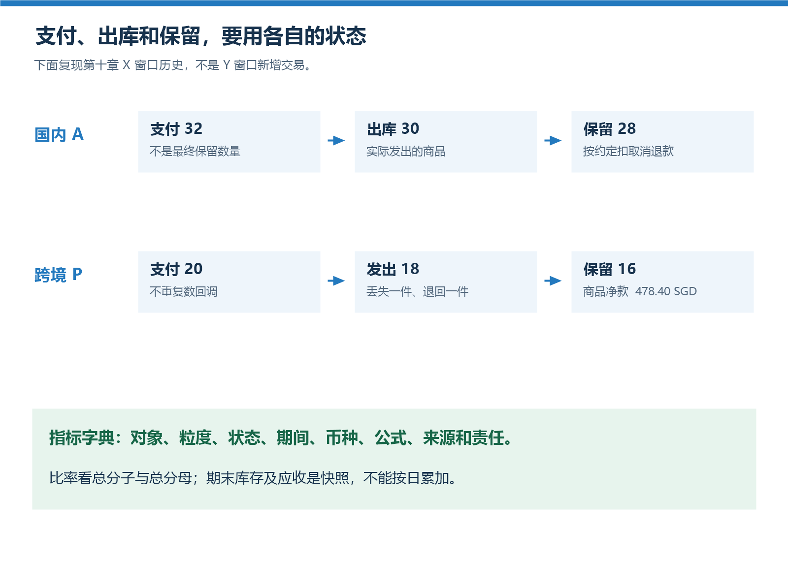

*图 11-3　先对齐状态和期间，再比较指标；总比率通常需用总分子除以总分母。*

跨境按时有效签收率为 17 ÷ 18＝94.44%。若分渠道展示比率，不能不看基数就直接平均百分比。若分母为零，应显示不适用并解释，不伪装成 0% 或 100%。

### 2.3　时间、快照和版本决定能否比较

记录业务发生时间、系统接收时间、报表截止时间和使用时区。北京时间某日 00:30 与 UTC 前一日 16:30 是同一时刻，不能因日期文字不同重复统计；本课 Y、X 是相对管理日，真实系统还需记录对应日期和时区。

销售是期间流量，期末库存和待结算是时点余额。不能把十四个日末库存相加当成期末数量，也不能把同一笔保留款每天显示的余额加成新应收。

预算 V0、实际和后续预测 V1 要分开保存。修正业务错误要留原值、新值、原因、证据和批准；延迟收到的消息不必然是当日新交易。以下迟到消息讨论只说明处理方法，不对前十章已核对结果作隐藏更正。

**练习 11-2**　两天日末都显示 P 合同保留 50 SGD，分析人员把它合计为 100 SGD；另把历史跨境交易贡献 152.88 元写成企业净利润。错在哪里？

**参考答案**　50 是同一应收内部的时点余额，不是每天新增流量，不能相加。152.88 是历史跨境交易贡献，还未扣启动、汇兑及手续费，也没有合并国内经营及其他完整企业成本，不能称为企业净利润。

**本节交付物**　一份含公式、分子分母、状态、时间、币种、版本、来源及责任人的指标字典。

---

## 第三节　怎样让看板支持经营决定？

看板第一页写着“销售增长、签收良好”，采购却发现下一个窗口黑色杯子可能在到货前不足。你把看板重做为：结果、解释、风险和行动。

**本节目标**　用结果与驱动分析连接预算、利润、库存和现金，让预警进入责任及决策流程。

### 3.1　看板先服务问题，再决定图表

经营负责人先看需求与销售、交易贡献及固定投入、库存结构与供需缺口、现金与回款风险；岗位再下钻到商品、渠道、日期、批次、费用及异常。不是所有人都需要看到全部顾客资料或全部字段。

| 看板层次 | 要回答的问题 | 山禾历史例子 |
|---|---|---|
| 结果 | 实际发生了什么，与预算差多少 | 跨境保留十六单，结果 −5,912 |
| 原因 | 是数量、价格、成本、质量还是回款问题 | 同规模交易费用较原假设多 270.80 |
| 风险 | 下一窗口哪里可能失守 | 国内黑色十三、前二十五天工作需求十五，缺二 |
| 行动 | 谁在何时完成什么，失败时怎样调整 | 供需评审、限额、询价或用途转换需批准 |

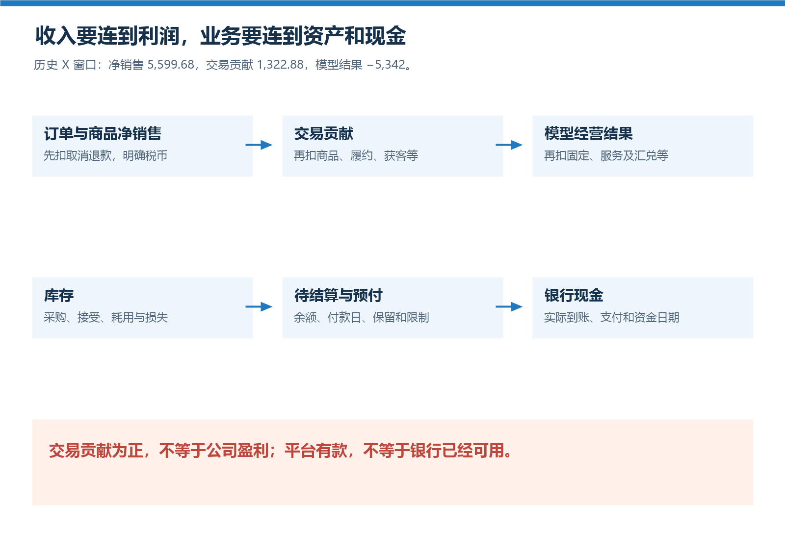

*图 11-4　一个销售结果要连到商品、费用、应收、库存和现金，不能只盯收入。*

销量下降时先区分缺货、限额、访问下降、转化下降、取消或退款；广告归因好也不证明增量。成本异常要分商品、每次出库、售后、固定和汇兑，不把不同原因都塞进“运营效率”。

### 3.2　预算差异要对齐规模，并保留假设

第十章二十单模型与实际十六单比较，先算少四单的贡献差异，再算同规模费用及资金差异。若直接把总费用除以支付订单，就可能因取消率变化而产生虚假的单笔改善。

现金看板还要列银行、待结算、保留款、已签未付款、采购预付、库存与后续日期。库存少也不一定改善现金：如果只是没补上需要的货，可能以失去服务为代价。

本章 Y1 冻结一份两周 V0：国内预计保留二十二单、出库二十四、退回两件并恢复；专项服务计划及现金上限 2,400；跨境无新销售，预计收回旧款 74.40 SGD，暂按原账面汇率 5.00 估算并预计收款费 5 元；不提前预算未确认赔偿或汇兑收益。实际在第八节逐项比较，V0 不改成实际以消除差异。

### 3.3　预警必须有证据、责任人和退出条件

以下阈值是本案例工作规则，**不是行业统一标准**；样本量、商品风险及实际能力变化时需要复核。

| 工作预警 | 检查与升级条件 | 对应动作和关闭依据 |
|---|---|---|
| 黑色到货前缺口 | 预测需求减已放行可用及确认到货大于零 | 供应链牵头、运营确认名额，缺口解决或承诺收缩后关闭 |
| 跨境签收表现 | 工作线 95%，历史 17／18＝94.44%，且样本小 | 核查丢件及路线，不机械推断所有承运长期都不合格 |
| 单保留订单贡献 | 工作线 15 元，历史约 9.56 | 运营、供应链、财务一起查获客、交付和异常，扩张另审批 |
| 待结算到期 | 已过合同付款日且无法解释的差额 | 财务向平台跟进；未到期保留款单独监控，不全部报逾期 |
| 数据质量 | 重复、未映射、跨币种误加或库存关键差异未解释 | 隔离报表版本、保留源数据，修复核对后再发布 |
| 权限异常 | 未授权改价、付款信息或批量导出等 | 冻结相应操作并调查，按批准恢复，不只隐藏告警 |

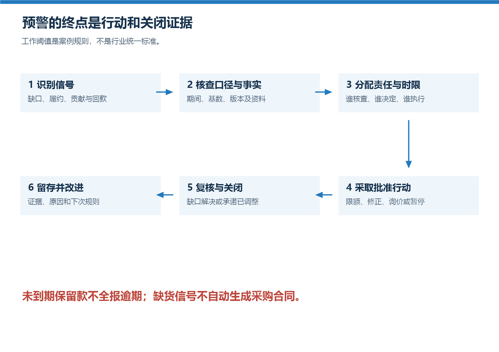

*图 11-5　信号到核查、行动、复核和关闭，才构成预警管理。*

**练习 11-3**　P 有 50 SGD 保留款，运营要求立即标成“逾期坏账”；采购见未来缺二件，要求系统自动下黑白各一百件。应怎样处理？

**参考答案**　先看保留条件、到期日和可收回性，不把未到期款一概当逾期或坏账。供需缺口需要数量、日期、替代方案、合同和资金评审；系统可发起任务，但不能仅凭缺二件就绕过授权形成 8,400 元采购。实际承诺及异常状态核实后再作决定。

**本节交付物**　一张精简经营看板和异常任务表，每个信号对应口径、负责人、动作、期限及关闭证据。

---

## 第四节　ERP、OMS、WMS，要怎样分工？

服务商说一个系统能管所有数据，仓库担心接入后订单重复发。你先把业务责任画清楚，再决定系统边界和交换方式。

**本节目标**　理解常见业务系统分工，设计权威来源、交换、去重、核对和故障处理。

### 4.1　系统名称不是功能和责任的保证

| 常见系统或能力 | 主要关注对象 | 山禾需要确认的边界 |
|---|---|---|
| ERP，企业资源计划 | 采购、接受、成本、库存及财务衔接等 | 哪些业务记在其中，哪些与平台或专业系统交换 |
| OMS，订单管理 | 多渠道订单、状态、分配和履约协同 | 谁创建订单、谁锁定、如何处理取消和补寄 |
| WMS，仓库管理 | 库位、批次、收发、盘点及实物作业 | 操作确认怎样回传，隔离与放行由谁决定 |
| TMS 或物流协作能力 | 运单、运输、节点、费用与索赔 | 承运数据质量、时效和费用证据 |
| CRM，客户关系管理 | 服务、客户关系、分层与授权范围内经营 | 客户身份、同意及数据使用范围，不重复计订单 |
| 商品资料与版本管理 | 规格、材料、图文、区域版本和证据 | 哪个版本可上架、何时失效、库存怎样对应 |
| BI，商业分析 | 汇总指标、分析、预警和看板 | 读什么数据、用什么口径；看板不自动成为交易账 |

一个产品可能兼有多项能力，同一个缩写的实现也可能不同。本章讲分工方法，不指定软件品牌或承诺某产品功能。

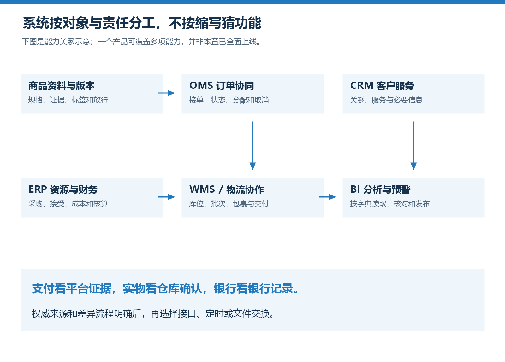

*图 11-6　先确定每类事实由哪里产生、谁确认，再决定系统怎样互相传递。*

例如支付以平台或支付确认资料核对，实物出库以实际仓库确认，银行以银行记录核对。要有权威来源和差异流程；不能让多个系统互相覆盖后，谁最后写入谁就变成事实。

### 4.2　去重不是把相同订单号全部删掉

订单主键要包含足以防止跨平台、店铺串单的范围，例如“渠道＋店铺＋订单号”；多商品场景还需订单行。事件另有身份，支付、取消、发货与退款不是同一种事件，不能因为同属一张订单就只留最后一行。

本轮用第十章历史数据的**演练副本**复现回调重发：二十个真实支付事件，加 E0007、E0011 各一次重复传输，得到二十二行原始支付回调。历史业务实际仍是二十笔，十章已按核实数量记录；演练不会新增交易或更改历史结果。

| 支付回调演练 | 数量或金额 |
|---|---|
| 原始支付回调行 | 22 行 |
| 不同真实支付事件 | 20 个 |
| 重复传输 | 2 行 |
| 错把每行都当付款 | 22 × 32.59＝716.98 SGD |
| 正确支付额 | 20 × 32.59＝651.80 SGD |
| 虚增顾客付款 | 65.18 SGD |

幂等处理是同一业务操作重复到达，也只产生一次应有影响。本轮以“来源系统＋事件身份”辨认重复，保留原始传输与处理记录；订单身份用来关联业务，事件身份用来防止重复执行，两者不能替代。

若重复支付后仍只扣真实四笔退款，商品净款会从正确的 478.40 错变为 538.20 SGD，虚增 59.80；对应税项也会多算 5.38。报表错不等于又收到了真实的钱。

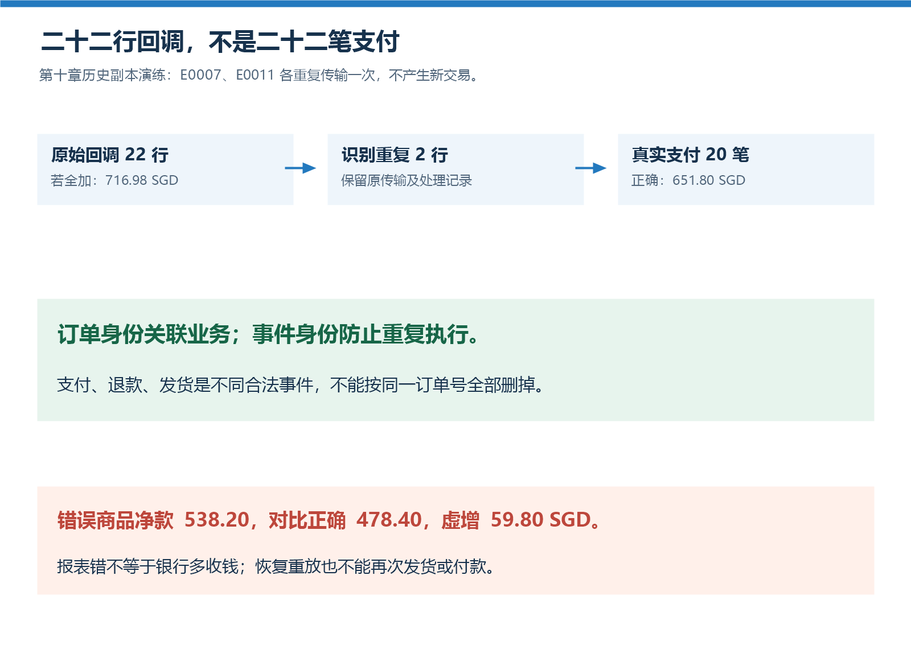

*图 11-7　保留源数据、识别重复、解释差异；不靠删除记录让合计碰巧正确。*

### 4.3　交换数据还要考虑迟到、缺失和恢复

接口可以实时、定时或文件交换，选择取决于业务时效、能力及成本。订单分配和库存承诺通常比月度分析更敏感，但“实时”不等于每个外部节点随时准确。

需要记录提取窗口、版本、处理结果及失败；支持缺失补采、失败重试、重复防护和差异隔离。读报表的链路失败，不应引发第二次发货；取消到达时如果已经出库，应走对应异常流程，而不是机械改回未发。

质量规则至少覆盖完整、唯一、有效、关联一致、时效和数量金额核对。金额舍入差异要按批准规则解释，不能给一个容差就把所有误差自动抹平。模型变更先在副本回放，与已核对基准比较后再申请发布。

**练习 11-4**　二十二行支付回调应该按订单去重后只留一个状态吗？报表导入失败，是否可以重新创建所有订单以“保证不漏”？

**参考答案**　不能只靠订单号删状态；要区分订单、行、包裹和事件身份，保留合法支付、退款及其他事件。识别两个重复支付传输后真实支付仍是二十笔。导入失败应补采、重试和核对，使用幂等保护；不能通过重新创建订单造成重复锁定、发货或收付。

**本节交付物**　一份系统职责和交换图，附权威来源、身份映射、质量规则及失败补偿处理。

---

## 第五节　数据都打通了，谁可以改、谁可以付？

有人建议全员共用管理员账户：“这样最省事。”财务担心付款信息被改，仓库担心隔离品被误放行。你把查看、操作、批准和审计分别列出。

**本节目标**　根据岗位任务设置授权、职责分离、变更审计及故障恢复，保护业务连续性。

### 5.1　权限跟任务走，不跟职位名称无限放大

最小权限的原则是，只给予完成授权任务所需的访问和操作；职责分离则把需要独立核查的工作分开。NIST SP 800-53 的 AC-5、AC-6 提供了相关控制参考。本课借鉴原则，不表示所有电商企业被要求按该文件逐项认证。[NIST：AC-5 与 AC-6 控制参考](https://csrc.nist.gov/CSRC/media/Projects/risk-management/800-53%20Downloads/800-53r5/SP_800-53_v5_1-derived-OSCAL.pdf)

| 事项 | 可执行角色 | 独立复核或批准 | 不应因便利而开放什么 |
|---|---|---|---|
| 商品资料与区域版本 | 商品质量维护，采购提供来源 | 授权质量负责人放行 | 运营自行替换材料证据或删除限制 |
| 改价与促销 | 运营提交方案 | 按金额、毛利及风险权限批准 | 随意覆盖历史价格和预算 |
| 供方及收款资料变更 | 采购提出、财务核验 | 独立确认变更并批准 | 同一人新增账户后独自批准付款 |
| 采购及付款 | 采购发起、财务按批准付款 | 预算和合同权限复核 | 看板发预警就自动对外下单 |
| 库存调整及隔离放行 | 仓库提出，质量核实状态 | 授权人批准并留证据 | 直接改余额或把隔离改成可售 |
| 退款和赔偿 | 客服提交，财务核对 | 按条款及金额授权处理 | 为冲业绩删除退款或提前确认索赔 |
| 报表和顾客资料 | 按岗位及必要范围查看 | 批量导出与共享另按授权 | 全员可下载完整联系人、账户或凭据 |
| 系统管理与审计 | 指定管理员执行批准变更 | 业务验收与独立日志复核 | 管理员既改数据又删审计记录 |

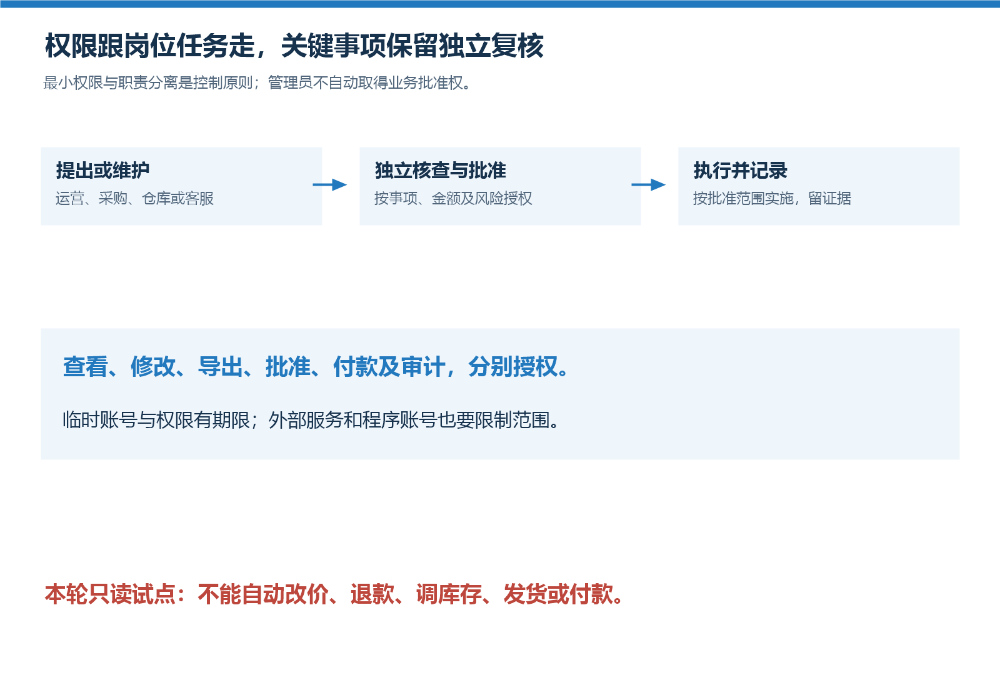

*图 11-8　发起、复核、批准、执行及审计各有边界，系统管理员不自动取得业务批准权。*

小团队可以兼岗，但应识别冲突，用独立确认、限额、双人复核或事后有证据的检查补足；不能因为人少就完全取消制衡。本案例职责由现有岗位兼任，没有新增招聘或隐含工资。

### 5.2　能解释谁改了什么，比“现在看起来对”更重要

重要变更记录操作者、时间、对象、原值、新值、原因、批准和证据。权限开通、转岗、离岗及外包结束要复核；临时权限有期限，不因一次救急长期保留。

外部人员和服务账号也要限范围。本轮试点只读已授权的业务副本，不取得改价、退款、出库或付款权限；共享资料采用必要字段及去标识展示，不向培训名单公开真实个人资料或账户凭据。

生产数据、备份和日志应按需要保护。具体数据保存期限、跨境传输及个人信息义务需要按真实业务和适用要求核实，本课不编造一条对所有市场通用的保存年限。

### 5.3　恢复安排要覆盖数据和业务状态

备份不等于已经证明能恢复。要演练资料能否取回、版本能否核对、权限能否恢复，以及恢复期间哪些新事件需要补采。

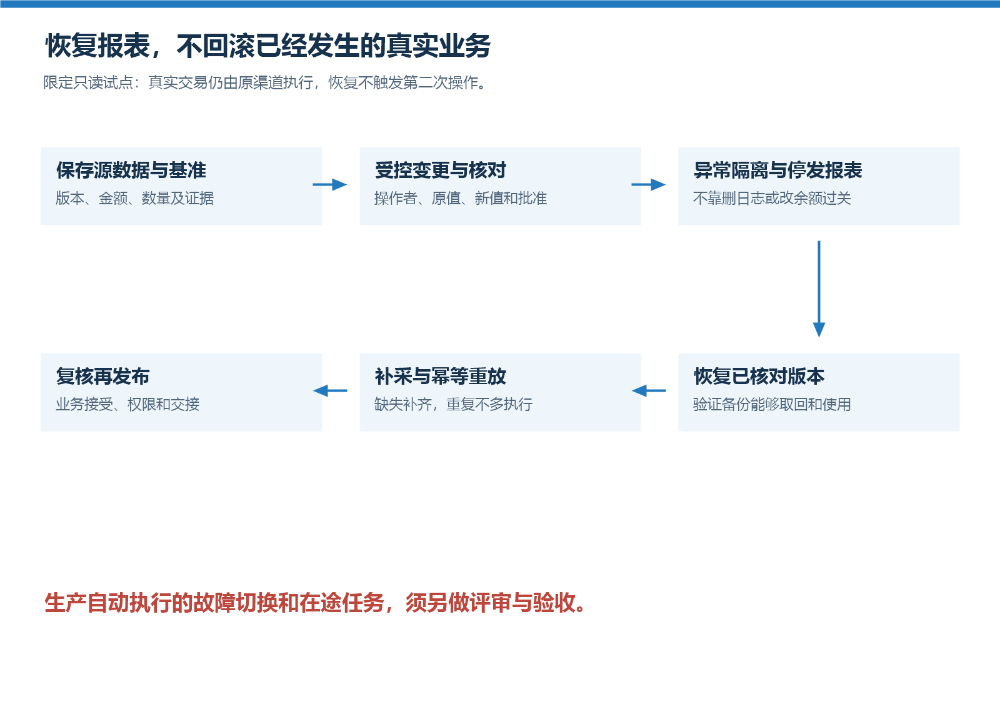

*图 11-9　先保留源数据和证据，再恢复服务；不能为了恢复把已完成的发货或付款再执行一次。*

本轮失败时停止发布新看板版本，回到上一份已核对报表；实际成交、仓配及收款仍使用原执行渠道。报表恢复不回滚真实退款，也不重新触发发货。以后若接入自动执行，应另评审故障切换、重复防护及在途任务，不能照搬只读试点的简单恢复办法。

**练习 11-5**　分析人员只负责经营看板，却申请修改供方银行账户和删除异常日志。是否合理？若新看板失败，应该回滚真实订单吗？

**参考答案**　不合理，权限超出任务需要并破坏审计。按必要字段及只读范围授权，敏感变更另经独立确认和批准。只读看板失败应暂停发布、恢复已核对报表并补采核对，不回滚真实交易、退款或发货。

**本节交付物**　一张含角色、范围、操作、批准、期限和日志要求的授权表，附备份恢复及紧急处理安排。

---

## 第六节　怎样让部门指标帮助同一门生意？

运营想冲支付订单，采购想压单价，仓库想多发包裹，财务希望少占现金。如果只分别考核这些数字，结果可能是低质获客、过量采购、超卖和售后积压。

**本节目标**　建立围绕共同结果的岗位目标、责任分配、绩效制衡和会议节奏。

### 6.1　先定共同结果，再给岗位可影响的指标

共同结果至少包括可持续经营贡献、兑现商品及服务承诺、资金与风险控制、数据和流程可信。目标、预测和预算仍是不同对象，不能为了达到目标擅自改实际。

| 岗位 | 可观察的结果及驱动 | 配套制衡，避免只冲一个数 |
|---|---|---|
| 运营与客户经营 | 保留净销售、转化、获客、复购及贡献 | 同看退款、优惠费用、履约约束与证据，不只看支付 GMV |
| 商品与质量 | 合格放行、版本一致、问题闭环和追溯 | 不以减少检测或隐藏缺陷换取上线速度 |
| 采购与供应链 | 可兑现交期、质量、供应风险及总投入 | 同看起订余货、资金、索赔和替代，不只看最低单价 |
| 仓配与物流 | 准确库存、正确发货、及时交付及成本 | 同看错漏、丢损、追踪和安全，不只看出库件数 |
| 客服 | 问题解决、响应、退换处理和反馈质量 | 不以压低退款数量代替依法依约解决问题 |
| 财务与数据 | 回款核对、资金预测、准确及时的经营信息 | 不能为平衡报表抹差异，也不能让风控阻断所有合理业务 |

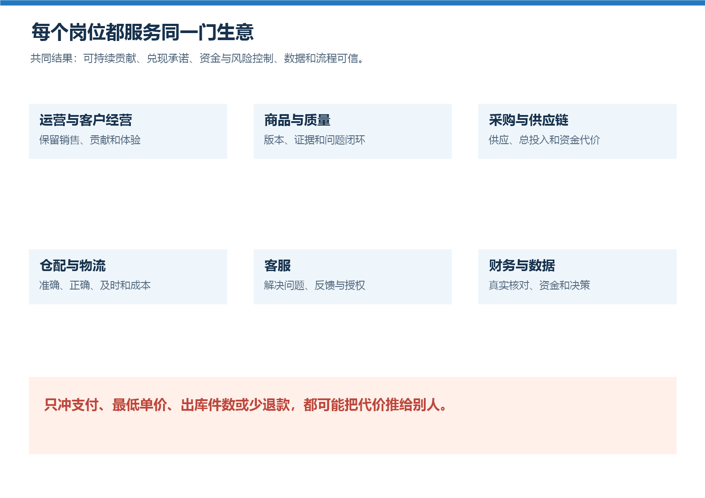

*图 11-10　指标用于改进行为，也要防止把成本、风险或工作推给其他岗位。*

指标要有可影响性和适度稳定的观察窗口。小样本波动、其他岗位造成的约束、外部规则变化都应解释；不把本课工作阈值机械变成真实员工奖金算法。

### 6.2　RACI 帮助澄清责任，但不能代替实际授权

R 是执行负责人，A 是对该项结果最终负责的人，C 是需要征询的人，I 是需要知会的人。每个明确任务应有一个 A，R 可以按工作拆分；同一人兼 R、A 要检查是否影响独立复核。

| 本轮任务 | R：执行 | A：最终负责 | C：征询 | I：知会 |
|---|---|---|---|---|
| 商品与区域映射 | 商品质量、仓库 | 商品质量负责人 | 采购、运营、财务 | 项目协调人 |
| 指标及币种字典 | 数据协作、财务 | 财务负责人 | 运营、供应链 | 各岗位 |
| 到货前缺口方案 | 采购供应链 | 经营负责人 | 运营、质量、财务 | 仓库、客服 |
| 平台旧款及索赔核对 | 财务、物流协作 | 财务负责人 | 客服、供应链 | 经营负责人 |
| 试点验收和发布 | 项目协调人 | 经营负责人 | 财务、运营、质量、仓库 | 使用者 |

这张表说明谁把事情推进到结果，付款、商品放行和数据导出的具体权限仍看上一节授权表。不能因某人是项目 A，就让其跳过法定或合同责任及必要独立核查。

### 6.3　会议以决定、任务和复查结束

日常异常处理解决当日可发、订单、质量和结算信号；周度供需会修正需求、到货、活动及资金；经营评审分析预算实际差异、资源和持续风险。项目例会则追踪范围、依赖、缺陷及验收，不把所有会议混在一起。

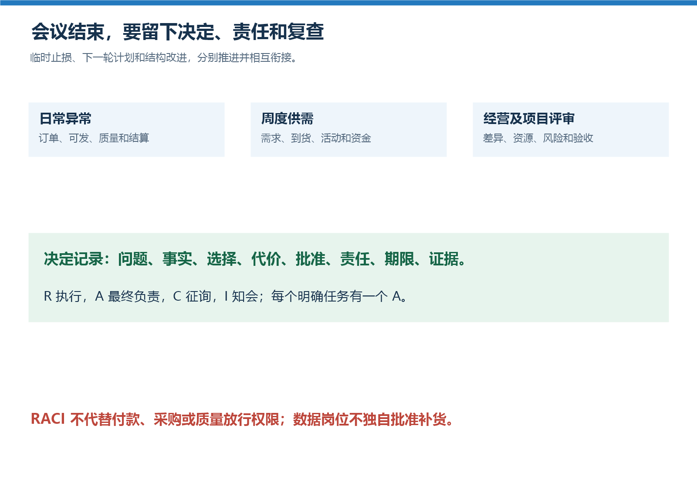

*图 11-11　同一问题分清临时止损、下一轮计划和结构改进，留下相互衔接的决定。*

每次决定记录问题、事实、选择、代价、批准、责任、期限与复查证据。例如黑色未来缺二件，今天先收缩承诺，采购比较补货选项，财务确认资金日期；系统团队改善预警，并不能替代真实供货。

**练习 11-6**　采购单价降了，但余货、预付和交付风险增加，采购是否当然表现更好？数据人员能否独自决定缺货时采购什么？

**参考答案**　不能只以单价评价，应按满足相同需求的质量、交期、总成本、余货与资金风险看共同结果。数据人员提供口径、缺口和方案证据；采购、运营、质量、财务及授权负责人按流程决定，不把数据维护权当作采购批准权。

**本节交付物**　一份共同目标、岗位指标、制衡、RACI、会议节奏和决策记录要求。

---

## 第七节　两周能完成什么样的系统改进？

服务商建议立即采购完整系统，创始人则希望先证明关键报表能核清。你把项目收敛为有明确输入输出的小试点。

**本节目标**　定义范围、预算、方案比较、验证、验收和交接，区分演练成功与生产系统上线。

### 7.1　把需求写成业务结果和可检查场景

本轮范围是商品用途映射、国内及跨境订单状态、库存余额、平台待结及人民币现金的统一字典；用历史副本和本期授权资料做并行核对、权限演练及发布流程训练。业务执行仍在原渠道，**不自动下单、不自动调库存、不执行退款付款、不迁移生产账务**。

| 选择方向 | 可以解决什么 | 必须比较的完整投入 |
|---|---|---|
| 先规范现有表单与报表 | 小范围口径、受控记录及责任，容易复核 | 人工核对、权限局限、维护与规模边界 |
| 配置已有或订阅式业务工具 | 可能减少重复录入并支持协同 | 功能适配、接口、数据导出、服务、续费及退出 |
| 定制或全面替换系统 | 可以针对复杂流程设计 | 需求开发、迁移、测试、培训、运维、安全、切换及供应商依赖 |

本轮选第一种，只验证关键管理流程。后续选系统应以同一组业务场景演示，检查功能、范围、数据所有权、迁移、接口、服务水平、完整费用和退出条件；本章不提供真实厂商推荐或现行价格。

### 7.2　计划 2,400，实际服务 1,800，要分别记录

Y1 的 V0 专项服务计划及现金上限为 2,400 元。范围复核及询价后，同范围正式服务合计 1,800，本期全部完成、Y10 支付；没有额外软件许可、订阅预付、设备、资本化资产或后续自动续约承诺。

| 本轮专项服务实际 | 人民币元 | 交付 |
|---|---|---|
| 数据字典与对象映射 | 600 | 指标、字段、身份和区域用途映射 |
| 并行核对与权限训练 | 800 | 历史及本期副本验证、角色与异常流程演练 |
| 验收复盘及交接 | 400 | 核对记录、缺陷结论、发布及恢复说明 |
| 实际合计 | 1,800 | 完成并费用化；未花的 600 不计实际费用或应付 |

与第十章平台收款设置 1,000 元范围不同，本轮是全公司指标、流程和权限管理，不重复支付前期服务。现有岗位参加训练，不假设新增人员或隐藏工资；真实项目仍需核算内部投入和持续维护成本。

### 7.3　验证要覆盖重复、例外和恢复

| 阶段 | 本案例完成事项 | 是否改变真实业务余额 |
|---|---|---|
| Y1—Y3 定义与基准 | 冻结范围、字典、权威来源和 X28 已核对基准 | 否 |
| Y4—Y7 映射与回放 | 重发回调去重、区域库存、两币种结算和金额核对 | 演练不改变；真实旧款另按实际记录 |
| Y8—Y10 权限及恢复 | 不同角色只读测试、失败导入、重新处理、恢复报表 | 不触发真实下单、发货或付款 |
| Y11—Y14 业务验收 | 本期并行核对、缺陷关闭、责任与维护交接 | 报表反映实际，不生成额外交易 |

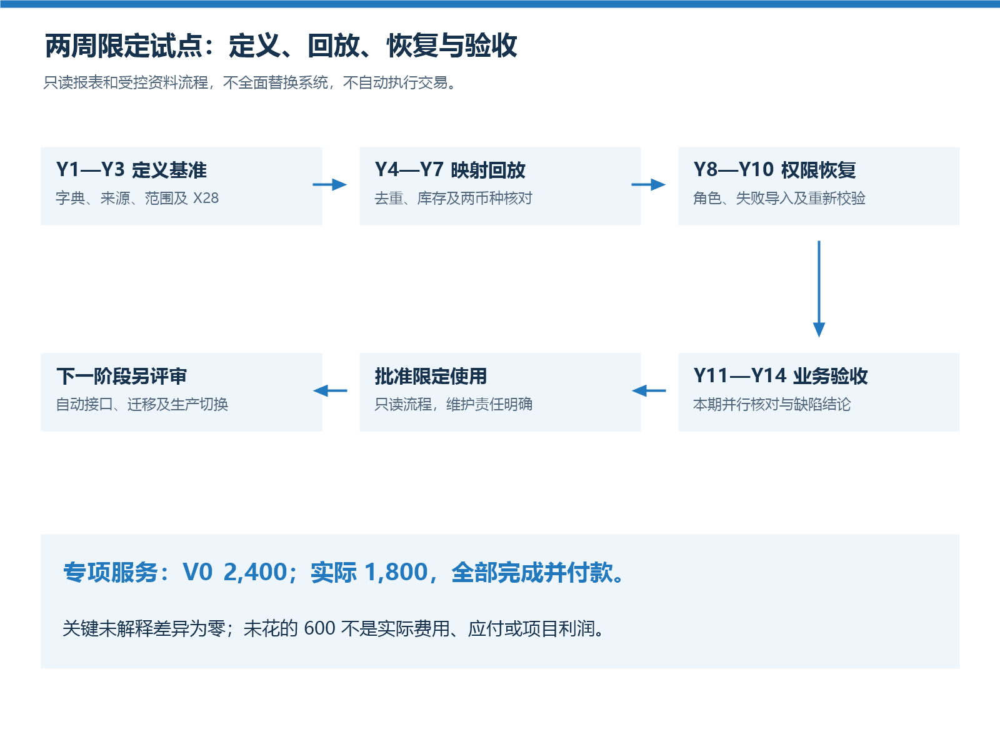

*图 11-12　范围、基准、例外、验收和恢复都要有证据，演示页面能打开不是验收完成。*

本轮验收：跨境演练二十二行回调识别出二十个真实支付事件和两行重复；恢复后重放不增加交易；关键主数据映射完整；X28 历史数量金额及 Y14 本期核对一致；未授权角色不能执行修改或敏感导出；模拟导入失败能回到已核对报表并重新校验。关键未解释差异为零，不用随意删行或调整余额来通过。

这是限定副本与只读流程的验收，不证明所有自动接口、生产并发、实际支付风控或灾难恢复都已通过。后续扩大上线要另做影响分析、边界和负荷测试、切换及回退、数据迁移核对、操作训练和稳定观察，并明确谁批准。

Y14 结论：**受控字典、报表及人工复核流程可按本轮范围使用；不批准全面系统替换或自动交易执行**。后续维护由现有指定岗位负责，记录改动、失效和复查；尚未签下一阶段实施合同。

**练习 11-7**　演练发现两行重复，最后合计与历史相同，是否可以宣布自动发货与付款已经可上线？专项预算节约 600 是否证明项目收益为 600？

**参考答案**　不能。只读副本测试只证明对应范围，自动执行还需验证权限、幂等、状态冲突、切换、异常恢复及真实业务验收。600 是相对 V0 服务计划的费用差异，不自动等于创造的收益，也不能替代质量和后续维护评价；实际只确认发生的 1,800 费用。

**本节交付物**　一份项目范围、预算实际、测试场景、缺陷、验收、发布范围及维护恢复的完整交接记录。

---

## 第八节　试点做完，公司经营是否也核清了？

项目验收当天，财务把真实经营也放在桌上：国内店继续卖了，旧平台款收回了一部分，索赔终于确认，专项服务也已经付款。你需要把“项目完成”与“经营结果”分开解释后再合并核对。

**本节目标**　核对本期国内订单、历史外币结算、赔偿、项目费用和期末资产，解释预算差异并形成下一章交接。

### 8.1　国内有限经营，先核订单状态

本期国内在 A 成交，一单一杯，原款实付 119、小杯 99，无新优惠。保留订单平台费每单 6；每次出库包装 3、快递 6，退回运费每件 8。Y4 完成本轮二十三件发出，米白一件退回合格恢复，没有额外补寄或报损。

| 国内订单状态 | 黑色 | 米白 | 小杯 | 合计 |
|---|---|---|---|---|
| 支付 | 7 | 8 | 10 | 25 |
| 发货前取消 | 1 | 0 | 1 | 2 |
| 实际出库 | 6 | 8 | 9 | 23 |
| 签收后退回退款 | 0 | 1 | 0 | 1 |
| 最终保留 | 6 | 7 | 9 | 22 |
| 恢复可售 | 0 | 1 | 0 | 1 |

支付额＝15 × 119＋10 × 99＝2,775 元；取消退款 119＋99＝218，签收后退款 119。净销售＝2,775−218−119＝**2,438 元**，也等于 13 × 119＋9 × 99。

| 国内实际经营核算 | 人民币元 |
|---|---|
| 净销售 | 2,438.00 |
| 已售商品成本 | 852.00 |
| 平台费 | 132.00 |
| 出库包装 | 69.00 |
| 出库快递 | 138.00 |
| 退回运费 | 8.00 |
| 广告 | 200.00 |
| 国内交易贡献 | 1,039.00 |
| 会员客服 | 80.00 |
| 仓储操作 | 300.00 |
| 国内模型经营结果 | 659.00 |

国内旧款 244 元在 Y1 收回。本期净应结＝2,438−132＝2,306，Y12 已到账 2,000，期末待结 **306 元**。广告、包装、运输、会员及仓储服务均在本期完成并付款，范围与专项服务独立，没有另增应付。

### 8.2　旧外币款和索赔，是新销售吗

Y7，P 支付旧待结中的 **74.40 SGD**，全部按实际教学汇率 5.10 结汇：银行手续费前入款 **379.44 元**；对应原账面 74.40 × 5.00＝372，已实现汇兑收益 **7.44 元**。另付人民币收款手续费 5，银行净增 **374.44 元**。

剩余 **50 SGD**仍为合同保留款，未到本轮释放条件。Y14 按期末教学汇率 5.20 重估为 **260 元**，较原账面 250 增加未结汇部分汇兑收益 **10 元**。

> 期初跨境待结 622＋本期汇兑收益 17.44−手续费 5＝银行净入 374.44＋期末待结 260＝**634.44 元**。

上述变化没有新增跨境销售或外币银行余额。不能将本期实际结汇的 74.40 SGD 再按旧交易收入汇率 5.20 入账，也不能把剩余 50 同时计成平台余额和独立保留款两份资产。

上章申请运输赔偿 120 元，L 本期 Y5 书面确认可赔 **100 元**，Y6 人民币到账 100。按案例确认为本期赔偿收益，不是新商品销售；没有将上章损失抹掉重写，也没有把未获赔的 20 记应收。

跨境旧款处理、汇兑与赔偿本期净结果＝7.44＋10−5＋100＝**112.44 元**。当地零账面退件一件仍隔离代管，上章 80 元约定服务覆盖至本期末，本期没有新增代管费用、退款、处置或应付。下一窗口处置和费用需继续确认。

### 8.3　专项费用、预算与实际逐项比较

本章实际专项服务费用 **1,800 元**，全部完成并付款。未花的 600 元既不形成费用，也不形成资产。全章结果为：

> 国内 659＋跨境旧事项 112.44−专项服务 1,800＝**−1,028.56 元**。

为复核 V0，国内预计保留同样二十二单：黑六、白七、小杯九；预计退回黑一、白一，因此预计发出二十四、支付二十六、取消二，商品净销售和已售成本与实际相同。广告预计 240、包装 72、快递 144、退回运费 16，会员 80、仓储 300，预计国内结果 602 元。

| Y1 冻结预算与实际 | V0 人民币元 | 实际人民币元 | 对结果有利差异 |
|---|---|---|---|
| 国内模型经营结果 | 602.00 | 659.00 | 57.00 |
| 专项服务费用 | 2,400.00 | 1,800.00 | 600.00 |
| 赔偿收益 | 0.00 | 100.00 | 100.00 |
| 汇兑收益 | 0.00 | 17.44 | 17.44 |
| 跨境收款手续费 | 5.00 | 5.00 | 0.00 |
| 合计模型结果 | −1,803.00 | −1,028.56 | 774.44 |

国内有利差异＝包装少 3＋快递少 6＋退回运费少 8＋广告少 40＝57。实际支付二十五低于预计二十六，但最终保留数量相同，不能仅凭支付少一单就说经营一定变差。

774.44 是相对原方案的结果差异，不是本章新赚到 774.44，也不是项目自动创造的永久收益。实际全章仍为 −1,028.56；赔偿与汇兑也不宜当成稳定增长来源。

### 8.4　库存、银行和资产核对到同一截止日

| Y14 可售存货核对 | 期初 | 国内出库 | 退回恢复 | 期末 | 单位成本 | 期末成本 |
|---|---|---|---|---|---|---|
| 国内黑色 | 13 | 6 | 0 | 7 | 42.00 | 294.00 |
| 国内米白 | 28 | 8 | 1 | 21 | 42.00 | 882.00 |
| 国内小杯 | 32 | 9 | 0 | 23 | 34.00 | 782.00 |
| 国内仓跨境专用黑色 | 2 | 0 | 0 | 2 | 42.00 | 84.00 |
| 合计 | 75 | 23 | 1 | 53 | — | 2,042.00 |

存货成本＝2,894−已售 852＝**2,042 元**。国内仓在场＝79−23＋1＝**57 件**，即可售五十三＋旧隔离四；新加坡仍代管隔离一件，故两地在场 **58 件**。本期没有新采购、转用途、报损、补寄或实物处置。

| 银行实际变动 | 人民币元 |
|---|---|
| 期初银行 | 205,681.88 |
| 收回国内旧待结算 | +244.00 |
| 国内本期结算到账 | +2,000.00 |
| 跨境旧款结汇，手续费前 | +379.44 |
| 运输赔偿到账 | +100.00 |
| 国内广告付款 | −200.00 |
| 国内包装付款 | −69.00 |
| 国内出库快递付款 | −138.00 |
| 国内退回运费付款 | −8.00 |
| 国内会员客服付款 | −80.00 |
| 国内仓储操作付款 | −300.00 |
| 专项服务付款 | −1,800.00 |
| 跨境收款手续费 | −5.00 |
| 期末银行 | 205,805.32 |

现金入款 2,723.44，付款 2,600，净增 **123.44 元**。国内平台费已从应结款中扣除，已售成本来自存货，期末 10 元汇兑收益也没有直接进入银行，均不再重复加减现金。

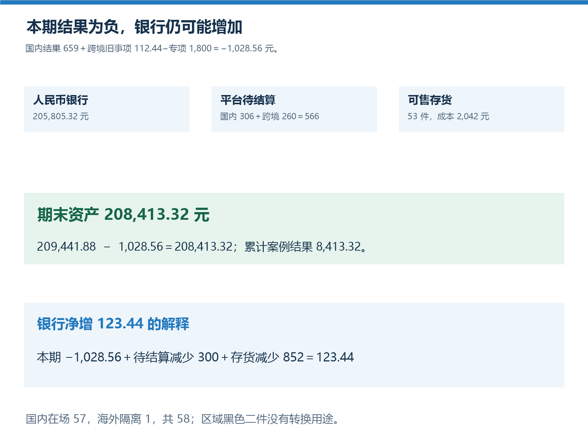

*图 11-13　银行增加而结果为负，可以由存货、待结算及费用变化解释。*

| Y14 案例资产核对 | 人民币元 |
|---|---|
| 银行 | 205,805.32 |
| 国内平台待结算 | 306.00 |
| 跨境平台待结算，50 SGD × 5.20 | 260.00 |
| 可售存货 | 2,042.00 |
| 其他列示资产 | 0.00 |
| 案例资产合计 | 208,413.32 |
| 相对期初资产变动 | −1,028.56 |
| 相对最初 200,000 的累计案例结果 | 8,413.32 |

期初资产 209,441.88−1,028.56＝208,413.32。另一条核对：待结算从 866 变为 306＋260＝566，减少 300；存货减少 852；所以银行变化＝−1,028.56＋300＋852＝**123.44 元**。

实际银行日期依次为：Y1 收旧款 244；Y2 付广告 200；Y4 付包装及出库快递 207；Y6 收赔偿 100；Y7 结汇扣手续费后收 374.44；Y9 付退回运费 8；Y10 付专项 1,800；Y12 收国内结算 2,000；Y13 付会员和仓储 380。其他日期无银行变动，最低余额为 Y10—Y11 的 **204,185.32 元**。

57,000 用途预留仍包含在银行中，未新增借款、注资或分红。期末无采购预付、在途、应付、未发锁定、外币银行余额或未收赔偿；剩余跨境保留款 50 SGD 继续按合同监控，不因看板上线就变成现金。

### 8.5　综合作业：交付一份可以接手的经营管理方案

请用本章及指定历史窗口完成以下交付，历史、实际、预算与演练分开记录。

1. 画出 SKU、区域版本、批次、库存状态、订单、包裹、结算和银行的关系，并指出权威来源和负责人。
2. 为支付订单、净销售、发运、交易贡献、可承诺库存和待结算写指标字典，解释为什么不能只统一列名。
3. 重现二十二行回调演练，算出错误和正确支付额、净商品款，以及去重与恢复应满足的条件。
4. 设计经营预警、权限矩阵及 RACI，说明谁可以提供数据、谁可以批准采购或放行隔离品。
5. 交付本轮专项计划、实际费用、测试、验收与恢复说明，并解释只读试点与自动执行上线的差别。
6. 核对 Y14 订单、库存、两地实物、外币待结、赔偿、银行、资产及预算差异。
7. 写出下一章的交接事项：国内黑色剩七、区域余量二、跨境保留款和当地隔离品各应怎样管理；未签采购及未批准扩张如何避免变成默认承诺？

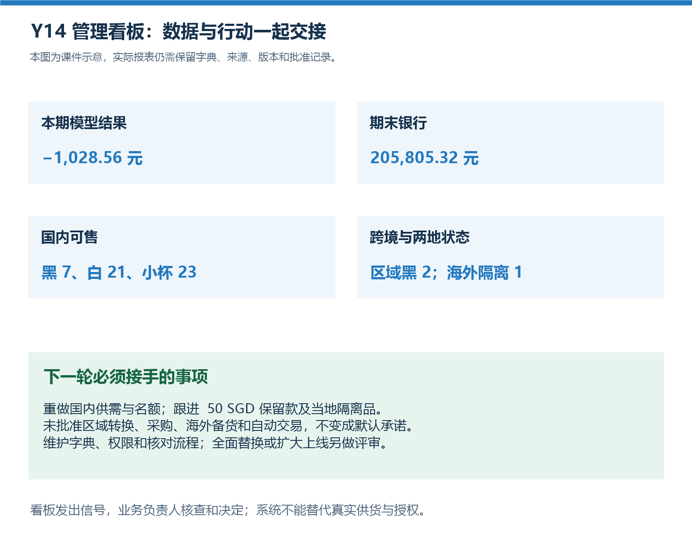

*图 11-14　数据、责任和行动一起交接，才能进入年度及全链路经营决策。*

**综合作业参考答案**

1. 内部 SH500-BK 与区域 XB500-BK v1 建映射，位置、用途、状态和批次分开；订单事件、包裹和结算各有身份。Y14 黑色总可售九件＝国内七＋区域二，不能两边重复。商品质量定义版本，仓库确认实物，平台及银行各提供对应交易凭证，数据负责人维护映射及核对。
2. 写明对象、粒度、状态、观察期、截止时点、币种汇率、公式、来源和批准版本。支付不等于保留，净销售不等于含税顾客款，发运不等于签收，交易贡献不等于完整净利润；余额快照不能按天累加。
3. 原始二十二行含两个重复传输，真实二十笔支付，错误支付 716.98、正确 651.80 SGD。扣真实四笔退款后，错误商品净款 538.20、正确 478.40，虚增 59.80；不能据错误报表增加银行。以来源和事件身份防重复，保留合法状态，重试不再产生第二次影响。
4. 缺口、低贡献、履约、到期款及数据权限异常都应有核查、负责人和关闭依据。RACI 不能代替采购、付款或质量放行授权；看板和只读账号不能自动改库存、付款或创建采购承诺。
5. V0 服务 2,400，实际 1,800 全部完成付款，差 600 不计实际费用或应付。本轮验收限定字典、只读报表、并行核对、权限和恢复；后续自动执行仍要另做影响、接口、幂等、切换与业务验收。
6. 国内保留二十二、净销售 2,438、国内结果 659；跨境旧事项净结果 112.44，专项 1,800，全章 −1,028.56。可售五十三、成本 2,042；国内在场五十七、海外隔离一，共五十八。银行 205,805.32、国内待结 306、跨境待结 260，资产 208,413.32，累计 8,413.32。预算 −1,803，实际有利差异 774.44，不等于本期盈利。
7. 下一轮需重做需求、日期、采购起订及资金，减少或确认国内新名额；区域二件用途未经批准不共享。50 SGD 跟合同条件，不列成已到账；当地一件隔离品继续记录位置、服务范围及后续处置。全系统替换、自动下单、海外备货和新采购均未批准，不进入实际余额或对外承诺。

**本章完成标准**　能让同一业务事实在不同岗位、系统和报表中保持可解释，发现差异后有人核查并作决定；能将数据质量、权限、绩效、流程和资金放进同一经营管理方案，而不仅是展示图表。

下一章《从部门负责人到全链路经营管理者》将把国内与跨境、商品与供应、团队与资金放入综合计划和压力情景。它将承接本章期末实际和未完成的供需、回款及处置任务，完成整套课程的经营实战。

---

## 附录　参数、结果与参考资料

### 本章核对摘要

| 口径 | 本章结果 |
|---|---|
| 实际期间 | Y1—Y14，国内有限经营、跨境旧事项结算及只读数据管理试点 |
| 国内支付／取消／出库／退回／保留 | 25／2／23／1／22；米白退回一件恢复 |
| 国内净销售／国内结果 | 2,438／659 元 |
| 专项 V0／实际 | 2,400／1,800 元，完成并付款；无软件预付或新增固定资产 |
| 跨境旧款结汇 | 74.40 SGD，实际 5.10，手续费前 379.44、扣费后 374.44 元 |
| 跨境期末待结 | 合同保留 50 SGD，按 5.20 折 260 元；无外币银行余额 |
| 汇兑与赔偿 | 汇兑收益 17.44；索赔 120 中确认并到账 100，余 20 不计应收 |
| 跨境旧事项净结果 | 112.44 元，含 5 元手续费，不是新销售 |
| 本章结果／预算有利差异 | −1,028.56／774.44 元，不能把差异称为本期利润 |
| 期末可售 | 国内黑七、白二十一、小杯二十三、区域黑二；共五十三、成本 2,042 元 |
| 两地在场 | 国内五十七含旧隔离四；海外隔离一；合计五十八 |
| 银行／银行最低点 | 205,805.32／204,185.32 元 |
| 待结算合计 | 国内 306＋跨境 260＝566 元 |
| 资产／累计案例结果 | 208,413.32／8,413.32 元 |
| 演练边界 | X28 历史副本回调、故障恢复与后续系统方案不产生新真实交易 |
| 期末未发生 | 新采购、预付、在途、应付、未发锁定、区域转换、跨境新单或全面系统替换 |

### 参考资料与适用边界

以下官方资料于 **2026-11-17** 核查，用于术语及控制原则参考。具体主数据分工、系统架构、阈值、岗位和验收方案由本课程结合虚构业务设计，不是上述机构对山禾的认证或对所有企业的统一要求。

| 资料 | 本章使用范围 |
|---|---|
| [GS1：GTIN 的定义](https://support.gs1.org/support/solutions/articles/43000734283-what-is-a-global-trade-item-number-gtin-) | 区分内部 SKU 与贸易项目识别；实际分配和版本变更按适用规则确认 |
| [NIST SP 800-53：AC-5、AC-6](https://csrc.nist.gov/CSRC/media/Projects/risk-management/800-53%20Downloads/800-53r5/SP_800-53_v5_1-derived-OSCAL.pdf) | 职责分离和最小权限的控制原则参考；非本课的强制认证要求 |

本章不提供软件厂商现行功能、报价或数据保护法律清单。实际选型、接口、个人信息和跨境数据事项需按真实系统、合同和适用要求核查。

[返回课程总览](../00-课程总览与十二章介绍.md)　｜　[上一章：从跨境订单到海外交付与回款](../第十章-从跨境订单到海外交付与回款/第十章-从跨境订单到海外交付与回款.md)
