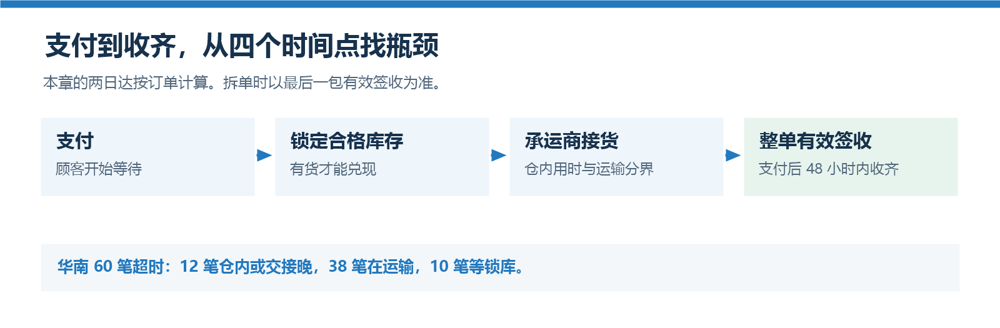
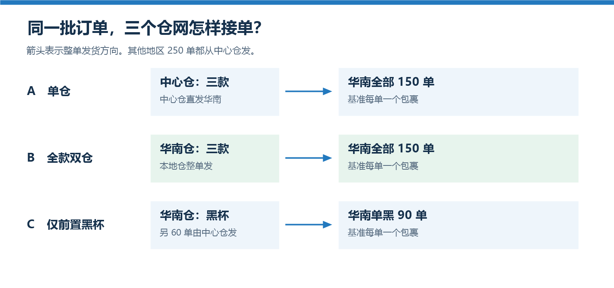
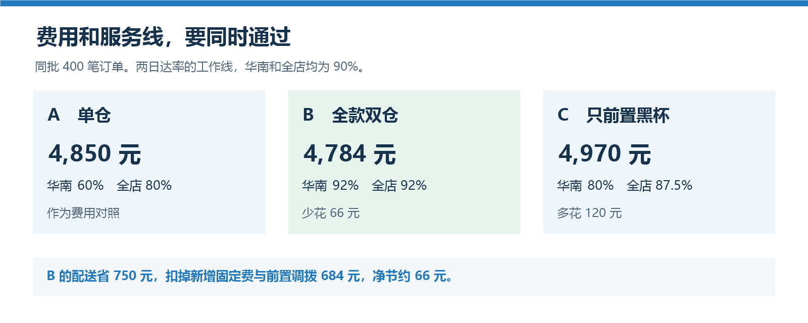
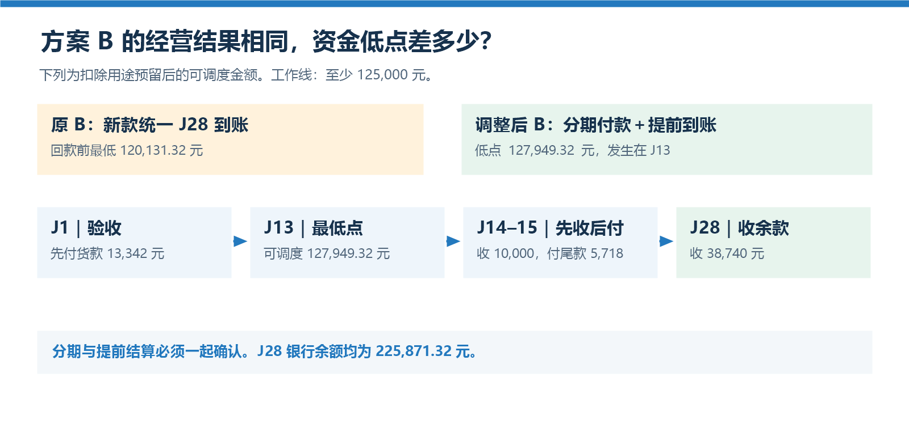
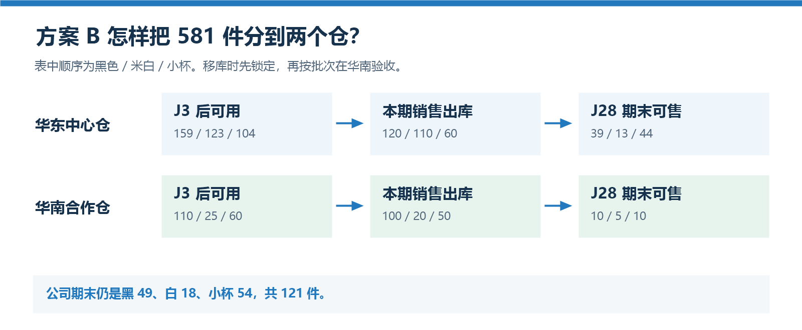
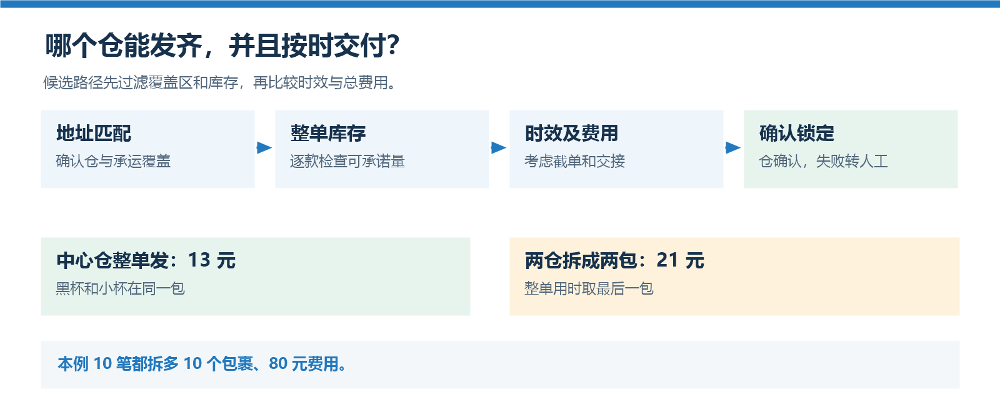
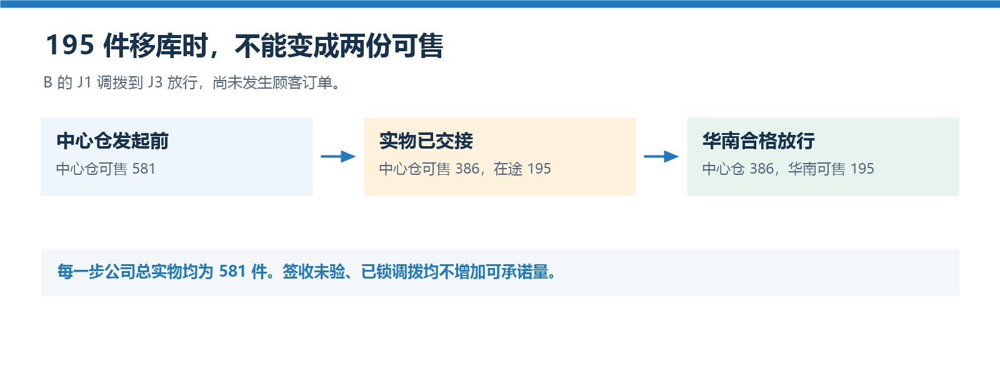
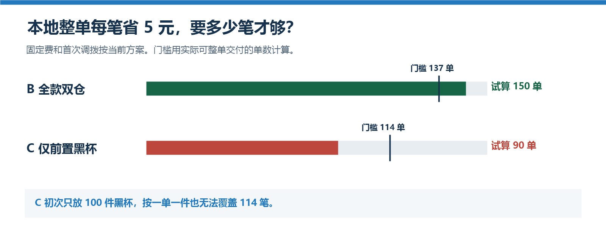
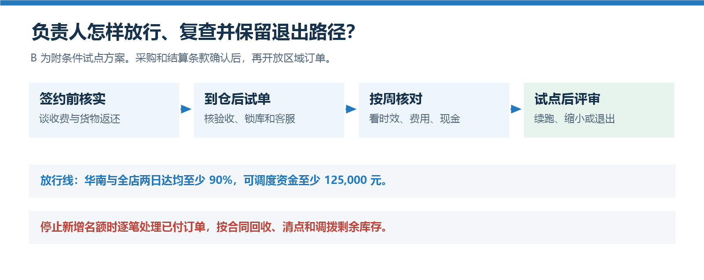

# 第十三章　从单仓到多仓：山禾生活要不要开华南仓？

**选修｜仓网与履约决策**

第十二章结课时，山禾生活已经能把销售、库存、服务和现金放到同一张经营表上。现在做一次新的管理评审：如果华南订单增长，从现有仓发货又偏慢，值不值得加一个华南合作仓？

合作仓报价：“送华南每单只要 5 元，你现在要付 10 元。”财务补了一句：“每月另有固定服务费，货要运过去，做不起来还得运回来。”仓库问：“顾客买了两个不同的杯子，两边各有一个，要发两个包裹吗？”

**学完本章**，你应能把客户收货承诺、仓库覆盖、分仓库存、发货路径和现金低点放进同一套方案，给出带放行条件的试点决定。

## 阅读顺序

| 节次 | 要解决的问题 | 交付物 |
|---|---|---|
| [第一节　华南收货慢，慢在仓内还是路上？](#section-01) | 找到影响时效的环节 | 区域履约诊断 |
| [第二节　把哪种订单交给华南仓？](#section-02) | 定义方案和共同服务目标 | 仓网与订单覆盖表 |
| [第三节　运费少一半，公司真的省钱吗？](#section-03) | 核算整网费用和现金 | 三方案费用和资金对照 |
| [第四节　两座仓各放多少货？](#section-04) | 分配首批库存并设置调拨触发 | 分仓与补调计划 |
| [第五节　一个订单有两个商品，哪个仓发？](#section-05) | 设计可执行的发货规则 | 订单路由决策表 |
| [第六节　货在路上，哪座仓可以承诺？](#section-06) | 核对在途、退件与两地库存 | 状态流水与异常交接 |
| [第七节　订单少了或仓停了，还能做吗？](#section-07) | 测算费用门槛与异常代价 | 压力测试表 |
| [第八节　今天该批准什么？](#section-08) | 把试点、复盘和退出写成决定 | 一页立项建议 |

先选方案，再读计算。学完后可用[章末多仓案例数据核对](#chapter-check)复盘。

## 案例约定与起点

本章是**接在第十二章 Z28 之后的独立选修推演**。采用彼时已核对的案例期末作为起点，为三种仓网配置另做 J1—J28 的计划。J 期订单、报价、到货和收付款是教学假设，单独核算，与第十二章 Q1 V1 是两套方案。用华东表示现有国内中心仓，用华南表示候选合作仓的服务范围。

| Z28 已核对的起点 | 金额或数量 |
|---|---:|
| 银行余额 | 201,705.32 元 |
| 银行中的用途预留 | 57,000 元，已包含在银行余额 |
| 国内平台待结／跨境待结 | 470／269 元 |
| 中心仓可售 | 黑 29 件 × 44 元、米白 8 件 × 42 元、小杯 84 件 × 34 元 |
| 可售存货合计 | 121 件，4,468 元 |
| 案例资产 | 206,912.32 元 |

继续使用第十二章的资金工作线：扣除 57,000 元用途预留后的可调度资金，若预计低于 125,000 元，先提交收付款调整。模型只列国内仓网决策涉及的收入费用，旧跨境待结沿用 269 元账面数，其他经营和税费在实务中另行核对。

---

## 第一节　华南收货慢，慢在仓内还是路上？

创始人看了大盘：“两日达有 80%，还行吧？”你先问两个问题：“80% 是按订单还是按包裹？华南单独是多少？”

**本节目标**　按顾客实际收到整单的口径，找出时效瓶颈。

### 1.1　给同一笔订单记四个时间

| 时点 | 要回答的问题 | 典型证据 |
|---|---|---|
| 支付 | 顾客从什么时候开始等 | 平台支付时间 |
| 合格库存锁定 | 所需商品都能发了吗 | 订单明细、SKU、仓和锁库时间 |
| 承运商实际接货 | 仓什么时候交出包裹 | 出库和揽收交接记录 |
| 整单有效签收 | 顾客何时收到全部商品 | 所有应发包裹的签收凭证 |

本章的两日达指**支付后 48 小时内整单有效签收**。拆成两包时取最后一包。未到观察截止点的订单单列待观察。同一批 400 笔已付订单在基准均正常交付，无取消或退款，超时仍计入分母。真实试点同步报告取消、缺货拒单和未签收量，避免靠取消难交付订单把达标率做高。

*图 13-1　分段计时可区分等库存、仓库作业和运输延迟。*

### 1.2　先看地区，再看原因

单仓按同一组需求试算，其他地区 250 笔有 230 笔按时，华南 150 笔只有 90 笔。全店 **320 ÷ 400 = 80%**，华南 **90 ÷ 150 = 60%**。

将华南 60 笔超时按第一处可处理原因互斥分类：12 笔仓内处理或交接晚，38 笔交接及时但运输用时长，10 笔等待库存锁定。同一订单可以保留其他原始异常标签，汇总时避免重复。改仓址主要改善运输，也会改变锁库分布。先请现有承运商给同一批地址的提速报价和时效记录，把“换快递”留作可评估的对照。

### 1.3　练习与参考答案

**练习。** 黑杯在支付后 30 小时到，小杯在 51 小时到。这单算两日达吗？

**参考答案。** 整单用时 51 小时，超过工作线。第一包可以计为按时包裹。订单与包裹各有自己的分母。

---

## 第二节　把哪种订单交给华南仓？

“黑杯卖得最多”还不能回答“黑杯仓能发多少笔订单”。顾客若同时买黑杯和小杯，只存黑杯的仓就无法整单发出。

**本节目标**　用相同的订单结构、售价和时效目标评估三种方案。

### 2.1　按地区和购物车拆需求

| 地区与订单构成 | 单黑 | 单白 | 单小杯 | 黑＋白 | 黑＋小杯 | 白＋小杯 | 两个小杯 | 订单 |
|---|---:|---:|---:|---:|---:|---:|---:|---:|
| 华南 | 90 | 10 | 30 | 0 | 10 | 10 | 0 | 150 |
| 其他地区 | 100 | 90 | 20 | 20 | 0 | 0 | 20 | 250 |
| 合计 | 190 | 100 | 50 | 20 | 10 | 10 | 20 | **400** |

| 地区 | 黑色件数 | 米白件数 | 小杯件数 | 商品件数 |
|---|---:|---:|---:|---:|
| 华南 | 100 | 20 | 50 | 170 |
| 其他地区 | 120 | 110 | 60 | 290 |
| 合计 | **220** | **130** | **110** | **460** |

400 单含 60 笔两件单。基准方案均由单个仓发齐一笔订单，共 400 个包裹。比较阶段固定需求和售价，提速带来的可能增量留给真实试点观察。订单安排于 J4—J25 支付，模型最长 72 小时内完成签收，J28 按完整观察期核对。

### 2.2　先定清覆盖，才有费用分母

| 方案 | 华南仓布货 | 华南由华南仓整单发 | 华南由中心仓整单发 | 其他地区 |
|---|---|---:|---:|---|
| A 维持单仓 | 无 | 0 | 150 | 中心仓发 250 单 |
| B 全款双仓 | 黑、白、小杯 | 150 | 0 | 中心仓发 250 单 |
| C 仅前置畅销款 | 只存黑杯 | 90 | 60 | 中心仓发 250 单 |

C 中那 10 笔黑杯加小杯仍由中心仓发齐。第五节把拆单作为独立选择。

*图 13-2　C 的 90 笔是南仓能整单发齐的单黑订单，华南其余 60 笔仍由中心仓发。*

### 2.3　两个区域口径都要过线

本次工作线是**华南两日达率至少 90%，全店也至少 90%**。按同一批地址回放预计时效，其余地区均为 230 笔按时。

| 方案 | 华南本地仓按时 | 华南中心仓按时 | 华南两日达 | 全店两日达 |
|---|---:|---:|---:|---:|
| A | — | 90／150 | 60.0% | 80.0% |
| B | 138／150 | — | **92.0%** | **92.0%** |
| C | 84／90 | 36／60 | 80.0% | 87.5% |

这里用试算表现选择试点方向，签约后还需用实际支付、交接与签收记录验证。现有中心仓的提速报价尚未拿到，若拿到可执行方案，纳入同口径比较。

### 2.4　练习与参考答案

**练习。** C 的南仓 84／90 已超过 90%。为什么华南整体未过线？只增加黑杯能解决吗？

**参考答案。** 另有 60 笔华南单走中心仓，其中 36 笔按时，合计 120／150 = 80%。中心仓余下的订单还有小杯、米白及跨 SKU 组合，增加黑杯无法让南仓把这些整单发齐。

---

## 第三节　运费少一半，公司真的省钱吗？

合作仓的 5 元是配送报价。你还要买到中心仓到华南的调拨服务，并承担两地作业、固定服务费和库存返还费用。

**本节目标**　把配送节约、网络增费和现金日期放进一份可重算的表。

### 3.1　先对齐采购与收入

三案共用一份假设采购。J1 中心仓合格接受黑 240、白 140、小杯 80，黑白每件 43 元，小杯每件 34 元，货款 **19,060 元**，含送到中心仓的费用。是否能签这种数量、价格及期限，要在试点前确认。

原款每件 119 元，小杯每件 99 元，多件单价格按相加计算。净销售 **350 × 119 + 110 × 99 = 52,540 元**。每笔最终保留订单的平台费 6 元，合计 2,400 元。各案广告 1,200 元，退回与报损另做情景。

中心仓保留原黑 29 件、原白 8 件，华南只转新批。三个方案中心仓的黑白出库都足够先用完旧批。

| SKU | 本次已售成本，元 | 期末可售与成本 |
|---|---:|---:|
| 黑色 | 29 × 44 + 191 × 43 = 9,489 | 49 × 43 = 2,107 |
| 米白 | 8 × 42 + 122 × 43 = 5,582 | 18 × 43 = 774 |
| 小杯 | 110 × 34 = 3,740 | 54 × 34 = 1,836 |
| 合计 | **18,811** | **121 件，4,717 元** |

移库随原批次成本转移。本教学模型将前置调拨费用计入履约，商品账面成本沿用上表。

### 3.2　把 5 元放回全网费用表

中心仓固定费 650 元，各案都付。开华南仓时另加固定服务费 450 元。包装与出库操作统一每包 3 元。中心仓发其他地区 6 元，发华南 10 元，华南本区发 5 元。前置调拨每件 1.20 元，无另计启动费。华南固定费与逐包费用是报价中的两项。

| 履约项目，元 | A 单仓 | B 全款双仓 | C 仅前置黑杯 |
|---|---:|---:|---:|
| 中心仓固定费 | 650 | 650 | 650 |
| 华南仓固定费 | 0 | 450 | 450 |
| 400 包操作与包材 | 1,200 | 1,200 | 1,200 |
| 其他地区配送 | 1,500 | 1,500 | 1,500 |
| 华南配送 | 1,500 | 750 | 1,050 |
| 华南前置调拨 | 0 | 195 × 1.20 = 234 | 100 × 1.20 = 120 |
| **全网履约费** | **4,850** | **4,784** | **4,970** |
| 相对 A | — | **少 66** | **多 120** |
| 每保留订单履约费 | 12.13 | 11.96 | 12.43 |
| 列示经营结果 | 25,279 | **25,345** | 25,159 |

华南首次调拨量按当地计划出库加留仓余量计算。B 为 170 + 25 = 195 件。C 为 90 + 10 = 100 件，其中计划出库的 90 件对应南仓整单发出的 90 笔单黑订单。分款明细见[第 4.1 节](#stock-allocation)。

列示结果等于净销售减平台费、已售成本、广告和全网履约费。B 配送省 750 元，新增固定费和调拨合计 684 元，差额只剩 66 元。

*图 13-3　同批订单下 B 达到两项时效工作线，较 A 省 66 元。此处费用还未计入试点结束时的退仓。*

### 3.3　检查钱什么时候进银行

基准约定 J1 先收国内旧待结 470 元，随后付全额货款、广告、固定费和已发起的调拨费。J4—J27 逐包费用在新回款前全部支付。平台净应结 50,140 元，其中 48,740 元于 J28 入账，余 1,400 元待结。旧跨境待结 269 元另列。

| 财务节点，元 | A | B | C |
|---|---:|---:|---:|
| 新回款前银行低点 | 177,065.32 | 177,131.32 | 176,945.32 |
| 扣用途预留后的最低可调度 | 120,065.32 | 120,131.32 | 119,945.32 |
| J28 银行余额 | 225,805.32 | 225,871.32 | 225,685.32 |
| J28 待结及存货 | 6,386.00 | 6,386.00 | 6,386.00 |
| J28 案例资产 | 232,191.32 | 232,257.32 | 232,071.32 |

以 B 为例，低点 **201,705.32 + 470 − 19,060 − 1,200 − 4,784 = 177,131.32 元**。减去预留后低于 125,000 元工作线。期末资产 232,257.32 元可由期初 206,912.32 元加本期列示经营结果 25,345 元算回。

### 3.4　把 B 的付款顺序改成可评审方案

提出一组**待确认条件**：供应商接受 J1 验收后先付 70%（13,342 元）、J15 再付 30%（5,718 元）。平台能把本期结算中的 10,000 元提前到 J14，J28 入余下 38,740 元。若提前放款另收费，重新计入比较。

| B 改付款节奏 | 银行变动，元 | 节点余额，元 |
|---|---:|---:|
| J1 收旧款，付 70% 货款、广告、两仓固定与调拨 | +470 − 13,342 − 1,200 − 650 − 450 − 234 | 186,299.32 |
| J4—J13 逐包费用 | −1,350 | **184,949.32** |
| J14 新结算到账 | +10,000 | 194,949.32 |
| J15 付货款尾款 | −5,718 | 189,231.32 |
| J15—J27 余下逐包费用 | −2,100 | 187,131.32 |
| J28 新结算余款 | +38,740 | 225,871.32 |

逐包费用合计 3,450 元。J15 节点按先付尾款再付余下逐包费用列示。J13 是这一安排的低点，可调度资金 **127,949.32 元**。J1 验收后暂有 5,718 元货款应付，J15 付清。B 的期末经营结果和银行余额与原方案相同。

*图 13-4　调整收付款日期改变期中资金低点，J28 银行余额相同。*

### 3.5　练习与参考答案

**练习。** 原 B 每期较 A 省 66 元，可以按 J1 全款批准吗？若允许后付尾款，但 J14 提前结算没有实现呢？

**参考答案。** 原 B 的可调度低点 120,131.32 元低于工作线。若 J28 才有新回款，且所有费用仍先付完，延付尾款后的低点也为 120,131.32 元。要核实两项新约定一起成立。

---

## 第四节　两座仓各放多少货？

仓库想把库存平分。你先把各地区订单拆成 SKU，再问两边的进货时间和腾挪余量。华南小杯出库预计 50 件，米白只有 20 件，为两款各放 50 件会把米白长期留在南仓。

**本节目标**　用区域订单推算首批分配，识别需要补调的日期和数量。

### 4.1　用首批分配表排期

J1 验收后，中心仓有 **黑 269、白 148、小杯 164**，共 581 件。B 转新批黑 110、白 25、小杯 60，C 只转新批黑 100。J1 发起调拨，按 J3 收货检验并放行的计划，J4 才开放华南仓本地订单。

| 方案与仓 | J3 后开始可用（黑／白／小杯） | 本轮销售出库 | J28 可售 |
|---|---:|---:|---:|
| A 中心仓 | 269／148／164 | 220／130／110 | 49／18／54 |
| B 中心仓 | 159／123／104 | 120／110／60 | 39／13／44 |
| B 华南仓 | 110／25／60 | 100／20／50 | 10／5／10 |
| C 中心仓 | 169／148／164 | 130／130／110 | 39／18／54 |
| C 华南仓 | 100／0／0 | 90／0／0 | 10／0／0 |

全公司期末都是黑 49、白 18、小杯 54。B 中心仓有 39 件黑杯，华南仓有 10 件。华南能否承诺本地时效，取决于本地可用量与替代路线。

*图 13-5　公司库存汇总相同。各仓库存的位置决定本地能兑现多少订单。*

### 4.2　调整数量时把时间算进去

单仓用同一处库存吸收各区波动。分仓后，另一个仓的现货要经过调拨才能覆盖本地需求。若两个仓都要独立保有更多安全库存，会增加库存资金。本章先固定总库存来比较位置。

独立调拨练习：B 到 J14，假设南仓已发黑 50、白 10、小杯 25，分别剩 60、15、35。原计划剩余黑杯需求 50 件，若改为 70 件：

| 计算 | 黑杯数量 |
|---|---:|
| 华南当时合格在库 | 60 件 |
| 更新后的剩余需求 | 70 件 |
| 单纯覆盖需求的缺口 | **10 件** |
| 若还想留下 10 件工作余量 | **需补 20 件** |
| 中心仓满足原地区全期需求后的余量 | 39 件 |

39 件说明全期数量有余，仍要逐日验证中心仓现货与已经锁定的订单。调拨 20 件需 24 元，实际发出前要确认到达及验收日期。看到的是预计到货时，先按本地能兑现的数量设置名额。调拨在缺口日之后放行，只能服务后续订单。

### 4.3　用规则触发补调

每日截单前按 SKU 核对本地净可承诺、已批准且能按时验收的在途、到达前的需求和工作余量。若出现缺口，先指出哪个日期缺几件，再比较中心仓整单发、调拨、限售或调整新订单的时效承诺。已经支付的订单，由客服确认可兑现的替代方案。

### 4.4　练习与参考答案

**练习。** B 华南若按调整后需求多出 20 件黑杯，并及时补调 20 件，会留下多少黑杯？公司库存怎样变化？

**参考答案。** 60 + 20 − 70 = 10 件。调拨只改变库存位置。公司合计的黑杯期末少 20 件，是因为额外需求转成了销售出库。

---

## 第五节　一个订单有两个商品，哪个仓发？

顾客买了黑杯和小杯，华南只有黑杯，中心仓两款齐。能不能先从华南发黑杯？你请仓库算两种费用，请客服看两包最晚什么时候到。

**本节目标**　把仓覆盖、库存、时效和费用写成可执行的订单路由规则。

### 5.1　先筛出实际能履约的路径

| 检查顺序 | 要核对什么 | 不满足时怎么办 |
|---|---|---|
| 地址 | 覆盖区、承运商服务范围 | 排除不适用路线 |
| 整单库存 | 每个 SKU 能锁多少，是否完成检验 | 找能发齐的替代仓 |
| 截单与承运 | 今天还能拣配、交接并按时送达吗 | 重新比较路线及承诺 |
| 成本与体验 | 包裹数量、逐包运费和预计签收 | 在可兑现的路径中择优 |
| 确认库存 | 仓返回锁定成功，取消可释放 | 失败则记录原因并交回运营 |

改派时对照同一订单和明细编号。确认原仓未交接承运且接到停止出库的回执，再在新仓确认锁定，并核对原仓释放。若改派失败，标记异常，由客服处理现有承诺。订单状态和仓库真实状态要对上。

*图 13-6　拆单后的整单送达时间取最后一包的有效签收时间。*

### 5.2　拆单看最后一包

用 C 的 10 笔黑杯加小杯订单比较。

| 单笔处理 | 包裹 | 履约费用 | 整单时效 |
|---|---:|---:|---|
| 中心仓整单发 | 1 | 3 + 10 = 13 元 | 以中心仓包裹签收为准 |
| 黑杯南仓、小杯中心仓 | 2 | 3 + 5 + 3 + 10 = 21 元 | 取两包中较晚的一包 |

若 10 笔都拆，从 400 包变成 410 包，多付 **80 元**。小杯仍走中心仓到华南，若它迟到，黑杯先到不能让整单提速。拆单可能在某仓库存不足时帮助保住订单，也增加包裹、签收和退货核对。基准 C 仍按整单发，拆单另外测算。

### 5.3　练习与参考答案

**练习。** 一个华南顾客买两个黑杯，华南净可承诺只剩一个，中心仓有两个，你先检查什么？

**参考答案。** 先查中心仓能否同时锁两件并兑现已作出的承诺。若能，走一包整单。若不能，再看跨仓后的两包送达时间、费用及顾客是否能接受。任一新方案都要核对原锁库的释放。

---

## 第六节　货在路上，哪座仓可以承诺？

J1，中心仓把 B 的 195 件交给干线。华南仓看到到货预报 195，客服问：“是不是可以接单了？”

**本节目标**　按调拨单和退货流水追踪货物位置、状态与可售数量。

### 6.1　区分仓内可售、在途和待检

| 状态 | 中心仓可售 | 调拨在途 | 华南仓可售 | 公司实物含在途 |
|---|---:|---:|---:|---:|
| J1 发起前 | 581 | 0 | 0 | 581 |
| 完成交接并划出中心仓 | 386 | 195 | 0 | 581 |
| J3 华南全部合格放行 | 386 | 0 | 195 | 581 |

业务上分别记录发起、锁定、实物交接、签收与验收。调拨锁定后、实物交接前仍在中心仓，但不能再对顾客承诺。签收后待检也不能提前加到华南可售。用调拨编号把 SKU、批次、件数和两边凭证连起来。

*图 13-7　华南签收后若仍待检，货已到场，但要等合格放行才增加当地可售。*

### 6.2　退到不同的仓，财务按原订单核对

一笔中心仓发出的黑杯订单，顾客按指引退到华南。先找原订单和退款状态，再扫码识别原 SKU 和批次。商品合格后恢复到实际所在地华南仓。品质待确认时先留在待检位。若要返原仓，再走一笔移库。

| 流程 | 订单侧记录 | 仓库侧记录 |
|---|---|---|
| 申请 | 金额、原因、是否需寄回 | 等待实物 |
| 寄回 | 原订单、退运单与接收仓 | 到货预报 |
| 华南收货 | 关联原发货仓和商品行 | 实物到场待检 |
| 合格放行 | 退款与回收入账核对 | 华南恢复同批次可售 |

独立情景：一件 J 期中心仓发出的新批黑杯，退款 119 元，按原账面成本 43 元恢复到华南，退回运费 8 元。假设整单只有这一件，平台退回 6 元费用，原包材与配送不退。相对顾客保留，此单列示结果变化 **−119 + 43 + 6 − 8 = −78 元**。退款和入库都要留单，时点可以不同。

### 6.3　处理合作仓差异

每天以调拨单核对中心仓出库、承运记录和华南接收。系统显示“已放行”，但现场还有一箱待检，仓配应先撤掉该箱的可承诺名额。调拨迟到时核对签单、时点和异常凭证，及时让运营评估替代路径。财务核对资产与费用，客服标明受影响订单。

### 6.4　练习与参考答案

**练习。** 195 件到华南后，194 件合格，1 件外箱破损待复检，怎样记录？

**参考答案。** 中心仓 386 件可售，华南 194 件可售、1 件待检，在途为零，公司总实物仍 581 件。待检商品留待验收结论，若确认报损再按批次核销。

---

## 第七节　订单少了或仓停了，还能做吗？

有人说“量大就能摊薄”，有人说“分仓以后两边都容易缺货”。你把争论改成三道可以复算的题。

**本节目标**　求出费用持平所需本地订单量，并测试需求、调拨和退仓风险。

### 7.1　算费用持平需要多少有效整单

同一笔华南订单从中心仓整单改为南仓整单，逐包操作不变，配送每单省 5 元。

| 方案 | 新增固定费及初次调拨 | 费用至少持平所需本地整单 | 本次试算 |
|---|---:|---:|---:|
| B 全款双仓 | 450 + 234 = 684 元 | 684 ÷ 5，向上取整 **137 单** | 150 单 |
| C 仅前置黑杯 | 450 + 120 = 570 元 | **114 单** | 90 单 |

137 单仅对应这份报价和首调量。C 只放了 100 个黑杯，即使用于一件单，最多覆盖 100 笔，现有分配达不到 114 笔。若增加货量、拆单或发生额外费用，应重算门槛。费用持平以后，还要过时效与资金工作线。

*图 13-8　固定费、每单配送差额或首调数量改变时，要重算费用持平的单量。*

### 7.2　测三种变化

| 独立情景 | 怎么算 | 建议动作 |
|---|---|---|
| 华南本地整单量降为 110 | 同样降低需求的 A 为对照，110 × 5 − 684 = **−134 元**节约，即 B 多花 134 元 | 调低预计量，重谈固定费或试用期 |
| 华南黑杯剩余需求多 20 件 | 见第四节，补并保留余量要转 20 件，再付 24 元 | 确保缺口日前验收，延误则限制新的本地承诺 |
| 南仓暂时停发，10 笔整单改走中心仓 | 多付配送差额 10 × 5 = **50 元** | 先确认中心仓库存，跟踪受影响的订单 |

停发时，中心仓要能锁足每笔订单的各 SKU。若华南库存一时无法移出，应查双方交接责任、货权、库存清单和接管时间。已经支付的订单逐笔核对时效。

若 J28 结束试点，按 1.20 元／件运回中心仓，B 的 25 件需 30 元，C 的 10 件需 12 元。相对 A，B 加退出后省 36 元，C 多支出 132 元。若这笔费用要在低点前预留，B 的调整后可调度资金可按 127,949.32 − 30 = 127,919.32 元保守估算。续约和做完即退出是两种预算。

### 7.3　练习与参考答案

**练习。** B 最终由华南发了 137 笔完整订单，另有 5 笔原本计划由中心仓整单发的订单改为两仓各发一包。按第五节每笔多 8 元估算，还能省费用吗？

**参考答案。** 137 × 5 − 684 只多出 1 元，再付 40 元，B 相对 A 多花 39 元。报表要把整单迁移与增加包裹分开计。

---

## 第八节　今天该批准什么？

创始人问：“B 的两日达最好，能不能签一年？”你把价格对照和现金时间表放到一起。费用差很小，应先取得可以兑现的服务和结算条件。

**本节目标**　按费用、时效和证据设放行条件，写清监控与退出路径。

### 8.1　先批有条件的验证

B 在本次试算中同时达到华南和全店两日达门槛。原付款顺序的资金低点未过线。建议取得分期付款与提前结算的有效约定，核实到仓、退件和锁库，再批准一轮 28 天的短期试点。若无法放行，延用单仓服务方案重新安排需求、时效和资金。

| 决策点 | 动作 | 负责人 |
|---|---|---|
| 签约前 | 核实覆盖、交接、收费、盘点、差异赔偿、退出与库存返还条款 | 供应链、财务 |
| 采购前 | 确认 70%／30% 约定及 J14 到账计划，按日期核对可调度资金 | 财务、采购 |
| 开仓前 | 按 SKU 和批次验收，演练下单、取消、改仓和退件 | 仓配、系统、客服 |
| 每日／每周 | 核对交付、取消、锁库、调拨与现金，汇总全网费用 | 运营、仓配、财务 |
| 试点结束 | 核对实绩、剩余库存和退出费用，决定续跑、缩小或退出 | 经营负责人 |

服务线为两项两日达率均至少 90%。费用以同批订单从单仓走的费用作对照，超出的金额和服务价值要另行批准。资金低点至少 125,000 元。若 J14 到账失约或验收失败，暂停新增名额，当天核对已付订单和到期付款，先把替代交付与资金重排报给负责人。

*图 13-9　试点结束时对照服务、费用和资金实绩，再决定续跑、缩小或退仓。*

### 8.2　交出三件作品

1. **一张仓网图**。标明供方、中心仓、华南仓、顾客与退仓路径。
2. **一份三方案对照表**。列相同订单和商品件数下的包裹、时效、费用、资金低点、库存分布和待确认条件。
3. **一页决策建议**。说明能批准的范围、审批证据、负责人、复查日期、退出条件与库存回收安排。

### 8.3　综合作业与参考答案

**作业。** 华南仓固定费升至 550 元，J14 放款还有待确认。用同一批需求重算 B 的费用、列示结果与费用门槛，说明现在可以批准哪些动作。

**参考答案。** B 履约费变为 **4,884 元**，比 A 多 34 元，列示结果 **25,245 元**。初次调拨 234 元不变，费用持平需向上取整至 **157 笔**本地整单，基准只有 150 笔。若分期与提前收款都成立，可调度资金低点降 100 元至 127,849.32 元。若 J14 没有放款且先付完本期支出，低点为 120,031.32 元。现阶段先批准核价、同址运输回放和退出安排，待资金及服务条件落实后再报试点申请。

**完成标准**　读者能交代哪种方案兑现服务、成本差多少、资金何时不足，以及触发变更后谁来处理。

---

## 附录　多仓案例数据核对

| 项目 | 核对数 |
|---|---|
| 同批比较 | J1—J28。400 单、460 件、基准 400 包 |
| 数量结存 | 121 + 460 − 460 = 121 件 |
| 存货金额 | 4,468 + 19,060 − 18,811 = 4,717 元 |
| 华南由华南仓整单发货 | A 0、B 150、C 90 |
| 华南两日达／全店两日达 | A 60%／80%，B 92%／92%，C 80%／87.5% |
| 三案全网履约费 | A 4,850，B 4,784，C 4,970 元 |
| 国内待结 | 52,540 − 2,400 − 48,740 = 1,400 元，旧国内款 470 元另收 |
| 原 B／调整后 B 可调度资金低点 | 120,131.32／127,949.32 元 |
| B 期末案例资产 | 225,871.32 + 1,400 + 269 + 4,717 = 232,257.32 元 |
| 费用持平门槛 | B 137、C 114 笔本地整单，按初始报价及首次调拨计算 |

延伸阅读可从 MIT 的[两日达电商履约网络研究](https://ctl.mit.edu/publications/network-design-two-day-e-commerce-fulfillment)入手，留意其如何同时比较库存、配送及服务水平。本章使用独立的教学数据。

[返回课程总览](../00-课程总览与十二章介绍.md)　｜　[上一章：从部门负责人到全链路经营管理者](../第十二章-从部门负责人到全链路经营管理者/第十二章-从部门负责人到全链路经营管理者.md)
