# 第十二章　从部门负责人到全链路经营管理者

从第一章的二十万元和一款杯子开始，山禾已经经历商品组合、多渠道、补货、供应商、仓配、增长、跨境试点以及组织和数据管理。现在银行有 205,805.32 元，但国内黑色只剩七件，跨境还有两件专用余量、50 SGD 保留款和一件当地隔离品。

创始人不再问“下次投多少钱”，而是问：“未来一年做什么、不做什么？商品、渠道、供应、人员和现金能不能一起支持这个决定？如果旺季、质量、汇率和需求同时变化，谁来调整？”

你现在承担经营负责人的任务：提出年度方案，只在条件明确的范围内执行第一步，用实际与压力情景修正判断，并向团队交付可继续运行的经营机制。

**本章完成目标**　能把战略取舍、商品与渠道、需求与采购、质量与履约、人员与组织、利润与现金连接成年度经营计划，组织压力测试及评审，核对首四周实际，并完成全课程综合实战。

## 阅读顺序

| 节次 | 要解决的问题 | 交付物 |
|---|---|---|
| [第一节　接手公司，先决定什么？](#section-01) | 起点、约束、选择与资源 | 年度经营任务与边界 |
| [第二节　增长目标怎样变成商品和需求计划？](#section-02) | 商品组合、渠道、增长证据与年度数量 | 分业务分 SKU 需求方案 |
| [第三节　采购便宜一点，全年就更好吗？](#section-03) | 起订、批次、供应与库存资金 | 年度供需及采购比较 |
| [第四节　年度赚钱，现金是否也够用？](#section-04) | 预算、人员、利润、应收与现金 | 联动年度经营预算 |
| [第五节　延期、退货、汇率和质量变化怎么办？](#section-05) | 单项与组合压力、旺季与恢复 | 情景推演及应急决定 |
| [第六节　部门怎样共同执行和滚动修正？](#section-06) | 授权、阶段、会议和预警 | 执行与经营评审机制 |
| [第七节　第一步执行后，实际结果怎样？](#section-07) | 限定执行、订单、批次与资金 | 首四周经营复盘 |
| [第八节　怎样证明自己能把全链路管起来？](#section-08) | 综合任务、参考方案及能力检验 | 年度经营评审和结课作品 |

各节提供所需参数，完成后可用[章末参数与结果核对](#chapter-check)复查。

## 案例起点与三个观察范围

本章承接第十一章 Y14，首四周实际称 **Z1—Z28**。年度方案指未来十二个自然月，按四个三月季度 Q1—Q4 汇总；执行前仍须按实际日历拆到月份和日期。Z1—Z28 只是第一个四周观察窗口，**不等于整个 Q1，更不等于已执行完整年度**。

| Z1 起点项目 | 数量或金额 |
|---|---|
| 人民币银行 | 205,805.32 元 |
| 国内待结算 | 306 元 |
| 跨境待结算 | 保留款 50 SGD，账面 260 元 |
| 国内可售黑色 | 7 件 × 42＝294 元 |
| 国内可售米白 | 21 件 × 42＝882 元 |
| 国内可售小杯 | 23 件 × 34＝782 元 |
| 国内仓跨境专用黑色 | 2 件 × 42＝84 元 |
| 可售存货合计 | 53 件、2,042 元 |
| 旧零账面隔离品 | 国内四件、新加坡一件；两地实际在场五十八件 |
| 案例资产合计 | 208,413.32 元 |

没有采购合同在途、采购预付、应付、未发锁定或外币银行余额；前章运输赔偿已确认并到账，不再重复计收益。57,000 元用途预留包含在银行内，本章仍不动用，不另加资产或重复扣银行。

本章分三类记录：**年度 V0 是条件预算；Z1—Z28 是实际；压力情景是独立演练**。采购报价、数量、人员费用和汇率均为虚构教学设定，不代表市场现价。年度原款新方案、未来扩品和后续跨境名额，须逐项满足条件，不能因进入预算就自动生效。

本模型继续用于经营学习，未按真实企业逐项计算国内税项、所得税及全部工资租金等。年度公共资源预算也不是完整财务报表的保证；真实方案须列明全部税费、人员、资产、融资和适用义务，未知项目不能无依据填零。本章称“模型结果”，不称完整企业净利润。

---

## 第一节　接手公司，先决定什么？

运营希望增加海外投放，采购希望按原供方最低单价补货，商品负责人想重新研究大容量杯。你没有先给每人加预算，而是先确定共同任务和取舍。

**本节目标**　把增长愿望变成有范围、有约束、能退回的经营任务。

### 1.1　先确定共同结果和不能透支的条件

山禾的任务是维持国内可兑现经营，逐步验证跨境重复经营能力，改善库存与资金效率，并让商品、服务及数据控制能持续运行。收入只是其中一个结果，还要看贡献、库存、承诺和现金。

| 经营问题 | 本轮选择 | 执行前必须确认 |
|---|---|---|
| 国内做什么 | 保留原款两色与小杯，按 SKU 限额及补货日期经营 | 商品、库存、作业和服务承诺 |
| 跨境做什么 | 本市场、本版本、小规模恢复验证；不同时开多个国家 | 整改、平台窗口、商品证据及链路复核 |
| 扩什么品 | Q2 预留 1,200 元作大容量方向研究，不签新品首批采购 | 用途、需求、差异、起订、证据和增量 |
| 如何供货 | 比较联动起订与分色方案，先解决四周窗口缺口 | 有效报价、质量、产能、交期和付款 |
| 是否海外备货 | 年度基准仍国内直发，不批准海外仓首批库存 | 真实需求、完整落地成本、当地责任与退出安排 |
| 人员与系统 | 使用既有责任机制，分阶段安排公共资源 | 能力缺口、工时、费用范围及验收；不自动替换系统 |

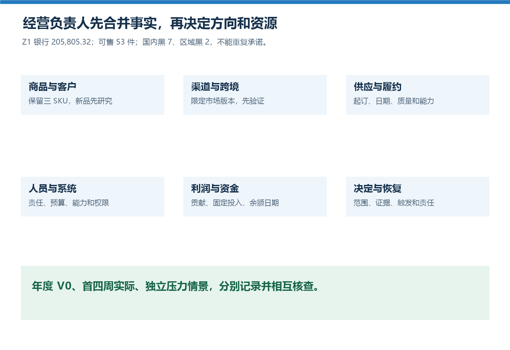

*图 12-1　目标、预测、预算和已经承诺的事项分别记录，共同决定可执行范围。*

### 1.2　有钱不等于所有方向都值得投入

现金余额较充足，但黑色库存紧、跨境样本小、白色起订可能形成余货。资金可以支持调查、缓冲和改进，不能替代需求或准入证据。

决定时同时比较“继续、缩小、推迟、改方案、退出”。例如研究大容量不代表马上添 SKU；国内直发不代表永远不能用海外仓；跨境恢复两单不代表已验证稳定增长。

**练习 12-1**　创始人同意年度方案研究，是否等于可以立即支付所有采购和新品费用？

**参考答案**　不等于。年度框架、预算、商品放行、具体合同和付款各有条件与权限。应按里程碑确认事实、资源和风险，再批准对应执行；没有形成的采购、预付和收入不进入实际。

**本节交付物**　一页年度经营任务：共同结果、选择、停止事项、约束、责任与复查条件。

---

## 第二节　增长目标怎样变成商品和需求计划？

“全年多卖一点”不能让采购排产。你要求运营解释每个季度由哪些商品、客群、渠道和增长动作支持。

**本节目标**　建立分业务、分 SKU 的年度需求假设，区分保留订单、发运和异常损耗。

### 2.1　年度数量是待验证假设，不是已经拿到的订单

V0 国内仍在 A，每单一件，原款实付 119、小杯 99，无新增折扣。跨境仍在 P，净商品收入每保留单 29.90 SGD；模型汇率统一 5.20，配送由山禾承担。大容量研究没有销售或采购数量。

| 年度 V0 需求，件或单 | Q1 | Q2 | Q3 | Q4 |
|---|---|---|---|---|
| 国内保留黑色 | 60 | 85 | 110 | 135 |
| 国内保留米白 | 55 | 75 | 95 | 115 |
| 国内保留小杯 | 65 | 80 | 95 | 110 |
| 国内保留合计 | 180 | 240 | 300 | 360 |
| 国内退回并恢复 | 6 | 8 | 10 | 12 |
| 国内实际出库预算 | 186 | 248 | 310 | 372 |
| 跨境保留黑色 | 20 | 40 | 60 | 80 |
| 跨境发出后退款且商品不可恢复 | 2 | 3 | 4 | 5 |
| 跨境实际出库预算 | 22 | 43 | 64 | 85 |

国内退回全部恢复，故商品最终消耗按保留数量；包装运输按出库，退回运费按退回。跨境情景中的异常商品不能恢复，商品消耗按跨境出库数计算。取消未发不消耗商品及履约费，支付数量待具体活动和取消假设进一步拆分，不用上述保留数冒充支付订单。

### 2.2　用证据和触发条件支持增长

国内每保留单广告预算依次为 20、19、18、17 元，对应 3,600、4,560、5,400、6,120 元；这是假设的混合分摊，不是已证明的广告增量获客成本。需要继续观察客群、内容、渠道、价格、复购、退款及缺货影响。

跨境广告预算为 300、600、900、1,200 元，相当于每保留单混合分摊 15 元；增长依赖商品、交付、页面和服务被验证，不能只因第二季度写四十单就加倍投放。若贡献和交付未改善，减少名额并重做预算。

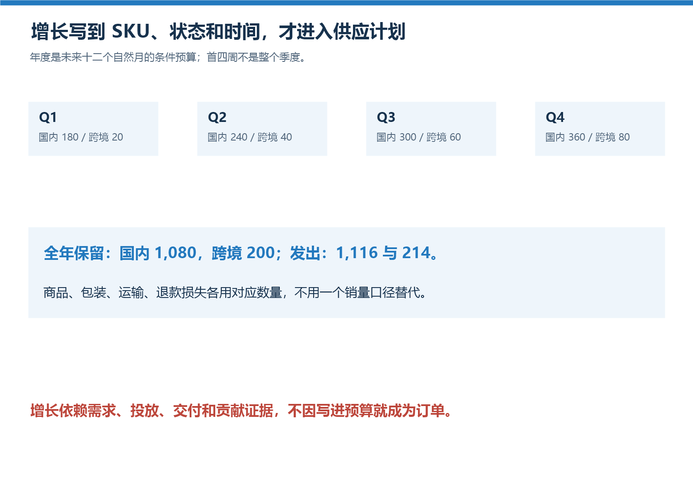

*图 12-2　数量、来源、费用和证据一起讨论；季度总量还要拆到日期与活动窗口。*

本轮不以折价清库存来伪造增量。米白若持续积压，应比较渠道、价格、替代、调拨和退出，但必须解释实际净收入、贡献和对其他商品的影响。

### 2.3　准入及价格口径沿用，不扩大适用范围

截至 **2026-11-18** 核查，新加坡 GST 标准税率为 9%；低价值货物销售环节征收仍有主体、货值及运输等适用条件，不能推断所有低值商品免税。[IRAS：当前税率](https://www.iras.gov.sg/taxes/goods-services-tax-%28gst%29/basics-of-gst/current-gst-rates)，[IRAS：进口低价值货物](https://www.iras.gov.sg/taxes/goods-services-tax-%28gst%29/consumers/gst-on-imported-low-value-goods)

本案例继续采用第十章已核实的 P 处理相应 GST、税款不计山禾收入的限定前提。每单商品净价 29.90、逐单税额 2.69、顾客付 32.59 SGD；真实舍入、发票和申报仍须按实际要求。新采购批次、其他国家或新品都要重新确认适用性，不能沿用一份报告宣布全球可售。

**练习 12-2**　Q4 国内保留三百六十、退回十二；跨境保留八十、异常五。采购和物流应分别用什么数量？

**参考答案**　国内商品最终净消耗三百六十，物流及包装按三百七十二次出库、逆向按十二；跨境出库八十五，八十五件均消耗商品，八十件保留销售、五件异常损失。不能全部按保留数量算运费或用支付额确认销售。

**本节交付物**　一份分商品、渠道、时间、状态及证据强弱的需求方案，含低于预期时的调整条件。

---

## 第三节　采购便宜一点，全年就更好吗？

原供方联动起订的单价是 42 元，另一份年度条件方案允许分色、但要 43 元。财务要求把全年余货和现金也放进比较。

**本节目标**　连接最低订量、采购日期、批次成本、质量及期末库存，形成可执行的供需方案。

### 3.1　42 元联动与 43 元分色，是两套不同条件

方案 A 延续原条件：原款黑白各一百件一批、42 元。方案 B 是本章新取得的**年度条件报价草案**：黑、白分别一百件起订、43 元，仍须逐批确认交期、质量、材料证据、合同和付款，尚未形成后续采购合同。不能把旧供方的约束直接删掉而不付任何代价。

首批黑色四十件由备选供方重新书面确认 44 元、本批十二天到仓；小杯本批八十件重新确认 34 元、十二天。它们属于首四周会实际执行的独立小批，年度预算也只纳入一次。

| 方案 B 预计接受采购，件 | Q1 | Q2 | Q3 | Q4 |
|---|---|---|---|---|
| 备选黑色，44 元 | 40 | 0 | 0 | 0 |
| 分色黑色，43 元 | 100 | 100 | 200 | 200 |
| 分色米白，43 元 | 100 | 100 | 100 | 100 |
| 小杯，34 元 | 80 | 80 | 160 | 80 |
| 采购总金额，元 | 13,080 | 11,320 | 18,340 | 15,620 |

年度预计采购黑色六百四十、米白四百、小杯四百，共 **1,440 件、58,360 元**。接受日期仍需倒排到每个 SKU 的缺口前；季度合计有货不证明月内每天都够。

### 3.2　保留批次成本，不用 43 元覆盖旧库存

年度模型先分配现有区域两件用于跨境；国内黑色先用旧七件 42 元，再用四十件 44 元，然后用后续 43 元批次。未来跨境其余二十件商品消耗来自 Q1 新主供批次，随后各季按 43 元；是否可转区域用途仍待对应放行。米白先用旧二十一件 42 元，再用新 43 元；小杯均为 34 元。

| 方案 B 存货与商品成本，元或件 | Q1 | Q2 | Q3 | Q4 |
|---|---|---|---|---|
| 国内已售商品成本，元 | 7,167 | 9,600 | 12,045 | 14,490 |
| 跨境保留商品成本，元 | 858 | 1,720 | 2,580 | 3,440 |
| 跨境异常商品成本，元 | 86 | 129 | 172 | 215 |
| 期末黑色件数 | 67 | 39 | 65 | 45 |
| 期末米白件数 | 66 | 91 | 96 | 81 |
| 期末小杯件数 | 38 | 38 | 103 | 73 |
| 期末件数合计 | 171 | 168 | 264 | 199 |
| 期末存货成本，元 | 7,011 | 6,882 | 10,425 | 7,900 |

Q1 国内黑色成本＝7 × 42＋40 × 44＋13 × 43＝2,613；米白成本＝21 × 42＋34 × 43＝2,344；小杯 65 × 34＝2,210，合计 7,167。不能把所有商品都按最新报价计算。

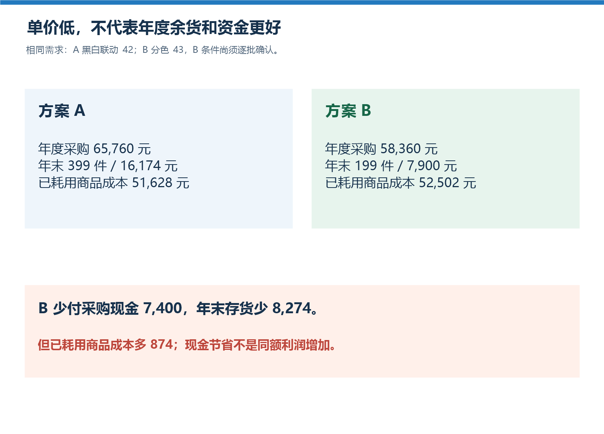

*图 12-3　较高单价可以换来较少余货，但要把商品成本和现金代价都算出。*

若用 A 达到相同黑色供应，四季主供联动批次为一、一、二、二批，全年会多买二百件米白。相同需求下，A 采购 **65,760 元**、期末可售 **399 件、16,174 元**；B 采购 58,360、期末 199 件、7,900 元。B 少付采购现金 **7,400 元**，期末存货少 **8,274 元**，但全年已售及异常商品成本反而多 **874 元**。

因此“省采购现金”不是同额利润增加。是否值得接受多出的已耗用商品成本，要结合余货风险、资金、供应稳定和其他选项决定。这里选择 B 作为**有条件的年度 V0**，不是宣称 B 永远最优；条件未确认时必须退回重排。

### 3.3　首十二天缺口先按日期解决

实际起点国内黑色七件。首十二天计划出库黑六、白六、小杯八，共二十件；黑剩一，不能把 Z13 的到货提前作为 Z5 库存。

Z1 确认备选黑四十、小杯八十，共 4,480 元，30% 预付 1,344；Z11 支付尾款 3,136，Z13 全部合格接受，供方本批交期和放行均有记录。该实际采购不是年度分色 43 元方案的签单。

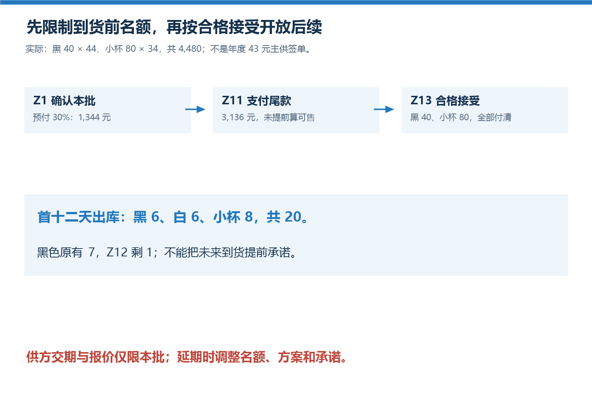

*图 12-4　先限制到货前名额，再按实际接受放开后续；未来采购仍不加入实际。*

**练习 12-3**　为什么方案 B 的采购现金少 7,400，但商品成本多 874？能否把两者都当成本节创造的利润？

**参考答案**　现金采购同时形成存货，A 有更多余货留在资产中；B 单价较高，使已消耗商品成本增加。用期初成本 2,042＋采购−期末存货核对，A 已耗用 51,628、B 52,502，差 874。不能把现金节省再作为利润加一次，也不能假设余货账面价值必然能全额回收。

**本节交付物**　一份按数量、日期、批次、价格、付款及期末余货比较的供应方案。

---

## 第四节　年度赚钱，现金是否也够用？

财务算出年度有正结果，采购却提醒第三季度有集中采购。你要求同一份模型同时说明费用、资产、回款和付款。

**本节目标**　建立可复算的年度经营预算，区分商品成本、采购付款、固定资源和现金缓冲。

### 4.1　先补齐费用范围和人力资源安排

下表与第二、三节共同组成方案 B 的 V0 参数。国内平台费每保留单 6、出库包装 3、快递 6、退回运费 8；跨境综合平台支付费每实际发出单 3 SGD、包装 6、交付 32、变动客服每保留单 4。除 SGD 收费按 5.20 折算外，均为人民币。

| 年度其他费用预算，元 | Q1 | Q2 | Q3 | Q4 |
|---|---|---|---|---|
| 国内广告 | 3,600 | 4,560 | 5,400 | 6,120 |
| 国内会员客服 | 400 | 500 | 600 | 700 |
| 国内仓储操作 | 1,200 | 1,400 | 1,600 | 1,800 |
| 跨境广告 | 300 | 600 | 900 | 1,200 |
| 跨境当地异常处理 | 80 | 120 | 160 | 200 |
| 跨境固定整改及维护 | 600 | 300 | 300 | 300 |
| 人员、计划及公共管理资源 | 6,000 | 6,000 | 6,000 | 6,000 |
| 收款手续费 | 25 | 20 | 20 | 20 |
| 大容量方向研究 | 0 | 1,200 | 0 | 0 |
| 旧零账面隔离品处置 | 100 | 0 | 0 | 0 |

公共资源 24,000 元是本模型新增范围，包含现有安排下的统筹、计划与管理服务预算；不是对真实员工人数或工资水平的建议。要把工作量、能力、内部工时、外包及持续维护列清，再决定招聘或服务，不能只填一个总额。

客服、仓储、跨境变动服务、固定整改及公共管理各有范围，不重复计同一工作。Q1 公共资源中首四周将实际支出 2,000，其余 4,000 仍为未来；Q1 收款费 25 包含旧 50 SGD 回款预计费用 5。上章已发生的项目费及研究费不再次加入本年费用。

### 4.2　预算结果应能逐项重算

例如 Q1 国内净销售＝115 × 119＋65 × 99＝20,120；减商品 7,167、平台 1,080、包装 558、快递 1,116、退回 48、广告 3,600，交易贡献 6,551；再减会员 400、仓储 1,200，国内结果 4,951。

Q1 跨境净销售＝20 × 29.90 × 5.20＝3,109.60；减保留商品 858、异常商品 86、平台 343.20、包装 132、交付 704、广告 300、客服 80、当地处理 80，交易贡献 526.40。异常按实际情景列商品和处理成本，不再叠加第九章的损失均摊。

| 年度模型结果，元 | Q1 | Q2 | Q3 | Q4 |
|---|---|---|---|---|
| 国内净销售 | 20,120.00 | 26,960.00 | 33,800.00 | 40,640.00 |
| 跨境净销售 | 3,109.60 | 6,219.20 | 9,328.80 | 12,438.40 |
| 国内模型经营结果 | 4,951.00 | 7,164.00 | 9,485.00 | 11,926.00 |
| 跨境交易贡献 | 526.40 | 1,185.40 | 1,846.40 | 2,507.40 |
| 合计模型结果 | −1,247.60 | 829.40 | 5,011.40 | 8,113.40 |

合计还扣表中跨境固定、公共资源、收款、研究和处置等费用。全年国内保留 1,080、跨境保留 200，净销售 **152,616 元**，模型结果 **12,706.60 元**。这是多项条件成立后的预算，不是收益承诺；也不能由此断言跨境单独承担全部公共资源后仍然盈利。

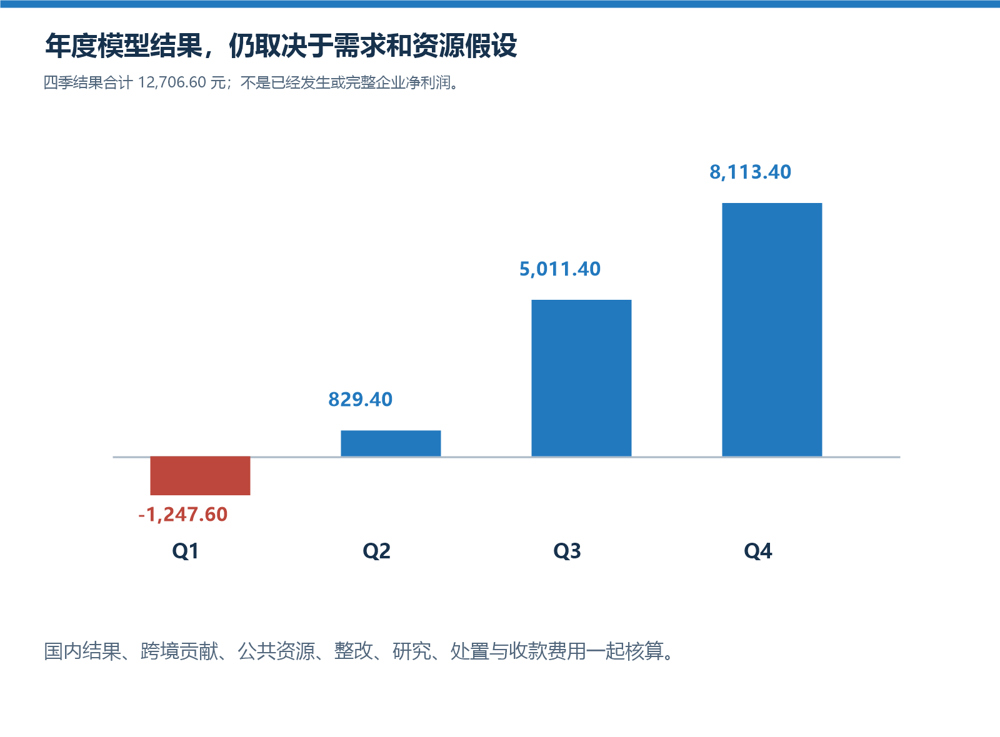

*图 12-5　区分业务贡献、公共资源与完整模型结果，保留季度和业务线明细。*

### 4.3　从回款和采购重建现金预算

基准预算假设所有 SGD 的交易、结汇和期末估值都按 5.20，无汇兑差额；期初保留款 50 SGD 在 Q1 满足条件后收回。各季采购在当季付款并接受，期末无采购预付或货物应付；不表示季内不存在预付阶段。

国内期末待结依次 500、600、700、800 元；跨境期末待结依次 60、80、100、120 SGD。每季净收款＝国内净销售−国内平台费＋期初国内待结−期末国内待结，加跨境同口径净收款；综合费已在收款前扣除，不再从银行付一次。

| 年度现金及资产预算，元 | Q1 | Q2 | Q3 | Q4 |
|---|---|---|---|---|
| 银行收款预算 | 21,560.40 | 30,864.40 | 40,126.40 | 49,388.40 |
| 银行付款预算 | 28,023.00 | 30,110.00 | 38,862.00 | 38,954.00 |
| 期末银行 | 199,342.72 | 200,097.12 | 201,361.52 | 211,795.92 |
| 期末国内待结 | 500.00 | 600.00 | 700.00 | 800.00 |
| 期末跨境待结折算 | 312.00 | 416.00 | 520.00 | 624.00 |
| 期末存货 | 7,011.00 | 6,882.00 | 10,425.00 | 7,900.00 |
| 期末案例资产 | 207,165.72 | 207,995.12 | 213,006.52 | 221,119.92 |

年末资产＝期初 208,413.32＋全年结果 12,706.60＝221,119.92。银行增加只有 5,990.60，因存货和待结占款增加；不能把利润全部当成可分配现金。

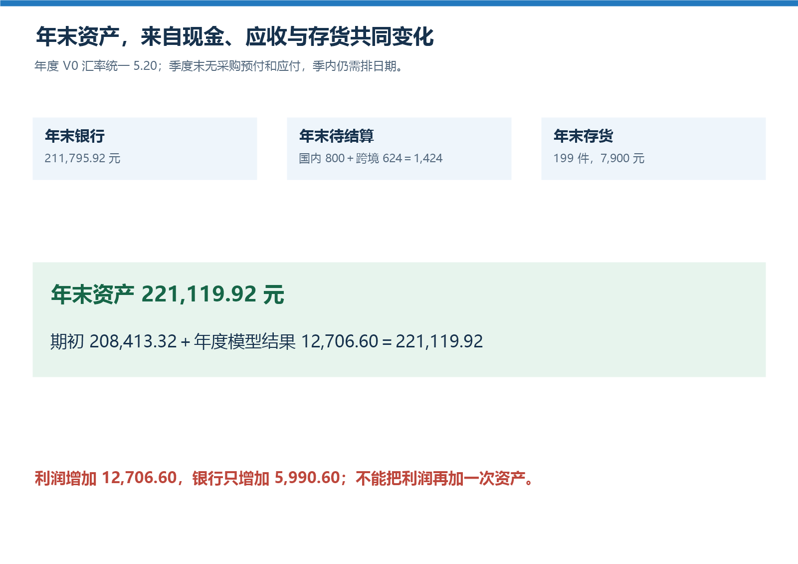

*图 12-6　季度末余额不能替代季内资金低点；采购、回款和用途预留还要拆到日期。*

进一步按周、付款节点和回款条件做资金低点表，保留已批准未付、订货预付、退件、税款及风险缓冲。遇到缺口先检查收款、库存、付款条款和方案规模，再评估融资，不假设资金可以无限补充。

**练习 12-4**　年末预测银行 211,795.92、存货 7,900、待结合计 1,424，是否可把全年结果再加一次资产？

**参考答案**　不能。它们合计已经是 221,119.92，包含全年模型结果；再加利润会重复。年度结果 12,706.60 也不是全部现金增加，更不是已执行后的真实净利润。

**本节交付物**　一份利润、库存、应收及现金相互核对的预算，附人员资源、费用范围及季内资金日期。

---

## 第五节　延期、退货、汇率和质量变化怎么办？

经营评审时，团队不能只说“加强管理”。你给出具体冲击，要求每人算数量、费用、现金和承诺，再说如何调整。

**本节目标**　区分单项和组合情景，先保护安全与承诺，再安排恢复和资源。

### 5.1　延期和旺季，先看时间与能力

**独立延期演练**：首批从 Z13 延到 Z16。原计划 Z13—Z15 出库黑四、白二、小杯三，而 Z12 黑只剩一，因此在到货前黑色缺 **三件**。不能用白色余货覆盖黑色，也不能默认把区域两件改给国内；应重新分配名额、批准可行替代或沟通符合规则的交期。

**独立旺季演练**：一个窗口九十个一杯订单，常规每小时六十件，确认支援二十件，总能力八十，缺十。需要减少名额、增加经过验证的能力或调整承诺，并核包材、库存、交接和安全；不是在表中把产能直接填成九十。

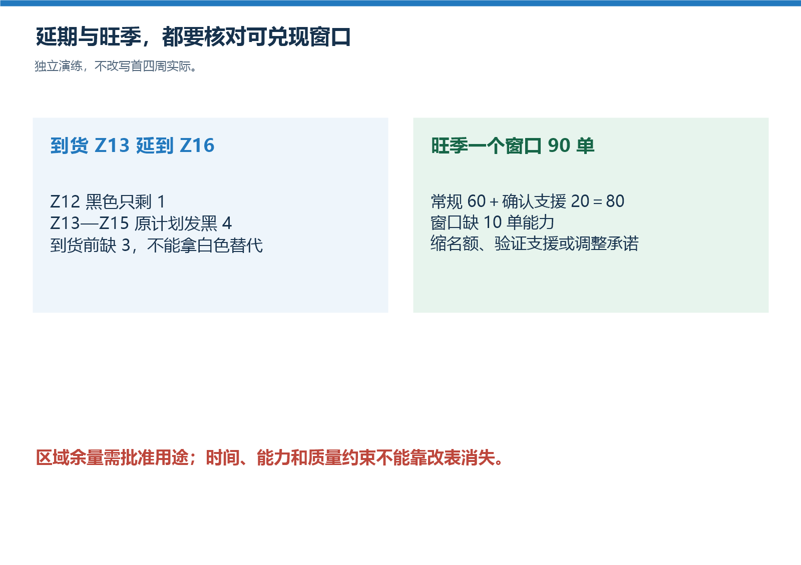

*图 12-7　货物总量够与窗口能兑现，是两项不同约束。*

### 5.2　组合压力不能只把总费用乘一个比例

以 Q4 为基准，分别作如下**未来独立情景**：运费由 32 升 42；或 SGD 从 5.20 变为 5.00；或同时发生国内和跨境保留需求下降 20%、交付 42、SGD 5.00。采购已经按原数量接受并付款，不假设全部可取消。

组合情景国内保留黑 108、白 92、小杯 88，合计 288，退回仍十二，发运三百；跨境保留六十四，异常仍五，发出六十九。广告、国内会员仓储、公共资源、当地处理等固定额度不随销量自动下降，客服按跨境保留数量变化。

汇率变化同时影响商品净收入和 3 SGD 综合费；Q3 留下的 100 SGD 待结在 Q4 按 5.00 收回，还比原账面少二十元。不能只改海外售价换算而漏掉费用及旧余额。

| Q4 独立压力情景 | 模型结果，元 | 期末银行，元 | 期末存货，元 |
|---|---|---|---|
| 基准 | 8,113.40 | 211,795.92 | 7,900.00 |
| 仅交付升为 42 | 7,263.40 | 210,945.92 | 7,900.00 |
| 仅 SGD 降为 5.00 | 7,666.00 | 211,372.52 | 7,900.00 |
| 需求减 20%＋交付 42＋SGD 5.00 | 2,034.00 | 202,154.52 | 11,486.00 |

组合情景年末国内待结仍按工作假设 800，跨境仍 120 SGD、折 600；期末资产 **215,040.52**，等于 Q3 末 213,006.52＋Q4 结果 2,034。相对基准，利润少 6,079.40、存货多 3,586、待结少 24，所以银行少 **9,641.40**。现金下降比结果变化更多，原因正是余货占款。

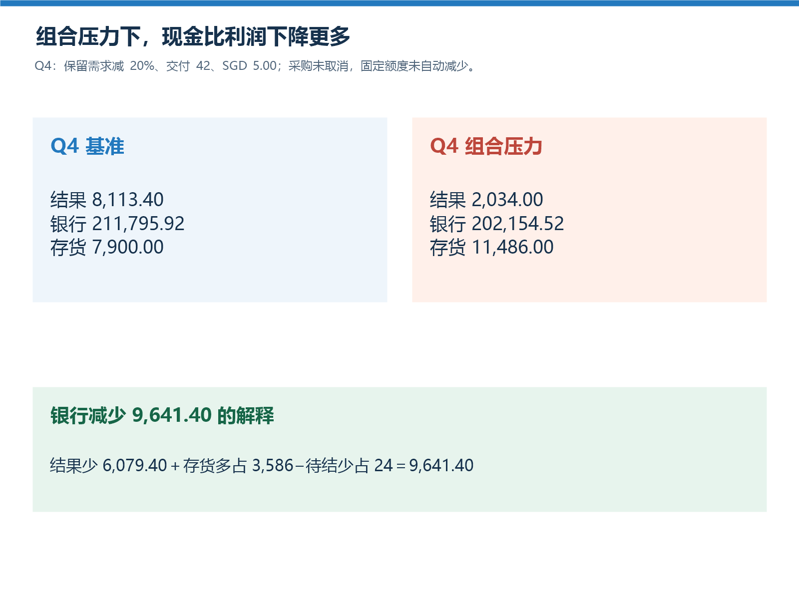

*图 12-8　需求下降时，采购与广告未必同步取消；库存和汇率会放大现金差异。*

### 5.3　质量范围不明时，不能只隔离最少数量

**独立质量演练**：新接受黑色四十件中，可追溯子批十件出现疑点，应先冻结对应十件、成本 440 元，并由质量负责人判断关联范围；范围不明时扩大核查或冻结，不能为了不断货武断缩成十件。

待验不等于立即报损；若最终确认其中五件不可恢复，则按 44 元确认 **220 元商品损失**，索赔未确认不能先冲掉损失。客服、页面、相关订单及适用通知或召回责任也要核实，恢复必须凭证据和授权。

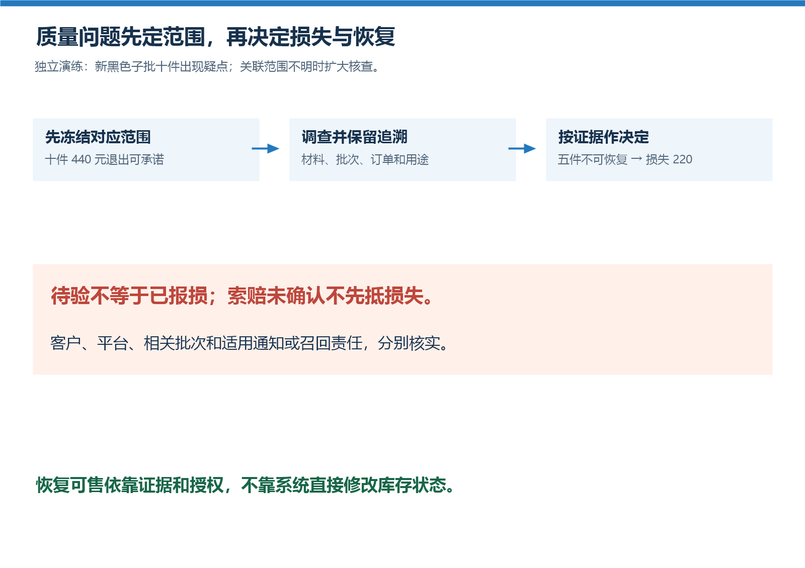

*图 12-9　状态冻结、损失确认、索赔和恢复分别处理，不用系统改成可售替代质量放行。*

温控、冷链、食品保质期、危险品或带电商品，还需按品类补齐温度、期限、运输和准入约束。例如临期不能只看总数量，冷链不能只看签收时点；本课杯子流程不直接等于这些品类的完整操作规范。

**练习 12-5**　组合情景结果仍为正，是否可以维持原计划？十件质量待验是否就是已亏 440 元？

**参考答案**　正结果不代表库存和现金代价可接受，还要看季内低点、余货价值、后续费用及供货风险，需滚动修正。待验先改变可用状态，是否减值或报损依据实际证据；最终五件不可恢复才按给定假设损失 220，不提前计赔偿。

**本节交付物**　一份情景参数、数量、财务、承诺、触发动作、责任和恢复证据相连的压力测试。

---

## 第六节　部门怎样共同执行和滚动修正？

年度方案通过不代表所有岗位可以独立执行到年底。每个阶段仍需把需求、质量、资源、合同和资金重新合到一起。

**本节目标**　把预算批准、业务放行、日常执行及滚动评审连接起来。

### 6.1　分阶段批准，不能一次授权覆盖全年

| 阶段 | 核心决定 | 本轮范围 |
|---|---|---|
| 年度任务与 V0 | 方向、资源、情景和约束 | 条件预算，不形成全部合同 |
| 首四周执行 | 明确数量、供方、费用及日期 | 黑四十、小杯八十；有限国内经营；跨境两件复核后恢复 |
| 具体商品与交易放行 | 版本、批次、平台、税款及履约 | 不因年度批准就覆盖新品和其他国家 |
| 后续季度及扩张 | 实际验证、供应、完整费用与资金 | 逐阶段再评审，必要时缩小或停止 |

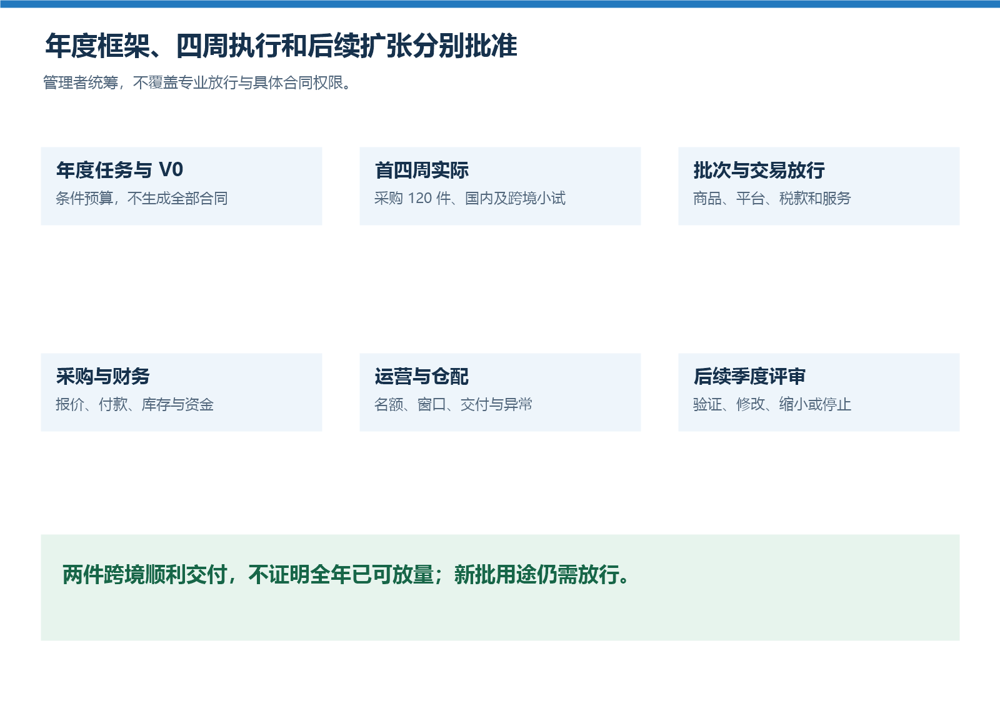

*图 12-10　经营负责人统筹资源，质量、财务、采购及消费者责任各有专业边界。*

本轮在 Z13 前完成跨境历史丢件分析、服务条款与路线交接复核、页面承诺及客服流程整改，支出固定服务 600 元。确认原两件 v1 的证据范围及平台销售窗口仍适用后，批准两件定向小试，不放开更多名额；备选新批四十件没有转为跨境用途。

跨境两单不是稳定能力证明。后续数量、原款分色条件、新品研究、海外仓及生产系统自动执行，都留在相应批准节点。

### 6.2　同一份记录支持日常、周度和经营评审

日常处理订单、缺口、质量及收款异常；周度合并需求、供应、活动和资金；经营评审比较 V0、实际与后续 V1。记录问题、事实、选项、代价、责任、批准、期限和复查，沿用第十一章字典及权限。

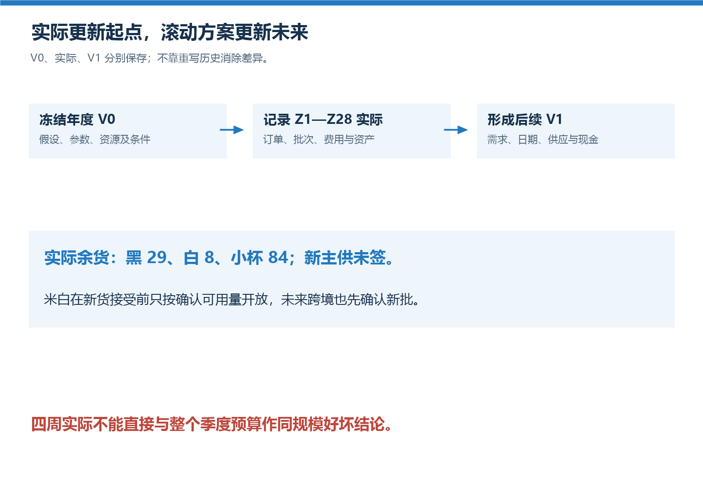

*图 12-11　实际更新起点，V1 更新未来，V0 保留解释原决定；不靠改历史消除差异。*

对方口头承诺、预警提示、采购申请、合同、预付、在途、接受和可售必须分开。付款、改资料、库存调整和质量放行按授权执行，管理看板不能自己给供方发采购或重发顾客订单。

**练习 12-6**　跨境两单顺利完成后，运营能否按 Q2 的四十单目标直接开放名额并把新批黑杯全部出口？

**参考答案**　不能。需评估本轮小样本、实际贡献、后续商品批次证据、库存、链路、平台与资金。新批未放行区域用途，年度目标也不是开放名额的自动授权。

**本节交付物**　一份阶段授权、责任矩阵、会议节奏与实际和滚动版本的管理安排。

---

## 第七节　第一步执行后，实际结果怎样？

年度预测没有发生完，第一批真实订单已经留下结果。你用同一截止日核对，不拿一年的收入掩盖四周费用，也不拿四周费用断言全年方案必败。

**本节目标**　核对首四周采购、国内和跨境订单、批次、旧款、处置及资金。

### 7.1　国内执行与采购接受

本轮国内无新增优惠，一单一杯。平台按保留单收 6；出库包装 3、快递 6；退回每件运费 8。Z13 接受黑四十、小杯八十，成本 4,480，全部款已付，无未收采购。

| Z1—Z28 国内订单 | 黑色 | 米白 | 小杯 | 合计 |
|---|---|---|---|---|
| 支付 | 20 | 14 | 20 | 54 |
| 发货前取消 | 1 | 0 | 1 | 2 |
| 实际出库 | 19 | 14 | 19 | 52 |
| 退回并退款 | 1 | 1 | 0 | 2 |
| 最终保留 | 18 | 13 | 19 | 50 |
| 退回恢复 | 1 | 1 | 0 | 2 |

实际首十二天出库黑六、白六、小杯八，符合到货前名额；剩余三十二件在 Z13 到货后至 Z22 发出，退回在截止前收到恢复。黑退件来自新 44 元批次，白退件为旧 42 元，没有新增报损或补寄。

净销售＝31 × 119＋19 × 99＝**5,570 元**，也等于支付 6,026−取消 218−退回退款 238。已售成本＝黑旧七件 294＋黑新十一件 484＋米白十三件 546＋小杯十九件 646＝**1,970 元**。

| 国内实际经营，元 | 金额 |
|---|---|
| 净销售 | 5,570.00 |
| 已售商品成本 | 1,970.00 |
| 平台费 | 300.00 |
| 包装 | 156.00 |
| 出库快递 | 312.00 |
| 退回运费 | 16.00 |
| 广告 | 900.00 |
| 交易贡献 | 1,916.00 |
| 会员客服 | 100.00 |
| 仓储操作 | 700.00 |
| 国内模型结果 | 1,116.00 |

旧待结 306 在 Z1 收回。本期净应结 5,570−300＝5,270，Z28 收 4,800，期末国内待结 **470 元**。

### 7.2　两单跨境与旧保留款

两笔跨境订单 Z14 后支付、Z16 发出，Z22 和 Z24 签收并保留，无取消、退款、丢件或补寄。使用原两件区域专用品 42 元；顾客共付 65.18 SGD，其中 GST 5.38，商品净款 **59.80 SGD**。无付费获客，本轮来自已获授权的定向沟通，不据此承诺未来广告费为零。

商品净款按 5.20 折 310.96 元；P 综合费 6 SGD 折 31.20，商品 84、包装 12、交付 64、客服 16，交易贡献 **103.76 元**。服务商本批有效报价由原 35 改为 32，范围仍明确，不自动永久适用。

本期新净待结为 53.80 SGD，未到账，Z28 按 5.00 折 **269 元**，相对原记账 279.76 形成汇兑损失 **10.76 元**。

旧保留 50 SGD 经 P 在 Z14 确认满足释放条件，按 5.10 全部结汇，手续费前收 255，较原账面 260 形成已实现汇兑损失 **5 元**；另付收款手续费 5，银行净增 250。没有外币银行余额，没有再将旧款计销售。

跨境结果＝103.76−整改 600−汇兑 15.76−手续费 5＝**−517 元**。仅有两笔且获客来源特殊，不能说跨境已稳定赚钱。

### 7.3　隔离处置、公共资源和本期结果

Z18 根据批准及服务商可核验证据，国内旧零账面四件完成合法回收，付 40；新加坡零账面一件完成当地合法处置，付 60，均以人民币支付，无残值收入。五件离开原保管范围，不再计实物；因账面原已为零，**不再重复计商品报损**，只计 100 元新处置费用。

本期统筹及计划管理服务完成，实际支出 **2,000 元**，列公共资源，不与仓储、会员、跨境客服及整改重叠。没有新增固定资产或隐含招聘。

> 首四周模型结果＝国内 1,116＋跨境 −517−公共资源 2,000−处置 100＝**−1,501 元**。

### 7.4　库存、资产和现金核对

| Z28 可售批次 | 期初 | 新接受 | 出库 | 恢复 | 期末 | 单位成本 | 期末成本 |
|---|---|---|---|---|---|---|---|
| 国内黑旧 42 批 | 7 | 0 | 7 | 0 | 0 | 42.00 | 0.00 |
| 国内黑新 44 批 | 0 | 40 | 12 | 1 | 29 | 44.00 | 1,276.00 |
| 国内米白 42 批 | 21 | 0 | 14 | 1 | 8 | 42.00 | 336.00 |
| 国内小杯 34 批 | 23 | 80 | 19 | 0 | 84 | 34.00 | 2,856.00 |
| 区域专用黑旧 42 批 | 2 | 0 | 2 | 0 | 0 | 42.00 | 0.00 |
| 合计 | 53 | 120 | 54 | 2 | 121 | — | 4,468.00 |

存货成本＝期初 2,042＋采购 4,480−国内已售 1,970−跨境已售 84＝4,468。两地实物＝58＋接受 120−国内出库 52−跨境出库 2＋退回 2−旧品处置 5＝**121 件**，全在国内可售区，无隔离或在途。

| 实际银行变动，元 | 金额 |
|---|---|
| 期初银行 | 205,805.32 |
| 收旧国内待结 | +306.00 |
| 收本期国内结算 | +4,800.00 |
| 收旧跨境款，手续费前 | +255.00 |
| 采购支付 | −4,480.00 |
| 国内广告 | −900.00 |
| 国内包装、快递及退回 | −484.00 |
| 国内会员与仓储 | −800.00 |
| 跨境整改 | −600.00 |
| 跨境包装、交付与客服 | −92.00 |
| 收款手续费 | −5.00 |
| 统筹与计划服务 | −2,000.00 |
| 零账面品处置服务 | −100.00 |
| 期末银行 | 201,705.32 |

银行收款 5,361，付款 9,461，净减 **4,100 元**。最低点在 Z27，为 **196,905.32 元**，早于 Z28 国内结算，不能由期末余额替代。

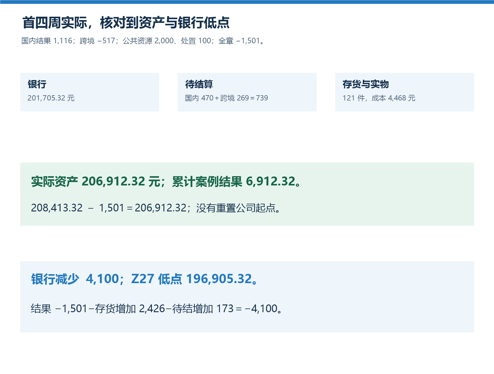

*图 12-12　真实采购和成本批次、旧应收、汇兑及处置一起核对，不重置起点。*

| Z28 案例资产 | 人民币元 |
|---|---|
| 银行 | 201,705.32 |
| 国内待结 | 470.00 |
| 跨境待结，53.80 SGD × 5.00 | 269.00 |
| 可售存货 | 4,468.00 |
| 合计 | 206,912.32 |
| 相对期初变动 | −1,501.00 |
| 自最初 200,000 累计案例结果 | 6,912.32 |

另一条核对：本期结果 −1,501−存货增加 2,426−待结增加 173＝银行减少 4,100。期末无采购预付、应付、未发锁定、外币银行余额或海外存货；未来年度 43 元主供采购和其他预算均未自动加入实际。

### 7.5　V1 接受新起点，不改写 V0

若暂保留 Q1 原目标，后续仍需国内保留黑四十二、白四十二、小杯四十六，共一百二十八，国内出库一百三十四；跨境仍需保留十八、异常情景二、出库二十。它们不是已经接到的订单。

实际余货黑二十九、白八、小杯八十四；43 元分色主供未签。V1 必须先重排日期，米白在新货接受前只按现有八件及已确认可用量开放，不以 Q1 后续有一百件预算掩盖中间断档；后续跨境二十件也需新批及用途放行。

重新验证需求、广告、成本、汇率、到货和资源，再决定保留、降低或推迟目标。年度 V0 仍保留，Z 四周实际也仍保留；不能把四周结果直接与整季度结果作同规模好坏结论。

**练习 12-7**　旧隔离品处置为什么只新增 100 元费用？本期银行减少 4,100 为什么不等于亏损 4,100？

**参考答案**　旧品以前已归零，处置不重复记商品成本，只记新服务费用。银行同时支付采购形成库存，并受新旧待结变化影响；用结果 −1,501、库存增加 2,426、待结增加 173，可以解释现金减少 4,100。

**本节交付物**　一份能核到批次、状态、两币种、日期和资产的首四周复盘及后续 V1 任务。

---

## 第八节　怎样证明自己能把全链路管起来？

最后一次经营评审，不是复述十二章概念，而是提交一份别人能够检查、批准、执行和继续修正的方案。

**本节目标**　形成完整结课作品，并识别哪些能力已经能演练、哪些仍需真实经营验证。

### 8.1　综合作业：为山禾主持年度评审

请先独立完成以下八项，再看参考方案。只使用本章实际及明确的独立情景，新增假设必须注明来源、范围和影响。

1. 提交一页经营任务书，说明国内、跨境、商品、渠道、人员与系统的选择和停止事项。
2. 按 SKU、业务、季度和订单状态重建年度需求，说明增长证据与验证条件。
3. 比较 A、B 采购，核对批次商品成本、期末余货和资金，写出分色条件失效时怎样退回计划。
4. 重算年度利润、库存、待结及现金，补出人力、服务、项目和税费核查范围，标明季度末不能代表季内低点。
5. 分别推演延期、旺季、质量及 Q4 组合压力，提交数量、费用、现金、责任和恢复决定。
6. 核对 Z 四周实际，处理旧保留款和零账面处置，并写出与年度 V0 不同的实际汇率及费用。
7. 提交一份首四周后经营评审纪要，说明未来 Q1 需求、米白缺口、跨境放行及采购日期如何重排。
8. 设计年度执行的授权、岗位目标、看板、会议、版本和项目验收机制，并说明哪些工作需专业支持或真实业务验证。

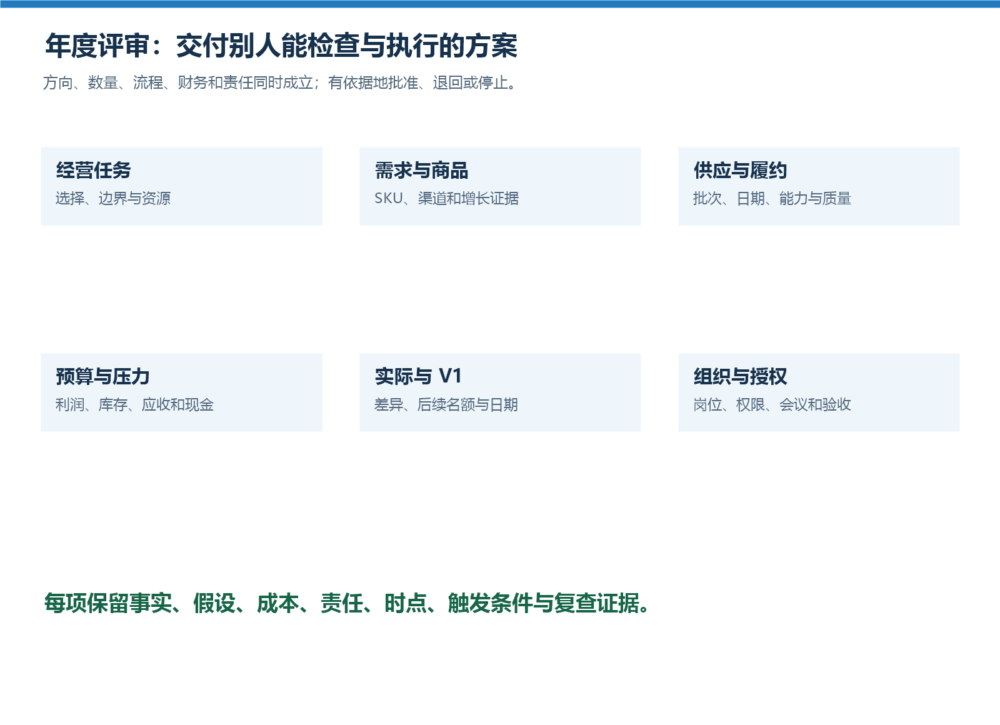

*图 12-13　把方向、数量、流程、财务与责任放在一份可复核的经营方案里。*

### 8.2　参考方案的关键结论

1. 国内保留三 SKU、按日期兑现；跨境单市场单版本有限验证，不自动多国或海外备货；大容量仅 Q2 研究，人员和系统分阶段安排。全部预算以证据与授权为前提。
2. 年度国内保留 1,080、跨境 200；国内出库 1,116、跨境 214。净销售 152,616。数量不是支付或承诺，增长及异常率需要验证。
3. B 采购 58,360，年末 199 件、7,900；A 采购 65,760，年末 399 件、16,174。B 采购少付 7,400、已消耗商品成本多 874，不能把少付款直接加利润。新条件未签，不改变旧合同约束。
4. 四季结果依次 −1,247.60、829.40、5,011.40、8,113.40，全年 12,706.60。年末银行 211,795.92、待结 1,424、存货 7,900，资产 221,119.92。公共资源 24,000、研究 1,200 等已列入，真实企业仍需补齐全部适用项目。
5. 延迟三天使原到货窗口黑色缺三；旺季九十对八十能力差十；质量待验十件不自动损失 440，五件确认不可恢复才损失 220。Q4 组合情景结果 2,034、银行 202,154.52、库存 11,486，需重排采购、活动与资源，不能只因结果正就照旧执行。
6. Z 四周国内结果 1,116、跨境 −517、公共资源 2,000、处置 100，全章 −1,501。银行 201,705.32、待结 739、存货 4,468、资产 206,912.32、累计 6,912.32。旧保留款收回不再计销售，零账面五件已离场，不重复报损。
7. 余货黑二十九、白八、小杯八十四，新主供未签。后续 Q1 国内一百二十八保留、跨境十八仍是目标，先拆日期及供货，减少未到货前名额；以实际资金、汇率和新证据建立 V1，不改 V0。
8. 每个关键事项有执行、最终负责、征询和知会；付款、采购、质量、数据权限分别批准。日常异常、周度供需及经营评审共享字典和证据，改变系统执行方式要另做测试和验收。

### 8.3　结课评分与后续练习

| 结课作品评价 | 分值 | 达标证据 |
|---|---|---|
| 方向与边界 | 10 | 选择、停止、假设和条件清楚 |
| 商品渠道及需求 | 15 | 能解释客户、增量、数量、状态和时间 |
| 供应质量与履约 | 15 | 起订、日期、批次、能力和证据衔接 |
| 利润库存现金 | 15 | 能复算并相互核对，税费和范围明确 |
| 压力与应急 | 15 | 单项组合分开，数量、财务、承诺与恢复一致 |
| 组织和授权 | 10 | 责任、制衡、会议和项目验收可执行 |
| 实际及滚动修正 | 10 | 不重置余额，不将未来方案计实际 |
| 表达与证据 | 10 | 他人能够复核、提问、批准或退回 |

本课自评可用八十分作为继续实战的工作线；**重大账实或资金无法解释、把未来当实际、绕过商品安全和准入、关键责任无人承担**等问题，应先返工，不靠其他分数抵消。这是学习标准，不是职业资格认证。

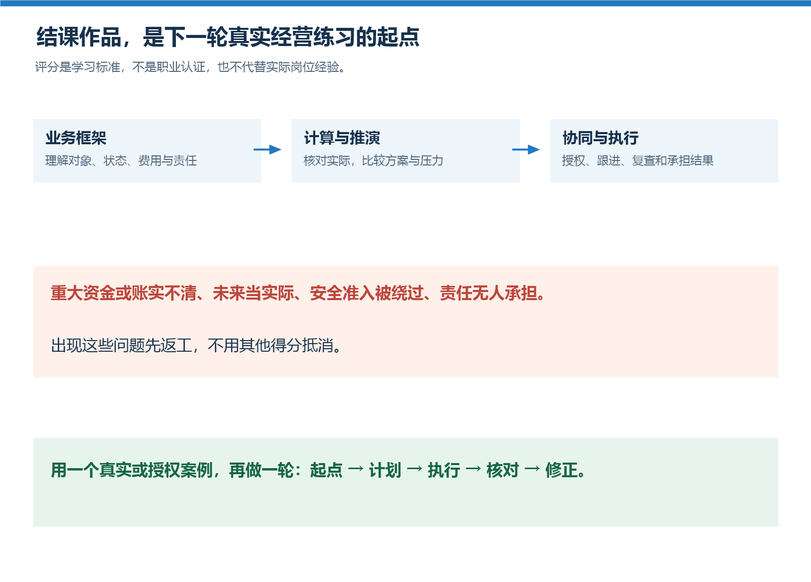

*图 12-14　读完与算对建立框架；持续验证、协同执行和承担真实结果，才形成成熟管理能力。*

十二章的核心不是背术语，而是能解释“谁买、卖什么、如何获得订单、何时有货、怎样交付、谁负责、成本多少、钱在哪里、出了问题怎样修正”。之后可把自己的一个真实商品或授权案例放进同样框架，先核对一轮，再做预算和复盘；遇到新市场、品类和规则，补齐证据及专业支持。

**本章完成标准**　交付一套可复核的年度计划、情景推演、实际核对和经营评审；既能提出增长，也能说明约束、代价、停止及恢复。完成教程建立的是业务框架和演练能力，资深管理仍需真实岗位实践、带团队及承担结果的积累。

---

## 附录　核对参数与结果

### 年度方案与首四周实际分开保存

| 核对口径 | 结果 |
|---|---|
| 年度基准 | 方案 B、四季、统一汇率 5.20；未来十二自然月的条件预算 |
| 年度净销售／模型结果 | 152,616／12,706.60 元 |
| 年度采购／年末存货 | 58,360／199 件、7,900 元 |
| 年末银行／待结／资产 | 211,795.92／1,424／221,119.92 元 |
| Q4 组合情景 | 需求减 20%、交付 42、SGD 5.00；结果 2,034、银行 202,154.52、存货 11,486 |
| 首四周实际采购 | 黑四十 × 44、小杯八十 × 34，共 4,480，全部合格接受并付清 |
| 国内实际支付／取消／出库／退回／保留 | 54／2／52／2／50，退回黑新批及米白各一件恢复 |
| 国内净销售／已售成本／结果 | 5,570／1,970／1,116 元 |
| 跨境实际 | 两单均保留，净款 59.80 SGD，净待结 53.80 SGD，期末折 269 元 |
| 旧保留款 | 50 SGD 已满足条件释放并结汇，银行净入 250 元，不再计销售 |
| 跨境实际结果 | −517 元，含整改 600、汇兑损失 15.76、手续费 5 |
| 公共资源／处置 | 2,000／100 元；旧零账面五件已离场，不重复计商品损失 |
| 本章实际模型结果 | −1,501 元 |
| Z28 可售／实物 | 黑二十九、白八、小杯八十四，共一百二十一件，成本 4,468；均在国内，无隔离 |
| 实际银行／最低点 | 201,705.32／196,905.32 元 |
| 实际待结／资产／累计结果 | 739／206,912.32／6,912.32 元 |
| 尚未执行 | 年度 43 元主供方案、后续跨境名额、新品首单、海外备货、全面系统替换等 |

### 复算及资料边界

首四周银行日期：Z1 收旧款 306、付采购预付 1,344；Z3 付广告 900；Z6 付整改 600；Z11 付采购尾款 3,136；Z14 旧跨境款扣手续费后收 250；Z16 付跨境包装交付 76；Z18 付处置 100；Z22 付国内包装快递 468；Z24 付跨境客服 16；Z26 付退回运费 16；Z27 付会员、仓储及公共资源 2,800；Z28 收国内结算 4,800。其他日期无银行变动。

税率与低价值货物入口于 **2026-11-18** 核查，链接见第二节；案例未据此扩张到其他商品、主体或市场。其余报价、预算、汇率、需求、费用和服务安排为教学参数。压力情景不改实际，年度目标不自动变成合同、收入、库存或付款。

[返回课程总览](../00-课程总览与十二章介绍.md)　｜　[上一章：从业务报表到组织与系统管理](../第十一章-从业务报表到组织与系统管理/第十一章-从业务报表到组织与系统管理.md)
