# 第十章　从跨境订单到海外交付与回款

第九章结束，山禾选择新加坡作为优先验证市场，但还没有海外订单。银行余额 209,830.88 元，国内平台待结算 215 元；可售黑色原款 41、米白 37、小杯 43，共 121 件。

创始人提出：“条件满足后做一次小试点，但不要只告诉我卖了多少。我要知道顾客实际付了什么、谁处理进出口、货在哪里、退款怎么处理、钱什么时候能用。”

这一次，山禾要把一张立项书变成可追溯的订单、包裹和结算。试点中会出现取消、丢件和当地退货；同一笔生意还会同时出现新加坡元金额、人民币收入、未到账款和汇兑差额。国内店继续营业，不能为了复盘跨境而把国内库存和钱忽略掉。

**本章完成目标**　能从含税到手价建立跨境价格与投放模型，解释贸易条件和申报资料，比较直发、第三方海外仓与平台仓配，处理交付及逆向物流，核对平台结算、汇率、库存和经营现金，并提出下一轮供应与资金安排。

## 阅读顺序

| 节次 | 要解决的问题 | 交付物 |
|---|---|---|
| [第一节　条件立项之后，怎样真正启动试点？](#section-01) | 条件、版本、预算与订单边界 | 试点放行与执行记录 |
| [第二节　29.90 新加坡元，顾客究竟付多少？](#section-02) | 含税价、净收入、投放与归因 | 价格及获客口径表 |
| [第三节　谁负责到哪里，申报资料怎样对应？](#section-03) | 贸易条件、清关、主体与单证 | 责任及资料核对表 |
| [第四节　从国内直发，还是先把货放到海外？](#section-04) | 运输链路、海外仓、平台仓与资金 | 履约网络比较方案 |
| [第五节　十八个包裹，为什么只留下十六单？](#section-05) | 取消、丢损、退款和当地退货 | 订单包裹与逆向记录 |
| [第六节　平台有钱，为什么银行还没收到？](#section-06) | 收款、扣费、保留款、汇兑与对账 | 外币结算及人民币核对表 |
| [第七节　订单有贡献，能不能马上扩大？](#section-07) | 预算差异、供应约束与滚动计划 | 试点复盘及下一轮决定 |
| [第八节　跨境和国内合起来，公司结果怎样？](#section-08) | 双业务库存、费用、资产和现金 | 全公司经营核对与综合作业 |

正文提供各节所需数据，完成后可用[章末参数与结果核对](#chapter-check)复查。

## 案例约定与起点

本章实际期间称为 **X1—X28**，承接第九章 N14，不补记此前未执行的采购或销售。第九章的二十单、6,000 元、9,000 元原本都只是条件方案；本章先说明新增事实，再记录实际执行。

| X1 起点项目 | 金额或数量 |
|---|---|
| 银行余额 | 209,830.88 元 |
| 国内平台旧待结算 | 215 元 |
| 黑色原款可售 | 41 件 × 42 元＝1,722 元 |
| 米白原款可售 | 37 件 × 42 元＝1,554 元 |
| 小杯可售 | 43 件 × 34 元＝1,462 元 |
| 可售存货 | 121 件，成本 4,738 元 |
| 旧隔离实物 | 国内仓 4 件，账面零，不可售 |
| 案例资产合计 | 214,783.88 元 |
| 其他状态 | 无采购预付、在途、应付、未发锁定或外币余额 |

银行中 57,000 元用途预留仍已包含在上述余额内，本章不动用该项用途，也不将其另加为资产。跨境试点另在普通可用资金范围内管理。

本章全部公司、平台 P、物流服务商 L、报价、订单及时间均为**虚构教学设定**。平台 P 不是某真实平台的现行政策。规则入口与部分贸易术语引用官方资料，核查日期 **2026-11-17**；真实商品及主体适用性仍须按实际确认。

山禾以人民币观察经营结果，跨境商品净收入、平台扣费在相关发生日统一按教学汇率 5.20 折算；实际结汇用 5.10、期末外币待结算重估用 5.00，均是不同环节的教学参数，不是实时行情。

本案例列示试点交易及服务成本，企业层面未列明的国内税项、全部人员与管理成本等仍需在真实经营中补齐；文中的“结果”是案例模型结果，不是完整企业财务报表净利润。

---

## 第一节　条件立项之后，怎样真正启动试点？

运营准备开启收款，你请他先展示放行记录。第九章只是确定了优先研究对象；这一次必须能解释每一个原本未知的问题是怎样被解决的。

**本节目标**　把条件方案、实际放行、费用执行和库存用途变化分开记录。

### 1.1　新增事实必须能连接上一章的缺口

下表是本章的**案例前提**，表示虚构企业已取得对应的可核验资料；不是本教程替真实产品作出的准入判断，也不是“花 6,000 元必然能出海”。如果真实项目不能形成这些资料，应退回核查，不能照抄本案例的放行结论。

| 放行项目 | X1—X5 新完成的事项 | 本轮限制 |
|---|---|---|
| 区域商品版本 | 材料、用途、既有批次及相关证据完成适用性评审，标签与页面定版 | XB500-BK v1，仅本次确认的黑色原款批次、市场及用途 |
| 技术及供应变更 | 第九章机构留存的两件样品及补充资料用于本轮工作，无新增领样 | 变更材料、来源或用途仍要重评 |
| 品牌图文与消费者信息 | 本轮使用权、主张、使用限制、退货条款和客服安排完成核查 | 不扩张为其他商品或国家的授权 |
| 平台与收款 | P 完成卖家及收款审核，扣费、退款、保留款和结算条款确认 | 不使用私人账户代收或虚构交易收汇 |
| 进出口与税务链 | 山禾、P、L 确认本次出口路径、快件进口办理、主体授权及税款信息传递 | 仅适用于本轮明确的交易、商品及运输条件 |
| 作业与资源 | 库存、地址校验、单证、追踪、售后与对账流程联测通过 | 初次开放至多二十个一杯订单，异常不得自动增量补寄 |

本轮消费者为收件人，L 的合资格快件运营方按确认的代理授权及本次适用程序办理进口手续；山禾留存主体、授权、申报及税款信息链的确认记录。不能只在流程图上写“物流包清关”，却不知道实际由谁办理、使用谁的信息及谁承担义务。

### 1.2　6,000 元未来假设，在本章成为实际费用

后续工作范围经过内部批准并全部交付。本轮服务不形成库存或固定资产，按案例费用处理；不是上一章 2,084 元研究费用的重复入账。

| 固定启动服务 | 本章费用与付款，人民币元 | 与上一章的区别 |
|---|---|---|
| 技术适用性评审及资料补充 | 3,000 | 从初核推进到本次版本证据闭合，复用原留样，不新增实物领用 |
| 正式标签页面及权利资料核查 | 1,200 | 不同于前期草稿理解测试，确认本轮正式使用范围 |
| 平台收款及对账设置 | 1,000 | 固定设置工作，不包含按订单收取的平台支付费用 |
| 物流资料与售后流程联测 | 800 | 固定联测，不包含每个包裹的交付或当地退货费用 |
| 合计 | 6,000 | X2、X5 各支付 3,000，X5 前服务完成 |

未来新增现金上限 9,000 元在 X1 获内部批准。本章不是把 9,000 元一次扣掉，而是按每笔实际支出记录，并同时监控回款扣费与汇兑差额。若实际工作不能在条件和预算内完成，应暂停并重新评审。

### 1.3　区域用途转换不是新采购

X6 将现有黑色 41 件中的 **20 件**按已放行的 v1 资料转入跨境专用可售区，成本仍为 20 × 42＝840 元。国内黑色可售变为 21 件，米白和小杯不变；公司总库存依旧 121 件、4,738 元。

X1 重排国内窗口时，运营在 X1—X5 暂不安排国内黑杯出库，X6—X28 计划最多发黑 18 件，另留 3 件处理已知波动。X6 核对仍有完整的 41 件后，21 件留国内高于第九章的 20 件工作保留，剩余 20 件才划入跨境。仓库每日核实各自可承诺量，遇到国内需要扩大名额时，先做独立供需评审。最终国内黑杯实际出库 9 件，退回恢复 1 件，期末剩 13 件。

区域标识 XB500-BK v1 与国内 SH500-BK 对应同一批实物的不同用途状态，不能两边同时算可售。区域包装在实际出库时每件支出 6 元，不预先增加库存价值；本案例按履约费用处理。

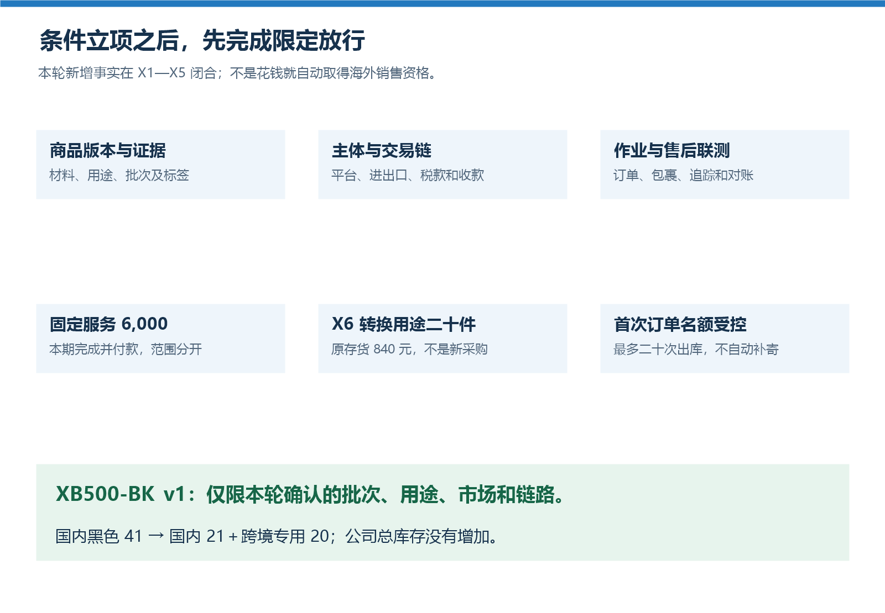

*图 10-1　先确认前置条件，再开放名额；资料定版和用途转换都不增加实物。*

本轮二十件支持最多二十个首次出库，每次一杯。发生丢件、退货或换货需求先暂停对应承诺并评审，可按条款退款，不自动动用国内库存补寄。最终二十笔支付中两笔取消，只有十八个首次包裹出库，保留两件跨境库存作为本轮未用余量，没有额外补寄。

**练习 10-1**　X6 转入跨境区二十件，是否增加 840 元采购付款或 840 元公司资产？上一章的 2,084 元是否需要再计入本章费用？

**参考答案**　都不需要。用途转换只改变区域可用量，二十件和 840 元原本就在公司存货中。上一章费用已发生，不能重复计入本章；若分析项目自研究开始的累计投入，应另做跨期汇总并注明范围。本章新发生的固定启动费用是 6,000 元。

**本节交付物**　一份含证据、版本、主体、资源、日期及负责人签认的放行记录，以及库存用途转换记录。

---

## 第二节　29.90 新加坡元，顾客究竟付多少？

上一章的 29.90 SGD 是扣适用税费后的商品净收入假设。现在页面真正上线，运营必须给顾客一个可理解的到手价格，也要让财务知道其中哪些钱属于山禾。

**本节目标**　连接前台含税价、净收入、获客和归因，避免把含税支付额或混合流量当作利润证据。

### 2.1　先从净商品价还原消费者支付

新加坡当前 GST 标准税率为 9%。[IRAS：当前 GST 税率](https://www.iras.gov.sg/taxes/goods-services-tax-%28gst%29/basics-of-gst/current-gst-rates)

对适用低价值货物交易，已注册的海外供应商或在特定条件下承担相关责任的电子市场运营方，会在销售环节处理 GST；低货值不意味着一律不收税。适用条件、运输方式及平台身份要具体核实。[IRAS：进口低价值货物 GST](https://www.iras.gov.sg/taxes/goods-services-tax-%28gst%29/consumers/gst-on-imported-low-value-goods)

本轮**教学前提**为 P 已按适用安排作为相关 GST 收取和申报责任主体；一单一杯，经空运快件发往新加坡，商品及交易符合本次已核查的适用条件。山禾将该税款视为 P 处理的税项，不计为山禾销售收入或待收款。不是断言所有平台或所有进口路径都如此。

| 单个保留订单价格 | SGD | 说明 |
|---|---|---|
| 商品净价 | 29.90 | 无其他优惠，承接第九章净收入口径 |
| GST | 2.69 | 本案例按单件交易金额计算后保留两位小数：29.90 × 9% |
| 顾客支付 | 32.59 | 29.90＋2.69 |
| 顾客另付运费 | 0.00 | 本轮配送成本由山禾承担 |

本轮 P 的教学结算明细逐单列税，后续合计也按逐单数相加。实际业务应遵循适用开票、舍入和申报要求，不能将一个订单的税额舍入方式套用于所有企业。

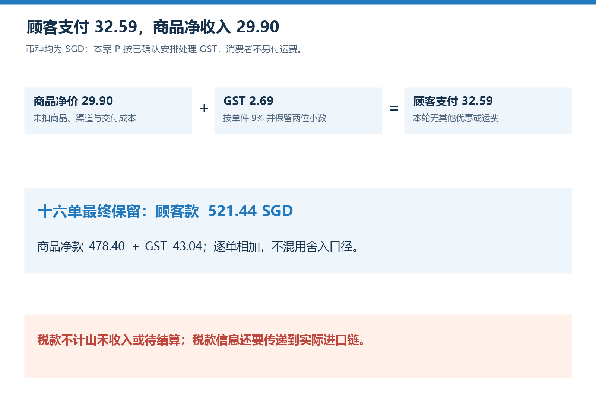

*图 10-2　32.59 是本例顾客支付，29.90 才是未扣山禾经营成本的商品净收入。*

若发生整单取消或全额退款，P 按本轮条款处理商品款和对应税款退款。税项应与实际订单、平台发票及进口信息对应，不能在销售端和进口端各算一笔后都留作收入，也不能假设“平台收过税”就无需传递证明。

### 2.2　流量、支付和保留订单分别观察

X6—X7 开放本轮活动，支付到二十单即停止新收单；本轮访问与支付窗口为 X6—X7，订单后续结果跟踪到 X28，归因按预先冻结的本案例有效来源记录。以下人数及归因均为教学数据：已完成本案例约定的去重，广告访问 200 与其他访问 200 没有重叠，不涉及真实用户数据导出。

| 本轮获客记录 | 数量或金额 |
|---|---|
| 广告展示 | 8,000 次 |
| 广告点击并形成访问 | 200 次 |
| 其他来源访问 | 200 次 |
| 合计去重访问 | 400 次 |
| 广告费用 | 400 元人民币 |
| 广告归因支付／取消／发出／后退款／保留 | 12／1／11／1／10 单 |
| 其他来源支付／取消／发出／后退款／保留 | 8／1／7／1／6 单 |
| 合计支付／取消／发出／后退款／保留 | 20／2／18／2／16 单 |

广告点击率＝200 ÷ 8,000＝2.5%；每次点击费用＝400 ÷ 200＝2 元。全店支付转化率＝20 ÷ 400＝5%，最终保留转化率＝16 ÷ 400＝4%。这些分母不相同，不能互换。

### 2.3　投放回报不能脱离口径和增量

广告归因保留十单，归因的商品净收入＝10 × 29.90 × 5.20＝1,554.80 元。按这个口径，广告支出回报 ROAS＝1,554.80 ÷ 400＝**3.887，约 3.89**。ROAS 是收入与广告费之比，不是利润率。

广告归因每保留订单获客成本＝400 ÷ 10＝**40 元**；若把广告费分摊到全店十六个保留订单，则为 **25 元**，这是混合口径。不能用 25 元声称广告自己以 25 元买来了十六单，更不能把其他来源全部归给广告。

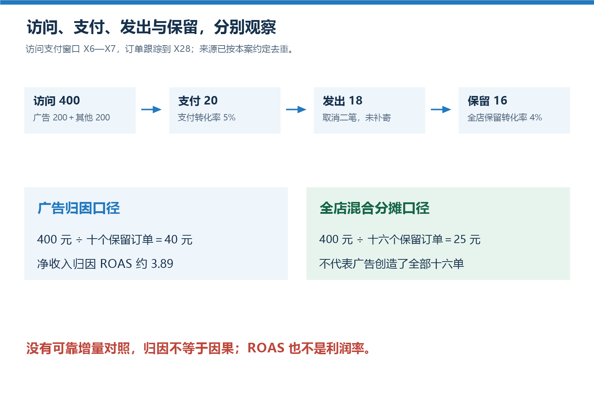

*图 10-3　全店结果用于经营核算，渠道归因用于定位表现，增量结论还需要对照证据。*

本轮没有随机对照或可靠增量设计，因此不能认定广告创造了全部十笔归因订单。客户价值和复购也尚未验证。支付前还应检查价格和币种、地址与配送范围、消费者信息、异常支付风险及收款资格；高风险订单按平台和支付协议处理，不能为了凑二十单跳过审核。本轮未发生拒付、盗刷或额外风控费用。

**练习 10-2**　运营报告“广告 ROAS 是全店 2,487.68 ÷ 400＝6.22，获客成本 25 元，因此广告效果已被证实”。请指出问题。

**参考答案**　2,487.68 元含其他来源的六个保留订单，不能全部作为广告归因收入。按约定归因，ROAS 约 3.89，广告归因每保留订单成本 40 元；25 元是混合分摊。两者都还不能说明广告增量，也没有扣商品、交付、售后和固定投入，不能由此证明盈利。

**本节交付物**　一张明确币种、税项、优惠、运费、流量分母、订单状态与归因窗口的价格和获客表。

---

## 第三节　谁负责到哪里，申报资料怎样对应？

物流报价写着“门到门”，供应商建议发票统一写“杯子样品”。你要把这两种模糊说法都改成能核验的责任和资料。

**本节目标**　认识贸易条件的成本与风险边界，建立订单、商品、运单、申报和税务证据的对应关系。

### 3.1　交货、费用、风险和所有权不是一件事

国际贸易术语 Incoterms® 2020 由 ICC 发布，用于约定买卖双方交货、风险及部分费用和手续责任。使用时要写规则、具体地点或港口及版本；它不自动决定所有权转移、付款安排或全部违约救济，也不替代消费者权益和适用法律。[ICC：Incoterms® rules](https://iccwbo.org/business-solutions/incoterms-rules/)

以下是认识差异用的简表，不是完整条款。正式合同需要结合实际交接方式及 ICC 规则文本核实。

| 适用运输 | 术语 | 学习时首先抓住的区别 |
|---|---|---|
| 各种运输方式 | EXW | 通常在卖方指定地点备妥，装车及出口等安排需特别注意买方能力 |
| 各种运输方式 | FCA | 在指定地点向买方指定承运人等交货，具体交接和装卸依地点而定 |
| 各种运输方式 | CPT／CIP | 卖方付运费到约定目的地，但风险通常在向承运人交货时转移；CIP 另有保险义务 |
| 各种运输方式 | DAP | 指定目的地交到备卸状态，进口手续通常由买方负责 |
| 各种运输方式 | DPU | 指定目的地完成卸货后交货，进口手续通常由买方负责 |
| 各种运输方式 | DDP | 卖方承担进口清关和相应税费等义务，交到指定目的地备卸状态，需确认实际履行能力 |
| 海运及内河运输 | FAS／FOB | 分别关注装运港船边、船上交付，不应直接用作空运快件交接术语 |
| 海运及内河运输 | CFR／CIF | 卖方支付约定目的港运费，但风险不等到目的港才转移；CIF 另有保险义务 |

“卖方付了到目的地的运费”不必然等于风险在目的地才转移。[ICC Academy：C 组与 D 组风险转移](https://academy.iccwbo.org/incoterms/article/incoterms-2020-c-or-d-rules/)

“DDP”也不是服务商声称包税就自动成立。卖方能否合法完成进口、处理税费，必须与真实主体能力一致。[ICC Academy：DAP 与 DDP](https://academy.iccwbo.org/incoterms/article/incoterms-2020-dap-or-ddp/)

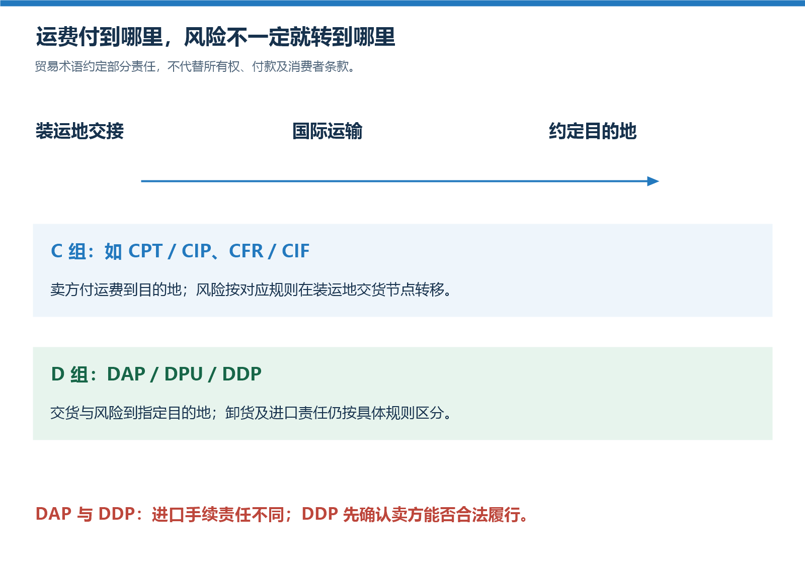

*图 10-4　付款、货权、运输费用与风险分别确认；一句“送到国外”说明不了全部责任。*

山禾本轮面向消费者按 P 的销售及配送条款履行，不在消费者页面随意加一个 FOB 或 DDP 来替代完整约定。山禾与 L 的服务合同另写运输、清关协作、税款信息、索赔、跟踪和当地退货；服务合同与消费者承诺保持一致。

### 3.2　资料不是越多越好，而是彼此一致且真实

本轮为正常销售，一单一杯，不因数量少就写成无偿样品。不低报金额、不虚构品名或来源，也不把收款拆给无关主体以规避审核。

| 资料对象 | 至少核对什么 | 与什么对应 |
|---|---|---|
| 商品主资料 | 型号、材料、用途、归类依据、原产信息和区域版本 | 实物、报告、标签与页面 |
| 商业发票或适用销售资料 | 买卖双方、订单、真实品名、数量、币种、货值及费用口径 | 支付与实际销售条件 |
| 装箱及包裹资料 | 件数、单件内容、重量、尺寸、包裹标识 | 仓库复核与物流交接 |
| 运单与轨迹 | 收寄信息、运单、交接、运输和签收节点 | 同一个订单及其包裹 |
| 出口与进口资料 | 适用方式、申报主体、商品归类、数量、价值和所需文件 | 两侧适用要求及代理授权 |
| 税款及平台资料 | 税款责任、已收税信息、退款调整和发票凭证 | 同一订单及相应进口信息链 |
| 收款与结算凭证 | 币种、退款、扣费、保留、到账、银行和主体 | 订单与申报、物流的业务实质 |

商品归类应依据实际结构、材料及用途等确认，不因竞品网页用了某代码就直接套用。本章不虚构一个海关编码代表所有杯子。是否需要申报许可、适用简化及具体税项，按商品、路径和当期规则核查。

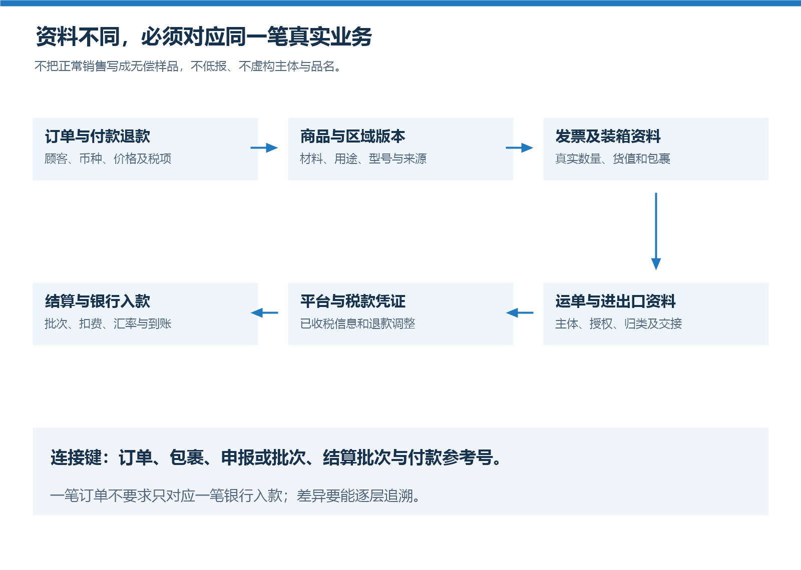

*图 10-5　一单、多份资料、同一业务事实；退款后还要更新对应状态。*

### 3.3　低价值、已收税与进口手续分别确认

新加坡海关对网上购买、空运或邮寄等进口路径列有税费和手续说明，商品是否属于受管制、应税类别，金额及运输方式都会影响处理。[Singapore Customs：快件与邮包程序](https://www.customs.gov.sg/personal-shipment/buying-from-overseas/courier-postal-procedures/)

平台销售环节收取 GST 的信息需要正确传递到运输链，不能用“低价值”三个字覆盖所有税项和手续。[Singapore Customs：低价值货物 GST](https://www.customs.gov.sg/personal-shipment/buying-from-overseas/gst-on-low-value-goods/)

本案例假设本款及本次路径已确认不产生另列的进口关税，销售环节 GST 由 P 按适用安排处理，L 正确传递已收税资料，未重复收税。35 元每包的服务价包含本轮约定的境内揽运、国际运输、通关操作协作和末端配送；**不把税款混入该报价后宣称所有商品均包税**。

如果实际出现重复征收、资料不符或货物滞留，应先核对订单、税款凭证、运单和申报信息，由对应主体向平台、承运或主管方处理。不能让客服未经核实就承诺必定退税，也不能为恢复运输而伪造资料。

**练习 10-3**　报价为 CIF 某目的港，采购认为所有运输风险都到目的港才转移；另有人准备用 FOB 描述空运小包。这两种说法有什么问题？

**参考答案**　CIF 下运费及保险安排与风险转移不是同一个节点，不能只看费用由谁付；FOB 属海运及内河运输规则，不宜直接套用于空运小包。应核实实际运输和交接方式、指定地点、规则版本及完整合同，同时单独确认所有权、付款及消费者承诺。

**本节交付物**　一份写清主体、操作方、交接节点、资料和异常负责人的责任矩阵及单证核对表。

---

## 第四节　从国内直发，还是先把货放到海外？

服务商提供三种介绍：国内快件直发、第三方海外仓、平台仓配。运营只想比较“每单运费”，你要求先画出整条链路，再放入相同需求情景。

**本节目标**　识别头程、清关、入仓、存储、尾程和逆向的费用与时间，比较网络选择对库存和资金的影响。

### 4.1　直发也需要逐段交接和时效证据

本轮实际链路为：国内仓复核包装 → L 揽收交接 → 适用出口程序 → 国际空运 → 新加坡适用进口办理 → 末端配送 → 顾客签收。出口放行、起飞、到港、进口处理、派送和签收分别跟踪，不能把“已出库”都标成“国际运输中”。

十八个包裹 X8 交给 L，每包交付服务 35 元，共 **630 元**。报价适用于本次确认的包裹、路线和服务范围，真实业务需核对燃油、偏远、旺季、重派、退件、税款与附加费是否另计。

本案例每包实际毛重 0.45 kg，外箱 30 × 10 × 10 cm，合同体积重除数为 5,000：体积重＝30 × 10 × 10 ÷ 5,000＝0.60 kg。本轮按二者较高的 0.60 kg 计费，35 元已对应此规格。除数、进位和费用是合同教学假设，不是全部承运人的统一标准；不能只用杯子净重询价。

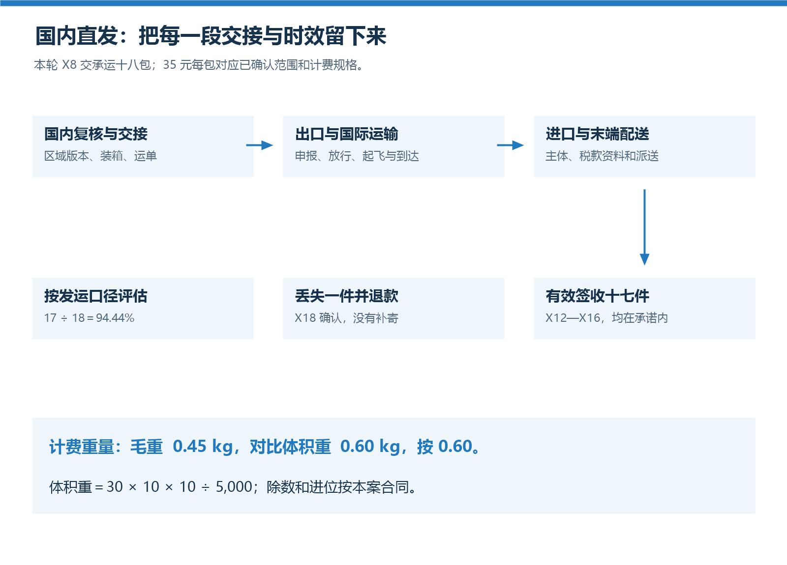

*图 10-6　运费有范围、重量有口径、时效有起止；每段都能找到交接和异常记录。*

本轮承诺为交承运后十个自然日内送达，即 X18 前。十七件在 X12—X16 有效签收，一件运输中丢失，X18 确认后退款。按全部十八次发运计算，按时有效签收率＝17 ÷ 18＝**94.44%**；不把丢件从分母删掉后宣布全部履约成功。

### 4.2　海外仓不是把尾程报价贴到原模型里

海外仓通常增加先备货的头程、进口和入仓，再转为当地订单作业和尾程。平台仓也有自己的入仓、存储、配送、退件、移除或销毁条款，仍需核实库存所有权和责任。商品提前到海外，不等于已卖给顾客，也不等于收入已经实现。

下面是**独立演练**，不进入本章实际。假设另有一批已具备销售条件的一百件商品，只比较给定网络的物流运营费用，忽略退件及其他变动；不表示山禾当前有一百件，也不表示供方取消了黑白各一百件起订条件。

| 独立网络费用假设 | 国内直发 | 海外仓方案 |
|---|---|---|
| 货物位置与安排 | 一百件留国内，按实际订单发 | 一百件先发往海外 |
| 本窗口固定物流费用 | 0 | 头程及通关操作 1,200＋入仓 200＋存储 300＝1,700 元 |
| 每个实际发出订单 | 35 元 | 当地作业及尾程 10 元 |
| 仅售二十件的物流费用 | 700 元 | 1,900 元 |
| 售出一百件的物流费用 | 3,500 元 | 2,700 元 |
| 仅售二十件时的余货 | 国内八十件 | 海外八十件 |

本表只比较物流运营费用，采购、包装、税费及其抵扣或回收、退件、额外仓龄费用、资金和汇兑等需另列后才能做完整决策，不能用表中结果宣布海外仓整体必然更优。

按这组假设，1,700＋10q＝35q，得到 **q＝68 个实际发出订单**，只是物流子模型的费用交点。它不是利润盈亏平衡，也不是证实市场有六十八单，更不是让山禾立即采购一百件的理由。

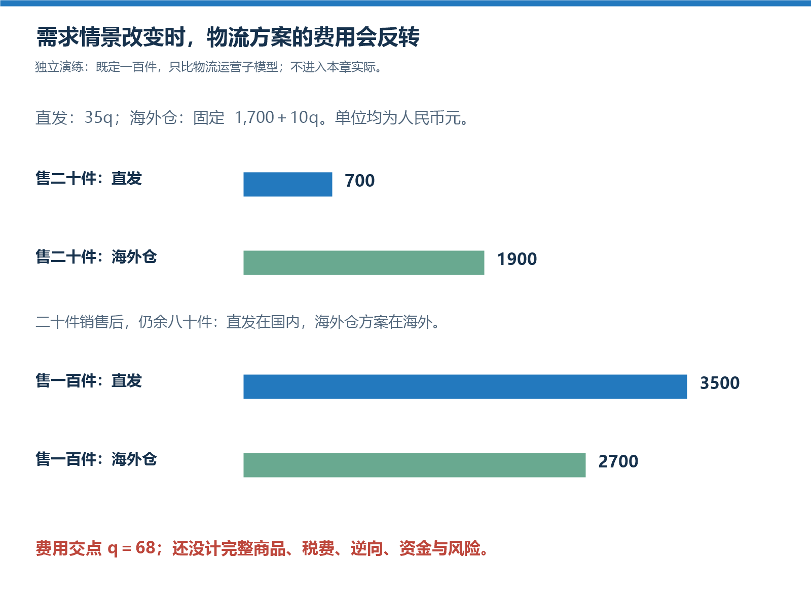

*图 10-7　需求低时，海外余货和前置投入可能比尾程节省更重要。*

### 4.3　补货必须同时看区域、日期和现金

后续若做海外备货，至少区分：国内可发、区域专用、出口运输中、海外待验、海外可售、已锁定、退件隔离及不可售。总库存一百件，不代表一百件都能服务明天的新加坡订单。

补货日期要连接供方生产及放行、国内集货、头程、进口处理、入仓及上架。比较报价时同时看服务范围、波动、批次与追溯、库存准确、赔付条款、数据回传和退出处理；货物在服务商那里，山禾仍需能对账和取回或处置。

本章没有海外备货，没有新采购、预付或在途。跨境区未用两件仍在中国境内，不因区域标签就变成海外库存。

**练习 10-4**　海外仓尾程每单 10 元，是否一定比直发 35 元便宜？若演练中只卖二十件，未售八十件按 42 元计，在哪、价值多少？

**参考答案**　不能只比尾程。按该物流子模型，二十件直发 700，海外仓 1,900；还需计入其他完整成本和资金影响。未售八十件成本 3,360 元，直发方案在国内，海外仓方案在海外，位置和处理代价不同。它们是演练库存，不改变本章实际。

**本节交付物**　一份按相同需求、时间、费用范围及期末余货比较的履约方案，并注明资金前置与退出安排。

---

## 第五节　十八个包裹，为什么只留下十六单？

一名顾客取消，另一名顾客的杯子已到当地退货点。客服发现“退款”“货回来”和“可以重新销售”不是同一个动作。

**本节目标**　把订单、包裹、退款和库存状态串起来，比较跨境逆向处理方案，避免重复损失或虚增可售。

### 5.1　先按状态数订单，再解释每一个差异

| 本轮跨境订单状态 | 单数或件数 | 处理 |
|---|---|---|
| 支付订单 | 20 | 每单一杯 |
| 发货前取消 | 2 | 全额退款，不出库，不收本轮综合平台支付费 |
| 首次包裹出库 | 18 | 包装、交付及综合平台支付费均已发生 |
| 运输丢件 | 1 | 未签收，X18 全额退款，没有补寄 |
| 有效签收 | 17 | 包含随后当地退回的一件 |
| 当地退货并退款 | 1 | X20 到当地退货点，X22 全额退款，不恢复可售 |
| 最终保留订单 | 16 | 十八次发运减两笔发出后退款 |
| 换货或额外补寄 | 0 | 没有隐含第二次出库 |
| 跨境区剩余可售 | 2 | 国内二十件用途转换后，发出十八件 |

二十笔支付的顾客款＝20 × 32.59＝651.80 SGD；发货前取消退 65.18，发出后两笔再退 65.18，最终保留顾客支付 **521.44 SGD**。

| 顾客款与商品净收入核对 | 商品净款 SGD | GST SGD | 顾客支付 SGD |
|---|---|---|---|
| 二十笔支付 | 598.00 | 53.80 | 651.80 |
| 两笔发货前取消 | −59.80 | −5.38 | −65.18 |
| 两笔发出后退款 | −59.80 | −5.38 | −65.18 |
| 十六笔保留 | 478.40 | 43.04 | 521.44 |

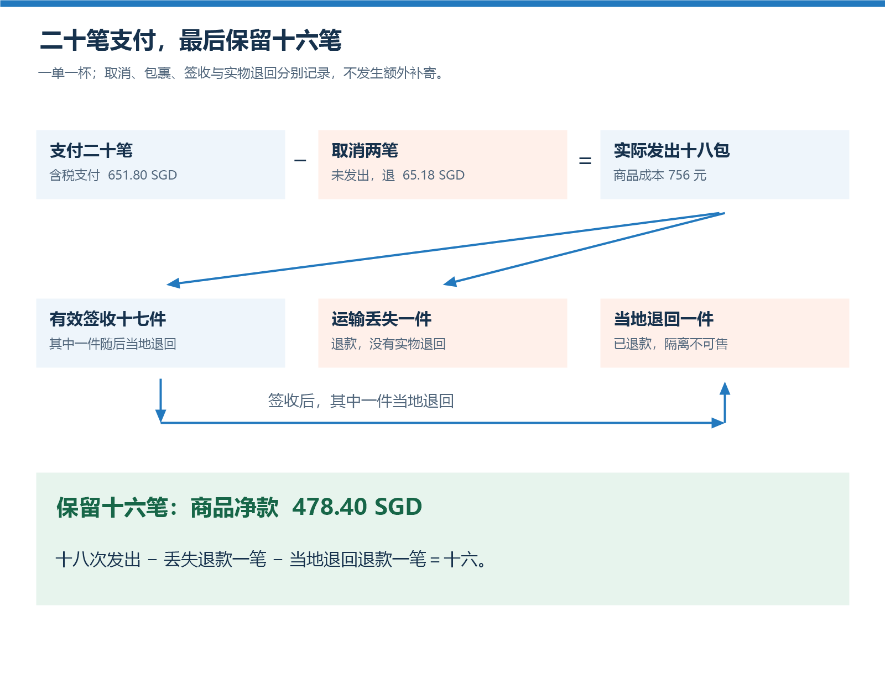

*图 10-8　保留订单十六、发出包裹十八、签收十七、实物退回一件，四个数字各有含义。*

最终商品净收入为 16 × 29.90＝**478.40 SGD**，按 5.20 折为 **2,487.68 元**。GST 的 43.04 SGD 由 P 按本轮约定处理，不进入山禾收入或待结算。平台完整记录付款和退款，山禾只将已满足本案交付确认条件、扣已知退款后的商品净额计入结果；支付和出库时都不提前把全部款当作已经实现的销售。

### 5.2　丢件与退货的商品成本都不能留在可售里

十八件从库存转出，原商品成本共 **756 元**：十六件保留订单成本 672 元，丢件成本 42 元，当地退回不可售成本 42 元。后两件合计 **84 元异常商品损失**。

丢件已按证据确认，山禾向 L 申请 120 元赔偿，但 X28 尚未获对方确认、没有到账，本章不确认赔偿收入或应收。索赔申请金额不是已赚到的钱。

当地退回的一件已开封使用，按本案例质量与卫生处置决定不再销售；在合作退货点隔离，账面价值零，实物一件仍由服务商代管，后续处置待审批。原来国内仓的四件零账面隔离品没有因此消失，两处实物分别盘点。

### 5.3　退回中国、当地处理与仅退款要比较完整代价

处理路径要结合适用消费者规则、平台条款、质量证据、商品价值和实际可行性。不能以成本高为由拒绝应履行的消费者或产品安全义务。

| 逆向处理选择 | 要核对的业务问题 |
|---|---|
| 当地收回并检查 | 收件、身份关联、检查、库存状态、服务费及后续处置 |
| 退回国内 | 逆向运输、实际进出口及退运安排、税款、时长和可恢复价值 |
| 合法可行的退款不退货 | 平台与消费者规则、证据、滥用风险及质量安全问题是否允许 |
| 换货或补寄 | 新出库、包装、运输、时效、税务信息与额外库存 |
| 回收、移除或销毁 | 适用要求、授权、凭证、数量和责任，不只在系统点“已处理” |

本轮选择当地收回、检查和隔离，实际支付 **80 元人民币**给合同服务商，覆盖本次收回及检查隔离服务，无额外外币应付。没有退回中国、跨境补寄、销毁或再售，也没有另发生上述其他路径费用。

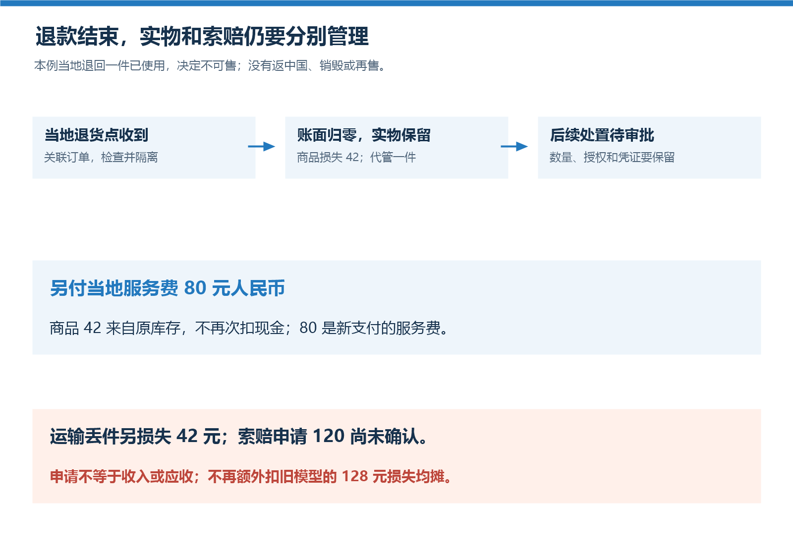

*图 10-9　退款结束不代表实物消失；检查和处置结束也不自动恢复销售资格。*

本期客户退回一件，运输丢失一件，不能都写成“退货两件”。若按发运数算发出后退款率为 2 ÷ 18＝11.11%；按有效签收数算实物顾客退回率为 1 ÷ 17＝5.88%。样本很小，不能直接将其当成长周期稳定概率。

第九章每保留订单 8 元是预期损失的模型分摊，本期已经有实际异常商品、交付及当地处理记录，不能再额外扣 16 × 8＝128 元“准备费”造成重复。真实未决索赔、争议或退货风险还要按实际状态和适用核算另评估；本案例截止 X28 没有其他已知未决顾客退款或拒付事项。

**练习 10-5**　顾客退回一件后已经退款，仓库能否把它恢复到国内黑色可售？是否再扣一次 42 元现金？申请的 120 元赔偿是否加入本期利润？

**参考答案**　不能恢复。它在新加坡、已判不可售，账面零且实物单独代管，不在国内库存。42 元来自原存货成本，本期转损失不再扣现金；当地处理 80 元才是本次新增现金服务费。赔偿尚未确认、未收，不计为本期收入或应收，后续获得确认再按新事实处理。

**本节交付物**　一张订单、包裹、付款退款、商品状态及索赔相互关联的异常与逆向记录。

---

## 第六节　平台有钱，为什么银行还没收到？

运营说后台“净款 424.40 SGD”，银行却只增加了一千多元。财务还发现平台保留了一部分款，人民币汇率也变了。

**本节目标**　把商品净款、扣费、可结算、保留、实际付款、结汇和银行到账逐层核对。

### 6.1　先用原币核对，不急着换人民币

P 本轮每个已发出订单收综合平台、支付及收款服务费 **3 SGD**，本案例该综合收费已含约定服务范围内费用；取消未发不收，发出后退款不退这项费。十八次发出共 **54 SGD**。这不同于第九章按保留订单估的每单 14 元，不应把旧假设改写成实际合同。

| 跨境平台原币结算 | SGD |
|---|---|
| 最终商品净款 | 478.40 |
| 综合平台支付费用 | −54.00 |
| 净应结算 | 424.40 |
| X25 实际付出并结汇 | −300.00 |
| X28 平台待结算 | 124.40 |
| 其中未到本轮付款日的部分 | 74.40 |
| 其中按合同保留的风险款 | 50.00 |

50 SGD 包含在 124.40 中，不能再次加成资产或再减一次费用。74.40 尚未到银行，也不能当作可以立刻付款的现金。本轮合同约定前者进入下一付款窗口、保留款后续按复核条件释放；不保证在没有满足条件时自动到账。

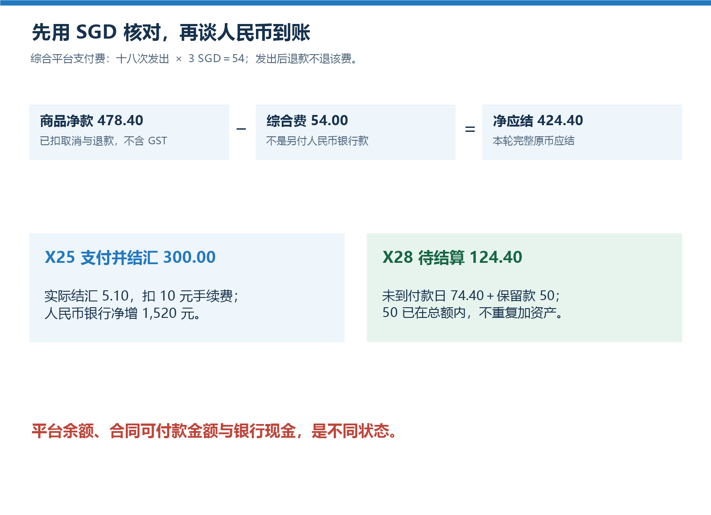

*图 10-10　净应结算、可申请付款和银行可用现金，是不同状态。*

收款机构和账户需支持真实业务、币种和主体，保留订单、支付、物流、申报及费用依据。外汇管理部门的贸易新业态答问区分交易电子信息与电子单证，并要求相应真实性审核；净额收付也不等于可以丢掉销售与费用的完整记录。[国家外汇管理局：贸易新业态问题解答](https://www.safe.gov.cn/qingdao/2026/0121/3049.html)

该资料不是对所有企业收汇手续的完整替代。山禾按本次已确认的银行及收款安排办理，实际适用登记、申报和材料要求仍由经办主体核实。

### 6.2　三种汇率分别服务三个问题

本章以 5.20 折算相关商品净收入和平台费用：478.40 × 5.20＝2,487.68 元，54 × 5.20＝280.80 元，初始净应结算折算为 **2,206.88 元**。

X25 结汇 300 SGD，账面对应 300 × 5.20＝1,560 元；实际兑换率 5.10，银行入款前金额为 1,530 元，因此已实现汇兑损失 **30 元**。另收人民币结汇收款手续费 **10 元**，实际银行净增 **1,520 元**。

剩余 124.40 SGD 原折算为 646.88 元，X28 按期末教学汇率 5.00 重估为 **622 元**，形成尚未结汇部分的汇兑损失 **24.88 元**。本章汇兑损失合计 **54.88 元**，手续费另外列示，不混成一个不明扣款。

| 汇率与收款核对 | 人民币元 |
|---|---|
| 商品净收入折算 | 2,487.68 |
| 平台综合费折算 | −280.80 |
| 初始净应结算折算 | 2,206.88 |
| 已实现汇兑损失 | −30.00 |
| 未结汇部分期末汇兑损失 | −24.88 |
| 结汇收款手续费 | −10.00 |
| 银行实际净入款 | 1,520.00 |
| 期末外币待结算折算 | 622.00 |

> 2,206.88−30−24.88−10＝**1,520＋622＝2,142 元**。

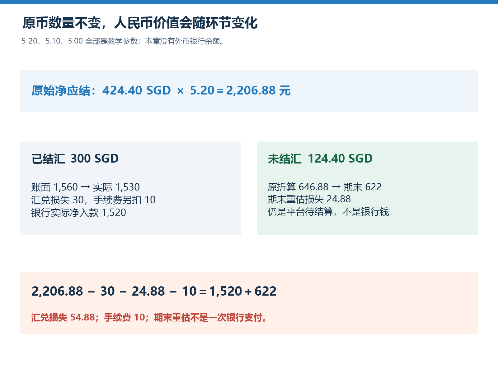

*图 10-11　原币数量不因汇率改变而变化；人民币价值、到账和期末重估分别记录。*

5.20、5.10、5.00 是教学简化的交易、实际结汇及期末汇率，实际业务需按适用核算和汇率政策逐笔处理。若后续结汇率再变，还会产生后续差额；不把 X28 这笔重估当成银行真的支付了 24.88 元。

### 6.3　日常对账按订单、结算单和银行三层做

第一层核对订单支付、税、取消及退款；第二层核对平台扣费、准备金或保留、调整及付款；第三层核对支付机构、结汇与银行入款。按订单、包裹、结算批次及付款参考号建立关联，不要求一张订单必须恰好对应一笔银行入账。

差异先分清未到付款日、合同保留、退款时间差、费用、汇率、重复或漏单，再派给对应负责人。平台余额异常或受限不只是财务问题，也会影响投放、采购和履约资金安排。

本章没有另行留存外币银行余额；300 SGD 已全部结汇，124.40 SGD 留在平台待结算。实际状态分别记录，不把二者都写成“外币现金”。

**练习 10-6**　若用 424.40 × 5.20 直接作为人民币银行到账，再把保留款 50 SGD 单独加为资产，会错在哪里？

**参考答案**　424.40 是扣费后的原币应结总额，不是已收到银行的钱；本轮只付出并结汇 300 SGD，银行净入 1,520，期末平台仍待结 124.40 SGD、折 622 元。50 已包含在剩余 124.40 中，不能重复增加资产；还要计 54.88 汇兑损失及 10 元手续费。

**本节交付物**　一份能从每单净款追到结算批次、外币原额、汇率、费用和银行入款的结算表。

---

## 第七节　订单有贡献，能不能马上扩大？

运营认为“下一次多卖一些，就能摊薄启动费”。你要求先解释本轮单笔为什么偏离假设，再把国内承诺、采购起订和回款放进下一轮计划。

**本节目标**　比较同口径预算与实际，识别可重复能力和一次投入，形成受约束的滚动决定。

### 7.1　实际贡献先扣清楚，不拿预期损失重复扣

| 跨境实际经营项目 | 人民币元 | 本轮依据 |
|---|---|---|
| 商品净收入 | 2,487.68 | 16 × 29.90 × 5.20 |
| 保留订单商品成本 | 672.00 | 16 × 42 |
| 异常商品损失 | 84.00 | 丢件一件、当地不可售退件一件 |
| 综合平台支付费用 | 280.80 | 18 × 3 SGD × 5.20 |
| 区域包装 | 108.00 | 18 × 6，实际出库时使用 |
| 跨境交付 | 630.00 | 18 × 35 |
| 广告 | 400.00 | 本轮实际已支付 |
| 变动客服服务 | 80.00 | 本轮单独约定、已交付并支付的跨境服务，不含国内客服 |
| 当地退回检查隔离 | 80.00 | 已支付，无其他当地应付 |
| 跨境交易贡献 | 152.88 | 净收入减以上成本费用 |
| 固定启动服务 | 6,000.00 | 本章新发生，不重复计第九章研究 |
| 汇兑损失 | 54.88 | 已实现 30＋期末重估 24.88 |
| 结汇收款手续费 | 10.00 | 人民币银行实际扣款 |
| 跨境本章模型结果 | −5,912.00 | 152.88−6,000−54.88−10 |

平均每保留订单交易贡献＝152.88 ÷ 16＝**9.555 元，约 9.56 元**，尚未扣启动、汇兑及结汇手续费。它比第九章假设的 26.48 元低，不能以“最终还有正贡献”掩盖执行差异。

### 7.2　先对齐十六单，再解释费用差异

第九章按二十个保留订单预计结果 −5,470.40 元。先改用本轮实际十六个保留订单，保持其他假设不变，贡献为 16 × 26.48＝423.68 元，扣固定 6,000 后为 −5,576.32 元；数量变化先解释 **−105.92 元**。

再比较相同十六单规模。下表“费用增加”是相对旧模型的差异，不是新增一笔重复入账。

| 同规模费用比较项目 | 十六单原模型 | 本轮实际 | 费用增加 |
|---|---|---|---|
| 保留订单商品成本 | 672.00 | 672.00 | 0.00 |
| 异常商品及当地处理 | 128.00 | 164.00 | 36.00 |
| 包装 | 96.00 | 108.00 | 12.00 |
| 交付 | 560.00 | 630.00 | 70.00 |
| 平台支付综合费 | 224.00 | 280.80 | 56.80 |
| 广告 | 320.00 | 400.00 | 80.00 |
| 变动客服 | 64.00 | 80.00 | 16.00 |
| 合计 | 2,064.00 | 2,334.80 | 270.80 |

旧模型异常均摊 128 元，实际对应异常商品 84＋当地处理 80＝164 元；实际多发两件相应的包装 12、运输 70 和综合收费，分别放在本来所属项目，不再挤进同一个“退货准备”重复算。

> 二十单原预计 −5,470.40−数量差异 105.92−费用差异 270.80−汇兑 54.88−手续费 10＝**实际 −5,912 元**。

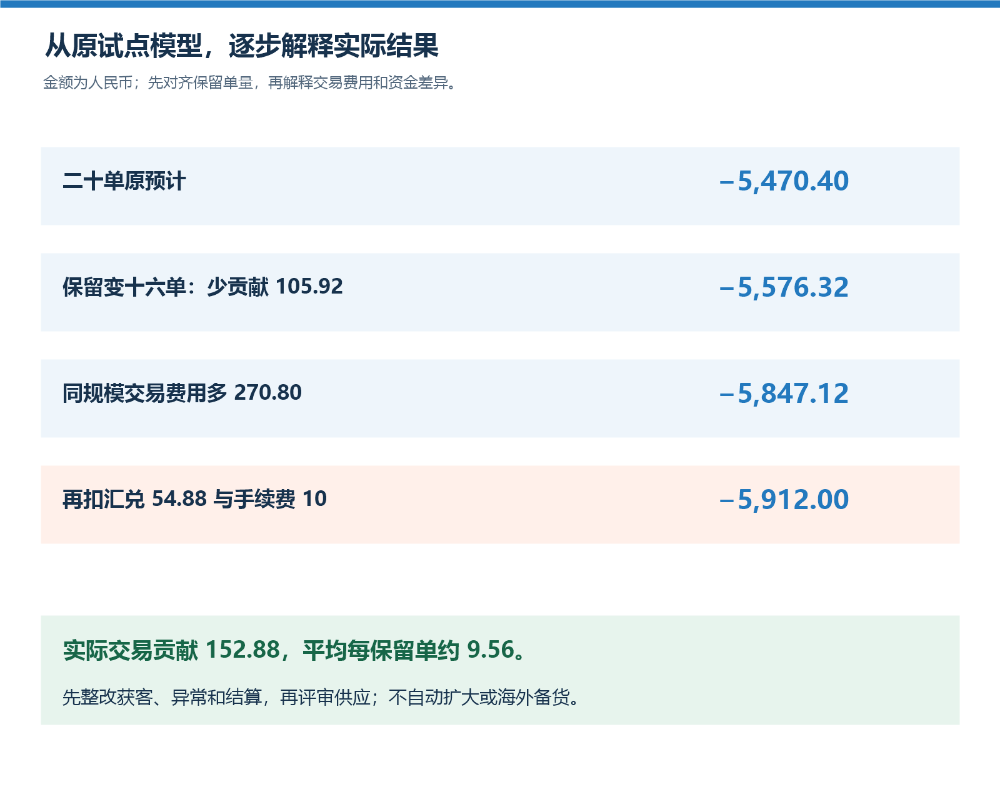

*图 10-12　把规模、单笔条件和资金差异拆开，才能找到下一轮要验证的动作。*

若从第九章研究阶段起观察跨境项目，研究 2,084＋本章试点净损失 5,912＝累计项目模型损失 **7,996 元**；这不等于本章公司总结果，也不能把国内贡献拿来改写跨境自身表现。

### 7.3　起订、区域余货和回款共同约束放大

本轮结束国内黑色可售 13、米白 28、小杯 32，跨境专用黑色剩 2；详细变动见下一节。下面是**未来独立工作假设**，并非已经接受的订单或已经下出的采购。

下个二十八天国内预计出库黑 16、白 18、小杯 24，暂不把未收到的退货当可用；其中前二十五天黑 15、白 16。原款常规交期仍为二十五天，若下一窗口第一天签单、第二十六天到仓，国内现有黑 13 在到仓前就可能差 **2 件**。整个窗口黑色净缺 **3 件**。

跨境专用两件不能自动同时承诺给国内。若经批准恢复国内用途，可缓解前二十五天缺口，但整窗口仍差一件，且跨境可用相应归零。未获批准前，应按实际可兑现量限制销售、调整活动或给出经确认的交期，不先无限收单。

现供方黑白各一百件起订、每件 42 元和二十五天是重新评审的基础条件，若实际再签还需确认有效报价及条款。按此批量需 8,400 元，30% 预付 2,520、尾款 5,880，但会带来远大于眼前缺口的余货。不能仅为补三件而忽略同时买入的一百件米白。

可以重新谈分色或小批条件、评估备选供方、调整促销、批准用途转换，或暂缓一部分需求；每种方案都要说明代价和证据。备选报价须重新确认，不能默认第五章的试批条件永远有效。**本章未签新采购、未预付、无新增在途**，下一轮方案需在承诺新订单前落地。

本轮评审决定：**暂停扩大投放和海外备货，完成差异整改与下一轮供需评审；不自动追加跨境名额**。当前两件区域余量及国内商品按各自已确认范围管理，未发生新的消费者承诺。

**练习 10-7**　如果声称“下一轮不需要启动费，只要按本轮 9.56 元贡献多卖即可”，还缺哪些判断？

**参考答案**　9.56 是十六单平均交易贡献，不是长期稳定单笔利润。还要验证获客与增量、取消退款、收费、物流和客服是否改善或持续，评估维护合规、人员、系统及税费等固定和持续成本；检查已放行版本、剩余库存、原款起订与交期、国内优先及回款约束。去掉一次性启动费不等于已经具备放大能力。

**本节交付物**　一份能解释数量与费用差异、区分一次和持续投入、约束供应和资金的试点复盘及下一轮决定。

---

## 第八节　跨境和国内合起来，公司结果怎样？

创始人最后问：“跨境花了不少钱，但国内店也在卖。现在公司还有多少货、多少应收、多少现金？”你需要给出同一截止日的一份完整答案。

**本节目标**　把两条业务线、两个币种及多处实物放回同一家公司，核对本期结果和资金变化。

### 8.1　国内业务另记，不与跨境订单重复

国内仍在平台 A 一单一杯，原款实付 119、小杯 99，无新券或赠品；最终保留单平台费 6，实际出库包装 3、快递 6，顾客退回运费每件 8。两件退回全部合格恢复，没有国内报损或补寄。

| 国内实际订单状态 | 黑色 | 米白 | 小杯 | 合计 |
|---|---|---|---|---|
| 支付 | 10 | 10 | 12 | 32 |
| 发货前取消 | 1 | 0 | 1 | 2 |
| 实际出库 | 9 | 10 | 11 | 30 |
| 签收后退回退款 | 1 | 1 | 0 | 2 |
| 最终保留 | 8 | 9 | 11 | 28 |
| 恢复可售 | 1 | 1 | 0 | 2 |

国内支付额＝20 × 119＋12 × 99＝3,568 元；取消退款 218，签收后退款 238，净销售＝3,568−218−238＝**3,112 元**，等于 17 × 119＋11 × 99。

| 国内实际经营项目 | 人民币元 |
|---|---|
| 净销售 | 3,112.00 |
| 已售商品成本 | 1,088.00 |
| 平台费 | 168.00 |
| 包装 | 90.00 |
| 出库快递 | 180.00 |
| 退回运费 | 16.00 |
| 广告 | 400.00 |
| 国内交易贡献 | 1,170.00 |
| 国内会员客服 | 100.00 |
| 国内仓储操作 | 500.00 |
| 国内模型经营结果 | 570.00 |

国内应结净额＝3,112−168＝2,944 元，本期到账 2,700，期末待结算 **244 元**。旧待结算 215 元在 X1 收回，不再形成新收入。

国内会员客服及仓储操作范围与跨境包装、物流、客服和启动服务分别约定；以上国内 100、500 与跨境 80 不重叠。所有列示现金服务本期完成并已支付，无期末应付。

### 8.2　按用途、地点和状态核对存货

| X28 公司可售核对 | 期初 | 国内出库 | 国内恢复 | 跨境出库 | 期末可售 | 单位成本 | 期末成本 |
|---|---|---|---|---|---|---|---|
| 黑色原款及其区域用途 | 41 | 9 | 1 | 18 | 15 | 42.00 | 630.00 |
| 米白原款 | 37 | 10 | 1 | 0 | 28 | 42.00 | 1,176.00 |
| 小杯 | 43 | 11 | 0 | 0 | 32 | 34.00 | 1,088.00 |
| 合计 | 121 | 30 | 2 | 18 | 75 | — | 2,894.00 |

黑色十五件＝国内可售十三＋跨境专用两件，并非各有十五件。跨境当地退件不可售且账面零，不进入表中恢复栏。

> 存货成本＝4,738−国内已售 1,088−跨境保留订单已售 672−异常商品损失 84＝**2,894 元**。

| X28 实物地点与状态 | 数量 | 账面价值及解释 |
|---|---|---|
| 中国境内国内可售 | 73 | 黑 13、白 28、小杯 32，成本 2,810 元 |
| 中国境内跨境专用可售 | 2 | 成本 84 元，不在海外 |
| 中国境内旧隔离 | 4 | 零账面，不可售 |
| 新加坡退货点隔离 | 1 | 零账面，不可售，待后续处置 |
| 中国境内在场合计 | 79 | 125−国内出库 30＋恢复 2−跨境发出 18 |
| 公司及代管在场合计 | 80 | 中国 79＋新加坡 1，不能把消费者持有商品算回来 |

丢失一件不在任何仓位，已按证据转损失；十六件保留销售在顾客处，不是公司存货。期末没有销售运输中或海外可售备货，没有库存重复占用。

### 8.3　合并结果与资产必须解释同一变化

| 本章双业务结果 | 人民币元 |
|---|---|
| 国内模型经营结果 | 570.00 |
| 跨境交易贡献 | 152.88 |
| 跨境固定启动费用 | −6,000.00 |
| 跨境汇兑损失 | −54.88 |
| 结汇收款手续费 | −10.00 |
| 本章合计模型结果 | −5,342.00 |

银行按实际人民币入款与付款核对，不把平台费用、商品成本或期末汇兑损失再次当成银行扣款。

| 银行实际变动 | 人民币元 |
|---|---|
| X1 期初银行 | 209,830.88 |
| 收回国内旧待结算 | +215.00 |
| 国内本期平台到账 | +2,700.00 |
| 跨境 300 SGD 实际结汇入款，手续费前 | +1,530.00 |
| 固定启动服务付款 | −6,000.00 |
| 国内及跨境广告付款 | −800.00 |
| 国内及跨境包装付款 | −198.00 |
| 国内及跨境交付付款 | −810.00 |
| 国内退回及海外检查隔离付款 | −96.00 |
| 国内及跨境客服付款 | −180.00 |
| 国内仓储操作付款 | −500.00 |
| 结汇收款手续费付款 | −10.00 |
| X28 期末银行 | 205,681.88 |

现金入款 4,445，付款 8,594，净减少 **4,149 元**。跨境平台综合费 54 SGD 已在应结中扣除；外币款的 30 元结汇损失体现为较低入款，24.88 元重估损失没有产生现金付款。

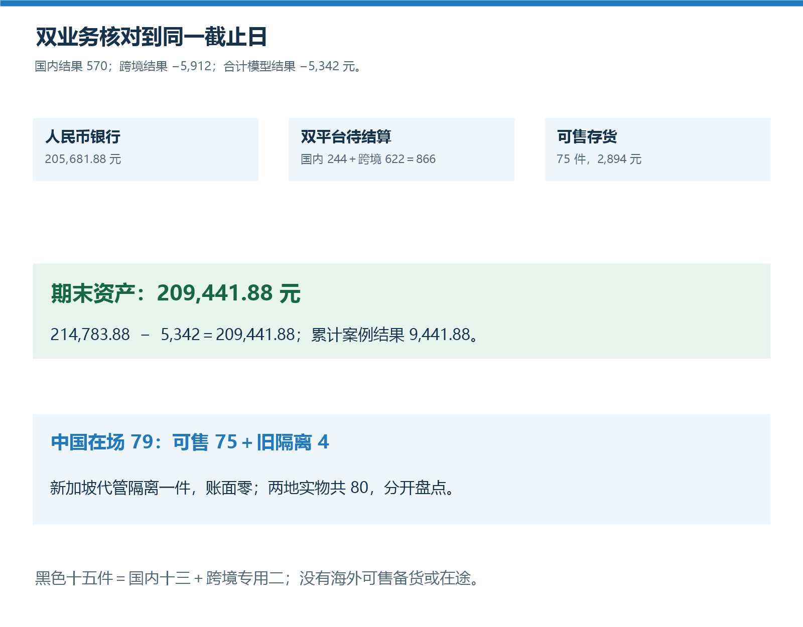

*图 10-13　国内、跨境和总部银行放在同一截止日，保留原币及用途明细后再合并。*

| X28 案例资产核对 | 人民币元 |
|---|---|
| 人民币银行 | 205,681.88 |
| 国内平台待结算 | 244.00 |
| 跨境平台待结算，124.40 SGD × 5.00 | 622.00 |
| 可售存货 | 2,894.00 |
| 其他列示资产 | 0.00 |
| 案例资产合计 | 209,441.88 |
| 相比 X1 的资产变动 | −5,342.00 |
| 相比最初 200,000 的累计案例结果 | 9,441.88 |

从期初核对：214,783.88−5,342＝209,441.88。从银行变化核对：本期结果 −5,342＋存货减少 1,844−待结算增加 651＝**−4,149 元**；其中待结算从 215 变为国内 244＋跨境 622＝866，增加 651。

期末没有新采购、在途、采购预付、应付、未发订单锁定或外币银行余额。57,000 元用途预留仍在银行内，不另外增减资产。赔偿申请 120 未确认，不放进应收；50 SGD 保留款已含在 124.40 SGD 内，也不另加。

### 8.4　现金低点比期末余额多说明什么

本轮付款与入款日期按下表执行。其他未列日期无银行变动，表中均为**实际现金**；平台内部付款退款不重复进入这张银行表。

| 实际银行时间线 | 当日净变动，人民币元 | 当日日终余额，人民币元 |
|---|---|---|
| X1 收回旧待结算 | +215.00 | 210,045.88 |
| X2 首笔启动服务 | −3,000.00 | 207,045.88 |
| X5 启动尾款及全部服务完成 | −3,000.00 | 204,045.88 |
| X6 国内跨境广告 | −800.00 | 203,245.88 |
| X8 国内跨境出库包装与交付 | −1,008.00 | 202,237.88 |
| X18 国内退回运费 | −16.00 | 202,221.88 |
| X20 海外退回检查隔离 | −80.00 | 202,141.88 |
| X24 国内平台本期入款 | +2,700.00 | 204,841.88 |
| X25 跨境结汇扣手续费后 | +1,520.00 | 206,361.88 |
| X27 国内仓储及双方客服 | −680.00 | 205,681.88 |

本章银行最低点为 **202,141.88 元**，出现在 X20—X23，早于回款；期末余额较高，不能反推此前每天都有同样多现金。X2 服务尚未全部完成时的付款状态与 X5 完成后的费用状态也不同，期末没有未交付服务预付余额。

跨境实际人民币银行支付＝6,000＋400＋108＋630＋80＋80＋10＝**7,308 元**。若把销售回款中已扣的平台费按发生汇率折算 280.80 元也纳入保守资金消耗观察，则为 **7,588.80 元**，两者均低于本轮 9,000 元上限；已实现汇兑损失 30 元还减少本可收到的款，期末 24.88 是重估。费用、银行支付、扣费和汇率影响应同时报告，不把一种口径冒充另一种。

库存成本 756 元的跨境耗用来自已有存货，不是本期再付的采购现金；本章实际也不把未来尚未签订的 8,400 元采购直接扣银行。

### 8.5　综合作业：交付一次跨境试点复盘

请提交能被运营、供应链和财务共同使用的复盘文件，按本章实际统一核对；第七题另作独立情景，不改写实际。

1. 说明第九章哪些条件在本章完成，画出商品版本、库存用途和放行边界。
2. 从二十笔支付核到十六笔保留，分别算顾客支付、GST、商品净收入和平台净应结；列出数据来源。
3. 画出直发链路和责任，解释为什么“门到门”“CIF”“DDP”都不能替代全部主体、合同和申报资料。
4. 核对丢件、当地退件、两件跨境余量和两地隔离实物，解释损失、索赔和现金怎样记录。
5. 将原币 424.40 SGD 核到人民币净入款 1,520 和期末待结 622；区分费用、汇兑与保留款。
6. 核对国内及跨境结果、存货、银行、现金低点与期末资产，并解释是否适合扩大投放或海外备货。
7. 独立追问：如果 X25 的 300 SGD 也延迟到下一期，本期结汇与 10 元手续费均未发生，其他经营事项不变，期末仍按 5.00 重估，应如何重算现金、待结算及本期结果？能否把未到账款当作银行付款？

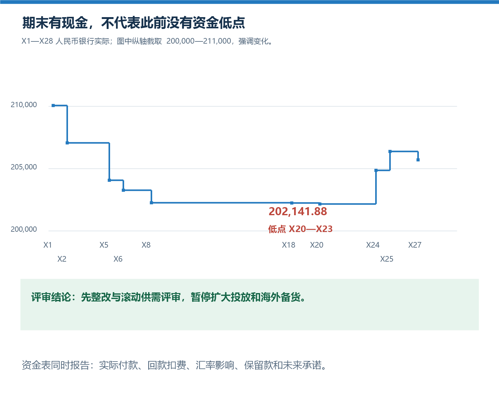

*图 10-14　从交易、交付和回款核对，走向有证据的整改、补货与资金决定。*

**综合作业参考答案**

1. 补齐本次材料用途、品牌图文、平台收款、主体税款、物流售后及作业证据后，在 X5 前完成限定放行，X6 转二十件为区域专用；总存货不增加，固定 6,000 为本期新增服务费用，原研究 2,084 不重复计入。
2. 支付二十、取消二、发出十八；丢一退款、签收十七、当地退一退款，最终十六。顾客保留支付 521.44 SGD，其中 GST 43.04、商品净款 478.40；再扣综合费 54，净应结 424.40。资料需对应订单、付款退款、税单、包裹、结算与银行。
3. 从国内仓到国际、进口、末端及签收逐段确认，成本、风险和具体交接分开。贸易术语不决定全部所有权、支付和消费者义务，服务商报价也不能替代真实申报与主体资格。
4. 保留销售成本 672，异常商品损失 84；当地处理另付 80。中国可售 75、旧隔离 4，共 79；当地代管隔离 1，共在场 80。索赔 120 未确认不计应收，余量两件仍在国内，不当作海外可售备货。
5. 净应结初始折算 2,206.88，扣已实现汇兑 30、期末重估 24.88、手续费 10，得到银行净入款 1,520＋平台期末待结 622。待结的 124.40 SGD 含保留 50，不重复增减。
6. 国内结果 570，跨境 −5,912，合计 −5,342。期末存货 2,894、银行 205,681.88、待结算合计 866，资产 209,441.88，累计案例结果 9,441.88。银行低点 202,141.88。交易贡献低于假设，库存、起订及回款仍受约束，结论为先整改和重做供需计划，不自动扩大。
7. 这是独立情景，删除 X25 净入款 1,520，期末银行变为 204,161.88 元。全部 424.40 SGD 待结，期末折 2,122 元；原始 2,206.88 减 2,122，汇兑损失为 84.88，全是期末重估，无已实现结汇损失，也无 10 元手续费。相对实际，汇兑损失多 30、手续费少 10，本期合计结果变为 −5,362 元，资产为 209,421.88；可由银行 204,161.88＋国内待结 244＋跨境待结 2,122＋存货 2,894 核对。原 X20 现金低点不变，但后续可用现金更少。未到账款不能直接支付银行款，也不能把延迟收款只改银行却遗漏外币重估的变化。

**本章完成标准**　能追溯一笔跨境销售从前台价格、获客、支付、申报、发运、签收、退款到平台与银行的完整变化；能核对多币种待结算、不同地点和状态的库存，并用同一截止日解释结果与现金。

下一章《从业务报表到组织与系统管理》将连接国内和跨境数据、统一指标与主数据、设置权限和预警，建立跨部门流程与经营看板。它会承接本章实际余货、待结算和整改任务，不将未执行采购或未来扩张写成已经发生。

---

## 附录　参数、结果与官方资料

### 实际结果与独立演练边界

| 口径 | 本章实际或范围 |
|---|---|
| 实际期间 | X1—X28；跨境小试点与国内同时经营 |
| 新增固定服务 | 6,000 元，本期完成并付款；不重复记上章研究 2,084 |
| 跨境支付／取消／发出／保留 | 20／2／18／16；丢件一退款、当地退件一退款，无补寄 |
| 跨境顾客保留支付／GST／商品净款 | 521.44／43.04／478.40 SGD |
| 跨境综合费／净应结 | 54／424.40 SGD |
| 结汇与待结 | 结汇 300 SGD，银行净入 1,520 元；余 124.40 SGD，期末折 622 元 |
| 汇率参数 | 发生 5.20，实际结汇 5.10，期末 5.00；全部为教学设定 |
| 跨境交易贡献／跨境本章结果 | 152.88／−5,912 元 |
| 国内支付／取消／出库／退回／保留 | 32／2／30／2／28；两件退回均恢复 |
| 国内净销售／经营结果／期末待结 | 3,112／570／244 元 |
| 全章结果 | −5,342 元 |
| 期末可售 | 国内黑 13、白 28、小杯 32；跨境专用黑 2，共 75，成本 2,894 元 |
| 两地实物 | 中国 79，含旧隔离 4；新加坡零账面隔离 1，共在场 80 |
| 期末银行／待结合计 | 205,681.88／866 元 |
| 最低银行／期末资产 | 202,141.88／209,441.88 元 |
| 累计案例结果／用途预留 | 9,441.88／57,000 元；用途预留已包含在银行内 |
| 非实际事项 | 海外仓一百件比较、未来国内需求和采购、结汇延迟追问均为独立情景 |
| 期末没有 | 新采购、在途、采购预付、应付、未发锁定、外币银行余额、海外可售备货 |

### 官方资料及使用范围

以下页面核查于 **2026-11-17**。官方内容用于解释规则与核查路径，订单、平台费率、运输报价、样品和服务费用为虚构案例；不将它们拼成对真实杯子或主体的经营放行。

| 官方资料 | 本章使用范围 |
|---|---|
| [ICC：Incoterms® rules](https://iccwbo.org/business-solutions/incoterms-rules/) | 贸易术语及选择规则的入口，正式合同仍须查具体规则和地点 |
| [ICC Academy：C 组与 D 组风险转移](https://academy.iccwbo.org/incoterms/article/incoterms-2020-c-or-d-rules/) | 运输费用、交货地点与风险转移的区别 |
| [ICC Academy：DAP 与 DDP](https://academy.iccwbo.org/incoterms/article/incoterms-2020-dap-or-ddp/) | 进口手续、税费、交货及履行能力的差别 |
| [IRAS：当前 GST 税率](https://www.iras.gov.sg/taxes/goods-services-tax-%28gst%29/basics-of-gst/current-gst-rates) | 9% 标准税率；具体交易仍按适用规则 |
| [IRAS：进口低价值货物 GST](https://www.iras.gov.sg/taxes/goods-services-tax-%28gst%29/consumers/gst-on-imported-low-value-goods) | 销售及进口环节、供应者与信息传递条件，不推定所有低值货物免税 |
| [Singapore Customs：快件与邮包程序](https://www.customs.gov.sg/personal-shipment/buying-from-overseas/courier-postal-procedures/) | 个人网上购买及快件程序入口，具体商品和申报主体需核查 |
| [Singapore Customs：低价值货物 GST](https://www.customs.gov.sg/personal-shipment/buying-from-overseas/gst-on-low-value-goods/) | 低价值安排、税款信息与进口处理的衔接 |
| [国家外汇管理局：贸易新业态问题解答](https://www.safe.gov.cn/qingdao/2026/0121/3049.html) | 交易电子信息、电子单证及真实性审核，不替代企业具体办理要求 |

数据与证据应保留日期、适用范围和责任主体。材料、市场、渠道、进口路径、税务主体或收款安排变化时，重新评估原放行是否仍适用。

[返回课程总览](../00-课程总览与十二章介绍.md)　｜　[上一章：从国内生意到跨境市场选择](../第九章-从国内生意到跨境市场选择/第九章-从国内生意到跨境市场选择.md)　｜　[下一章：从业务报表到组织与系统管理](../第十一章-从业务报表到组织与系统管理/第十一章-从业务报表到组织与系统管理.md)
