# 第四章　从需求预测到补货计划

第三章的活动改变了山禾的库存结构。期末可售黑色 65 个、米白色 81 个、小杯 42 个。原来白色卖得慢，一场活动后，它的库存覆盖却低于原款常规交期。

创始人提出下轮目标：“28 天争取 220 笔支付订单。”采购问三种 SKU 各订多少，仓库则需要知道哪天会到货。

你要先把销售目标、需求预测、采购数量分清，再把渠道活动、库存状态、交期与资金放进一份时间计划。

**本章完成目标**　能够整理预测数据，形成分 SKU、分时间的需求，计算误差和偏向，解释安全库存与补货触发，安排订单与到货，并在条件变化后滚动修正。

## 阅读顺序

| 节次 | 要解决的问题 | 交付物 |
|---|---|---|
| [第一节　目标 220 单，采购就订 220 个吗？](#section-01) | 定义需求口径，整理历史和订单 | 预测数据底表 |
| [第二节　只有几周销量，怎样做第一版预测？](#section-02) | 比较平均、加权和业务修正 | 基线预测与假设 |
| [第三节　下次活动，怎样加到日常需求里？](#section-03) | 拆活动、替代和情景，排到日期 | 28 天需求日历 |
| [第四节　剩多少货才补，安全库存怎么算？](#section-04) | 定义库存位置、交期和风险余量 | 触发与目标库存 |
| [第五节　算出只缺十几个，工厂却要起订两百](#section-05) | 结合起订、交期、时间和资金下单 | 采购及预计库存计划 |
| [第六节　需求和到货变了，怎样滚动调整？](#section-06) | 处理实际偏差与延期演练 | 例外清单与执行记录 |
| [第七节　总量只差五个，为什么还要检查每个 SKU？](#section-07) | 衡量误差、偏向和粒度差异 | 预测复盘表 |
| [第八节　让销售、采购、仓库和财务认同同一份计划](#section-08) | 核对结果，建立协同与责任 | 联合计划和章节作业 |

各节需要的数据就近列出。完成正文与作业后，可用[章末参数与结果核对](#chapter-check)检查。

## 案例约定与时间线

承接第三章，银行为 190,478.38 元、平台待结算 1,470.50 元，可售库存成本 7,560 元。可售为黑色 65、米白色 81、小杯 42，共 188 个，另有两件零账面报损实物隔离。期初无未发锁定、欠交和在途采购。

公司、预测、合同、统计参数及本轮订单均为教学设定，金额为人民币，继续使用前面章节的列示费用范围。工资、税费、仓租等实际项目需在真实经营中补齐。60,000 元仍留作后续支出安排，本章没有发生对应费用和付款。

本轮观察 F1—F28。山禾根据上一章评估，本轮内容合作改为固定费用引流 A，老客入口也引导至 A 完成本期新交易。B 的按佣金活动未续签，C 原交易页保留历史服务，本轮没有新的 C 订单或新增计费。所有本章新销售均在 A 成交，平台按保留订单每笔收 6 元。

原款实付仍为 119 元、小杯 99 元，成本分别为 42、34 元，包装每次出库 3 元、快递 6 元、退回运费 8 元。新增固定内容合作费为 800 元，实际广告费用在后面根据本轮报告核对。本轮不另收按销售额佣金。

| 时间 | 本轮事项 |
|---|---|
| F1 | 收回上章待结算 1,470.50 元，确认需求假设与供应条件 |
| F1—F7 | 观察日常需求，准备 F10 内容活动 |
| F8 | 下原款补货订单，两色各 100，确认 12 天后 F20 到仓 |
| F10 | 内容活动引流 A，按正常实付价成交 |
| F14 | 下小杯 80 个订单，确认 12 天后 F26 到仓 |
| F20、F26 | 分别到货，按约验收合格 |
| F28 | 核对出库、退货、库存、预测与资金 |

预测表中的出库需求已考虑支付后取消可能造成的数量差异；尚未发生的退货回流暂不抵减基础备货需求。执行时记录实际退回并检验后的可用数量。为集中练习，F28 时案例所列签收、取消、退货和退款均已完成，仍有部分本章销售款待结算。

---

## 第一节　目标 220 单，采购就订 220 个吗？

销售在会议上报出 220 单目标。采购准备按三种 SKU 分一分直接订货。你发现仓库还有 188 个，支付订单还可能取消，一件退货也可能重新销售。

**本节目标**　定义要预测什么，辨认销量中混入的活动、缺货、退货与口径问题。

### 1.1　三类数字分别回答什么

| 数字 | 业务作用 | 本轮例子 |
|---|---|---|
| 销售目标 | 团队希望达到的经营结果 | 28 天争取 220 笔支付 |
| 需求预测 | 在明确条件下，对未来需求作估计 | 后面形成 190 个出库需求 |
| 采购计划 | 结合库存、在途、交期和起订决定买多少 | 本例最终采购 280 个 |

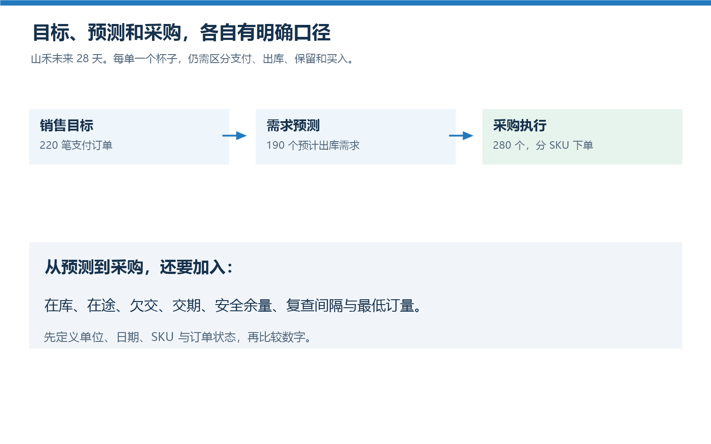

*图 4-1　比较数字前先确认支付、出库、保留与采购各自的单位、日期和范围。*

销售可以提出实现目标的活动和预算，计划人员核对这些动作是否足以支持需求假设，采购再计算缺口。目标变化需要解释准备怎样改变结果。

### 1.2　预测粒度与时间窗口

本轮按三个 SKU、每周做需求预测，并把活动和到货排到具体日期。长期品类机会可以更粗，临近交付则要更细。

例如总量够卖一个月，白色仍可能在活动后先紧张；按月总量观察，也看不见月中到货前的空档。粒度要与订货、分货和交付决定匹配。

### 1.3　整理历史时先处理什么

| 数据问题 | 应保留的线索 | 处理思路 |
|---|---|---|
| 支付、出库、保留混用 | 订单状态及统计截止 | 统一预测目标口径 |
| 缺货造成销量低 | 可售日期、缺货时长、未满足需求 | 标记受限制销量，估计潜在需求及区间 |
| 一次活动 | 活动日期、商品、价格、渠道和投入 | 拆出事件，再判断下一次能否重复 |
| 新品上架不足一周 | 可售天数、曝光、测试阶段 | 使用可比期间和业务假设 |
| 退款与退回滞后 | 申请、退款、回仓、检验日期 | 需求和可用回流分别记时间 |
| SKU 改名或换代 | 编码、版本、替代关系 | 保留映射，避免重复或丢失历史 |

有了原始记录，调整理由也要留存。不要直接改掉原交易数字，再丢失差异来源。

### 1.4　本轮的四周参考序列

最近四周来自第二章试销 14 天和第三章观察 14 天。下表的按周拆分为本章补充的教学记录，合计与前章相同。为了练习基线，先单列第三章 B 活动的出库。

| 历史周 | 黑色参考出库 | 米白参考出库 | 小杯参考出库 | 另列活动出库 |
|---|---:|---:|---:|---|
| H1，第二章试销前 7 天 | 20 | 14 | 9 | 无 |
| H2，第二章试销后 7 天 | 22 | 14 | 11 | 无 |
| H3，第三章 T1—T7 | 10 | 15 | 10 | B 黑 9、白 27 |
| H4，第三章 T8—T14 | 9 | 15 | 8 | 无 |

两周合并核对，第二章仍是黑 42、白 28、小杯 20；第三章参考加活动仍为黑 28、白 57、小杯 18 的出库数。

H3、H4 参考数主要来自 A、C，活动可能影响其他渠道。因此这张表是工作用参考序列，下一步仍要检验渠道转移和价格等变化，不能把 B 全部出库直接认定为独立新增。

### 1.5　练习与参考答案

**练习。** 某 SKU 一周只卖 5 个，但有 5 天缺货，能否把下周预测直接设为 5？要补什么记录？

**参考答案。** 核对实际可售天数、缺货前后流量与成交、未满足订单及活动条件，估计完整期间需求并保留不确定性。若缺货集中在高峰，简单按天数倍增也可能失真。

**本节交付物**　一张标明 SKU、期间、订单口径、可售状态和调整原因的数据底表。

---

## 第二节　只有几周销量，怎样做第一版预测？

运营看到黑色从 22 降到 9，想直接按最近一周预测。采购则认为以前卖得多，应取四周平均。

你先算出两种方法，再把差异带回业务。

**本节目标**　使用简单平均和加权预测，识别趋势、季节、活动及新品信息的作用。

### 2.1　先算一个透明的基准

四周简单平均为：

- 黑色，（20 + 22 + 10 + 9）÷ 4 = 15.25 个／周。
- 米白，（14 + 14 + 15 + 15）÷ 4 = 14.5 个／周。
- 小杯，（9 + 11 + 10 + 8）÷ 4 = 9.5 个／周。

本轮暂把每周日常基线取为黑 15、白 15、小杯 10。数量取整是工作约定，活动与风险余量另列，避免在每一步不留记录地重复放大。

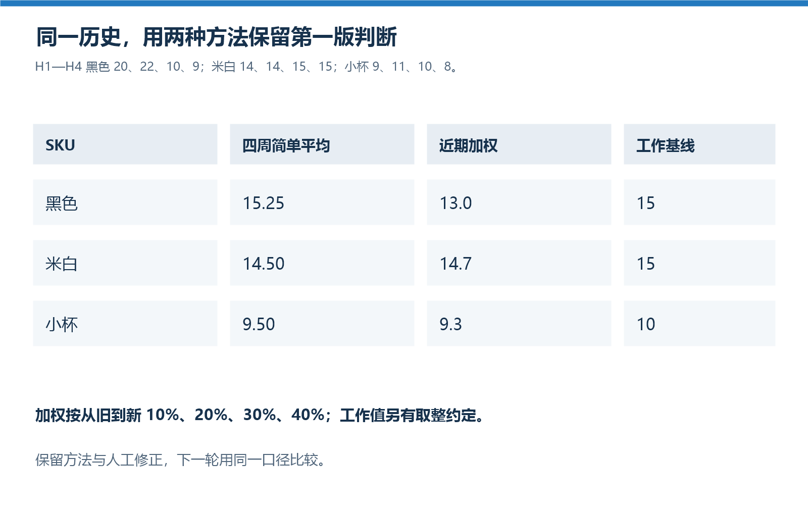

*图 4-2　同样历史，不同权重产生不同估计；先保留基准，后续按实际表现复查。*

### 2.2　给近期更大权重会怎样

设 H1 至 H4 的权重分别为 10%、20%、30%、40%，合计 100%。

**黑色加权预测 = 20 × 10% + 22 × 20% + 10 × 30% + 9 × 40% = 13 个。**

米白为 14.7，小杯为 9.3。近期黑色较低，加权结果低于简单平均。若低销量来自渠道转移或缺货，较大近期权重也会放大这些影响。

本轮用简单平均取整值作初版，同时记录加权方案供比较。只有四周数据，不能据此确认已经掌握长期趋势。

### 2.3　方法要和需求类型匹配

| 需求特点 | 可以尝试的做法 | 需要复查 |
|---|---|---|
| 稳定重复 | 移动平均、加权或平滑更新 | 误差、近期异常和库存限制 |
| 持续增长或下降 | 趋势与业务驱动因素结合 | 增长是否可持续、是否受活动推动 |
| 季节或节日 | 可比季节、日历和活动条件 | 商品、价格及渠道结构变化 |
| 新品 | 类似商品、样品、测试与小批成交 | 类似程度、替代和上新爬坡 |
| 间歇、低频大单 | 需求发生概率、批量与具体订单 | 零销量、偶发大单及服务代价 |

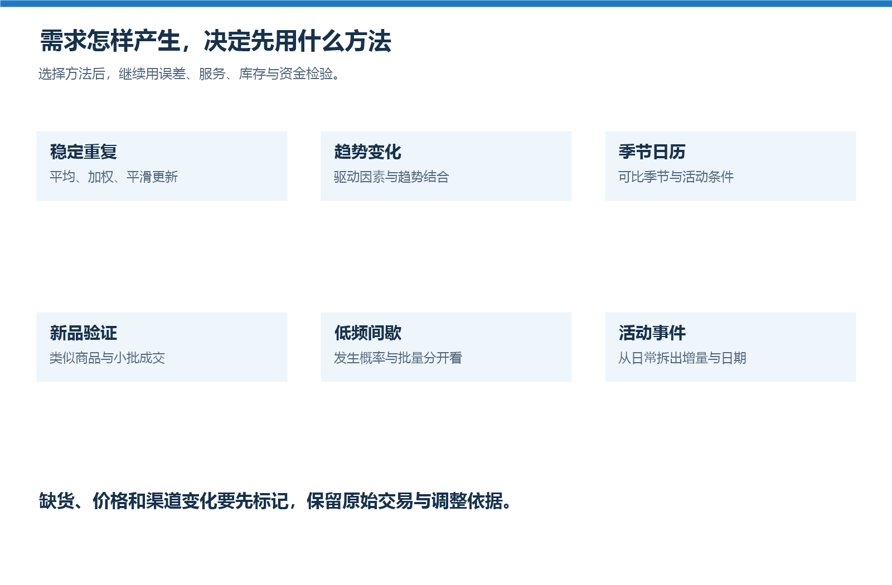

*图 4-3　先理解数据产生的业务，再决定怎样更新预测。*

### 2.4　人工调整也要可追溯

如果销售认为下月会增长，写明具体动作，例如广告计划、活动档期或已确认合作，同时给出增量、时间和取消条件。

记录原始模型、调整值、提出人、理由与实际结果。持续比较谁在什么场景下带来改进，避免每次事后只保留修改后的数字。

### 2.5　练习与参考答案

**练习一。** 小杯 9、11、10、8，按 10%、20%、30%、40% 加权，结果多少？

**参考答案。** 0.9 + 2.2 + 3 + 3.2 = 9.3 个。若直接把四周取整平均 10 作为本轮工作值，要把这种取值和加权结果分别记录。

**练习二。** 最近一周广告暂停，销量下降，是否应立刻把它作为永久下降趋势？

**参考答案。** 先解释广告暂停、曝光、价格、库存和其他渠道的变化，再评估恢复经营条件后的需求。将不同经营条件放进情景比较。

**本节交付物**　基线、备选方法、人工调整和假设记录。

---

## 第三节　下次活动，怎样加到日常需求里？

创始人看过基线，安排 F10 做内容活动，把顾客引导到 A 成交。本次维持正常实付价，固定内容合作费 800 元，无按额佣金。

运营想把上一场 36 件出库全部加到基线上。你提醒，两次价格、入口和合作方式已经变化，还要考虑其他来源订单转移。

**本节目标**　分开日常与活动，估计全店净增量，形成有时间位置的 SKU 预测。

### 3.1　把活动假设说具体

本轮暂估 F10 活动相对无活动情景，全店额外形成黑色 10、米白色 20 个出库需求，小杯无额外增量。增量已按工作假设考虑来源转移，实际效果还需观察。

活动预算、价格和内容对象与第三章不同，因此没有把上一场全部出库照搬。本章未给足够对照数据识别真实活动增量，后面可以核对总预测，但增量归因仍需另外验证。

### 3.2　四周需求计划

| 未来周 | 黑色日常 | 黑色活动 | 黑色合计 | 米白合计 | 小杯合计 | 三 SKU 合计 |
|---|---:|---:|---:|---:|---:|---:|
| W1，F1—F7 | 15 | 0 | 15 | 15 | 10 | 40 |
| W2，F8—F14 | 15 | 10 | 25 | 35 | 10 | 70 |
| W3，F15—F21 | 15 | 0 | 15 | 15 | 10 | 40 |
| W4，F22—F28 | 15 | 0 | 15 | 15 | 10 | 40 |
| 合计 | 60 | 10 | **70** | **80** | **40** | **190** |

米白日常共 60，活动增加 20。190 个是预测出库需求，220 笔是支付目标，不能用两个不同口径直接计算预测误差。

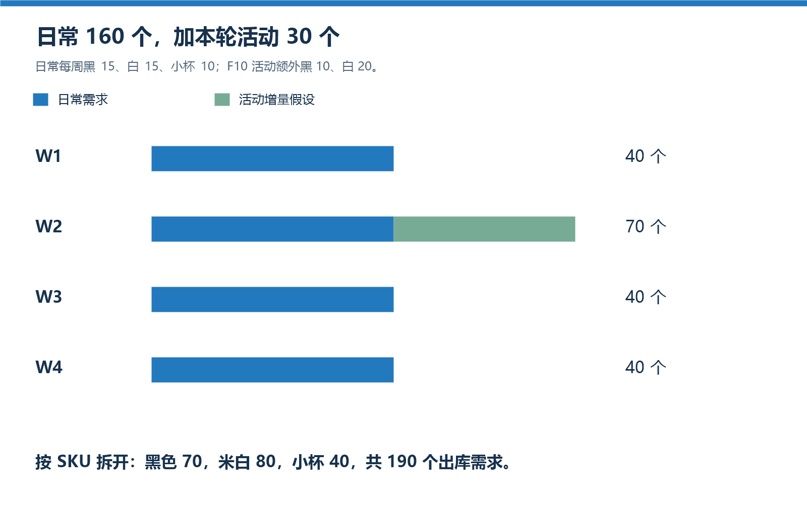

*图 4-4　活动放到 F10 所在周，采购和仓库继续关注它发生在哪一天。*

### 3.3　从周排到日

为练时间计划，两个原款每周日常按 2、2、2、2、2、2、3 个分配，小杯按 1、1、1、1、2、2、2 个分配。每周从第一天重新开始；F10 额外加黑 10、白 20。

这是教学用日历分配，真实计划应结合星期、揽收、活动时段和顾客行为。到货假定在当日出库前完成验收上架。

例如 F12 结束前预计累计消耗黑 35、白 45、小杯 16。若没有到货，剩黑 30、白 36、小杯 26，下一步要和供应日期对照。

### 3.4　保留低、中、高情景

| 情景 | 四周黑色 | 四周米白 | 四周小杯 | 假设 |
|---|---:|---:|---:|---|
| 活动未执行 | 60 | 60 | 40 | 日常基线保持 |
| 本轮工作方案 | 70 | 80 | 40 | 活动额外黑 10、白 20 |
| 活动较强 | 80 | 100 | 40 | 活动额外黑 20、白 40，日常不变 |

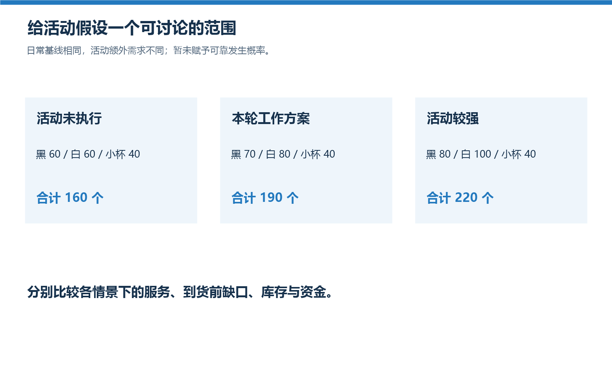

*图 4-5　没有可靠概率时分别比较服务、库存和资金后果，保留工作方案与变更条件。*

### 3.5　练习与参考答案

**练习。** 若活动额外订单预计 40 个，其中 15 个原本会在日常入口出库，假设没有其他变化，全店增量与四周总出库需求分别是多少？

**参考答案。** 全店额外 25 个；日常三 SKU 共 160 个，总出库需求为 185。分到具体 SKU 后才能计算备货，且仍需复核这个替代假设。

**本节交付物**　分 SKU、分周需求，活动日历与情景说明。

---

## 第四节　剩多少货才补，安全库存怎么算？

采购看到可售白色 81 个，问是否还需要下单。仓库说库存能卖几周，销售却担心活动后供应赶不上。

先定义库存和时间，再谈触发。

**本节目标**　认识库存位置、补货点和安全库存，避免把已订在途、订单锁定或活动重复计算。

### 4.1　先统一库存字段

补货中常用的简化关系为：

**库存位置 = 合格在库现货 + 已订未到数量 − 欠交数量。**

本章订货计算的关键时点没有未发锁定或欠交。实际有有效未交付订单时，要在时间计划中明确它们，并与尚未被订单覆盖的预测需求衔接，避免把同一需求算两次。

第一章学的可对外承诺量用于接单，需核对已锁定和内部预留；库存位置则同时观察未来供应。本例 80 个小杯已下单未到时，仍不能作为现货立即发给顾客。

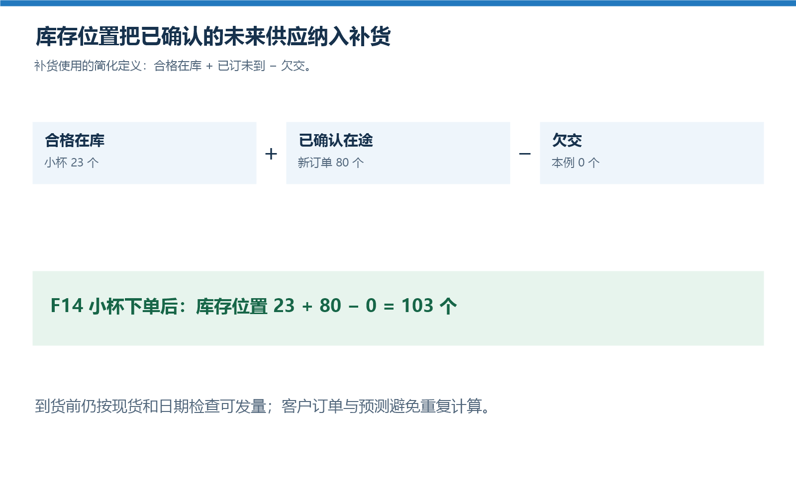

*图 4-6　在途必须有可信数量与到货日，并按 SKU 区分；已检验退货进入可用后再更新。*

### 4.2　安全库存应对什么

预测不确定、需求在日内波动、供应可能延迟，会造成交期内缺口。安全库存为这些剩余风险提供余量。

本轮暂用黑色 10、米白 12、小杯 6 个作为经验安全余量。这些是教学工作假设，样本不足以给出统计服务保证。已计入预测的活动额外 10 和 20 个，不再作为同一活动重复加入安全余量。

余量越多通常越占资金，也可能增加库龄。余量偏低则要承担更多缺货或加急，需要结合顾客承诺、利润、交期和处理能力决定。

### 4.3　交期内需求与补货点

若需求相对稳定，可以先用平均日需求乘交期，再加安全库存。

**补货点 = 平均日需求 × 补货交期 + 安全库存。**

本轮供方对即将确认的原款与小杯订单提供 12 天到仓条件，原款普通 25 天条件仍保留。按日常基线、12 天交期计算：

| SKU | 日常平均日需求 | 安全余量 | 补货点，向上取整 |
|---|---:|---:|---:|
| 黑色 | 15 ÷ 7 | 10 | 36 |
| 米白 | 15 ÷ 7 | 12 | 38 |
| 小杯 | 10 ÷ 7 | 6 | 24 |

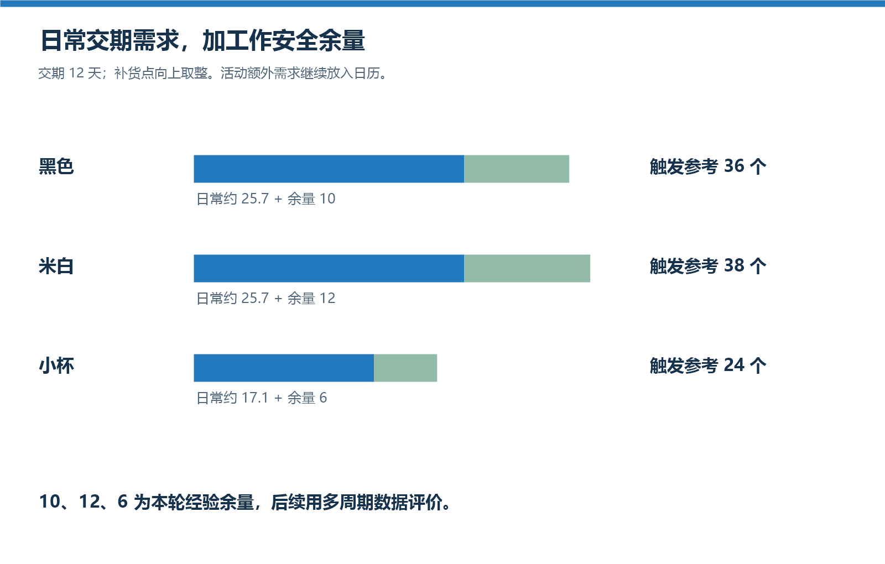

*图 4-7　这些触发值按日常平均估算。已知活动和固定到货日期继续放进逐日计划。*

如果只按平稳阈值等到活动之后再买，可能来不及处理活动峰值。已知事件应提前安排供应，触发点也需随需求与交期更新。

### 4.4　有统计数据时，怎样进一步估计

做一个独立方法练习，假设每日预测误差相互独立、近似稳定，累计误差适合用近似正态模型，交期固定为 12 天，每日误差标准差为 1 个。使用服务系数 1.65，可估计：

**安全库存 ≈ 1.65 × 1 × √12 ≈ 5.72，向上取整 6 个。**

服务系数反映所选概率目标。该概率与“有多少订单被满足”的数量满足率含义不同，方法也依赖分布、独立性和交期等假设。需求或交期显著变化时需要重新建模。

这个练习说明一种估计方式，本轮经验余量仍按 10、12、6 执行。后续积累多个补货周期的误差与交期记录，再评估调整。

### 4.5　练习与参考答案

**练习一。** 小杯合格实物 22，无欠交，已有 80 个确认在途，库存位置多少？是否应看到现货 22 就重复下一张 80 个订单？

**参考答案。** 库存位置为 102。继续按到货日核对期间缺口，已有订单纳入计划，再决定是否需要调整；避免漏看在途导致重复订货。

**练习二。** 原款交期回到 25 天，白色日常补货点按相同余量计算约多少？

**参考答案。** 15 ÷ 7 × 25 + 12 ≈ 65.57，向上取整 66。活动变化还要另排到日期，不能固定沿用 38。

**本节交付物**　库存字段定义、经验余量依据、交期、触发值和更新条件。

---

## 第五节　算出只缺十几个，工厂却要起订两百

采购拿到本批供应条件，原款仍要黑白各 100 个，小杯仍要雾蓝 80 个。运营问：“我们真的缺这么多吗？”

你把计划缺口、起订数量和时间放到一起。

**本节目标**　计算周期复查下的目标库存，把最低订量和到货日期转成可执行计划，并说明库存代价。

### 5.1　每周复查，需要覆盖多久

若每 7 天集中复查，交期 12 天，先用平均日常需求覆盖交期加复查间隔，再加安全余量：

**目标库存位置 = 平均日需求 ×（交期 + 复查间隔）+ 安全库存。**

统计估算也要覆盖这 19 天。若交期固定，每日预测误差相互独立且标准差稳定，累计误差可用近似正态模型，就用 **安全库存 ≈ 服务系数 × 日预测误差标准差 × √（交期 + 复查间隔）**。沿用 4.4 小节的示例参数，1.65 × 1 × √19 ≈ 7.19，向上取整为 8 个。本轮的目标库存仍按经验余量黑 10、白 12、小杯 6 个计算。

按本轮平均值并向上取整，黑色目标为 51、米白 53、小杯 34 个。下一次已知活动位于保护期间内时，额外需求继续加到对应 SKU。

F8 的计划计算包含 F10 活动，于是黑色参考目标为 61、米白为 73。活动结束后的下一次复查应移除已发生的活动需求，并更新日历。

### 5.2　计划库存和当日实物再核对一次

| F8 开始、下单前 | 黑色 | 米白色 |
|---|---:|---:|
| 依原预测的现货 | 50 | 66 |
| 当日已核对现货 | 52 | 66 |
| 此时在途与欠交 | 0 | 0 |
| 含活动的参考目标 | 61 | 73 |
| 按已核对现货算的缺口 | 9 | 7 |
| 现行最小订货 | 100 | 100 |

当日已核对数来自第六节将展开的 W1 执行记录。计划需要用最新库存作决定，原始预测版本同时保存，方便以后评价。

F8 小杯实际可售 33，距参考目标 34 只差 1 个，却要起订 80 个。逐日计划显示，若等 F14 复查、F26 到货，到货前仍能覆盖当前需求并保留工作余量。团队因此推迟这张订单，同时约定需求或交期变化时提前复查。

F14 收盘，小杯实际可售 23、无在途，目标 34，缺口为 11；原计划库存 22 对应缺口 12。当前最低订量均为 80 个，两个输入下采购量相同。

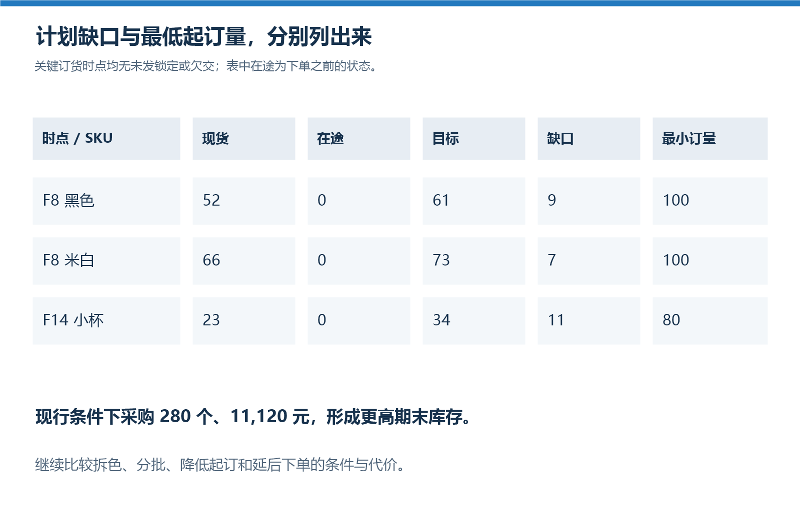

*图 4-8　数量取整、包装倍数、起订量和分色约束都可能让实际采购高于计算缺口。*

### 5.3　本章确认执行的采购

| 订单 | 下单日 | 数量 | 含入仓运输单价 | 货款 | 预付款 | 发货前尾款 | 到仓 |
|---|---|---|---:|---:|---:|---:|---|
| 原款 | F8 | 黑 100、白 100 | 42 | 8,400 | 2,520 | 5,880，F19 支付 | F20 |
| 小杯 | F14 | 雾蓝 80 | 34 | 2,720 | 816 | 1,904，F25 支付 | F26 |
| 合计 | 分订单 | **280** | 分 SKU | **11,120** | **3,336** | **7,784** | 分批到仓 |

原款供方本批再次书面确认 12 天到仓、费用包含在 42 元内；它没有改变常规 25 天记录。小杯也重新确认本批 12 天，均从订单确认并付预付款起算。

本案例选择在现行起订条件下落实供应，同时记录拆色、分批、降低起订或延后小杯的备选方案。采购前应把每个选项对日期、价格、质量与库存的影响拿来比较，不能因为资金足够就省掉这一步。

### 5.4　检查到货前的日期

根据第三节的日分配，F19 结束预计剩黑 15、白 21、小杯 16。原款 F20 当日出库前验收上架，能够接上这一版需求。

小杯 F14 下单，计划 F26 到仓。F25 结束预计还剩 8 个，高于暂定余量 6 个；到货当天继续核查实际可用。

若原款 F1 按普通 25 天下单、F26 才到仓，计划 F25 结束只剩黑 2、白 8，期间会低于工作安全余量。这说明预计仍有库存时，也可能需要为了交期风险提前安排。

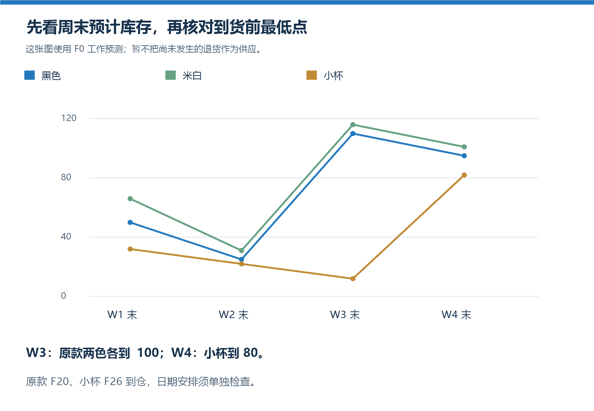

*图 4-9　折线连接周末快照，具体日期使用逐日表；到货前最低点需要继续看日期。*

### 5.5　看清最低订量带来的占款

| 周末 | 预计黑色可售 | 预计米白可售 | 预计小杯可售 | 本周到货 |
|---|---:|---:|---:|---|
| W1 | 50 | 66 | 32 | 无 |
| W2 | 25 | 31 | 22 | 无 |
| W3 | 110 | 116 | 12 | 原款两色各 100 |
| W4 | 95 | 101 | 82 | 小杯 80 |

表内暂不依赖未来退回商品作为供应。预计期末库存明显增加，小杯尤其受到 80 个最低订量影响。

F14 若能只买缺口 11 个，需要 374 元货款；当前 80 个为 2,720 元，相差 69 个和 2,346 元。11 个并不符合当前合同，若要实现需取得供应商新条件。更低起订量可能对应更高单价，也要算总成本。

### 5.6　练习与参考答案

**练习一。** 交期 12、复查 7、日需求 10 ÷ 7、安全余量 6，小杯目标库存向上取整多少？现货 23、在途 80 时还缺多少？

**参考答案。** 目标为 34，库存位置为 103，在这个目标口径下没有新增缺口；仍需检查 80 个的到货日期能否覆盖期间需求。

**练习二。** 工厂愿意将小杯起订降到 20 个，但单价改为 37 元。与现行 80 × 34 比较，单次采购占款差多少？本题为未执行方案。

**参考答案。** 20 × 37 = 740 元，少占 1,980 元；单位成本多 3 元。继续比较未来补货次数、运费、交期、质量和售出贡献，确定在相同需求期间内哪种更合适。

**本节交付物**　目标库存、最新库存、起订条件、采购付款、到货日与预计库存日历。

---

## 第六节　需求和到货变了，怎样滚动调整？

F10 活动后，黑色比原计划多出了一些订单；米白却没有达到活动周的原预测。你需要更新剩余期间，采购则继续核实 F20 的到货。

**本节目标**　保留原预测版本，用实际库存和有效供应更新计划，识别并处理缺口。

### 6.1　先记录实际出库

| 周 | 黑色实际出库 | 米白实际出库 | 小杯实际出库 | 总出库 |
|---|---:|---:|---:|---:|
| W1 | 14 | 16 | 9 | 39 |
| W2 | 28 | 33 | 11 | 72 |
| W3 | 16 | 18 | 10 | 44 |
| W4 | 14 | 15 | 11 | 40 |
| 合计 | **72** | **82** | **41** | **195** |

本轮没有记录到缺货拒单或欠交，实际出库可以作为本例评价的需求实现口径。若发生供货限制，还应补看未满足需求。

### 6.2　退回商品在什么时候可用

以下退回均在对应周末完成检验，括号为恢复可售数量。

| 周 | 黑色退回（可售） | 米白退回（可售） | 小杯退回（可售） | 处理结果 |
|---|---|---|---|---|
| W1 | 1（1） | 1（1） | 0 | 均可售 |
| W2 | 1（1） | 2（1） | 1（1） | 米白 1 件报损，成本 42 元 |
| W3 | 1（1） | 1（1） | 0 | 均可售 |
| W4 | 0 | 1（1） | 1（1） | 均可售 |
| 合计 | **3（3）** | **5（4）** | **2（2）** | 共退回 10，恢复可售 9 |

米白报损件的责任继续核查，本章未取得赔偿。两件原有隔离实物继续保留零账面记录。

退货预测可以帮助估计较长期回流，但采购依赖的数量还要看实际申请、运输、检验和可再售比例。不同日期的退回，不应提前加到今天可发的现货中。

### 6.3　把实际库存核对回来

| 周末 | 黑色可售 | 米白可售 | 小杯可售 | 本周合格到货 |
|---|---:|---:|---:|---|
| W1 | 52 | 66 | 33 | 无 |
| W2 | 25 | 34 | 23 | 无 |
| W3 | 110 | 117 | 13 | 原款黑白各 100 |
| W4 | **96** | **103** | **83** | 小杯 80 |

例如黑色 W2 为 52 − 28 + 1 = 25；米白 W3 为 34 + 100 − 18 + 1 = 117。

**期末可售 = 188 + 280 − 195 + 9 = 282 个。**

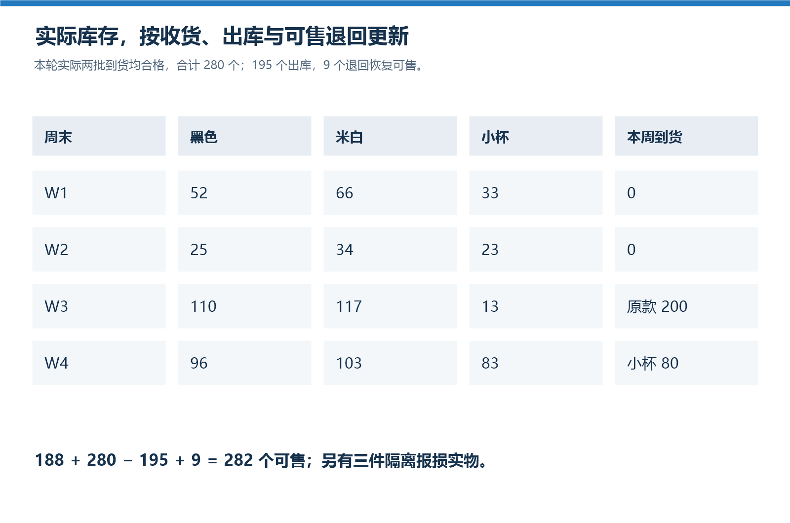

*图 4-10　预测版本用于复盘，实际出入用于更新库存，未来尚未发生的需求再重新估计。*

### 6.4　延期三天，怎样处理

设一个独立演练：F18 供方通知，原款从 F20 改到 F23。先核实原因、受影响 SKU、可分批数量和可信日期，再重排库存。

根据执行记录，F19 日末实际可售黑 15、白 21、小杯 17。对照 W2 末（F14）的黑 25、白 34、小杯 23，这五天尚未到货，W3 的退回件在 F21 周末才完成检验并恢复可售。由库存减少可倒推出 F15—F19 合计出库黑 10、白 13、小杯 6。延期演练从 F19 的实际库存起算。若 F20—F22 按黑 3、3、2，米白 2、3、2 出库，且 F21 退回检验后恢复可售黑白各 1，则 F22 日末可售黑 8、白 15。

黑色低于工作余量 10，尚需继续检查更强需求情景。若日期再变或需求增加，应比较部分到货、其他合格供应、活动或投放调整，以及顾客可接受的交付安排。

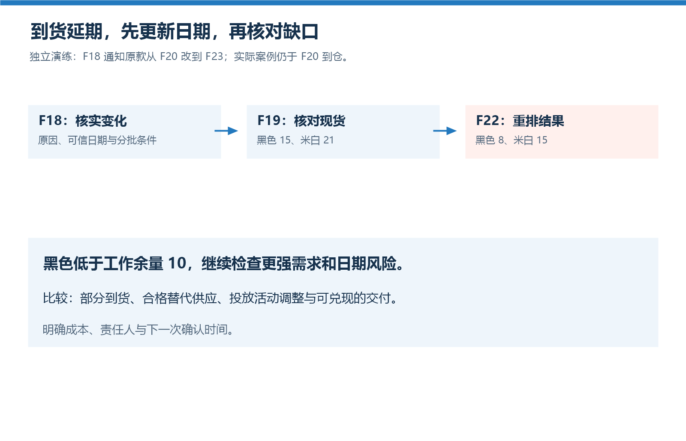

*图 4-11　这是未发生的延期演练，实际订单仍于 F20 合格到仓。*

加急和替代方案若产生费用，写明金额及确认人；改变交付时先核对顾客承诺并及时沟通。库存低于余量是复核信号，不能单凭这个数决定任何商品都用同一种处置。

### 6.5　滚动更新保留什么

每次更新保留版本日期、已发生订单与出入、在途可信日期、剩余预测、缺口、动作、责任人及下一次确认时间。

保存 F0 原预测用于比较，不把它改成已经看到的实际值。本章下单时更新了库存数，但仍保留最初 190 个预测版本评价表现。

### 6.6　练习与参考答案

**练习一。** 小杯现货 13 个、80 个计划 F26 到，F22—F25 预计每天 2 个，F26 当日需求 3 个。若到货改为 F27，当天是否够发？安全余量为 6 时怎样看？

**参考答案。** F25 结束余 5，F26 发 3 后余 2；仍能覆盖这组需求，但低于余量 6。继续检查波动和日期可信度，并比较调整方案。

**练习二。** 为什么不能把预计退回的 5 件都提前恢复可售？

**参考答案。** 退回时间、收到数量和可再售状态尚未确认。分别记录预期回流及实际待检，满足恢复条件后再更新可用。

**本节交付物**　实际出入、在途跟进、剩余期间预测与例外处理表。

---

## 第七节　总量只差五个，为什么还要检查每个 SKU？

F28，实际出库 195 个，原预测 190。运营说只差 5 个，预测很准。仓库提醒，每周和每个颜色的方向并不一样。

**本节目标**　计算绝对误差与偏差，理解统计粒度怎样影响评价，并把误差用于下一轮计划。

### 7.1　先对齐评价范围

本轮比较 F0 版本的 12 个“SKU—周”预测与实际出库，包含三 SKU、四周。支付目标 220、实际支付 200、保留订单 185 各自用于其他经营问题。

定义单项误差为预测减实际。正数表示本项高估，负数表示本项低估；绝对误差取大小。

| 周 | 黑预测／实际 | 米白预测／实际 | 小杯预测／实际 | 本周 SKU 绝对误差合计 |
|---|---|---|---|---:|
| W1 | 15／14 | 15／16 | 10／9 | 3 |
| W2 | 25／28 | 35／33 | 10／11 | 6 |
| W3 | 15／16 | 15／18 | 10／10 | 4 |
| W4 | 15／14 | 15／15 | 10／11 | 2 |
| 合计 | 70／72 | 80／82 | 40／41 | **15** |

### 7.2　三项入门指标

**平均绝对误差 MAE = 绝对误差合计 ÷ 项目数 = 15 ÷ 12 = 1.25 个。**

**加权绝对百分比误差 WAPE = 绝对误差合计 ÷ 实际合计 = 15 ÷ 195 ≈ 7.69%。**

**本章偏差率 =（预测合计 − 实际合计）÷ 实际合计 =（190 − 195）÷ 195 ≈ −2.56%。**

偏差率为负，说明这一观察窗口整体略偏低。只有四周，仍需积累记录判断是否持续，而不是直接认定永久低估。

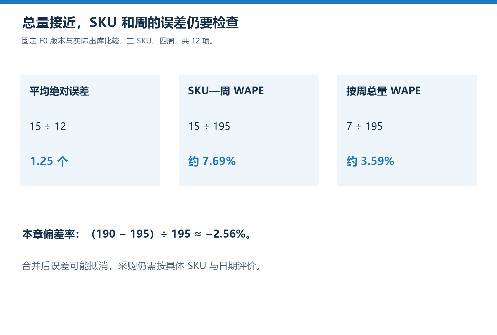

*图 4-12　先固定版本、口径和粒度，再比较方法；不同粒度的指标分别保留。*

### 7.3　为什么按周总量会看起来更准

四周总量预测为 40、70、40、40，实际为 39、72、44、40。按这些周总量的绝对误差只有 1 + 2 + 4 + 0 = 7，WAPE 约 3.59%。

它低于 SKU—周的 7.69%，因为同一周不同 SKU 的高低估可能相互抵消。采购按具体 SKU 做决定时，必须保留相应粒度。

若全部实际需求为零，上述百分比指标分母为零，应改用适当的数量与发生情况评价。逐项百分比误差遇到低销量和零销量时也容易失真，先解释业务场景。

### 7.4　复盘原因，再更新方法

检查哪些误差来自日常需求、活动、渠道转移、供货限制、资料质量或执行变化。活动周总量接近，并不能证明活动净增量已经估准；仍需对照资料。

记录预测误差的同时，看缺货、承诺交付、加急成本、库存资金与库龄。仅通过大量备货减少缺货，可能让资金效率变差。

下一轮可以并行保留简单平均、加权方案和人工调整，使用相同未来窗口逐步比较。不能利用后来结果给早先方法重新挑一组最有利参数。

### 7.5　练习与参考答案

**练习一。** 两 SKU 预测各 10，实际分别为 5、15。总量误差、绝对误差合计及 SKU 粒度 WAPE 是多少？

**参考答案。** 总量误差零，逐项绝对误差合计 10，WAPE 为 10 ÷ 20 = 50%。总量相等仍可能造成一款积压、另一款缺货。

**练习二。** 运营把 W2 黑色原预测 25 改成实际 28 后，再报预测误差，问题在哪里？

**参考答案。** 用已知结果覆盖了原预测版本。保留 F0 的 25，再另建更新版本和时间，分别评价不同提前期预测。

**本节交付物**　固定版本的 SKU—周误差表，附原因、动作和下一次比较方式。

---

## 第八节　让销售、采购、仓库和财务认同同一份计划

月底经营会上，销售报告支付 200 单，采购报告买了 280 个，仓库报告可售 282 个。财务问，增加的库存与本轮收益是否能相互解释。

**本节目标**　闭合需求到执行的数量与资金，并建立滚动协同和责任安排。

### 8.1　从出库回到销售结果

| 状态 | 黑色 | 米白色 | 小杯 | 合计 |
|---|---:|---:|---:|---:|
| 支付 | 74 | 84 | 42 | 200 |
| 未发取消 | 2 | 2 | 1 | 5 |
| 出库 | 72 | 82 | 41 | 195 |
| 签收后退货 | 3 | 5 | 2 | 10 |
| 截至 F28 保留 | 69 | 77 | 39 | 185 |

原支付金额为 158 × 119 + 42 × 99 = 22,960 元；未发取消退款 575，签收退货退款 1,150，共 1,725 元。

**退款后销售额 = 22,960 − 1,725 = 21,235 元。**

### 8.2　本章列示经营结果

| 项目 | 金额，元 | 计算依据 |
|---|---:|---|
| 退款后销售额 | 21,235 | 原款 146 × 119 + 小杯 39 × 99 |
| 商品销售成本 | −7,458 | 原款 146 × 42 + 小杯 39 × 34 |
| 平台费 | −1,110 | 185 × 6；已退订单原费已冲回 |
| 包装 | −585 | 195 × 3 |
| 出库快递 | −1,170 | 195 × 6 |
| 退回运费 | −80 | 10 × 8 |
| 新增报损 | −42 | 米白一件 |
| 实际广告 | −3,622 | 本轮账单消耗，退款不返广告费 |
| **列示贡献** | **7,168** | 扣上列实际费用 |
| 本轮固定内容合作 | −800 | 已支付，未按销售额计佣金 |
| **本章列示结果** | **6,368** | 贡献扣固定费 |

本轮广告预算上限 4,000 元，实际 3,622，剩余 378 未消耗。实际金额来自本章教学账单，不能因发生退款就按保留订单机械退回广告费用。

### 8.3　库存与银行分别核对

| 期末可售存货 | 数量 | 单位成本 | 成本金额 |
|---|---:|---:|---:|
| 原款黑色 | 96 | 42 | 4,032 |
| 原款米白色 | 103 | 42 | 4,326 |
| 小杯雾蓝 | 83 | 34 | 2,822 |
| 合计 | **282** | 分 SKU | **11,180** |

**期初存货 7,560 + 采购 11,120 − 销售成本 7,458 − 报损 42 = 11,180 元。**

A 本轮应结 21,235 − 1,110 = 20,125 元，实际到账 18,000，待结算 2,125 元。第三章的 1,470.50 元已在 F1 全部收回，减少原待结算，并未重复计成本章销售。

| 银行收支 | 金额，元 | 累计余额，元 |
|---|---:|---:|
| 接续第三章 | +190,478.38 | 190,478.38 |
| 收回第三章待结算 | +1,470.50 | 191,948.88 |
| 本章销售款到账 | +18,000.00 | 209,948.88 |
| 两张采购单全部付款 | −11,120.00 | 198,828.88 |
| 实际广告 | −3,622.00 | 195,206.88 |
| 包装 | −585.00 | 194,621.88 |
| 出库快递 | −1,170.00 | 193,451.88 |
| 退回运费 | −80.00 | 193,371.88 |
| 固定内容合作 | −800.00 | **192,571.88** |

表按用途汇总，每笔实际支付和到账仍按日期保留。采购尾款均已付清，60,000 元后续资金预留仍包含在银行余额。

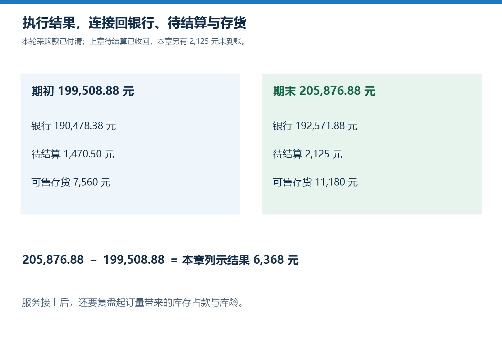

*图 4-13　账面闭合只针对章首约定的列示项目，真实企业还要补齐其他资产、负债和费用。*

**期末银行 192,571.88 + 待结算 2,125 + 存货 11,180 = 205,876.88 元。**

**期初列示资产 199,508.88 + 本章列示结果 6,368 = 205,876.88 元。**

从 20 万元启动资金累计看，四章列示结果为 5,876.88 元。仓内还有三件隔离报损实物，账面为零，实际存放共 285 件，可售仍为 282 件。

### 8.4　结果为正，也要复盘采购占款

本章可售从 188 增到 282 个，存货成本从 7,560 增到 11,180 元。供应接上了，但最低订量带来的余货也更高。

小杯目标库存约 34，期末却有 83 个。下一轮应比较拆批、缩小起订、延后下单、调整复查周期及服务余量，说明对缺货与成本的影响。预测指标、服务表现和资金效率应一起进入复盘。

### 8.5　建立一个滚动协同节奏

| 节奏 | 核对什么 | 输出 |
|---|---|---|
| 每日异常 | 缺货、异常订单、到货变化、质量 | 明确动作与下一次确认 |
| 每周计划 | 实际需求、剩余预测、活动、在途及资金 | 更新 SKU—周计划和采购建议 |
| 每月经营协调 | 需求、供应、库存、预算与策略 | 形成下一阶段共同经营方案 |

销售与运营计划常用缩写 S&OP，用来协调需求与供应，并形成经营选择。团队更小时，也可以用同样问题组织简洁会议。

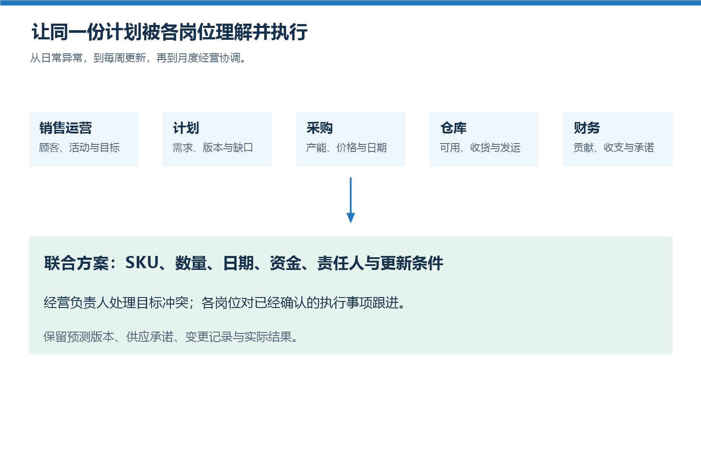

*图 4-14　计划需要具体数量、日期、资金、责任人和复查条件。*

销售提供顾客与活动，计划汇总预测与缺口，采购确认产能、交期和条件，仓库核实可用和收发能力，财务核对资金及贡献，经营负责人处理目标冲突。

临近生产和发货的变更，需要先核查供应可变更程度与代价，再更新承诺。预测是可修正的估计，订单、合同与对顾客的承诺则各有执行责任。

### 8.6　章节综合作业

请提交四张表和一页建议。

1. **需求与版本表。** 保留四周历史、F0 基线、活动假设、四周预测与实际。
2. **库存与供应表。** 计算目标库存、库存位置、最低订量、付款和到货日，标出最低点。
3. **误差与例外表。** 算 SKU—周 WAPE、偏差，并处理 F20 改 F23 的延期演练。
4. **贡献与资金表。** 从 200 支付、195 出库到 185 保留，核对采购、存货与银行。

建议中回答，下轮是否继续小杯 80 个起订，白色是否保持 12 个工作余量，活动未执行或扩大时怎样改采购，以及谁在何时确认条件。

### 8.7　参考方向与完成标准

计算应得到，预测出库 190、实际 195；SKU—周绝对误差 15，WAPE 约 7.69%，偏差率约 −2.56%。采购 280 个、11,120 元，期末可售 282 个，成本 11,180 元。

本章列示结果 6,368 元，银行 192,571.88、待结算 2,125，与期末资产 205,876.88 元相互解释。

建议应先改善余量与最低订量的匹配，继续验证活动净增量及交期。若你选择较少库存，要指出接受的服务风险；若坚持现有采购量，说明资金与库龄的代价。

| 复查项 | 完成表现 |
|---|---|
| 数据 | 支付、出库、保留与回流口径分清，活动和缺货有标记 |
| 方法 | 基线、调整、假设和版本能追溯 |
| 时间 | 订单与收货排到日期，能识别到货前缺口 |
| 数量 | 在库、在途、欠交、余量和起订一起计算 |
| 复盘 | 误差、服务、库存和资金共同评价 |
| 执行 | 数量、金额、责任人与确认日期具体 |

**本章完成标准**　你能把未来需求变成可解释的补货方案，条件变化时重排，并清楚说明当前方案的余货、缺货和资金代价。

下一章，山禾会进一步走进供应商与工厂，学习怎样核对成本、产能、质量和合同，让计划中的到货日期成为可以执行的交付。

---

## 附录　参数与结果核对

用于完成全章后复查，案例之外的预测参数和合同条件仍需按实际业务核实。

| 项目 | 结果 |
|---|---|
| 承接第三章 | 银行 190,478.38，待结算 1,470.50，可售 188，成本 7,560 |
| 工作基线 | 每周黑 15、白 15、小杯 10 |
| 活动 | F10 额外黑 10、白 20，按正常实付价引流 A |
| 原预测 | 四周黑 70、白 80、小杯 40，共 190 个出库 |
| 工作安全余量 | 黑 10、白 12、小杯 6，均为教学经验假设 |
| 常态 12 天补货点 | 黑 36、白 38、小杯 24，均向上取整 |
| 周复查目标 | 不含活动黑 51、白 53、小杯 34 |
| 原款采购 | F8 两色各 100，8,400 元，F20 到仓 |
| 小杯采购 | F14 雾蓝 80，2,720 元，F26 到仓 |
| 付款 | 预付共 3,336，尾款共 7,784，均已付清 |
| 本章订单 | 支付 200，取消 5，出库 195，退货 10，保留 185 |
| 退回与损耗 | 恢复可售 9，米白报损 1，未取得赔偿 |
| 期末可售 | 黑 96、白 103、小杯 83，共 282 |
| 误差 | 12 项绝对误差共 15，WAPE 7.69%，偏差率 −2.56% |
| 销售与贡献 | 销售额 21,235，贡献 7,168，扣固定 800 后 6,368 |
| 应结与到账 | 20,125 = 已到账 18,000 + 待结算 2,125 |
| 期末核对 | 192,571.88 + 2,125 + 11,180 = 199,508.88 + 6,368 |

延期、降低起订与活动变化均为独立演练，没有改写本章已执行的订单。所有图表、练习和对账使用各自明确的口径和版本。

[返回课程总览](../00-课程总览与十二章介绍.md)　｜　[上一章：从单店到多渠道经营](../第三章-从单店到多渠道经营/第三章-从单店到多渠道经营.md)　｜　[下一章：从供应商报价到稳定交付](../第五章-从供应商报价到稳定交付/第五章-从供应商报价到稳定交付.md)
